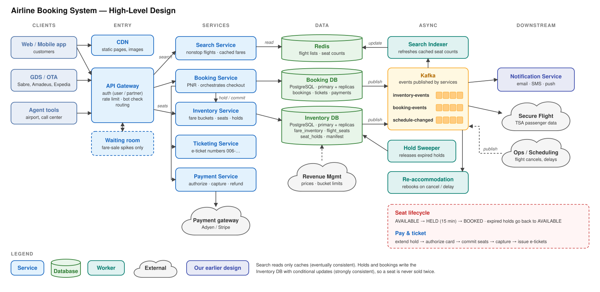

# ✈️ Airline Booking System (Delta)

## ❓ Questions to Ask the Interviewer

> Pin down scope, what "a seat" means, how long we may hold one, and who else sells our inventory, before drawing anything.

---

### 1. Which user flows are in scope? Search, booking, seat selection, payment, manage booking, check-in?

**Why ask:** Each flow is a different service with a different consistency need. Search is read-heavy and can be slightly stale. Booking and seat selection must be strongly consistent. Check-in and boarding bring in airport systems, which can blow up the scope.

**Interviewer Answer:** Search flights, pick a fare, pick seats, pay, get an e-ticket, and view, change or cancel a booking. Check-in, baggage, crew and loyalty accrual are out of scope.

### 2. Who sells our seats? Only delta.com and the app, or also travel agents and OTAs?

**Why ask:** Airlines sell the same seats through many channels: their own site and app, GDSs (Sabre, Amadeus, Travelport) used by travel agents, OTAs (Expedia) and the airport / call center. If every channel reads and writes one inventory, we need a single source of truth and per-partner rate limits. *(our addition)*

**Interviewer Answer:** Our system is the single source of truth for inventory. Direct channels call our APIs; GDS and OTA partners call the same APIs through a partner gateway. Focus on direct channels.

### 3. What is the expected scale?

**Why ask:** Sizes the search cache and the database, tells us whether one database is enough, and how hot a single flight can get.

**Interviewer Answer:** About 5,000 flights a day and about 550K passengers a day (~200M a year). Flights are on sale about 11 months (~331 days) ahead. Searches are roughly 1,000× bookings once partners and metasearch (Google Flights, Kayak) are counted. Fare sales cause 10× spikes.

### 4. Do users pick a specific seat (12A), or only a fare?

**Why ask:** This is the airline version of the movie-booking seat question, but with a twist: an airline sells **two different things**. *(our addition)*

- **A place on the flight in a fare class** (e.g. Main Cabin, class K at $189). This is a count: "how many K seats are left?"
- **A specific seat on the seat map** (12A). This is optional at booking time; passengers who don't pick one get one at check-in.

**Interviewer Answer:** Both. Every booking takes a place in a fare class. Seat selection is optional (and blocked by some fare rules, e.g. basic economy), but a chosen seat must never be given to two people.

### 5. Do we allow overbooking?

**Why ask:** Real airlines often sell more tickets than physical seats because some passengers don't show up. If that's allowed, the "never oversell" rule changes to "never sell above a Revenue Management limit". If not, physical seats are a hard cap. *(our addition)*

**Interviewer Answer:** No. Never sell more places in a cabin than it has physical seats. Every ticketed passenger is guaranteed a seat.

### 6. How long can a user hold seats while paying?

**Why ask:** Decides the hold TTL, the expiry mechanism, and the race between "hold expired" and "payment in progress". Too long and bots hoard seats; too short and real users lose seats while typing card details.

**Interviewer Answer:** 15 minutes from when the user starts the booking. If they don't pay in time, the seats go back on sale.

### 7. Do we own pricing?

**Why ask:** Airline prices change all the time (dynamic pricing, fare classes opening and closing). If we cache search results, the price a user saw may be gone by the time they book.

**Interviewer Answer:** No. Revenue Management (an external system) sets prices and how many seats each fare class may sell. We store what it gives us and must never sell at a price that is no longer valid.

### 8. Trip types and group size? Round trips, connecting flights?

**Why ask:** Round trips and connections mean one booking touches several flights that must all succeed together or none, and search has to build connecting itineraries. Keeping to one nonstop flight makes every booking one simple database transaction.

**Interviewer Answer:** Keep it simple: one-way, a single origin and destination, nonstop flights only (no connections, no round trips). So **every booking is exactly one flight**. Up to 9 passengers per booking.

### 9. What about payments, refunds and the 24-hour rule?

**Why ask:** Money must never be taken twice, and never taken without a seat. In the US, the DOT 24-hour rule means a booking made 7+ days before departure can be cancelled within 24 hours for a full refund (or held 24 hours without payment). *(our addition)*

**Interviewer Answer:** Use an external payment gateway. Support cancellation with refund or travel credit depending on fare rules, including free cancellation within 24 hours.

### 10. Do we handle flight cancellations and delays (irregular operations)?

**Why ask:** When a flight is cancelled, every passenger on it must be rebooked and told, sometimes thousands at once during a storm. That's a big async workload that must not slow down normal bookings. *(our addition)*

**Interviewer Answer:** Yes, at a high level: when Operations cancels a flight, rebook affected passengers automatically and notify them.

---

## ⚙️ Functional Requirements

> Core capabilities the booking system must provide.

---

### 1. Flight Search

Users search by origin, destination, date, passenger count and cabin. One-way, nonstop flights only: results list that day's flights on the route with prices per fare, sorted by price or departure time.

### 2. Fare & Seat Availability

Show which fares are still for sale on each flight and, for the chosen flight, a seat map with available seats, seat types (window, aisle, exit row) and seat prices.

### 3. Hold Seats During Checkout

When a user starts a booking, temporarily hold their fare-class places and chosen seats for 15 minutes, so nobody else can take them while they pay. Unpaid holds expire and are released automatically.

### 4. Booking, Payment & Ticketing

Create a booking (PNR with a 6-character confirmation code), take payment through a payment gateway, and issue one e-ticket per passenger. One booking is one flight, and it is all-or-nothing across every passenger.

### 5. Manage Booking

Look up a booking by confirmation code and last name, and cancel with a refund or travel credit according to fare rules (including free cancellation within 24 hours).

### 6. Notifications

Send booking confirmation, e-tickets, reminders and flight-change alerts through the Notification Service (our earlier design).

### 7. Disruption Handling

When a flight is cancelled or significantly delayed, automatically rebook affected passengers and notify them.

---

## 🛡️ Non-Functional Requirements

> Quality attributes, performance criteria, and availability SLAs.

---

### 1. Strong Consistency for Inventory and Money

A seat is never given to two passengers, a fare class never sells above its limit, a cabin never sells more places than its physical seats (no overbooking), and a customer is never charged twice or charged without getting a seat.

### 2. High Availability

99.99% for search and booking. Search may degrade (slightly stale or fewer results) but must stay up; booking must stay correct even if that means rejecting some requests.

### 3. Low Latency

Search under 1 second at p99 (mostly from cache). Seat hold under 300 ms. Payment and ticketing under 3–5 seconds (bounded by the gateway).

### 4. Scalability

Read-heavy (about 1,000 searches per booking) with 10× spikes during fare sales. Writes are small in volume but concentrate on a few hot flights.

### 5. Durability & Auditability

Every booking, seat and payment change is stored and logged (who, when, why). Needed for customer support, refunds, chargebacks and financial reconciliation.

---

## 💬 Would you like me to cover back-of-the-envelope calculations as well, or focus on the high-level design?

<details>
<summary><b>Back-of-the-envelope (if asked)</b></summary>

**Traffic**

```text
Passengers         550K / day  (~200M / year)
Bookings           550K ÷ 1.6 passengers per booking  ≈ 350K / day
  average          350K ÷ 86,400 s                    ≈ 4 / s
  daily peak       × 3                                ≈ 12 / s
  fare sale        × 10                               ≈ 120 / s
Holds              ~3 holds per paid booking (people abandon) ≈ 1M / day
  fare sale        ≈ 360 / s
Searches           350K bookings × 1,000 (look-to-book) ≈ 350M / day
  average                                              ≈ 4K / s
  daily peak       × 3                                 ≈ 12K / s
  fare sale        × 10                                ≈ 120K / s  → must come from cache
```

**Storage**

```text
Seat rows          5,000 flights × ~160 seats × 331 days ≈ 265M rows × ~100 B ≈ 27 GB
Fare inventory     5,000 flights × ~20 fare classes × 331 days ≈ 33M rows ≈ 3 GB
Bookings           350K / day × ~4 KB (PNR, passengers, tickets) ≈ 1.4 GB / day ≈ 500 GB / year
                   kept ~7 years for finance and audit ≈ 3.5 TB
Route cache        ~1,500 nonstop routes × 331 days × ~2 KB (that day's flight list) ≈ 1 GB → Redis
```

**Key insights**

1. **Search is the volume problem:** 1,000 reads per write. Cache it, and never let search touch the inventory database directly.
2. **Booking is the correctness problem:** only ~120 writes a second at a fare-sale peak, but many land on the same flight at the same time.
3. **One booking = one flight, and the data is small:** ~27 GB of seats and ~500 GB of bookings a year fit on one PostgreSQL primary, so **no sharding**. Every hold, payment commit and cancellation is a single database transaction.

</details>

---

## 🔌 API Design

> APIs called by the web and mobile apps (partners use the same APIs through a partner gateway). All fields use camelCase. Money is in minor units (cents) to avoid floating-point errors.

---

### 1. Search Flights

```text
GET /v1/flights/search
```

Find nonstop flights and fares on one route for one day. Results come from cache, so they can be a few seconds stale.

**Headers**

```text
// 1. X-Request-Id — traces this one request across gateway → services → caches
X-Request-Id: req_3f9a21c7
```

**Query parameters**

```jsonc
{
  // 1. origin / destination — IATA airport codes
  "origin": "ATL",
  "destination": "LGA",

  // 2. departDate — local date at the departure airport (one-way only)
  "departDate": "2026-12-20",

  // 3. passengers — counts by type. 1–9 in total (airline limit per booking)
  "adults": 2,
  "children": 0,

  // 4. cabin — MAIN | COMFORT | PREMIUM_SELECT | FIRST
  "cabin": "MAIN",

  // 5. sort — PRICE | DEPARTURE_TIME
  "sort": "PRICE"
}
```

**Response — 200 OK**

```jsonc
{
  // 1. flights — nonstop flights on this route and date
  "flights": [
    {
      // 1.1 flightInstanceId — one flight on one date. Every later call uses this ID
      "flightInstanceId": "DL2301-20261220",
      "flightNumber": "DL2301",
      "origin": "ATL",
      "destination": "LGA",
      "departAt": "2026-12-20T08:05:00-05:00",
      "arriveAt": "2026-12-20T10:20:00-05:00",
      "aircraft": "A321",

      // 1.2 fares — one per fare family that still has enough seats for all passengers
      "fares": [
        {
          "fareFamily": "MAIN",
          "fareClass": "K",

          // totalPrice — fare for all passengers, in cents (taxes and seat fees are added in API 3's breakdown)
          "totalPrice": { "amount": 37800, "currency": "USD" },

          // seatsLeft — shown only when fewer than 5, as "Only 3 left"
          "seatsLeft": 3,

          // seatSelection — false for fares like basic economy (seat given at check-in)
          "seatSelection": true
        }
      ]
    }
  ]
}
```

**Notes:**

1. Served from Redis: the route's flight list for that day plus cached seat counts. Search never reads the Inventory DB.
2. Public endpoint: no login needed, so no `Authorization` header. Abuse is handled by the gateway's rate limits.
3. Errors: 400 same origin and destination, date in the past, more than 9 passengers · 429 too many searches (bots scraping fares).

### 2. Get Seat Map

```text
GET /v1/flight-instances/{flightInstanceId}/seat-map?fareClass=K
```

The seat map for one flight, shown after the user picks a fare.

**Headers**

```text
// 1. Authorization — optional for viewing; required later to hold seats
Authorization: Bearer <user-token>
```

**Response — 200 OK**

```jsonc
{
  // 1. flightInstanceId — which flight this map is for
  "flightInstanceId": "DL2301-20261220",

  // 2. seatSelection — false if this fare class can't pick seats
  "seatSelection": true,

  // 3. cabins — rows of seats per cabin
  "cabins": [
    {
      "cabin": "MAIN",
      "rows": [
        {
          "row": 12,
          "seats": [
            // status — AVAILABLE | OCCUPIED | BLOCKED
            //   HELD and BOOKED are both shown as OCCUPIED, so nobody can tell
            //   whether a seat is only held (and wait to grab it) (our addition)
            { "seatNo": "12A", "status": "AVAILABLE", "position": "WINDOW", "price": { "amount": 0, "currency": "USD" } },
            { "seatNo": "12B", "status": "OCCUPIED",  "position": "MIDDLE" },
            { "seatNo": "12C", "status": "AVAILABLE", "position": "AISLE", "features": ["EXTRA_LEGROOM"], "price": { "amount": 4500, "currency": "USD" } }
          ]
        }
      ]
    }
  ]
}
```

**Notes:**

1. The map is a **hint**, cached for ~5 seconds. The hold (API 3) is the real check; if 12A was taken a second ago, the hold returns 409 and the app refreshes the map.
2. Errors: 404 unknown flight instance.

### 3. Create Booking (Hold Seats)

```text
POST /v1/bookings
```

Hold fare-class places (and chosen seats) on the flight for 15 minutes, and create the booking in `HELD` status. This is the "seat lock" step.

**Headers**

```text
// 1. Authorization — signed-in user or guest session; limits active holds per user (bots)
Authorization: Bearer <user-token>

// 2. Content-Type — the body is JSON
Content-Type: application/json

// 3. X-Request-Id — tracing
X-Request-Id: req_77b1e0d2
```

**Request**

```jsonc
{
  // 1. idempotencyKey — generated by the app once per "Continue" click.
  //    A retry after a timeout returns the same booking instead of holding seats twice
  "idempotencyKey": "4c1d8e2a-6f0b-4b7e-9a35-1e2f3d4c5b6a",

  // 2. the chosen flight + fare from API 1, and the price the user saw
  //    The server re-checks seats and price against the database, so stale search data is safe
  "flightInstanceId": "DL2301-20261220",
  "fareClass": "K",
  "expectedTotalPrice": { "amount": 37800, "currency": "USD" },

  // 3. passengers — names exactly as on the ID (needed for the ticket and TSA Secure Flight)
  //    3.1 passengerRef: a client-side label used to link seats to passengers.
  "passengers": [
    {
      "passengerRef": "p1",
      "type": "ADULT",
      "firstName": "Abhinav",
      "lastName": "Kumar",
      "dateOfBirth": "1996-04-12",
      "gender": "M",
      "knownTravelerNumber": null,        // optional (TSA PreCheck)
      "loyaltyNumber": "9123456789"       // optional (SkyMiles)
    },
    { "passengerRef": "p2", "type": "ADULT", "firstName": "Riya", "lastName": "Kumar", "dateOfBirth": "1997-09-03", "gender": "F" }
  ],

  // 4. seats — optional, passengerRef → seat. Passengers without a seat get one at check-in
  "seats": { "p1": "12A", "p2": "12C" },

  // 5. contact — where confirmations and flight alerts go
  "contact": { "email": "abhinav@example.com", "phone": "+919876543210" }
}
```

**Response — 201 Created**

```jsonc
{
  // 1. pnr — 6-character confirmation code, the booking's ID from now on
  "pnr": "GH7K2P",

  // 2. status — HELD until paid
  "status": "HELD",

  // 3. holdExpiresAt — the app shows a countdown; after this the seats are released
  "holdExpiresAt": "2026-11-03T10:15:00Z",

  // 4. price — re-checked against live inventory now, may differ from the search
  "price": {
    "fare":     { "amount": 37800, "currency": "USD" },
    "taxes":    { "amount": 5800,  "currency": "USD" },
    "seatFees": { "amount": 4500,  "currency": "USD" },
    "total":    { "amount": 48100, "currency": "USD" }
  },

  // 5. what is held
  "flightInstanceId": "DL2301-20261220",
  "fareClass": "K",
  "seats": { "p1": "12A", "p2": "12C" }
}
```

**Notes:**

1. **All or nothing:** every passenger and every chosen seat is held, or nothing is. It's one database transaction.
2. 201, not 202: the hold finishes during the request (~100–300 ms), and the user needs the answer now.
3. Errors: 409 `SEAT_UNAVAILABLE` (lists the seats) · 409 `FARE_SOLD_OUT` · 409 `PRICE_CHANGED` (with the new price; the user must accept it) · 429 too many active holds for this user.

### Why two calls: hold first, then pay?

**One-line answer:** the user must know their seats are secured **before** they pay, and payment can take minutes (card entry, 3-D Secure), so we lock first and charge second, exactly like a movie booking.

1. **Without a hold:** the user types card details for 3 minutes, pays, and then learns 12A was sold to someone else. We'd have to refund.
2. **With a hold:** the seats are theirs for 15 minutes, shown with a countdown; payment just confirms them.
3. **Cost:** abandoned holds block seats for up to 15 minutes, so holds must expire automatically (Deep Dive 2) and be limited per user (Deep Dive 8).

### 4. Pay & Confirm

```text
POST /v1/bookings/{pnr}/payments
```

Pay for a `HELD` booking. On success, the seats become `BOOKED` and e-tickets are issued.

**Headers**

```text
// 1. Authorization — the same user (or guest session) that created the hold
Authorization: Bearer <user-token>

// 2. Content-Type — the body is JSON
Content-Type: application/json
```

**Request**

```jsonc
{
  // 1. idempotencyKey — one per "Pay" click. Also sent to the payment gateway,
  //    so a double click or retry can never charge twice
  "idempotencyKey": "9e7f1a2b-3c4d-4e5f-8a9b-0c1d2e3f4a5b",

  // 2. paymentMethod — a token from the gateway's card form, never the raw card number.
  //    The card goes straight from the browser to the gateway (keeps us out of most PCI scope)
  "paymentMethod": { "type": "CARD", "token": "tok_1PqR8sT..." },

  // 3. amount — the total the user saw. If it doesn't match the booking's total → 409
  "amount": { "amount": 48100, "currency": "USD" }
}
```

**Response — 200 OK**

```jsonc
{
  "pnr": "GH7K2P",

  // 1. status — TICKETED (normal) | CONFIRMED (paid, tickets a few seconds behind)
  "status": "TICKETED",

  // 2. tickets — one 13-digit e-ticket per passenger; 006 is Delta's airline code
  "tickets": [
    { "passengerRef": "p1", "ticketNumber": "0062345678901" },
    { "passengerRef": "p2", "ticketNumber": "0062345678902" }
  ],

  // 3. paymentId — for support and refunds
  "paymentId": "pay_01J8ZQ4K"
}
```

**Notes:**

1. Same `idempotencyKey` again → the same response, no second charge.
2. If the bank asks for 3-D Secure, the response is `status: ACTION_REQUIRED` with a `redirectUrl`; the hold is extended while the user completes it.
3. Errors: 402 `PAYMENT_DECLINED` (the hold stays; try another card) · 409 `AMOUNT_MISMATCH` · 410 `HOLD_EXPIRED` (nothing was charged; start again).

### 5. Get Booking

```text
GET /v1/bookings/{pnr}?lastName=Kumar      → "Find my trip" (guest: code + last name)
GET /v1/users/{userId}/bookings            → "My Trips" (signed-in user)
```

**Response — 200 OK**

```jsonc
{
  "pnr": "GH7K2P",

  // 1. status — HELD | PAYMENT_PENDING | CONFIRMED | TICKETED | CANCELLED | EXPIRED
  "status": "TICKETED",

  // 2. passengers — each with their ticket
  "passengers": [
    { "passengerRef": "p1", "name": "Abhinav Kumar", "ticketNumber": "0062345678901" }
  ],

  // 3. flight — fare class, flight status and each passenger's seat
  "flight": {
    "flightInstanceId": "DL2301-20261220",
    "fareClass": "K",
    "flightStatus": "SCHEDULED",            // SCHEDULED | DELAYED | CANCELLED | DEPARTED
    "seats": { "p1": "12A", "p2": "12C" }
  },

  // 4. totalPaid
  "totalPaid": { "amount": 48100, "currency": "USD" }
}
```

**Notes:**

1. Guest lookup needs both the code and the last name, and is rate-limited per IP, so nobody can scan codes to find other people's trips. *(our addition)*
2. Errors: 404 (also returned when the last name doesn't match, so we don't reveal which codes exist).

### 6. Cancel Booking

```text
GET   /v1/bookings/{pnr}/cancellation-quote   → what the user gets back (refund or credit)
POST  /v1/bookings/{pnr}/cancellation         → cancel
```

**Response — GET quote (200 OK)**

```jsonc
{
  // 1. quoteId — passed to POST, so the user gets exactly what they were shown
  "quoteId": "q_5Tz8",

  // 2. outcome — REFUND (to the card) | TRAVEL_CREDIT | NONE, from fare rules
  //    2.1 Within 24 hours of booking (and 7+ days before departure): full REFUND (DOT rule)
  "outcome": "REFUND",
  "amount": { "amount": 48100, "currency": "USD" },
  "validUntil": "2026-11-03T10:45:00Z"
}
```

**Request (POST)**

```jsonc
{
  "idempotencyKey": "6d5c4b3a-2f1e-4d0c-9b8a-7f6e5d4c3b2a",
  "quoteId": "q_5Tz8"
}
```

**Response — 200 OK**

```jsonc
{
  "pnr": "GH7K2P",
  "status": "CANCELLED",

  // refundStatus — PENDING; the gateway takes days to return money to the card
  "refundStatus": "PENDING"
}
```

**Notes:**

1. Seats are released immediately (they can be sold again); the refund runs in the background.
2. Errors: 409 already flown or checked in · 410 quote expired (get a new one).

### DELETE vs POST /cancellation

**One-line answer:** a booking is never deleted; cancelling is a state change with money attached, so it's a `POST` that creates a cancellation.

|  | DELETE /bookings/{pnr} | POST /bookings/{pnr}/cancellation |
|---|---|---|
| **Meaning** | Remove the resource | Create a cancellation (an action with its own result) |
| **Body** | Usually none | `quoteId`, `idempotencyKey` |
| **What happens to the booking** | Sounds like it's gone | Stays, with status `CANCELLED` and a full history |
| **Result to return** | Usually 204 No Content | Refund amount and refund status |
| **Audit, refunds, chargebacks** | Awkward: the record "doesn't exist" | Natural: the booking and its events remain |

**Why POST:** finance, support and chargeback disputes need the booking forever, and the user needs the refund details in the response.

<details>
<summary><b>7. Partner Distribution (GDS / OTA)</b></summary>

**For learning only. In the interview, one line is enough:** "Partners call the same Search, Hold and Pay APIs through a partner gateway with their own keys, quotas and rate limits."

1. **Who:** travel agents through GDSs (Sabre, Amadeus, Travelport) and OTAs (Expedia). Airlines increasingly use IATA **NDC**, a modern XML/JSON standard, instead of old GDS messages.
2. **Same inventory:** a partner hold takes the same seat rows as a web hold, so a seat can't be sold twice across channels.
3. **Look-to-book quotas:** partners search far more than they book, so each partner gets a search quota (e.g. 2,000 searches per booking) and a rate limit, and partner search is served from cache.
4. **Partner holds** follow the airline's ticketing time limit (e.g. ticket within 24 hours or the hold is cancelled), the same sweeper releases them.

</details>

---

## 🗄️ Database Schema

> What the booking system stores, how each table is shaped, and which database it lives in.

---

### 1. Flight Instances & Fare Inventory (PostgreSQL — Inventory DB)

**Database:** PostgreSQL, one primary with a synchronous standby and read replicas (no sharding; see Deep Dive 12). Owned by the Inventory Service.

**Schema**

**🗃️ `flight_instances`** · one row per flight per date

| Column | Type | Key | Notes |
|:---|:---|:---|:---|
| `flight_instance_id` | `VARCHAR` | 🔑 PK | `"DL2301-20261220"` |
| `flight_number` | `VARCHAR` | NOT NULL | `"DL2301"` |
| `origin` | `CHAR(3)` | NOT NULL | `"ATL"` |
| `destination` | `CHAR(3)` | NOT NULL | `"LGA"` |
| `depart_at` | `TIMESTAMPTZ` | NOT NULL |  |
| `arrive_at` | `TIMESTAMPTZ` | NOT NULL |  |
| `aircraft_config` | `VARCHAR` | NOT NULL | `"A321-191"` (which seat map) |
| `status` | `ENUM` | NOT NULL | `SCHEDULED` · `DELAYED` · `CANCELLED` · `DEPARTED` |

**🗃️ `cabin_inventory`** · one row per flight per cabin (hard cap = physical seats)

| Column | Type | Key | Notes |
|:---|:---|:---|:---|
| `flight_instance_id` | `VARCHAR` | 🔑 PK (1) |  |
| `cabin` | `ENUM` | 🔑 PK (2) | `MAIN` · `COMFORT` · `PREMIUM_SELECT` · `FIRST` |
| `physical_seats` | `SMALLINT` | NOT NULL | 150 seats really on the plane (no overbooking) |
| `sold` | `SMALLINT` | NOT NULL | paid places |
| `held` | `SMALLINT` | NOT NULL | places in active holds |

**Indexes & constraints**

- `CHECK (sold + held <= physical_seats)`

**🗃️ `fare_inventory`** · one row per flight per fare class

| Column | Type | Key | Notes |
|:---|:---|:---|:---|
| `flight_instance_id` | `VARCHAR` | 🔑 PK (1) |  |
| `fare_class` | `CHAR(1)` | 🔑 PK (2) | `"K"` |
| `cabin` | `ENUM` | NOT NULL | MAIN |
| `seats_for_sale` | `SMALLINT` | NOT NULL | max places this class may sell, from Revenue Management |
| `sold` | `SMALLINT` | NOT NULL |  |
| `held` | `SMALLINT` | NOT NULL |  |
| `price` | `INT` | NOT NULL | one-way price per passenger, in cents |
| `updated_at` | `TIMESTAMPTZ` | NOT NULL |  |

**Indexes & constraints**

- `CHECK (sold + held <= seats_for_sale)`

**Example rows for `DL2301-20261220`, Main Cabin**

| fare_class | seats_for_sale | sold | held | price | |
|:---:|---:|---:|---:|---:|:---|
| `Y` | 150 | 2 | 0 | $549 | full fare, almost never closes |
| `M` | 60 | 41 | 3 | $319 | |
| `K` | 30 | 27 | 2 | $189 | 🟠 "Only 1 left" |
| `E` | 20 | 20 | 0 | $129 | 🔴 basic economy, sold out (closed) |

**How a hold takes places (one transaction, both rows):**

```sql
UPDATE fare_inventory
SET held = held + :n
WHERE flight_instance_id = :f AND fare_class = :fc
  AND sold + held + :n <= seats_for_sale;      -- 0 rows → FARE_SOLD_OUT

UPDATE cabin_inventory
SET held = held + :n
WHERE flight_instance_id = :f AND cabin = :cabin
  AND sold + held + :n <= physical_seats;      -- 0 rows → cabin full, roll back
```

**Why SQL (PostgreSQL):**

1. **Atomic check-and-update:** the `WHERE sold + held + :n <= limit` condition and the update happen in one statement, so two buyers can't both take the last place.
2. **Multi-row transactions:** a hold updates the fare row, the cabin row and the seat rows together, or not at all.
3. **`CHECK` constraints** are a last line of defence: even a buggy query can't push `sold + held` over the limit.
4. **Small:** ~33M fare rows, ~3 GB in total.

**Simplification to mention:** real airlines price by origin–destination and nest fare classes (selling a K seat also reduces what M can sell). We keep a flat limit per class, set by Revenue Management, which is enough for the interview. *(our addition)*

**Interview line**

"Inventory lives in PostgreSQL. Each fare class has a limit from Revenue Management and each cabin is capped at its physical seats, with no overbooking. A hold is one conditional update on each row, so the database itself refuses to sell past the limit."

### 2. Seats, Holds & Manifest (PostgreSQL — Inventory DB)

**Database:** the same Inventory DB. **One row per physical seat per flight.**

**Schema**

**🗃️ `flight_seats`** · one row per seat per flight (~160 per flight)

| Column | Type | Key | Notes |
|:---|:---|:---|:---|
| `flight_instance_id` | `VARCHAR` | 🔑 PK (1) |  |
| `seat_no` | `VARCHAR` | 🔑 PK (2) | `"12A"` |
| `cabin` | `ENUM` | NOT NULL |  |
| `position` | `ENUM` | NOT NULL | `WINDOW` · `MIDDLE` · `AISLE` |
| `features` | `VARCHAR` | NULL | `"EXIT_ROW,EXTRA_LEGROOM"` |
| `status` | `ENUM` | NOT NULL | `AVAILABLE` · `HELD` · `BOOKED` · `BLOCKED` |
| `hold_id` | `VARCHAR` | NULL | which hold owns it (status HELD) |
| `hold_expires_at` | `TIMESTAMPTZ` | NULL |  |
| `pnr` | `VARCHAR` | NULL | which booking owns it (status BOOKED) |
| `passenger_id` | `BIGINT` | NULL |  |
| `updated_at` | `TIMESTAMPTZ` | NOT NULL |  |

**🗃️ `seat_holds`** · one row per booking (a booking is one flight)

| Column | Type | Key | Notes |
|:---|:---|:---|:---|
| `hold_id` | `VARCHAR` | 🔑 PK | `"h_GH7K2P"` (one per booking) |
| `flight_instance_id` | `VARCHAR` | NOT NULL |  |
| `pnr` | `VARCHAR` | NOT NULL | the HELD booking |
| `fare_class` | `CHAR(1)` | NOT NULL |  |
| `passenger_count` | `SMALLINT` | NOT NULL |  |
| `seat_nos` | `VARCHAR` | NULL | `"12A,12C"` (seat selection is optional) |
| `status` | `ENUM` | NOT NULL | `ACTIVE` · `CONFIRMING` · `CONVERTED` · `RELEASED` |
| `expires_at` | `TIMESTAMPTZ` | NOT NULL |  |

**Indexes & constraints**

- `INDEX (status, expires_at)` → the sweeper's "what has expired?" query

**🗃️ `flight_manifest`** · who is on this flight (written at payment)

| Column | Type | Key | Notes |
|:---|:---|:---|:---|
| `flight_instance_id` | `VARCHAR` | 🔑 PK (1) |  |
| `pnr` | `VARCHAR` | 🔑 PK (2) |  |
| `passenger_id` | `BIGINT` | 🔑 PK (3) |  |
| `fare_class` | `CHAR(1)` | NOT NULL |  |
| `seat_no` | `VARCHAR` | NULL | NULL = no seat yet, assigned at check-in |
| `loyalty_tier` | `ENUM` | NULL | used to order rebooking on cancellations |

**Hold seats (the seat lock):**

```sql
UPDATE flight_seats
SET status = 'HELD', hold_id = :holdId, hold_expires_at = now() + interval '15 minutes'
WHERE flight_instance_id = :f AND seat_no IN ('12A', '12C')
  AND (status = 'AVAILABLE'
       OR (status = 'HELD' AND hold_expires_at < now()));   -- an expired hold counts as free
-- rows changed must equal 2, otherwise roll back → SEAT_UNAVAILABLE
```

**Commit seats after payment:**

```sql
UPDATE flight_seats
SET status = 'BOOKED', pnr = :pnr, passenger_id = :p, hold_id = NULL, hold_expires_at = NULL
WHERE flight_instance_id = :f AND seat_no = :seat AND hold_id = :holdId;  -- only our own hold
```

**Same split as AlgoMaster's movie design:** `screens.seat_layout` (JSONB) holds the static physical layout, and `show_seats` holds the status of each seat for one show. Ours: the aircraft config is the layout, and `flight_seats` is the status of each seat for one flight.

**Why seats are rows, not a JSON seat map:**

1. Two users picking 12A and 14C touch **different rows**, so they never block each other.
2. The conditional `UPDATE … WHERE status = 'AVAILABLE'` is atomic per row: of two requests for 12A, exactly one changes 1 row.
3. ~160 rows per flight; the whole seat map is one indexed range read.

**Why a manifest table in the Inventory DB:** questions like "who is on DL2301 tomorrow?" (rebooking, check-in, TSA lists) are by flight, and the passenger list belongs to the flight. Writing it at payment time answers them with one indexed read, without the Inventory Service calling into the Booking DB. *(our addition)*

**Interview line**

"Each physical seat is a row. Holding seats is a conditional update from AVAILABLE (or an expired HELD) to HELD with our hold ID, and payment moves HELD to BOOKED only if it is still our hold. Two people can never both get 12A because only one update can match."

### 3. Bookings / PNR (PostgreSQL — Booking DB)

**Database:** PostgreSQL, one primary with a synchronous standby and read replicas (no sharding). Owned by the Booking Service.

**Schema**

**🗃️ `bookings`** · one row per booking (PNR)

| Column | Type | Key | Notes |
|:---|:---|:---|:---|
| `pnr` | `CHAR(6)` | 🔑 PK | `"GH7K2P"`, random, no 0/O or 1/I |
| `user_id` | `BIGINT` | NULL | NULL for guests |
| `idempotency_key` | `VARCHAR` | ✳️ UNIQUE | from API 3; a retry returns the same PNR |
| `status` | `ENUM` | NOT NULL | `HELD` · `PAYMENT_PENDING` · `CONFIRMED` · `TICKETED` · `CANCELLED` · `EXPIRED` · `FAILED` |
| `total_amount` | `INT` | NOT NULL | cents |
| `currency` | `CHAR(3)` | NOT NULL |  |
| `contact` | `JSONB` | NOT NULL | email, phone (encrypted) |
| `flight_instance_id` | `VARCHAR` | NOT NULL | the one flight (row in the Inventory DB) |
| `fare_class` | `CHAR(1)` | NOT NULL | `"K"` |
| `hold_id` | `VARCHAR` | NOT NULL | the `seat_holds` row in the Inventory DB |
| `hold_expires_at` | `TIMESTAMPTZ` | NULL |  |
| `version` | `INT` | NOT NULL | optimistic locking for status changes |
| `created_at` | `TIMESTAMPTZ` | NOT NULL |  |
| `updated_at` | `TIMESTAMPTZ` | NOT NULL |  |

**Indexes & constraints**

- `INDEX (user_id, created_at)` → "My Trips"
- `INDEX (status, updated_at)` → the reconciler's "stuck in PAYMENT_PENDING?" query

**🗃️ `booking_passengers`** · one row per passenger

| Column | Type | Key | Notes |
|:---|:---|:---|:---|
| `passenger_id` | `BIGINT` | 🔑 PK |  |
| `pnr` | `CHAR(6)` | NOT NULL |  |
| `first_name` | `VARCHAR` | NOT NULL | exactly as on the ID |
| `last_name` | `VARCHAR` | NOT NULL | exactly as on the ID |
| `date_of_birth` | `DATE` | NOT NULL | encrypted, for Secure Flight |
| `gender` | `CHAR(1)` | NOT NULL | encrypted, for Secure Flight |
| `known_traveler_number` | `VARCHAR` | NULL | TSA PreCheck number, encrypted |
| `loyalty_number` | `VARCHAR` | NULL | SkyMiles number |

**🗃️ `tickets`** · one row per passenger (one flight, so one coupon each)

| Column | Type | Key | Notes |
|:---|:---|:---|:---|
| `ticket_number` | `CHAR(13)` | 🔑 PK | `"0062345678901"` |
| `pnr` | `CHAR(6)` | NOT NULL |  |
| `passenger_id` | `BIGINT` | NOT NULL |  |
| `seat_no` | `VARCHAR` | NULL |  |
| `coupon_status` | `ENUM` | NOT NULL | `OPEN` · `CHECKED_IN` · `FLOWN` · `REFUNDED` · `EXCHANGED` |

**Why a separate Booking DB from the Inventory DB:**

1. **Different owners:** the Inventory Service owns seats and counts; the Booking Service owns bookings, passengers and payments. Each service owns its own data.
2. **Different load:** inventory is hot for a few flights during a sale; bookings grow steadily and are kept for years.

**Lookups:** every booking call (`/bookings/{pnr}/…`) is a primary-key read on `pnr`; "My Trips" uses `INDEX (user_id, created_at)`.

**Events:** after a status change commits, the Booking Service publishes the event to Kafka (`booking-events`), retrying if Kafka is slow. Consumers dedupe by PNR + event type, so a retried event is harmless.

**Interview line**

"Bookings live in PostgreSQL: a bookings row that points to its one flight, the passengers, and one ticket per passenger. After each status change commits, the service publishes an event to Kafka for emails, Secure Flight and cache updates."

### 4. Payments (PostgreSQL — Booking DB)

**Database:** the Booking DB, next to the bookings. Based on AlgoMaster's payment schema (Shopify 6.4).

**Schema**

**🗃️ `payments`** · one row per payment attempt

| Column | Type | Key | Notes |
|:---|:---|:---|:---|
| `payment_id` | `VARCHAR` | 🔑 PK | `"pay_01J8ZQ4K"` |
| `pnr` | `CHAR(6)` | NOT NULL |  |
| `idempotency_key` | `VARCHAR` | ✳️ UNIQUE | from API 4; also sent to the gateway |
| `gateway_payment_id` | `VARCHAR` | NULL | the gateway's ID, set after authorize |
| `amount` | `INT` | NOT NULL | cents |
| `currency` | `CHAR(3)` | NOT NULL |  |
| `status` | `ENUM` | NOT NULL | `CREATED` · `AUTHORIZED` · `CAPTURED` · `VOIDED` · `DECLINED` · `REFUND_PENDING` · `REFUNDED` · `UNKNOWN` |
| `created_at,` | `updated_at` | TIMESTAMPTZ |  |

**🗃️ `payment_events`** · append-only log of every gateway call and answer

| Column | Type | Key | Notes |
|:---|:---|:---|:---|
| `event_id` | `BIGINT` | 🔑 PK |  |
| `payment_id` | `VARCHAR` | NOT NULL |  |
| `type` | `VARCHAR` | NOT NULL | AUTHORIZED, CAPTURED, VOIDED, REFUNDED, TIMEOUT … |
| `amount` | `INT` | NULL | for partial refunds |
| `gateway_response` | `JSONB` | NULL |  |
| `created_at` | `TIMESTAMPTZ` | NOT NULL |  |

**Why the payment state lives next to the booking:** the reconciler (HLD Flow 4) needs the booking status and the payment status together to decide "capture" or "void"; same database means one read.

**Interview line**

"Payments get their own table keyed by an idempotency key that we also send to the gateway, plus an append-only event log for audits, refunds and chargebacks."

### 5. Search Cache (Redis)

**Database:** Redis cluster. Everything here can be rebuilt from the schedule and the Inventory DB.

| Key | Holds | Example | Kept fresh by |
|:---|:---|:---|:---|
| `flights:{origin}:{destination}:{date}` | that day's nonstop flights on the route (list) | `["DL2301-20261220", "DL2405-20261220", …]` | nightly build from the schedule, plus Ops add / cancel events |
| `avail:{flightInstanceId}` | seats left + price per fare class (hash) | `{Y: "148/54900", K: "1/18900", E: "0/12900"}` | Search Indexer, from `inventory-events`, within seconds |
| `search:{hash of query}` | the full search response | — | TTL 60 s |
| `seatmap:{flightInstanceId}` | the seat map response | — | TTL 5 s |
| `holds:user:{userId}` | number of active holds (bot limit, Deep Dive 8) | `2` | +1 on hold, −1 on pay / expiry |

**Why Redis, not Elasticsearch:** flight search isn't text search. It's "which nonstop flights go from A to B on this date, and which fares are open", which is a key lookup plus a little arithmetic. Keep the flight lists and seat counts in memory. *(our addition)*

**Interview line**

"Search never touches the inventory database. The flight list per route and day is precomputed, and seat counts and prices are cached per flight in Redis and refreshed from inventory events within seconds. The hold call re-checks everything against the real database."

---

## 🏗️ High-Level Design

> How the parts fit together: clients, the gateway, the services, data stores, Kafka and the workers.

---

### 1. Architecture



**Components in one line each:**

1. **API Gateway:** authentication (users and partners), rate limits, bot checks, routing. The **waiting room** is switched on only during fare sales (Deep Dive 6).
2. **Search Service:** answers searches from Redis only.
3. **Booking Service:** owns the PNR and runs the checkout steps in order (hold → pay → commit → ticket).
4. **Inventory Service:** the only writer of fare counts, seats and holds.
5. **Payment Service:** talks to the payment gateway (authorize, capture, void, refund).
6. **Ticketing Service:** issues 13-digit e-ticket numbers from pre-allocated number blocks.
7. **Workers:** Search Indexer (cache refresh), Hold Sweeper (expiry), Re-accommodation (flight cancellations), plus a payment reconciler.

### 2. Flow: Search

1. **API Gateway:** rate-limits per user / IP / partner, then forwards to the Search Service.
2. **Response cache:** look up `search:{hash}`. Hit → return (most popular searches during a sale hit here).
3. **Flights:** read `flights:ATL:LGA:2026-12-20` from Redis.
4. **Seat counts and prices:** one multi-get of `avail:{flightInstanceId}` for those flights.
5. **Build fares:** for each flight and fare family, find the cheapest fare class with `seatsLeft ≥ passengers`. Price × passengers.
6. **Sort, store in the response cache for 60 s, return.**

**Why staleness is safe:** search can show a K fare that sold out 2 seconds ago. The hold (Flow 3) checks the real database and returns `FARE_SOLD_OUT` or `PRICE_CHANGED`. A stale search costs a retry, never an oversell.

**Interview line**

"Search is entirely cache-driven: precomputed flight lists per route and day plus per-flight seat counts in Redis, refreshed from inventory events. Results can be seconds stale, which is fine because the booking step re-validates against the database."

### 3. Flow: Create Booking (Hold)

The user picked fares (and maybe seats) and clicks Continue (API 3).

1. **API Gateway:** checks the token and the per-user hold limit (e.g. at most 2 active holds).
2. **Booking Service, dedup:** insert a `bookings` row with `idempotency_key`, status `HELD`. A duplicate key → it's a retry: return the existing booking.
3. **Hold the flight:** call the Inventory Service: `hold(flightInstanceId, holdId, fareClass, n, seats)`. The Inventory DB runs **one transaction**:

   3.1 `fare_inventory`: `held + n` if `sold + held + n <= seats_for_sale`, else `FARE_SOLD_OUT`.

   3.2 `cabin_inventory`: `held + n` if still within `physical_seats`, else roll back.

   3.3 `flight_seats`: chosen seats → `HELD` (only if `AVAILABLE` or an expired hold). Fewer rows changed than seats asked → roll back, `SEAT_UNAVAILABLE`.

   3.4 Insert the `seat_holds` row (`ACTIVE`, `expires_at = now + 15 min`).

   3.5 Read the current fare price from the same row. If it's higher than `expectedTotalPrice` → return it, and the Booking Service answers `PRICE_CHANGED`.
4. **Hold fails** → the transaction rolled back, so there is nothing to undo. Mark the booking `FAILED`, return 409.
5. **Held:** save the passengers, return 201 with `pnr`, `holdExpiresAt` and the price.

**Why the hold ID is deterministic** (`h_{pnr}`): if the Booking Service retries step 3, the Inventory Service sees the same `hold_id` and returns the existing hold instead of holding twice. *(our addition)*

**Interview line**

"Creating a booking is one database transaction: a conditional increment of the fare and cabin counters, and a conditional AVAILABLE→HELD update on each chosen seat. Either everything is held or nothing is. The booking is HELD with a 15-minute countdown."

### 4. Flow: Pay & Ticket

The user enters their card and clicks Pay (API 4).

1. **Dedup:** insert a `payments` row with the `idempotencyKey`. A duplicate → return the stored result.
2. **Check the booking:** status `HELD`, amount matches, `hold_expires_at` in the future. Otherwise 409 / 410, **before** any charge.
3. **Freeze the hold:** `seat_holds` `ACTIVE → CONFIRMING` and `expires_at + 10 min`, only if still `ACTIVE` and not expired. Booking → `PAYMENT_PENDING`.

   3.1 If the hold already expired → 410, nothing charged.

   3.2 The sweeper never touches `CONFIRMING` holds, so the seats can't expire while the bank is thinking.
4. **Authorize** the card at the gateway (same idempotency key).

   4.1 Declined → hold back to `ACTIVE`, booking back to `HELD`, return 402. The user can try another card until the original 15 minutes are up.
5. **Commit the flight** (one Inventory DB transaction): `seat_holds` → `CONVERTED`, seats `HELD → BOOKED` (only where `hold_id` is ours), `held - n`, `sold + n`, insert `flight_manifest` rows.
6. **Capture** the payment. Booking → `CONFIRMED`.
7. **Ticketing:** take numbers from the Ticketing Service's pre-allocated block, insert `tickets` rows, booking → `TICKETED`, then publish `BOOKING_TICKETED` to Kafka.
8. **Return 200** with the tickets.
9. **Async from Kafka:** Notification Service sends the confirmation and e-tickets; Secure Flight receives passenger data; Search Indexer updates seat counts.

**Why authorize → commit → capture** (AlgoMaster, Shopify 6.4): if the commit fails for any reason, we **void** the authorization, which is instant and free. Capturing first would force a refund, which takes days and may cost fees.

**If something crashes (the payment reconciler)**

A reconciler runs every minute and finds bookings stuck in `PAYMENT_PENDING` or `CONFIRMED` for more than 2 minutes (`INDEX (status, updated_at)`). Each step stored its result, so it resumes from where the crash happened:

1. **Crash before authorize:** the gateway has no payment for that key. Release the holds to `ACTIVE` (or let them expire), booking back to `HELD` / `EXPIRED`. Nothing charged.
2. **Crash after authorize, before commit:** ask the gateway by idempotency key → `AUTHORIZED`. The holds are still `CONFIRMING`, so commit, capture and ticket. The user gets their booking.
3. **Crash after commit, before capture:** seats are `BOOKED`, payment `AUTHORIZED` → capture, then ticket.
4. **Crash after capture, before ticketing:** booking `CONFIRMED` → issue tickets.
5. **Gateway timeout (we don't know if it authorized):** never assume failure. Query the gateway (AlgoMaster's `handle_timeout`); `UNKNOWN` after several tries → void if possible and alert support.
6. **`CONFIRMING` hold older than its expiry:** only the reconciler may release it, and only after it has voided (or confirmed no) authorization. So seats are never released while money is held.
7. **Why it's safe:** every step is idempotent (hold ID, payment idempotency key, `WHERE hold_id = ours`), so repeating a step changes nothing; the reconciler only moves bookings forward or voids.

**Interview line**

"Payment first freezes the holds so they can't expire mid-payment, then authorizes the card, commits the seats, captures, and issues tickets. Every step is idempotent and its result is stored, so a reconciler can finish or roll back any booking that crashed halfway: capture if seats were committed, void if they weren't."

### 5. Flow: Hold Expiry

1. **The Hold Sweeper runs every 30 seconds** against the Inventory DB: `SELECT … FROM seat_holds WHERE status = 'ACTIVE' AND expires_at < now() LIMIT 500 FOR UPDATE SKIP LOCKED`.

   1.1 2–3 sweeper instances run at once; `SKIP LOCKED` gives each different rows.
2. **For each expired hold, one transaction:** seats `HELD → AVAILABLE` (where `hold_id` matches), `held - n` on the fare and cabin rows, hold → `RELEASED`.
3. **Publish `HOLD_RELEASED`:** the Booking Service marks the booking `EXPIRED`; the Search Indexer shows the seats as available again.

**Lazy expiry closes the gap:** between "hold expired" and "sweeper ran" (up to 30 s), the seat-hold `UPDATE` already treats an expired `HELD` seat as free (`hold_expires_at < now()`), so a real user is never blocked by a dead hold. The counters are released by the sweeper; until then they briefly **undercount** availability, which is the safe direction (we may undersell for 30 s, never oversell). *(our addition)*

**Interview line**

"Holds have an expiry time in the database. A sweeper releases expired ACTIVE holds every 30 seconds with SKIP LOCKED, and the seat-hold query treats an expired hold as free, so a dead hold never blocks a real user."

### 6. Flow: Cancel & Refund

1. **Quote:** `GET cancellation-quote` applies fare rules: within 24 hours of booking (and 7+ days before departure) → full refund; otherwise refund, travel credit or nothing per fare.
2. **Cancel (POST):** check `quoteId` is valid and the booking isn't flown or checked in.
3. **Release inventory:** seats `BOOKED → AVAILABLE`, `sold - n`, delete the manifest rows. One transaction, idempotent by PNR.
4. **Booking → `CANCELLED`**, coupons → `REFUNDED`, payment → `REFUND_PENDING`. One transaction, then publish `BOOKING_CANCELLED`.
5. **Return 200** with `refundStatus: PENDING`.
6. **Async:** the Payment Service calls the gateway's refund (idempotency key = `refund:{pnr}`); a webhook marks it `REFUNDED`. The Notification Service emails the receipt.

**Refund policy as data** (AlgoMaster movie 7.2 uses a time-to-showtime table; airlines use fare rules). Example values, set by the business, not hard-coded:

| When / fare | Movie (AlgoMaster) | Airline (example) |
|:---|:---|:---|
| Within 24 h of booking, departure 7+ days away | — | 100% refund (US DOT rule) |
| > 24 h before start | 100% | refundable fare: 100% · standard fare: travel credit |
| 2–24 h before start | 50% | standard fare: travel credit |
| < 2 h before / no-show | 0% | basic economy: no value |

7. **Released seats go back on sale at once** (AlgoMaster movie 7.2): seats `AVAILABLE`, an `inventory-events` message updates the cached seat counts, and anyone viewing the live seat map sees them turn free (Deep Dive 13).

**Change of flight (exchange)** *(our addition)*: hold the new flight first, collect the fare difference, commit the new flight, then release the old one. If the new hold fails, the old booking is untouched.

**Interview line**

"Cancelling releases the seats right away so they can be resold, marks the booking cancelled in one transaction, publishes an event, and runs the refund in the background with its own idempotency key. Fare rules and the 24-hour rule decide refund versus credit."

### 7. Flow: Flight Cancelled (Re-accommodation)

1. **Operations cancels DL2301** → `schedule-changed` event on Kafka.
2. **Inventory Service:** flight status → `CANCELLED`, stop selling it, the Search Indexer removes it from search.
3. **Re-accommodation worker** reads the flight's `flight_manifest` and queues one job per PNR, ordered by priority: top loyalty tiers, premium cabins, then everyone else.
4. **Each job:** find the next nonstop flights on the same route, hold and commit on the new flight with an **airline override** (any open seat in the same cabin, ignoring fare-class limits), reissue the tickets, publish `BOOKING_REBOOKED`.
5. **Notify** the passenger with the new flight and an option to accept or take a refund (US DOT rules require a refund if they don't accept the alternative).

**Interview line**

"A flight cancellation is an event. Workers read that flight's manifest, rebook each PNR in priority order using the same atomic holds with an airline override, and notify passengers, on a separate worker pool so normal bookings aren't slowed down."

---

## 🔍 Deep Dives

> The follow-up questions interviewers push on, answered for this design. Deep Dives 1–6 and 13 map AlgoMaster's **Design Movie Booking System** deep dives (6.1–6.4, 7.1–7.2) and its **Design Shopify** payment and flash-sale deep dives onto flights; 7–12 are airline-specific.

**Movie booking (AlgoMaster) → Airline (ours)**

| Movie booking | Airline | Where |
|:---|:---|:---|
| `shows` (one movie on one screen at one time) | `flight_instances` (one flight on one date) | DB 1 |
| `screens.seat_layout` (JSONB, physical layout) | the aircraft config | DB 1 |
| `show_seats`, "the critical table" | `flight_seats` | DB 2 |
| Two-phase reservation: Redis soft lock, then database at payment | one conditional update on the database row | Deep Dive 1 |
| Hybrid expiry: Redis TTL + active check + cleanup job | hold row expiry + lazy check + sweeper | Deep Dive 2 |
| (no equivalent: a seat is the only inventory) | fare-class and cabin **counts**, because most passengers don't pick a seat | Deep Dive 3 |
| Saga: refund if seats can't be marked after payment | freeze hold → authorize → commit → capture (void, not refund) | Deep Dive 5 |
| Virtual waiting room, seat-holding limits | fare-sale waiting room, hold limits | Deep Dives 6 and 8 |
| WebSocket live seat map (follow-up 7.1) | live seat map | Deep Dive 13 |
| Tiered refunds by time to showtime (7.2) | fare rules + DOT 24-hour rule | Flow 6 |

---

### Deep Dive 1: "Two people click seat 12A at the same moment. Who gets it?"

**The race:** both read "12A AVAILABLE", both write "12A is mine". Without protection, the second write silently overwrites the first and two boarding passes say 12A.

**Approach 1: Pessimistic locking (`SELECT … FOR UPDATE`)**

```sql
BEGIN;
SELECT status FROM flight_seats WHERE flight_instance_id = :f AND seat_no = '12A' FOR UPDATE;
-- if AVAILABLE:
UPDATE flight_seats SET status = 'HELD', hold_id = :h … WHERE …;
COMMIT;
```

1. **Pros:** simple and correct; the second request waits, then sees `HELD`.
2. **Cons:** holds a lock across two round trips; with multiple seats in a different order, two transactions can **deadlock** (A locks 12A then 12B, B locks 12B then 12A). Fix: always lock seats in sorted order.

**Approach 2: Optimistic locking (version column)** (AlgoMaster movie, Approach 1)

```sql
SELECT status, version FROM flight_seats WHERE … AND seat_no = '12A';      -- version = 7
UPDATE flight_seats SET status = 'HELD', version = 8 … WHERE … AND version = 7;
-- 0 rows → someone changed it first → re-read and retry
```

1. **Pros:** no lock held while thinking.
2. **Cons:** an extra read, and retries under contention.
3. **AlgoMaster's version** puts both conditions in one update: `WHERE seat_id IN ('A1','A2','A3') AND status = 'available' AND version = 5`, and fails the whole reservation if fewer than 3 rows changed. The `status` condition alone already does the job, which is our Approach 3.

**Approach 3: Atomic conditional update (our choice)**

```sql
UPDATE flight_seats SET status = 'HELD', hold_id = :h, hold_expires_at = now() + interval '15 minutes'
WHERE flight_instance_id = :f AND seat_no IN ('12A', '12C')
  AND (status = 'AVAILABLE' OR (status = 'HELD' AND hold_expires_at < now()));
-- rows changed = 2 → both are ours; otherwise ROLLBACK
```

1. **Pros:** one statement, one round trip. The row lock lasts microseconds. The condition **is** the check, so there's nothing to retry: of two requests for 12A, exactly one changes 1 row.
2. **Cons:** the caller only learns "not all seats were free", so it re-reads to say which (cheap).
3. **Deadlocks:** two overlapping multi-seat holds could in theory lock rows in different orders. We sort the seat numbers before the update and the index is scanned in key order, so both lock in the same order. If a deadlock ever happens, PostgreSQL aborts one transaction; we return 409 and the user picks again.

**Approach 4: Redis distributed lock** (AlgoMaster movie, Approach 2)

```lua
-- KEYS = lock:flight:DL2301-20261220:seat:12A, …:12C   ARGV = holdId, ttlSeconds
local acquired = {}
for i, key in ipairs(KEYS) do
  if redis.call('SET', key, ARGV[1], 'NX', 'EX', ARGV[2]) then
    table.insert(acquired, key)
  else
    for _, k in ipairs(acquired) do redis.call('DEL', k) end   -- all or nothing
    return nil
  end
end
return acquired
```

1. **Pros:** under 1 ms; the Lua script makes a multi-seat lock all-or-nothing; the TTL releases abandoned seats by itself.
2. **Cons:** a second system next to the database; Redis replicates asynchronously, so a failover can lose a lock (split-brain) and let a second user lock 12A; Redis and the database can drift apart.

**Approach 5: Two-phase reservation** (AlgoMaster movie, Approach 3, **their recommendation**)

1. **Phase 1, soft lock (Redis):** at "Reserve", run the Lua lock above with a 10-minute TTL; also save the reservation in the database as `pending`, so ownership survives a Redis outage.
2. **Phase 2, hard lock (database):** at payment, check the Redis locks are still held, charge with an idempotency key, mark seats `booked` in a transaction, then delete the locks.
3. **If the database update fails after payment:** refund (saga).

**Why we don't follow AlgoMaster's recommendation for airlines** *(our addition)*:

1. **Load:** a blockbuster opening sends 100–1000× traffic at one show. Our peak is ~360 holds/s across **all** flights, and each is one ~1 ms statement. The database alone is fast enough, so Redis buys nothing.
2. **One source of truth:** with two-phase, "is 12A held?" has two answers (Redis and the database) that must be kept in sync.
3. **AlgoMaster's own edge case:** the Redis lock can expire while the bank is processing, someone else takes the seats, and the user must be refunded. We freeze the hold in the database before charging (Deep Dive 2), so that path can't happen.
4. **When we'd switch:** if a single flight ever saw thousands of holds per second, put the Redis lock in front as a fast filter and keep the database update as the final check.

**Comparison**

| Approach | Correctness | Throughput | Complexity | Fit for us |
|---|---|---|---|---|
| Pessimistic `FOR UPDATE` | Strong | Low under contention | Low (watch lock order) | OK, but slower |
| Optimistic version | Strong | Medium (retries) | Medium | OK |
| **Atomic conditional update** | **Strong** | **High (one statement)** | **Low** | **✅ our choice** |
| Redis lock (`SET NX EX` + Lua) | Hint only (failover can lose locks) | Very high | Medium | Only as a pre-filter for extreme spikes |
| Two-phase (Redis + DB), AlgoMaster's pick | Strong (DB is final) | High | Higher (two systems in sync) | Movie blockbusters; not needed at our load |

**Why the database is enough here:** even at a fare-sale peak we do ~360 holds per second across all flights, and each touches only ~2–4 rows. PostgreSQL does thousands of these per second. Redis would add a second system to keep in sync for throughput we don't need. *(our addition)*

**Interview line**

"Every seat is a row, and the hold is one conditional update: AVAILABLE or expired HELD → HELD with our hold ID. The database guarantees only one request can match, so there's no lock to manage and no double-assigned seat. I'd add a Redis pre-filter only if a single flight saw thousands of holds per second, which airlines don't."

### Deep Dive 2: "How do you hold seats while the user pays, and release them if they don't?"

This is AlgoMaster's **reservation with TTL** (Shopify 6.2, Approach 3): `available → held → sold`, and held goes back to available on expiry.

**Ways to expire a hold**

| Option | How | Problem |
|---|---|---|
| **DB `expires_at` + sweeper (our choice)** | Sweeper releases `ACTIVE` holds past `expires_at` every 30 s | Up to 30 s late → fixed by lazy expiry |
| **Lazy expiry (our addition)** | The hold query treats `HELD` with `hold_expires_at < now()` as free | Counters still need the sweeper |
| Redis key TTL + keyspace notifications | Key expires, a listener releases the seat | Notifications are fire-and-forget: a disconnected listener misses them, and the seat stays held forever |
| Delay queue (e.g. SQS delay) | Send "check hold h1" with a 15-minute delay | Extra system; a hold extended during payment needs the message re-sent (SQS max delay is 15 min) |

**Same idea as AlgoMaster's "Hybrid (Recommended)" expiry:** they combine a Redis TTL (seats free at 10 minutes), an active check when serving seat maps (show expired holds as available), and a cleanup job every minute (fix the database). We get the same three layers on one database row: `hold_expires_at` (the TTL), the lazy check inside the hold query, and the 30-second sweeper.

**The race everyone forgets: payment vs expiry**

1. **Problem:** the user clicks Pay at 14:58. The bank takes 5 seconds. At 15:00 the sweeper releases the seats and someone else holds them. At 15:03 the payment succeeds: the user is charged for seats they don't have.
2. **Fix:** step 3 of Flow 4 moves the hold to `CONFIRMING` and extends it **before** calling the bank, with a condition (`status = 'ACTIVE' AND expires_at > now()`). Either we freeze it first (and the sweeper ignores it), or the sweeper released it first (and we return 410 without charging). Never both.
3. **Commit is guarded too:** `UPDATE … WHERE hold_id = :ours`, so even in a bug, payment can't book a seat that belongs to another hold.

**How long should a hold be?** 15 minutes is the product answer. Our addition: shorten it on nearly full flights or during a fare sale (e.g. 7 minutes), because there the cost of a hoarded seat is highest.

**Interview line**

"Holds live in the database with an expiry. A sweeper releases expired ones every 30 seconds, and the seat query treats expired holds as free so there's no gap. Before charging the card, we freeze the hold with a conditional update, so a hold can never expire while the bank is processing."

### Deep Dive 3: "How do you prevent overselling?"

**Two different limits, both hard** *(our addition, the big difference from movie booking)*:

1. **Places (counts):** `fare_inventory.seats_for_sale` per fare class, and `cabin_inventory.physical_seats` per cabin. Every hold checks both with `sold + held + n <= limit`. The cabin limit is the real number of seats (150), so **we never overbook** (Q5).
2. **Specific seats:** `flight_seats` has exactly 150 rows. A seat assignment can never exceed physical seats, because there's no 151st row.
3. **Passengers without a seat** (selection is optional, or forbidden for basic economy) still have a guaranteed place: the cabin count reserved one for them, so a free seat is always left for check-in.
4. **Why the count check is still needed when seats are rows:** most passengers don't pick a seat at booking, so they don't touch `flight_seats`. Without the cabin counter, 150 seat-pickers plus 20 non-pickers could be sold on a 150-seat plane.

**If overbooking were allowed (likely follow-up):** add an `authorized_seats` column (e.g. 156 = 104% of 150, set by Revenue Management from no-show forecasts) and check against it instead of `physical_seats`. Seat rows still cap seat assignments at 150; an extra passenger who shows up is a denied boarding handled at the gate. Only one column in the WHERE clause changes.

**Why the database enforces it, not code:**

1. The limit check is inside the `UPDATE`'s `WHERE`, so two concurrent holds can't both pass.
2. `CHECK (sold + held <= seats_for_sale)` and `CHECK (sold + held <= physical_seats)` reject any write that would break the rule, even from a bug.
3. A nightly consistency job compares `sold` with the manifest count per flight and alerts on any mismatch. *(our addition)*

**What if Revenue Management lowers a limit below what's already sold?** The update must not fail the `CHECK`. RM's update sets `seats_for_sale = GREATEST(new_limit, sold + held)` (the class simply closes). Sold tickets are never taken away.

**Interview line**

"There are two hard limits. Counts per fare class and per cabin, with the cabin capped at its physical seats so we never overbook, are checked atomically in the WHERE clause of every hold. Physical seats are rows, so an assigned seat can never be double-booked. Supporting overbooking later would only change the cabin limit column."

### Deep Dive 4: "Why is one flight per booking simpler? What changes if the interviewer adds round trips or connections?"

**With one nonstop flight per booking (our scope):**

1. **Every write is one database transaction:** hold, commit after payment, cancel.
2. **Groups (up to 9 passengers):** one statement with `n = 9` and all 9 seats, so a group gets all seats or none, never 7 of 9.
3. **A failure leaves nothing behind:** if the hold fails, the transaction rolls back; if the service crashes, the hold expires on its own.

**Likely follow-up: "Now add round trips and connections."** *(our addition)*

1. One booking now touches 2–4 flights. With one Inventory DB (no sharding), that's still **one transaction**: hold every flight's fare row and seats together, or roll back.
2. **Avoid deadlocks:** update the flights in a fixed order (sorted by `flight_instance_id`), so two bookings sharing flights always lock in the same order.
3. **Search** must precompute connections through hubs (ATL, DTW, MSP, SLC …) with minimum connection times.
4. **Only if inventory were ever sharded** would the flights sit on different databases. Then use a **saga**: hold one flight at a time, release the earlier ones if a later one fails, and let the hold TTL clean up after a crash.

**Interview line**

"Because a booking is one nonstop flight, every hold, payment commit and cancellation is a single database transaction. If we add connections later, one database still lets us hold all the flights in one transaction, locking them in a fixed order; a saga would only be needed if we sharded inventory."

### Deep Dive 5: "How do you make sure we never charge twice, and never charge without a seat?"

Based on AlgoMaster's payment deep dive (Shopify 6.4), applied to tickets.

1. **Idempotency key per Pay click**, stored with a `UNIQUE` constraint and **also passed to the gateway**. Double click, app retry or network retry → same result, one charge.
2. **Authorize → commit seats → capture.** If committing fails, void (free and instant) instead of refund (days, fees).
3. **Freeze the hold before authorizing** (Deep Dive 2), so we never authorize money for seats that are about to expire.
4. **Timeouts are not failures:** query the gateway's status by idempotency key before deciding anything.

   4.1 **Key format** (AlgoMaster movie 6.4): `{pnr}:{attemptNumber}`, e.g. `GH7K2P:1`. A retry of the same attempt reuses the key (no double charge); trying a different card after a decline is a new attempt with a new key.

   4.2 **AlgoMaster movie's saga:** charge, then mark seats booked; if marking fails (their example: the Redis lock expired during payment), compensate with a refund. Our order (freeze hold → authorize → commit → capture) means the compensation is a free **void**, and the "lock expired mid-payment" case can't happen.
5. **State machine** with every transition in `payment_events`:

```text
CREATED → AUTHORIZED → CAPTURED → (REFUND_PENDING → REFUNDED)
        ↘ DECLINED    ↘ VOIDED
        ↘ UNKNOWN (timeout) → resolved by the reconciler
```

6. **Daily reconciliation** with the gateway's settlement file: every captured payment must match a `TICKETED` booking, and vice versa. Mismatches go to a finance queue. *(our addition)*
7. **Failure types** (AlgoMaster's table): declined → let the user try another card (hold kept); 3-D Secure → redirect, hold extended; gateway down → circuit breaker, switch to a secondary gateway, hold kept; fraud flag → block and review.

**Interview line**

"The Pay call has an idempotency key that we also send to the gateway. We freeze the hold, authorize, commit the seats, then capture, so if seats can't be committed we void instead of refunding. Timeouts are resolved by asking the gateway, a reconciler finishes any half-done booking, and a daily settlement check catches anything else."

### Deep Dive 6: "Fare sale: $49 fares, 10× traffic at 10 AM. What breaks?"

AlgoMaster's flash-sale strategies (Shopify 6.3), applied to a fare sale:

1. **Pre-warm (always):** fare-sale routes are known in advance. Pre-build their search results, scale Search and Booking Services up before 10 AM, and serve static pages from the CDN.
2. **Search stays on cache:** at ~120K searches/s, search reads only Redis and the 60 s response cache. The Inventory DB sees only holds.
3. **Waiting room for checkout only:** when hold requests exceed what we want to admit (e.g. 2,000 active checkouts), new users get "You're in line, about 2 minutes". It admits users at a steady rate, first come first served. Search stays open. *(entry column in the diagram)*

   3.1 **How it works (AlgoMaster movie 6.3):** a Redis sorted set `queue:sale:{saleId}`, scored by join time. An admitter lets in N users a minute and gives each a signed token valid for 5 minutes; the hold API requires the token, so refreshing the page can't skip the line. Queue position is pushed to the browser every ~10 s.

   3.2 **AlgoMaster's geographic sharding** (NYC users only compete with NYC users) doesn't fit flights: an ATL→LGA flight is bought from everywhere. At our load we don't shard at all (Deep Dive 12).
4. **Admission control at the gateway:** rate limits per user, IP and partner; 429 with retry-after as a safety net.
5. **Shorter holds and hold limits during the sale** (Deep Dive 2 and 8), so seats cycle back quickly.
6. **Graceful degradation:** turn off non-essential calls (seat-map upsell, recommendations) to protect search and booking.
7. **Hot flight?** At most a few hundred holds per second land on one flight, and each touches different seat rows. The real hot spot is the `fare_inventory` row for the $49 class. It's still fine at this rate; if it weren't, split the class into several counter rows ("sub-buckets") and pick one at random. *(our addition)*
8. **Why not a lottery (AlgoMaster Strategy 4)?** Fares are a price, not a scarce collectible; people expect first come, first served. A lottery fits a "1 free ticket" contest, not a fare sale.

**Interview line**

"Pre-warm caches and scale ahead of the sale, keep search entirely on cache, put a waiting room in front of checkout only, rate-limit at the gateway, and shorten holds. The database handles the few hundred holds per second because each one is a tiny conditional update."

### Deep Dive 7: "Search results are cached. What if the price changed?"

1. **Search may be stale; booking never is.** The hold request carries the price the user saw (`expectedTotalPrice`); the hold reads the live price in the same transaction.
2. **Price went up:** return 409 `PRICE_CHANGED` with the new price. The user must accept it. Never charge a different price silently.
3. **Price went down:** book at the lower price (good customer experience, and it's what's in the database).
4. **How fresh is the cache?** After each commit the Inventory Service publishes to `inventory-events` → Search Indexer → `avail:{flight}` within a few seconds. Revenue Management price changes flow the same way.
5. **Why not invalidate search responses on every change?** One sale changes one flight, but that flight appears in thousands of cached searches. A 60-second TTL is simpler and good enough, because the hold is the real check. *(our addition)*

### Deep Dive 8: "Bots hold seats without buying (seat spinning). How do you stop it?" *(our addition)*

Real airlines have been hit by bots that repeatedly hold seats for 15 minutes to block competitors or resell. The fix is limits on holds, not on searches:

| Rule | Movie (AlgoMaster 6.3) | Airline (ours) | Why |
|:---|:---|:---|:---|
| Max seats per transaction | 10 | 9 passengers | stop hoarding; 9 is the usual airline limit |
| Max concurrent holds | 1 per show | 1 per flight, 2 overall | one active checkout at a time |
| Hold timeout | 10 min, non-extendable | 15 min, extended **only** while the bank processes the payment | no seat expires mid-payment |
| Cool-down after failed / expired holds | 5 min | 5 min, longer after repeats | stop rapid retry abuse |

1. **Enforced at the gateway** with `holds:user:{userId}` in Redis (user ID for signed-in users, IP + session for guests).
2. **Max seats per hold:** 9 passengers, also enforced in the hold API.
3. **Require sign-in or a CAPTCHA** for holds on nearly full flights, and after repeated expired holds.
4. **Shorter holds** for accounts with many expired holds.
5. **Monitor the hold-to-ticket rate** per user, IP range and partner; very low rates mean abuse.

### Deep Dive 9: "Travel agents and Expedia sell the same seats. How do you stay consistent?" *(our addition)*

1. **One inventory:** partners call the same Hold and Pay services through a partner gateway, so a partner hold and a web hold compete for the same rows.
2. **Partners cache availability** too, so they also get `FARE_SOLD_OUT` / `PRICE_CHANGED` on stale data.
3. **Protect ourselves:** a separate rate limit and search quota per partner, and partner search served only from cache, so a partner's traffic spike can't slow down delta.com.

### Deep Dive 10: "A storm cancels 1,000 flights. How do you rebook 150K passengers?" *(our addition)*

1. **Event-driven, async:** each cancellation is a `schedule-changed` event; the Re-accommodation workers process one job per PNR (Flow 7).
2. **Separate worker pool and rate limit**, so rebooking never starves normal bookings of database capacity.
3. **Priority order:** top loyalty tiers and premium cabins, then everyone else, and the earliest replacement flights first.
4. **Competing for the same seats:** rebooking uses the same atomic hold, so two cancelled flights' passengers can't get the same seat on the next flight. Rebooked passengers use an override (any open seat in the cabin, ignoring fare-class limits), but never more than physical seats, since we don't overbook.
5. **Notify in bulk** through the Notification Service's high-priority (transactional) queue.
6. **Refund option:** if the new flight isn't accepted, refund automatically, as US DOT rules require for cancelled or significantly changed flights.

### Deep Dive 11: "What if a database, Redis, Kafka or the payment gateway is down?"

1. **Inventory or Booking DB primary dies:** a standby in another zone takes over in seconds. Use **synchronous replication to at least one standby** for these two databases: with async replication, a failover could lose a just-committed `BOOKED` seat and sell it again. *(our addition)* Callers retry with the same idempotency keys.
2. **Redis down:** search falls back to the schedule and Inventory DB **replicas** with strict rate limits and fewer results. Holds and bookings don't depend on Redis at all (only the bot-limit counter, which fails open with a stricter gateway rate limit).
3. **Kafka down:** bookings still work. The services retry publishing with backoff, so confirmation emails and cache updates arrive late. If a service also crashes before its retry succeeds, the event is lost; the daily reconciliation finds ticketed bookings with no confirmation sent and re-sends them.
4. **Payment gateway down:** circuit breaker; switch to a secondary gateway; holds stay valid, so the user can retry. If both are down, show "payments temporarily unavailable" and keep the hold.
5. **Booking Service instance dies mid-checkout:** the reconciler finishes or rolls back (Flow 4); holds expire on their own if it died before payment.
6. **Whole region down:** search is served from every region. Each database has one primary region with a warm standby region; failover is a planned, tested procedure. Active-active writes for the same seat across regions would need consensus, which isn't worth it at ~120 writes/s. *(our addition)*

### Deep Dive 12: "Do you need to shard the database?"

**No, not at this scale.** *(our addition)*

1. **Size:** the Inventory DB is ~27 GB of seats plus ~3 GB of fare rows for 11 months of flights; the Booking DB grows ~500 GB a year. One PostgreSQL primary handles that comfortably.
2. **Writes:** ~120 bookings/s and ~360 holds/s at a fare-sale peak, each a tiny transaction. One primary does thousands per second.
3. **Reads:** search never hits the databases (Redis); booking lookups and "My Trips" can use read replicas.
4. **Setup:** per database, one primary, one synchronous standby in another zone (no lost commits on failover, Deep Dive 11) and read replicas.
5. **Growth:** departed flights move from the Inventory DB to an archive after a few weeks; bookings older than ~2 years go to cheap storage (S3 + a query engine), kept ~7 years for finance and audit. Partition the append-only `payment_events` by month (primary key `(event_id, created_at)`), so old months are detached cheaply. `bookings` isn't partitioned: PostgreSQL would then need the partition column inside its unique `pnr` and `idempotency_key` keys.

**Likely follow-up: "When would you shard, and how?"**

1. **When:** the primary runs out of write capacity or storage (e.g. 10× the airline, or many airlines on one platform).
2. **Inventory DB by `flight_instance_id`:** everything for one flight stays on one shard, so a hold is still one local transaction.
3. **Booking DB by `pnr`:** every booking call carries the PNR; "My Trips" then needs a small `user_bookings (user_id, pnr)` table.
4. **Tooling:** Citus (PostgreSQL) or Vitess-style routing by shard key.

**Interview line**

"I wouldn't shard: about 30 GB of inventory and 500 GB of bookings a year, with a few hundred small writes a second, fit on one PostgreSQL primary with a synchronous standby and read replicas. If we outgrew it, I'd shard inventory by flight and bookings by PNR, so every transaction stays on one shard."

### Deep Dive 13: "Can other users see seats turn grey while they're choosing?"

Based on AlgoMaster movie follow-up 7.1 (WebSocket seat updates).

1. **Without it:** the seat map is cached for 5 seconds; a user can click a seat that was just taken and gets a 409 (API 3), then the app refreshes the map. Fine for most flights.
2. **With it:** when the user opens the seat map, the browser subscribes to `flight:{flightInstanceId}:seats`.
3. **Fan-out:** the Inventory Service publishes every seat change (hold, release, book) to Redis Pub/Sub on that channel; every real-time server is subscribed and pushes the change to its own connected users.
4. **Message:**

```jsonc
{
  "type": "seatUpdate",
  "flightInstanceId": "DL2301-20261220",
  "seats": [ { "seatNo": "12A", "status": "OCCUPIED" }, { "seatNo": "12C", "status": "OCCUPIED" } ],
  // timestamp — clients ignore updates older than what they already show
  "timestamp": "2026-11-03T10:00:05Z"
}
```

5. **Scale (AlgoMaster's numbers):** ~10,000 connections per server, so 100,000 people viewing seat maps need ~10 servers; sticky sessions so a reconnect lands on the same server.
6. **SSE instead of WebSocket** *(our addition)*: updates only go server → browser, so Server-Sent Events are enough (same choice as our Notification Service's in-app channel), with built-in reconnect.
7. **Worth it for airlines?** *(our addition)* Contention per flight is much lower than a blockbuster show, so build it only for fare sales and nearly full flights; the hold's 409 is still the real check.

**Interview line**

"For a live seat map, the Inventory Service publishes every seat change to a Redis Pub/Sub channel per flight, and real-time servers push it over SSE or WebSocket to everyone viewing that flight. It's a nicety on top: the atomic hold is still what prevents double booking."

---

## 📈 Monitoring

> How we know the system is healthy.

---

### Monitoring and Alerting

**Metrics and alerts:**

1. **Oversell detector:** any flight where `sold > physical_seats`, or where `sold` doesn't match the manifest count → page immediately. Should always be zero.
2. **Hold funnel:** holds created → paid → ticketed, and the hold expiry rate. A sudden drop in conversion means payment or UX trouble; a spike in holds per user means bots.
3. **Stuck bookings:** count of `PAYMENT_PENDING` / `CONFIRMED` older than 2 minutes (the reconciler's queue). Alert if it grows.
4. **Payment success rate per gateway** and authorize / capture latency; circuit breaker opened.
5. **Search:** p99 latency, cache hit rate, search-to-book ratio per partner.
6. **Freshness:** lag from inventory change to updated `avail:{flight}` (Kafka lag).
7. **Daily reconciliation mismatches** between captured payments and ticketed bookings.
8. **Re-accommodation queue depth** during disruptions.

**Logs, tracing and audit:**

1. **Tracing:** `X-Request-Id` follows one checkout through gateway → Booking → Inventory → Payment → Ticketing.
2. **Audit trail:** `payment_events` (every gateway call) plus `bookings.updated_at` and the logs answer "what happened to my booking?" for support and chargebacks.

**Interview line**

"The one alert that must never fire is the oversell detector. Beyond that I watch the hold-to-ticket funnel, bookings stuck mid-payment, payment success per gateway, search latency and cache hit rate, and how fresh the cached seat counts are."

---

## 🔐 Security

> How we protect the system, the money and the passengers' data.

---

### Security

1. **Card data never touches our servers:** the gateway's hosted card form returns a token; we store only the token and the last 4 digits (keeps most of the system out of PCI DSS scope).
2. **Passenger data is sensitive:** date of birth, gender, Known Traveler Number and passport details are encrypted at rest, masked in logs, and sent to TSA Secure Flight over secure channels only.
3. **Who can call:** OAuth tokens for users, API keys + mTLS for partners, roles for agents (an airport agent can override seats; a customer can't).
4. **Booking lookup:** PNR + last name, rate-limited per IP, and the same 404 for "wrong name" and "no such PNR", so codes can't be scanned.
5. **Bots and scraping:** rate limits and bot detection at the gateway; hold limits per user (Deep Dive 8).
6. **Fraud screening** before capture: e.g. last-minute one-way international trip on a brand-new card → step-up (3-D Secure) or manual review.
7. **Prices are never trusted from the client:** the hold re-reads the price from the database; `expectedTotalPrice` only triggers `PRICE_CHANGED`.
8. **Signed webhooks:** verify payment gateway webhook signatures, so nobody can fake "refund completed".

**Interview line**

"Cards are tokenized by the gateway so they never reach us, passenger identity data is encrypted and masked, partners and users are authenticated separately with rate limits, booking lookups can't be enumerated, prices are always re-read from the database, and webhooks are signature-checked."
