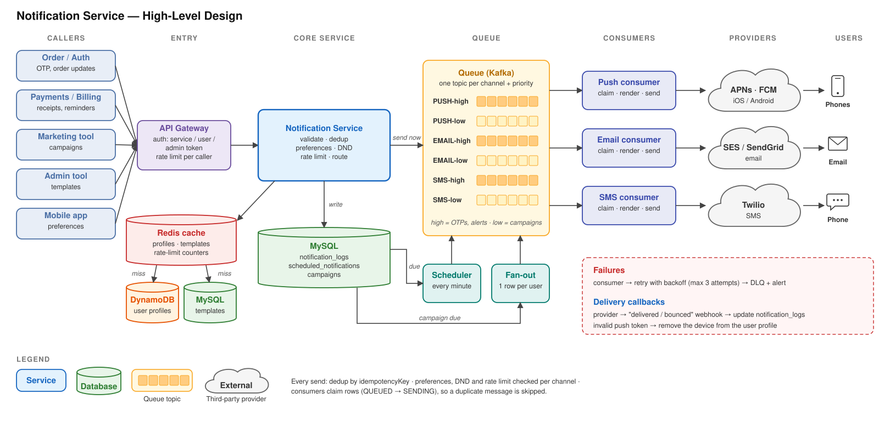

# 🔔 Notification System

## ❓ Questions to Ask the Interviewer

> Clarify system scope, external dependencies, and SLA boundaries before diving into architecture.

---

### 1. Which channels do we need to support? Do we need SMS, Push, In-App, and Email?

**Why ask:** Different channels use completely different 3rd-party gateways (APNs for iOS, FCM for Android, Twilio/Sinch for SMS, SendGrid/SES for Email, WebSockets for In-App). Each has different cost models, payload limits, and rate limits.

**Interviewer Answer:** Support Mobile Push (iOS & Android), SMS, and Email. (In-App is a bonus).

### 2. Do we need to segregate notifications based on type? (Transactional, Promotional, System Alerts)

**Why ask:** Each type has completely different latency SLAs, delivery priorities, and processing pipelines:

- Transactional: the user's own action caused it. Order confirmed, payment receipt, delivery update, ticket booked, OTP for the login they just tried, password reset link they just requested. High priority, strict SLA (<2–5s), 0% loss, zero batching.
- Promotional (Flash sale, marketing): High volume, delay-tolerant, bulk fan-out, requires rate-limiting/unsubscribe support.
- System Alerts: the platform sends it on its own; the user did nothing. Service downtime, suspicious login from a new device, storage almost full, policy or terms change. Critical; must bypass DND, opt-out and rate limits.

**Interviewer Answer:** Yes, support Transactional (highest priority), Promotional (marketing), and System Alerts.

### 3. What is the expected scale (Daily volume)?

**Why ask:** Sizes our message queues (Kafka partition count), worker instances, DB write throughput, and external vendor concurrency rate limits.

**Interviewer Answer:** 50 million DAU, with each user receiving an average of 5 notifications/day (250 million notifications/day).

### 4. Can notifications be scheduled for future delivery?

**Why ask:** Determines if we need a distributed task scheduler (e.g., Redis Sorted Sets, Delay Queues, Quartz) or only immediate queue dispatching.

**Interviewer Answer:** Yes, marketing campaigns and reminder notifications can be scheduled for a future date/time.

### 5. Can users customize preferences and opt-out? (Channel settings, DND, Unsubscribe)

**Why ask:** Requires a dedicated User Preference Service + Redis cache lookup before dispatching. Supporting DND quiet hours requires timezone-aware scheduling (holding non-urgent messages in delay queues until morning). Strict category separation ensures marketing honors unsubscribes (GDPR/CAN-SPAM) while critical security alerts are never suppressed.

**Interviewer Answer:** Yes, provide granular controls. Users can set custom Do Not Disturb (DND) quiet hours (e.g., 10 PM – 8 AM in their local timezone) during which promotional notifications are postponed until morning. Users can also opt out of marketing/promotional messages entirely per channel, while critical transactional alerts (OTPs, order updates, security warnings) must always be delivered and cannot be muted.

### 6. Do we need rate limiting per user?

**Why ask:** Prevents spamming users and causing app uninstalls. Requires sliding window or token bucket counters in Redis per user for promotional channels.

**Interviewer Answer:** Yes, ensure that users receive only a limited number of promotional messages in a given day (e.g., max 2–3 per day) to prevent spam. Transactional notifications (OTPs, order alerts) should bypass this limit.

### 7. What are the reliability and delivery guarantees? At-least-once or at-most-once?

**Why ask:** Clarifies whether message loss is tolerable and dictates queue persistence:

- At-most-once: Messages may be dropped during server crashes or network glitches, but are never re-sent. Unacceptable for critical alerts like OTPs and payment receipts.
- At-least-once: Guarantees zero message loss via persistent queues and consumer acknowledgments (ACKs). However, network timeouts or retries can cause duplicate deliveries.
- Architectural Impact: Mandates an Idempotency & Deduplication Engine (e.g., caching unique dedup_key or notification_id in Redis with a TTL) to ensure workers don't dispatch duplicate messages to external providers.

**Interviewer Answer:** At-least-once delivery is strictly required. Critical notifications must never be silently dropped. The system must implement idempotency/deduplication so that retries never spam the user with duplicate messages.

### 8. How should we handle notification delivery failures? Should we retry failed notifications, and if so, how many times?

**Why ask:** Dictates retry policies (exponential backoff with jitter), deduplication to avoid double-charging/spamming on retry, and Dead Letter Queue (DLQ) thresholds before alerting or failing over to backup providers.

**Interviewer Answer:** Retry transient failures up to 3 times using exponential backoff. If it still fails after 3 attempts, move it to a Dead Letter Queue (DLQ) for inspection and alert, with critical alerts falling back to an alternate provider.

---

## ⚙️ Functional Requirements

> Core operational capabilities the notification service must provide.

---

### 1. Multi-Channel Support

The service must deliver notifications across multiple communication channels, including Email, SMS, Mobile Push Notifications (iOS via APNs and Android via FCM), and In-App Messages.

### 2. Multiple Notification Types

The system must segregate and handle distinct message categories with differing delivery priorities and SLAs:

- Transactional Alerts: High priority with near-zero latency SLAs (e.g., order confirmations, payment receipts, delivery updates, ticket bookings, OTP logins, password reset links).
- Promotional Offers: High volume, delay-tolerant bulk campaigns (e.g., discount codes, flash sale alerts, abandoned cart nudges, product recommendations).
- System-Generated Alerts: Critical administrative notifications (e.g., service downtime warnings, suspicious-login alerts, storage quota limits, policy or terms changes).

### 3. Scheduled Delivery

The service must support scheduling notifications to be dispatched at a specific future date and time (e.g., upcoming payment reminders, calendar alerts, time-delayed marketing campaigns).

### 4. User Preferences, Opt-Out & Do Not Disturb (DND)

Users must have granular control over their notification experience across channels:

- Do Not Disturb (DND) Timings: Users can define custom quiet hours (e.g., 10:00 PM – 8:00 AM in their local timezone); non-critical messages are deferred and held until the window closes.
- Promotional Opt-Out: Users can opt out of promotional and marketing campaigns entirely or selectively per channel.
- Mandatory Transactional Delivery: Critical system alerts and transactional messages (OTPs, fraud alerts, security warnings) bypass opt-out settings and cannot be muted.

### 5. Rate Limiting & Frequency Capping

The service must enforce rate limits on outgoing messages (particularly promotional notifications, e.g., max 2–3 per user per day) to prevent spamming, avoid user fatigue, and reduce app uninstalls.

### 6. Retry Mechanism & Failure Handling

The service must detect delivery failures and timeouts from third-party providers (such as failed SMS, bounced emails, or expired push tokens). It must automatically retry transient failures using exponential backoff, and route exhausted messages to a Dead Letter Queue (DLQ) for alerting and fallback routing.

### 7. Message Deduplication & Idempotency

Delivery is at-least-once (no notification is ever lost), and strict idempotency makes it effectively exactly-once for the user. Using unique identifiers (e.g., idempotency_key or notification_id), the service must detect and drop duplicate requests caused by network retries or repeated client triggers, ensuring users never receive the same notification twice.

---

## 🛡️ Non-Functional Requirements

> Quality attributes, performance criteria, and availability SLAs.

---

### 1. Scalability

The system should handle millions of notifications per minute, seamlessly supporting hundreds of millions of daily active users and scaling horizontally during peak traffic surges (e.g., flash sales, breaking news).

### 2. High Availability

Ensure minimal downtime (99.99% availability) so that notifications are delivered even in case of partial system or downstream provider failures.

### 3. Reliability & Delivery Guarantees

Guarantee at-least-once delivery of notifications (zero silent message loss), with the possibility of exactly-once semantics for critical use cases via deduplication.

### 4. Low Latency

Notifications should be sent as quickly as possible to ensure timely delivery. High-priority transactional alerts (OTPs, security notices) must achieve low-latency SLAs (< 2–5 seconds).

---

## 💬 Would you like me to cover back-of-the-envelope calculations as well, or focus on the high-level design?

---

## 🔌 API Design

> APIs of the Notification Service: called by internal services (cards 1–3), the user's app (card 4) and an admin tool (card 5). All fields use camelCase.

---

### 1. Send Notification

```text
POST /v1/notifications
```

Send one notification to one user. Called by internal services (Order, Auth, Payments).

**Headers**

```text
// 1. Authorization — only verified internal services can call this API (prevents spam)
Authorization: Bearer <service-token>

// 2. Content-Type — the body is JSON
Content-Type: application/json

// 3. X-Request-Id — traces this one request across API → queue → workers → provider logs
X-Request-Id: req_8a7c10b4
```

**Request**

```jsonc
{
  // 1. idempotencyKey — unique ID per notification, generated by the calling service.
  //    If the caller retries (timeout, network error) with the same key, we return the
  //    original response (same notificationId) and send nothing again → no duplicate OTPs
  "idempotencyKey": "7f3c9a1e-4b2d-4e8a-9c1f-2d5b8e6a0c34",

  // 2. userId — who receives it. The service looks up email, phone number and
  //    device tokens itself, so callers never send stale contact details
  "userId": "u_789",

  // 3. type — TRANSACTIONAL | PROMOTIONAL | SYSTEM_ALERT
  //    3.1 Decides queue priority, so OTPs never wait behind marketing blasts.
  //    3.2 PROMOTIONAL obeys DND, opt-out and the daily rate limit.
  //    3.3 TRANSACTIONAL and SYSTEM_ALERT bypass all three.
  "type": "TRANSACTIONAL",

  // 4. templateId — which pre-approved template to use.
  //    Content always comes from a template; raw text is not accepted
  //    (consistent wording, no typos, translations handled by us)
  "templateId": "orderConfirmed",

  // 5. params — values filled into the template placeholders,
  //    e.g. "Hi {{name}}, your order {{orderId}} is confirmed"
  "params": {
    "name": "Abhinav",
    "orderId": "ORD-123456"
  },

  // 6. channels — optional. Which channels to send on.
  //    If omitted, the user's channel preferences decide
  "channels": ["PUSH", "EMAIL"],

  // 7. pushNotificationAction — optional, push only. What happens when the user taps it.
  //    7.1 type: OPEN_SCREEN (deep link inside the app) | OPEN_URL (opens in browser).
  //    7.2 url: the deep link, here it opens the order details screen.
  "pushNotificationAction": {
    "type": "OPEN_SCREEN",
    "url": "myapp://orders/ORD-123456"
  },

  // 8. scheduleSendAt — optional.
  //    8.1 null → send now (status QUEUED).
  //    8.2 Future ISO-8601 time → handed to the Scheduler (status SCHEDULED).
  "scheduleSendAt": null
}
```

**Response — 202 Accepted**

```jsonc
{
  // 1. notificationId — use with API 3 to check delivery status
  "notificationId": "n_01HZX8K2M4",

  // 2. status — QUEUED (send now) | SCHEDULED (scheduleSendAt is in the future)
  "status": "QUEUED"
}
```

**Notes:**

1. Returns 202 immediately. We only validate the request and put it on the queue; workers deliver it later, because providers take 200 ms to 3 s.
2. Errors: 400 invalid field · 401/403 caller not allowed · 404 unknown templateId/userId · 429 caller sending too fast.

### 2. Send Campaign (Bulk)

```text
POST  /v1/campaigns                 → send one message to a list of users
GET   /v1/campaigns/{campaignId}    → progress of the campaign (counts, not per user)
```

Send one message to a list of users. Used for marketing campaigns and system-wide alerts (e.g., downtime notice).

**Headers**

```text
// 1. Authorization — only verified internal services can call this API (prevents spam)
Authorization: Bearer <service-token>

// 2. Content-Type — the body is JSON
Content-Type: application/json

// 3. X-Request-Id — traces this one request across API → queue → workers → provider logs
X-Request-Id: req_8a7c10b4
```

**Request**

```jsonc
{
  // 1. idempotencyKey — unique ID per campaign request, generated by the caller.
  //    A retry with the same key returns the original response and creates no second campaign
  "idempotencyKey": "b2e4d6f8-1a3c-4e5d-8f7a-9c0b1d2e3f4a",

  // 2. campaignName — human-readable name, shown in dashboards and reports
  "campaignName": "Diwali Flash Sale",

  // 3. type — PROMOTIONAL | SYSTEM_ALERT only
  //    3.1 Transactional messages always go per user via API 1.
  //    3.2 PROMOTIONAL obeys DND, opt-out and the daily rate limit; SYSTEM_ALERT bypasses them.
  "type": "PROMOTIONAL",

  // 4. templateId — which pre-approved template to use. Raw text is not accepted
  "templateId": "diwaliSale",

  // 5. params — values for the template placeholders
  //    5.1 Shared by all users, e.g. the discount.
  //    5.2 Per-user values like {{name}} are filled from each user's profile.
  "params": {
    "discount": "40%"
  },

  // 6. userIds — who receives it
  //    6.1 Up to 10,000 users per request.
  //    6.2 Bigger audiences are split into multiple requests.
  "userIds": ["u_101", "u_102", "u_103"],

  // 7. channels — optional. If omitted, each user's channel preferences decide
  "channels": ["PUSH", "EMAIL"],

  // 8. pushNotificationAction — optional, push only. What happens when the user taps it.
  //    8.1 type: OPEN_SCREEN (deep link inside the app) | OPEN_URL (opens in browser).
  //    8.2 url: the deep link, here it opens the Diwali sale page inside the app.
  "pushNotificationAction": {
    "type": "OPEN_SCREEN",
    "url": "myapp://sale/diwali"
  },

  // 9. scheduleSendAt — optional. Campaigns are usually scheduled ahead of time.
  //    9.1 null → send now (status QUEUED).
  //    9.2 Future ISO-8601 time → handed to the Scheduler (status SCHEDULED).
  "scheduleSendAt": "2026-10-20T09:00:00Z"
}
```

**Response — 202 Accepted**

```jsonc
{
  // 1. campaignId — use to track and report on this campaign
  "campaignId": "c_01HZY3P7Q9",

  // 2. status — QUEUED (send now) | SCHEDULED (scheduleSendAt is in the future)
  "status": "SCHEDULED",

  // 3. acceptedCount — users accepted into the campaign.
  //    Opt-out, DND and rate limit are checked later for each user individually
  "acceptedCount": 3
}
```

**Response — GET campaign status (200 OK)**

```jsonc
{
  // 1. status — SCHEDULED | IN_PROGRESS | COMPLETED | CANCELLED
  "status": "IN_PROGRESS",

  // 2. counts — how many users are at each stage right now
  //    2.1 total = users accepted into the campaign (acceptedCount).
  //    2.2 skipped = opted out, DND or rate limit.
  "counts": { "total": 3, "sent": 2, "delivered": 1, "failed": 0, "skipped": 1 }
}
```

**Notes:**

1. Returns 202 immediately. The service fans the campaign out into one notification per user on the low-priority queue, so campaigns never delay OTPs.
2. Errors: same as API 1, plus 400 if userIds is empty or over the limit.

### 3. Get Notification Status

```text
GET /v1/notifications/{notificationId}
```

Check the delivery status of a notification on each channel.

**Headers**

```text
// 1. Authorization — only verified internal services can read status
Authorization: Bearer <service-token>
```

**Response — 200 OK**

```jsonc
{
  // 1. notificationId — the ID returned by API 1
  "notificationId": "n_01HZX8K2M4",

  // 2. type — the type it was sent with
  "type": "TRANSACTIONAL",

  // 3. channels — one entry per channel it was sent on
  //    3.1 status: where it is now on this channel (flow in Notes 1 and 2).
  //    3.2 attempts: how many times we tried (max 3, then moved to the DLQ).
  //    3.3 reason: why it failed or was skipped.
  "channels": {
    "PUSH":  { "status": "DELIVERED", "attempts": 1 },
    "EMAIL": { "status": "FAILED", "attempts": 3, "reason": "EMAIL_BOUNCED" }
  },

  // 4. createdAt — when the request was accepted
  "createdAt": "2026-10-04T16:30:00Z"
}
```

**Notes:**

1. Channel status: QUEUED / SCHEDULED → SENT → DELIVERED, or FAILED after 3 retries (moved to DLQ), or SKIPPED (opted out, DND, or rate limit).
2. SENT = handed to the provider (APNs, FCM, Twilio, SES). DELIVERED = provider confirmed delivery via callback.
3. Errors: 404 unknown notificationId.

### 4. User Preferences

```text
GET  /v1/users/{userId}/preferences    → read settings (shown on the settings screen)
PUT  /v1/users/{userId}/preferences    → replace settings
```

Lets users read and change their notification settings. Called by the user's mobile app or website.

**Headers**

```text
// 1. Authorization — the user's own login token; a user can only read or change their own settings
Authorization: Bearer <user-token>

// 2. Content-Type — the body is JSON (PUT only)
Content-Type: application/json
```

**Request (PUT)**

```jsonc
{
  // 1. promotional — which channels the user allows marketing messages on
  //    1.1 true = allowed, false = opted out on that channel.
  //    1.2 Transactional and system alerts are not listed here: they can never be muted.
  "promotional": {
    "PUSH": false,
    "EMAIL": true,
    "SMS": false
  },

  // 2. doNotDisturb — quiet hours in the user's local time
  //    2.1 enabled: turns quiet hours on or off.
  //    2.2 startTime / endTime: e.g. 10 PM to 8 AM.
  //    2.3 timezone: so "10 PM" means 10 PM where the user lives.
  //    2.4 Promotional messages that fall in this window are held until it ends.
  "doNotDisturb": {
    "enabled": true,
    "startTime": "22:00",
    "endTime": "08:00",
    "timezone": "Asia/Kolkata"
  }
}
```

**Response — 200 OK (GET and PUT)**

```jsonc
{
  // 1. userId — whose settings these are
  "userId": "u_789",

  // 2. promotional — same meaning as in the PUT body (true = allowed on that channel)
  "promotional": {
    "PUSH": false,
    "EMAIL": true,
    "SMS": false
  },

  // 3. doNotDisturb — same meaning as in the PUT body
  "doNotDisturb": {
    "enabled": true,
    "startTime": "22:00",
    "endTime": "08:00",
    "timezone": "Asia/Kolkata"
  },

  // 4. updatedAt — when the user last changed their settings
  "updatedAt": "2026-10-05T10:15:00Z"
}
```

**Notes:**

1. We use PUT; see the PUT vs PATCH card below.
2. Preferences are cached (Redis), because every send checks them. A PUT writes to the database and clears the cache entry.
3. Errors: 400 invalid time or timezone · 403 reading or changing another user's settings.

### PUT vs PATCH

**One-line answer:** PUT replaces the whole resource; PATCH changes only the fields you send. PUT is always idempotent; PATCH is not guaranteed to be.

|  | PUT | PATCH |
|---|---|---|
| **What it does** | Replaces the whole resource with the body you send | Changes only the fields you send |
| **Request body** | Must contain the full object | Contains only the fields to change |
| **Fields you leave out** | Reset to default or removed | Stay as they are |
| **Idempotent (same request twice = same result)** | Yes, always | Not guaranteed. "Set enabled = false" is, but "add 1 to a counter" is not |
| **Safe to retry after a timeout** | Yes | Only if the patch just sets values |
| **Payload size** | Bigger (full object every time) | Smaller (only the changes) |
| **Two devices update at the same time** | Last write replaces everything, so the other device's change can be lost | Each touches only its own fields, so both changes usually survive |
| **Can create the resource** | Yes, if the client knows the URL | No, usually 404 if it doesn't exist |
| **Example in our system** | `PUT /v1/users/{userId}/preferences` with full `promotional` + `doNotDisturb` | `PATCH /v1/users/{userId}/preferences` with `{"doNotDisturb": {"enabled": false}}` |
| **Use when** | The resource is small and the client already has the full state (a settings screen) | The resource is large, or clients change one field at a time |

**Why we chose PUT for preferences**

1. The settings object is small: two groups of fields.
2. The settings screen already has every value, so sending everything is easy.
3. It's idempotent, so the app can retry safely without an idempotencyKey.

**Likely follow-up: "how do you stop two devices overwriting each other with PUT?"**

1. GET returns a version tag in an `ETag` header, e.g. `ETag: "v7"`.
2. The app sends it back on PUT as `If-Match: "v7"`.
3. If someone else saved in between, the version no longer matches and the server returns 412 Precondition Failed. The app reloads the settings and tries again.
4. This is called optimistic locking.

### 5. Notification Templates (Admin)

```text
POST  /v1/templates                → create a template with the text for all its channels
PUT   /v1/templates/{templateId}   → update it (same body)
GET   /v1/templates/{templateId}   → read it
```

Called by an admin or marketing tool, never by the services that send notifications.

**Headers**

```text
// 1. Authorization — admin token; only admins can create or change templates
Authorization: Bearer <admin-token>

// 2. Content-Type — the body is JSON
Content-Type: application/json
```

**Request (POST)**

```jsonc
{
  // 1. templateId — readable unique name chosen by the admin; services pass it in API 1 and 2
  "templateId": "orderConfirmed",

  // 2. type — TRANSACTIONAL | PROMOTIONAL | SYSTEM_ALERT
  //    2.1 The template can only be sent with this type.
  //    2.2 Stops a marketing template being sent as TRANSACTIONAL to skip DND and opt-out.
  "type": "TRANSACTIONAL",

  // 3. requiredParams — names of the placeholders used in the text below
  //    3.1 Every {{placeholder}} in the text must be listed here, or create fails (400).
  //    3.2 A send (API 1/2) must give a value for each one, or the send fails (400).
  "requiredParams": ["name", "orderId"],

  // 4. channels — the message text for each channel; a send can only use channels listed here
  //    4.1 PUSH: short title + body, because lock-screen space is small.
  //    4.2 EMAIL: subject + HTML body, with full branding, links and footer.
  //    4.3 SMS: one plain-text message, max 160 characters.
  "channels": {
    "PUSH": {
      "title": "Order confirmed!",
      "body": "Hi {{name}}, your order {{orderId}} is confirmed."
    },
    "EMAIL": {
      "subject": "Your order {{orderId}} is confirmed",
      "htmlBody": "<h1>Thanks, {{name}}!</h1><p>Order {{orderId}} is confirmed.</p>"
    },
    "SMS": {
      "text": "Hi {{name}}, order {{orderId}} confirmed. Track: myapp.in/o/{{orderId}}"
    }
  }
}
```

**Response — 201 Created**

```jsonc
{
  // 1. templateId — the template that was created
  "templateId": "orderConfirmed",

  // 2. createdAt — when it was saved
  "createdAt": "2026-10-05T12:00:00Z"
}
```

**Notes:**

1. In the database it's stored as one row per channel, so each channel's worker reads only its own text. The API still takes it all in one call.
2. An update applies to every send from then on, including scheduled ones that haven't gone out yet.
3. Templates are cached, because every send reads one (Alex Xu).
4. 201 vs 202. Creating a template finishes immediately, so it returns 201 Created. Sending a notification only queues it, so it returns 202 Accepted.
5. Errors: 400 invalid body, a placeholder not listed in requiredParams, or SMS over 160 characters · 403 not an admin · 409 templateId already exists.

<details>
<summary><b>6. In-App Notifications</b></summary>

**For learning only. In the interview, bring this up only if the interviewer asks.** Otherwise say one line: "In-App is a fourth channel with its own queue topic and processor."

#### A. What it is

The 🔔 bell list inside the app (LinkedIn, Facebook, GitHub). Unlike a push, an item stays in the list until the user reads it.

#### B. Real-time connection: SSE vs WebSocket vs long polling

|  | Long polling | SSE (our choice) | WebSocket |
|---|---|---|---|
| **Direction** | Client keeps asking "anything new?" | Server → client only | Both ways |
| **Protocol** | Normal HTTP requests | One long HTTP response (`text/event-stream`) | Its own protocol after an HTTP upgrade |
| **Reconnect** | Not needed (new request each time) | Built in: the browser reconnects by itself | You build it yourself |
| **Missed messages** | The next poll fetches them | Built in: the browser sends `Last-Event-ID` and the server replays | You build it yourself |
| **Cost** | Many wasted requests | One open connection per user | One open connection per user |
| **Best for** | Very simple setups | Server-to-user feeds like notifications | Chat, games, two-way live data |

**Why SSE:**

1. Notifications only go server → user, so WebSocket's two-way channel isn't needed.
2. Auto-reconnect plus `Last-Event-ID` give us delivery of missed messages for free (section E).
3. It's plain HTTP, so it works with normal load balancers, proxies and HTTP/2.

**Caveats:**

1. On HTTP/1.1, browsers allow only about 6 connections per domain, so serve the stream over HTTP/2.
2. Mobile apps lose the connection when in the background. That's what push notifications are for.

AlgoMaster says "WebSockets or long polling". SSE is our own choice, so if asked, say why.

#### C. Database design

```text
inbox_notifications   (Cassandra / DynamoDB)
───────────────────────────────────────────────────────────────
user_id           PARTITION KEY   → all of one user's items stored together
notification_id   CLUSTERING KEY  → time-sortable ID (Snowflake / ULID), sorted newest first
type              TRANSACTIONAL | PROMOTIONAL | SYSTEM_ALERT
title             "Order confirmed!"
body              "Hi Abhinav, your order ORD-123456 is confirmed."
deep_link         "myapp://orders/ORD-123456"
is_read           false
created_at        2026-10-05T12:00:00Z
TTL               90 days → old items are deleted automatically
```

```text
Unread badge   (Redis)
───────────────────────────────────────────────────────────────
key   unread:{userId}  → number shown on the red badge
      +1 on every new item, −N when N items are marked read
      If Redis loses it, rebuild by counting rows with is_read = false
```

**Why Cassandra / DynamoDB:**

1. There's only one query: "this user's items, newest first". That's one partition, already sorted.
2. It's write-heavy and huge (every in-app notification is a row), and these databases scale by adding machines.
3. TTL deletes old rows by itself.

**Store the final text, not `templateId` + `params`:**

1. Reading the inbox never needs the template service.
2. Editing a template later doesn't change old items.

#### D. How a new notification reaches the user

1. Send API (card 1) → queue → In-App topic → In-App processor.
2. The processor **always** writes the row to `inbox_notifications` and adds 1 to the unread count. **The database is the inbox; the live connection is only a fast lane.**
3. The processor checks the **connection registry** in Redis, which maps each userId to the SSE server holding that user's connection.

   3.1 **Online:** publish to that SSE server (Redis Pub/Sub). The server sends the event down the open connection and the bell updates instantly.

   3.2 **Offline:** nothing more. The row waits in the database as unread.

#### E. User comes online: how pending messages are delivered

1. The app opens and calls **GET inbox**, getting the first page plus `unreadCount`. It now shows everything it missed.
2. The app opens the **SSE stream**, sending `Last-Event-ID` = the newest `notificationId` it already has.
3. The server first sends any rows newer than that ID from the database (arrivals during the gap), then live events.
4. If the connection drops, the browser reconnects by itself with `Last-Event-ID`, step 3 repeats, and nothing is lost.

#### F. APIs

```text
GET   /v1/users/{userId}/inbox?cursor=…&limit=20   → list items, newest first
GET   /v1/users/{userId}/inbox/stream              → SSE stream of new items (text/event-stream)
POST  /v1/users/{userId}/inbox/read                → mark items as read
```

**Response: GET inbox (200 OK)**

```jsonc
{
  // 1. items — newest first
  "items": [
    {
      "notificationId": "n_01HZX8K2M4",
      "title": "Order confirmed!",
      "body": "Hi Abhinav, your order ORD-123456 is confirmed.",
      "deepLink": "myapp://orders/ORD-123456",
      "isRead": false,
      "createdAt": "2026-10-05T12:00:00Z"
    }
  ],

  // 2. unreadCount — number for the red badge (read from Redis)
  "unreadCount": 3,

  // 3. nextCursor — pass as ?cursor= to get the next (older) page; null = no more
  //    3.1 It is the last notificationId on this page.
  //    3.2 Next page = items with notificationId < cursor, so new arrivals never shift the pages.
  "nextCursor": "n_01HZW1A9B3"
}
```

**One SSE event, exactly as it travels:**

```text
id: n_01HZX8K2M4
event: notification
data: {"title":"Order confirmed!","body":"Hi Abhinav, your order ORD-123456 is confirmed.","deepLink":"myapp://orders/ORD-123456"}
```

**Request: mark as read (POST)**

```jsonc
{
  // 1. notificationIds — the items to mark as read; the unread count drops by this many
  "notificationIds": ["n_01HZX8K2M4"]
}
```

</details>

---

## 🗄️ Database Schema

> What the Notification Service stores, how each table or document is shaped, and which database it lives in.

---

### 1. User Profile (NoSQL document)

**Database:** DynamoDB, with a Redis cache in front. **Key:** `userId`. One document per user holds contact info, preferences and devices.

**Document**

```jsonc
{
  // 1. userId — the key; every send looks up exactly one document
  "userId": "u_789",

  // 2. contact — copy of email and phone, kept fresh by "user updated" events
  //    2.1 Never send to an unverified email or phone.
  //    2.2 Phone is a string in E.164 format (+ country code), never an integer.
  "contact": {
    "email": "abhinav@example.com",
    "emailVerified": true,
    "phoneNumber": "+919876543210",
    "phoneVerified": true
  },

  // 3. preferences — exactly what card 4's GET / PUT reads and writes
  "preferences": {
    "promotional": { "PUSH": false, "EMAIL": true, "SMS": false },
    "doNotDisturb": { "enabled": true, "startTime": "22:00", "endTime": "08:00", "timezone": "Asia/Kolkata" }
  },

  // 4. devices — one entry per app install; a push goes to all of them
  //    4.1 platform decides the provider: IOS → APNs, ANDROID → FCM.
  //    4.2 Removed when APNs / FCM says the token is invalid (app uninstalled).
  "devices": [
    { "deviceId": "d_5f2a9c", "platform": "IOS", "pushToken": "a1b2c3…", "lastActiveAt": "2026-10-05T11:00:00Z" }
  ],

  // 5. updatedAt — when any part was last changed
  "updatedAt": "2026-10-05T11:00:00Z"
}
```

**Why NoSQL:**

1. **We always read it by `userId`.** Every send fetches the profile using `userId`; we never search by email, phone or anything else. A key-value store is built for exactly this: give it the key, get the item back.
2. Very read-heavy. All 250M sends a day read it, about 17K reads per second at the peak (1M a minute). NoSQL spreads that across machines by `userId`.
3. Nested shape. Contact, preferences and a list of devices fit in one document. In SQL that's three tables and a join (or three lookups) per send.
4. No cross-user queries needed. Campaigns arrive with a `userIds` list, so joins and ad-hoc SQL queries would go unused.

**Why DynamoDB, not MongoDB:**

1. Our only lookup is by `userId`, so MongoDB's flexible queries would go unused.

**Things to handle:**

1. Three writers touch the same document: the user service (contact), the settings screen (preferences) and login (devices). Each updates only its own part (DynamoDB `UpdateExpression`), never the whole document, so no one wipes another's change.
2. Size stays tiny: a few devices per user, far below DynamoDB's 400 KB item limit.

**Redis cache**

```text
key   user:{userId}   → the whole document above
TTL   1 hour          → safety net in case an update is ever missed
```

**How reads work (cache-aside):**

1. A send checks Redis first. Hit → done, no database call.
2. Miss → read from the database, store it in Redis with the TTL, continue.

**How writes work:**

1. Update the database first (only the changed part).
2. Then delete the Redis key, so the next read loads the fresh copy.
3. Delete instead of update: if two writes race, updating the cache can leave the older value in Redis; deleting always forces a fresh read.

**Why Redis:**

1. Every send reads the profile, about 17K times a second at the peak. Redis answers in under a millisecond.
2. Most reads hit the cache, so the database only sees cache misses and writes.
3. Alex Xu: "User info, device info, notification templates are cached."

**Interview line**

"I'll use a key-value NoSQL store, like DynamoDB, because we always read the profile by userId. The data is nested (contact, preferences, devices), and we never need joins or cross-user queries. Redis sits in front because every send reads it."

### 2. Notification Templates (SQL)

**Database:** PostgreSQL / MySQL, with a cache in front. **One row per template per channel.**

**Schema**

```text
notification_templates
───────────────────────────────────────────────────────────────────────
id                BIGINT     PK, AUTO_INCREMENT → internal row id (1, 2, 3 …)
template_id       VARCHAR    NOT NULL           → "orderConfirmed", the name services send in API 1/2
channel           ENUM       NOT NULL           → PUSH | EMAIL | SMS
type              ENUM       NOT NULL           → TRANSACTIONAL | PROMOTIONAL | SYSTEM_ALERT
subject           VARCHAR    NULL               → EMAIL subject, PUSH title; NULL for SMS
body              TEXT       NOT NULL           → PUSH body, EMAIL HTML, SMS text
required_params   VARCHAR    NOT NULL           → "name,orderId" (comma-separated, read whole and split in code)
created_at        TIMESTAMP
updated_at        TIMESTAMP
UNIQUE (template_id, channel)                   → one row per channel; a duplicate gives the 409
```

**Example rows for `orderConfirmed`**

```text
id  template_id     channel  type           subject                               body                                                  required_params
1   orderConfirmed  PUSH     TRANSACTIONAL  Order confirmed!                      Hi {{name}}, your order {{orderId}} is confirmed.     name,orderId
2   orderConfirmed  EMAIL    TRANSACTIONAL  Your order {{orderId}} is confirmed   <h1>Thanks, {{name}}!</h1>…                           name,orderId
3   orderConfirmed  SMS      TRANSACTIONAL  NULL                                  Hi {{name}}, order {{orderId}} confirmed.             name,orderId
```

**Why SQL:**

1. **Fixed columns:** every row has the same shape (`subject` + `body`), so this is structured data.
2. **Constraints come free:** `UNIQUE (template_id, channel)` blocks duplicates (the 409), and the ENUMs reject bad values.
3. **All-or-nothing create:** card 5's POST inserts one row per channel, wrapped in one transaction, so a template never exists with only some of its channels.
4. **Small and rarely written:** a few thousand rows that admins edit occasionally.

**Why both `id` and `template_id`:**

1. **`id` (INT):** the internal primary key. It's small and fast, and other tables (like the notification log) can point to it.
2. **`template_id` (text):** the readable name that services send in the API. Services never see the INT.

**How a send reads it:**

1. `WHERE template_id = 'orderConfirmed' AND channel = 'PUSH'` returns one row through the unique index (cached).
2. Fill `{{name}}`, `{{orderId}}` from the send's `params`.

**Cache:**

1. Key `template:{templateId}:{channel}` holds that one row.
2. On every PUT, update the rows, then delete the cache keys, the same pattern as the user profile.

**Trade-off to know:** `type` and `required_params` are repeated on each channel's row, so a PUT must update all rows of the template together, in one transaction. With a few thousand rows, that's fine.

**No versions:** an edit applies to every send from then on, including scheduled ones that haven't gone out yet.

**Interview line**

"Templates go in a relational database like PostgreSQL, one row per template per channel with a subject and a body. It's small, structured and rarely written, and a unique key on template and channel prevents duplicates. Every send reads from cache."

### 3. Notification Logs (MySQL)

**Database:** MySQL. **One row per channel per send**, all in one table.

**Schema**

```text
notification_logs                     → one row per channel per send (1–3 rows per notification)
─────────────────────────────────────────────────────────────────────────────
id                 BIGINT      PK, AUTO_INCREMENT
notification_id    BIGINT      NOT NULL      → same for all channel rows of one send; returned by API 1
idempotency_key    VARCHAR     NOT NULL      → the key the caller sent
user_id            BIGINT      NOT NULL
campaign_id        BIGINT      NULL          → set when the send came from a campaign
type               ENUM        NOT NULL      → TRANSACTIONAL | PROMOTIONAL | SYSTEM_ALERT
template_id        VARCHAR     NOT NULL      → "orderConfirmed"
params             JSON        NOT NULL      → {"name": "Abhinav", "orderId": "ORD-123456"}
push_action        JSON        NULL          → {"type": "OPEN_SCREEN", "url": "myapp://orders/…"}, from the API's pushNotificationAction (PUSH rows only)
channel            ENUM        NOT NULL      → PUSH | EMAIL | SMS
status             ENUM        NOT NULL      → SCHEDULED | QUEUED | SENDING | SENT | DELIVERED | FAILED | SKIPPED
attempts           TINYINT     NOT NULL      → max 3, then the DLQ
error_reason       VARCHAR     NULL          → "EMAIL_BOUNCED", "USER_OPTED_OUT" …
schedule_send_at   TIMESTAMP   NULL          → NULL = send now
sent_at            TIMESTAMP   NULL
delivered_at       TIMESTAMP   NULL
created_at         TIMESTAMP   NOT NULL
updated_at         TIMESTAMP   NOT NULL      → set automatically on every change (ON UPDATE CURRENT_TIMESTAMP); the sweeper uses it
UNIQUE (idempotency_key, channel)            → dedup at the API
INDEX  (notification_id)                     → API 3 reads all channel rows of one notification
INDEX  (campaign_id)                         → card 2's campaign counts (GROUP BY status)
INDEX  (created_at)                          → the 90-day cleanup job
INDEX  (status, updated_at)                  → the sweeper's "stuck in SENDING?" query
```

**One ID for the caller, many rows inside**

1. **`notification_id`** is the one ID for the whole send. All channel rows of that send share it, and it's what API 1 returns.
2. **`id`** is just the row's own primary key inside the database. Callers never see it.

Example: one send to PUSH and EMAIL creates 2 rows. API 1 returns `"notificationId": 88001`, so the caller holds one ID even though there are 2 rows.

```text
id    notification_id   channel   status
101   88001             PUSH      QUEUED
102   88001             EMAIL     QUEUED
```

API 3 reads `WHERE notification_id = 88001`, gets both rows, and combines them into one response. So the API never changes:

```jsonc
"channels": {
  "PUSH":  { "status": "DELIVERED", "attempts": 1 },
  "EMAIL": { "status": "FAILED", "attempts": 3, "reason": "EMAIL_BOUNCED" }
}
```

**Dedup:**

1. **API:** insert the channel rows. A duplicate-key error on `idempotency_key` means it's a retry, so return the same `notificationId`.
2. **Consumer:** `UPDATE … SET status = 'SENDING' WHERE id = ? AND status = 'QUEUED'`. 1 row changed → send. 0 rows → it's a duplicate, so skip.

**What we accept:** `user_id`, `type`, `template_id` and `params` repeat on each channel row. That's at most 3 rows per send, so it's fine.

**Old data:** a cleanup job deletes rows older than 90 days, in small batches. The table is not partitioned by day: MySQL requires the partition column inside every UNIQUE key, which would break the `(idempotency_key, channel)` dedup.

**Interview line**

"Notification logs go in MySQL, one row per channel per send, all sharing one notification_id that the API returns. A unique key on idempotency key plus channel blocks duplicate requests, and the consumer's conditional update blocks duplicate sends. A cleanup job deletes rows older than 90 days."

### 4. Scheduled Notifications (MySQL)

**Database:** MySQL. A small pointer table: the notification itself (template, params, channels) is already saved in `notification_logs` with status `SCHEDULED` when API 1 accepts it. This table only answers **"what is due, and when?"**

**Schema**

```text
scheduled_notifications              → one row per scheduled send
─────────────────────────────────────────────────────────────────────────────
id                 BIGINT      PK, AUTO_INCREMENT
notification_id    BIGINT      NULL          → the scheduled notification (rows in notification_logs)
campaign_id        BIGINT      NULL          → or the scheduled campaign (exactly one of the two is set)
scheduled_time     TIMESTAMP   NOT NULL      → when to send, in UTC
status             ENUM        NOT NULL      → PENDING | QUEUED
created_at         TIMESTAMP   NOT NULL
INDEX (status, scheduled_time)               → the Scheduler's "what's due now?" query
```

**How the Scheduler uses it (every minute):**

1. `SELECT … WHERE status = 'PENDING' AND scheduled_time <= UTC_TIMESTAMP() LIMIT 1000 FOR UPDATE SKIP LOCKED`

   1.1 2–3 Scheduler instances run this at once; `SKIP LOCKED` makes each one take different rows.

   1.2 A full batch of 1000 means more are due, so it fetches again right away.
2. **Single notification:** move its `notification_logs` rows `SCHEDULED → QUEUED` first (only `SCHEDULED` rows change), then publish every row that is still `QUEUED` to Kafka.
3. **Campaign:** set the campaign `SCHEDULED → IN_PROGRESS` and publish one "campaign due" message; the fan-out worker does the rest.
4. Mark the schedule row `QUEUED` and commit.
5. If anything is published twice, the consumer's claim (`UPDATE … WHERE status = 'QUEUED'`) stops a duplicate send. Full steps and crash cases: High-Level Design cards 4 (Single Notification, Scheduled) and 5 (Campaign).

**Old rows:** a cleanup job deletes `QUEUED` rows older than a few days. `PENDING` rows are never deleted, even when overdue (e.g. the Scheduler was down), so nothing scheduled is lost. No partitioning is needed: the table stays small.

**Differences from AlgoMaster's `scheduled_notifications`:**

1. **No `message_content`, `channels`, `user_id`:** they're already in `notification_logs`, so we just point to it.
2. **No `timezone` column:** `scheduleSendAt` arrives as an ISO time and we store it in UTC. (DND's timezone lives in the user's preferences.)
3. **Same core idea:** found by scheduled time and polled every minute. AlgoMaster partitions the table by time; ours stays small, so an index is enough.

**Interview line**

"Scheduled sends go in a small MySQL table of notification or campaign IDs and UTC send times. Every minute two or three Scheduler instances pick due rows with SKIP LOCKED, move the notification's rows to QUEUED, publish them to Kafka and mark the schedule done."

### 5. Campaigns (MySQL)

**Database:** MySQL. One row per campaign. Campaigns are few, so it's a small table.

**Schema**

```text
campaigns                            → one row per bulk send (card 2)
─────────────────────────────────────────────────────────────────────────────
campaign_id        BIGINT      PK, AUTO_INCREMENT → returned by API 2
idempotency_key    VARCHAR     UNIQUE        → dedup for API 2 (a retry returns the same campaignId)
campaign_name      VARCHAR     NOT NULL      → "Diwali Flash Sale"
type               ENUM        NOT NULL      → PROMOTIONAL | SYSTEM_ALERT
template_id        VARCHAR     NOT NULL      → "diwaliSale"
params             JSON        NOT NULL      → {"discount": "40%"}, shared by all users
push_action        JSON        NULL          → {"type": "OPEN_SCREEN", "url": "myapp://sale/diwali"}
channels           VARCHAR     NULL          → "PUSH,EMAIL" (NULL = each user's preferences decide)
user_ids           JSON        NOT NULL      → [101, 102, 103 …], up to 10,000
schedule_send_at   TIMESTAMP   NULL          → UTC; NULL = send now
status             ENUM        NOT NULL      → SCHEDULED | IN_PROGRESS | COMPLETED
created_at         TIMESTAMP   NOT NULL
```

**How a campaign runs:**

1. **API 2** inserts the row. A duplicate `idempotency_key` means it's a retry, so return the same `campaignId`.
2. **Due:** if it's scheduled, a row goes in `scheduled_notifications` with this `campaign_id`, and the Scheduler sends one "campaign due" message when the time comes. If not scheduled, that message is sent right away.

   2.1 The Scheduler never fans out itself, so its locked transaction stays short.
3. **Fan-out:** a fan-out worker reads `user_ids`, creates `notification_logs` rows in batches (with `campaign_id` set), and queues them on the **low-priority** topic. Status becomes `IN_PROGRESS`.

   3.1 Each fan-out row uses `idempotency_key = "{campaignId}:{userId}"`, so if the fan-out crashes and restarts, no user gets it twice.
4. When every user is processed, status becomes `COMPLETED`.

**Counts for card 2's GET (`/v1/campaigns/{campaignId}`):**

1. `SELECT status, COUNT(*) FROM notification_logs WHERE campaign_id = ? GROUP BY status`. At most 10,000 rows, and the result is cached for a few seconds.
2. Uses `INDEX (campaign_id)` on `notification_logs`.
3. **Why not counter columns here:** thousands of workers updating the same campaign row would fight over one row (lock contention).

**Trick question: "Isn't a list of user IDs in one column against normalization? Why not a separate campaign_users table?"**

1. **True, it breaks first normal form (1NF)**, which says one value per column. But normalization exists to stop update problems, and none can happen here.
2. **Why the list is fine:**

   2.1 Written once, never changed after the campaign is created.

   2.2 Read whole, once, by the fan-out worker.

   2.3 Never searched inside: we never ask "which campaigns include user 101?".

   2.4 Small: 10,000 IDs is about 100 KB of JSON.
3. **A separate table** would add 10,000 inserts per campaign for no benefit. Per-user progress is already tracked in `notification_logs` through `campaign_id`.
4. **When I'd switch to a `campaign_users` table:**

   4.1 The list could change after creation (add or remove users).

   4.2 We need to query by user ("is user 101 in this campaign?").

   4.3 Audiences become far bigger than 10,000 per request.

**Interview line**

"Campaigns go in a small MySQL table, with the user list stored as JSON because it's write-once and read whole. When a campaign is due, a fan-out worker turns it into one notification log row per user on the low-priority queue, with a per-user idempotency key so a restart never sends twice."

---

## 🏗️ High-Level Design

> How the parts fit together: callers, the core service, data stores, the queue, consumers and providers.

---

### 1. Architecture



### 2. Retry with Kafka Topics

How the "retry with backoff (max 3) → DLQ" box in the diagram works.

```text
EMAIL (main) ─fail─► EMAIL-retry-1m ─fail─► EMAIL-retry-5m ─fail─► EMAIL-retry-30m ─fail─► EMAIL-DLQ
(the same chain exists for PUSH and SMS)
```

**Flow:**

1. On failure, the consumer publishes the message to a delay topic, e.g. `EMAIL-retry-1m`, and moves on. The main topic keeps flowing.
2. A retry consumer reads `EMAIL-retry-1m`, waits until 1 minute has passed since the failure, then tries again.

   2.1 Kafka has no built-in delay, so the retry consumer checks each message's timestamp and pauses until it's due.
3. Fails again → `EMAIL-retry-5m`, then `EMAIL-retry-30m` (increasing delays = exponential backoff).
4. After the 3rd failure → `EMAIL-DLQ` topic, mark `FAILED`, and alert.

**Why not retry inside the consumer (sleep and try again):** if it waits 5 minutes on one failed message, everything behind it in that partition waits too (head-of-line blocking), so OTPs would get stuck behind one bad email.

**Simpler alternative:** reuse the Scheduler. Set the row back to `SCHEDULED` with a new time (now + 1 min, + 5 min, + 30 min), and the Scheduler re-queues it when due.

**What the books say:**

1. **Alex Xu:** "If the system fails to send notifications, they are put back in the messaging queue and the workers will retry for a predefined number of times."
2. **AlgoMaster:** exponential backoff; "If the notification remains undelivered after a set number of retries, it is moved to the Dead Letter Queue."

**Sweeper: rescuing stuck rows**

1. **Runs every minute** inside the Scheduler instances, with `FOR UPDATE SKIP LOCKED` so several instances never pick the same row.
2. **It looks for two kinds of stuck rows:** rows stuck in `SENDING` (case 1) and rows stuck in `QUEUED` (case 2).

**Case 1: stuck in `SENDING` (a consumer died after claiming)**

1. **The problem:** a consumer claims a row (`QUEUED → SENDING`) and crashes before writing `SENT`. Kafka redelivers the message, but the new consumer's claim needs `QUEUED`, so it changes 0 rows and skips. The row stays `SENDING` forever and the notification is silently lost.
2. **Find them:** `SELECT id FROM notification_logs WHERE status = 'SENDING' AND updated_at < UTC_TIMESTAMP() - INTERVAL 5 MINUTE LIMIT 1000 FOR UPDATE SKIP LOCKED`.
3. **Fix each one:** `UPDATE … SET status = 'QUEUED', attempts = attempts + 1 WHERE id = ? AND status = 'SENDING'`, then publish it to Kafka again. A consumer claims and sends it as normal.
4. **If `attempts` reaches 3:** `FAILED`, DLQ and an alert, like any other failure.
5. **Why 5 minutes:** a healthy send takes seconds, so the sweeper only touches rows whose consumer really died, never a slow but live one.

**Case 2: stuck in `QUEUED` (it never reached Kafka)**

1. **The problem:** the API saved the row as `QUEUED`, but the publish to Kafka failed (Kafka was down, or the service crashed right after saving). No message exists, so no consumer will ever claim the row.
2. **First line of defence, before the sweeper:** the API publishes **before** returning 202. If Kafka is down it returns 503, and the caller's retry with the same `idempotencyKey` finds the saved rows and publishes them.
3. **The sweeper is the safety net** for rows nobody retried. It finds `QUEUED` rows nobody has claimed for a while, with a different wait per priority:

   3.1 Rows meant for a `-high` topic (TRANSACTIONAL, SYSTEM_ALERT): unclaimed for **5 minutes**.

   3.2 Rows meant for a `-low` topic (PROMOTIONAL, campaigns): unclaimed for **1 hour**.
4. **Fix each one:** publish it to Kafka again and refresh `updated_at` (`UPDATE … SET updated_at = UTC_TIMESTAMP() WHERE id = ? AND status = 'QUEUED'`), so the next sweep doesn't pick it again straight away.
5. **Why the waits differ:** `-high` topics are nearly empty, so an OTP nobody claimed for 5 minutes was certainly never published. A `-low` row can legitimately wait a long time behind a big campaign; republishing it after 5 minutes would flood Kafka with millions of copies.
6. **If the original message did exist after all**, the extra copy is harmless: whichever copy is processed first claims the row, and the other changes 0 rows and skips.

**The cost: a rare duplicate**

1. **When:** only if the consumer crashes in the milliseconds between "provider accepted" and "write `SENT`". The user already got it, the row still says `SENDING`, and the sweeper sends it again.
2. **Why we accept it:** without a sweeper, that crash means a silently lost notification. Our requirement is at-least-once (Q7, NFR 3): never drop, dedup as far as possible. Alex Xu: "Will recipients receive a notification exactly once? The short answer is no."
3. **Why exactly-once is impossible here:** the provider is an outside system; if we crash right after it accepts, our database never learns that it did.

**How we keep the risk tiny**

1. Write `SENT` immediately after the provider responds, before anything else, so the window stays milliseconds.
2. The sweeper only touches rows stuck for 5+ minutes.
3. For push, set a collapse ID (APNs `apns-collapse-id`, FCM `collapse_key`) to our `notification_id`, so a second copy replaces the first on the phone and the user sees one.
4. A duplicate is the same message: a repeated OTP SMS carries the same code, so it's harmless.

**Interview line**

"Failed sends go to delay topics (1 minute, 5 minutes, 30 minutes) instead of blocking the main topic. After three failures they land in a dead-letter queue and we alert. If a consumer dies after claiming a row, a sweeper resets rows stuck in SENDING for 5+ minutes back to QUEUED, and it republishes QUEUED rows that never reached Kafka (after 5 minutes for high priority, 1 hour for low). That can rarely cause a duplicate, the accepted cost of at-least-once, and for push a collapse ID makes the phone show it once."

### 3. Flow: Single Notification, Send Now

One user, one request, sent right away (API 1, no `scheduleSendAt`). From the API Gateway to the user's device.

1. **API Gateway**

   1.1 Checks the caller's service token, e.g. the Order service.

   1.2 Applies the per-caller rate limit (429 if the caller sends too fast).

   1.3 Forwards the request to the Notification Service.
2. **Validate** (Notification Service)

   2.1 Required fields are present (`idempotencyKey`, `userId`, `type`, `templateId`, `params`).

   2.2 The template exists (cache, then MySQL), and every `requiredParams` value is given.
3. **Dedup + save:** insert one `notification_logs` row per channel, all with the same `notification_id` and status `QUEUED`.

   3.1 A duplicate `idempotencyKey` means it's a retry: return the original 202 and stop.
4. **Load the user profile** from Redis (on a miss, from DynamoDB): contact, preferences, devices.
5. **Check each channel:**

   5.1 No address (no device, or an unverified email or phone) → `SKIPPED`.

   5.2 PROMOTIONAL and the user opted out of this channel → `SKIPPED`.

   5.3 PROMOTIONAL and today's limit is reached (Redis counter, +1 per send) → `SKIPPED`.

   5.4 PROMOTIONAL inside DND hours → `SCHEDULED` for when DND ends (`scheduled_notifications`).

   5.5 TRANSACTIONAL and SYSTEM_ALERT skip 5.2–5.4.
6. **Publish to Kafka:** one message per allowed channel (notificationId + channel) to `PUSH-high`, `EMAIL-high` or `SMS-high` for TRANSACTIONAL and SYSTEM_ALERT, or the `-low` topic for PROMOTIONAL.
7. **Return 202 Accepted** with `notificationId` and status `QUEUED`. The caller is done; everything below happens in the background.
8. **The channel consumer reads the message** (one consumer group per topic; add instances to scale).
9. **Claim the row:** `UPDATE … SET status = 'SENDING' WHERE id = ? AND status = 'QUEUED'`.

   9.1 0 rows changed → another consumer already has it: skip (consumer dedup).
10. **Build the message:**

   10.1 Take the channel's text from the template (cache) and fill `{{placeholders}}` from `params`.

   10.2 Add the deep link (`push_action`) for push.

   10.3 Take the address from the profile: device tokens, email or phone.
11. **Call the provider:**

   11.1 PUSH → APNs (iOS) or FCM (Android), once per device.

   11.2 EMAIL → SES / SendGrid.

   11.3 SMS → Twilio.
12. **Success → `SENT`** (and `sent_at`).
13. **Provider callback (webhook):** delivered → `DELIVERED` (and `delivered_at`); bounced → `FAILED` with a reason.

   13.1 Invalid push token → remove that device from the user profile.
14. **Failure → retry topics:** `-retry-1m` → `-retry-5m` → `-retry-30m`, with `attempts` + 1 each time.

   14.1 After the 3rd failure → `-DLQ` topic, `FAILED`, and an alert.
15. **Status anytime:** `GET /v1/notifications/{notificationId}` reads all channel rows from `notification_logs`.

**Interview line**

"The gateway authenticates and rate-limits the caller. The service validates, writes one log row per channel (which also dedups), applies the user's preferences, publishes each channel to its Kafka topic by priority, and returns 202. Consumers claim each row, render the template, call APNs, FCM, SES or Twilio, and failures go through retry topics to a dead-letter queue."

### 4. Flow: Single Notification, Scheduled

One user, one request, with `scheduleSendAt` set to a future time (API 1), e.g. "remind me tomorrow at 9 AM". The DND hold in Flow 1 (step 5.4) also uses this path.

**Part A: when the request arrives**

1. **API Gateway**

   1.1 Checks the caller's service token.

   1.2 Applies the per-caller rate limit (429 if the caller sends too fast).

   1.3 Forwards the request to the Notification Service.
2. **Validate** (Notification Service)

   2.1 Required fields are present (`idempotencyKey`, `userId`, `type`, `templateId`, `params`).

   2.2 The template exists (cache, then MySQL), and every `requiredParams` value is given.

   2.3 `scheduleSendAt` is in the future.
3. **Dedup + save:** insert one `notification_logs` row per channel, all with the same `notification_id`, status `SCHEDULED` and `schedule_send_at`.

   3.1 A duplicate `idempotencyKey` means it's a retry: return the original 202 and stop.
4. **Save the schedule:** insert one row in `scheduled_notifications` (`notification_id`, `scheduled_time` in UTC, status `PENDING`).
5. **Return 202 Accepted** with `notificationId` and status `SCHEDULED`.

   5.1 Preferences are not checked now, because the user may change them before the send time.

**Part B: when the time arrives (Scheduler)**

6. **The Scheduler polls every minute:** `SELECT … WHERE status = 'PENDING' AND scheduled_time <= UTC_TIMESTAMP() LIMIT 1000 FOR UPDATE SKIP LOCKED`.

   6.1 2–3 Scheduler instances run this poll at the same time, so there's no single point of failure. `FOR UPDATE` locks the rows one instance picks, and `SKIP LOCKED` makes the others skip them, so each instance gets different rows.

   6.2 If an instance got a full batch of 1000, it loops again right away, so a big burst is split across instances and drained quickly.

   6.3 If one instance dies, the others keep going; the rows it had locked are released and picked up on the next poll.
7. **Move the log rows first** (saved right away, before publishing): `UPDATE notification_logs SET status = 'QUEUED' WHERE notification_id = ? AND status = 'SCHEDULED'`.

   7.1 Only `SCHEDULED` rows change, so a re-run never resets rows that were already sent.
8. **Check each channel now**, after loading the profile from Redis (on a miss, from DynamoDB):

   8.1 No address (no device, or an unverified email or phone) → `SKIPPED`.

   8.2 PROMOTIONAL and the user opted out of this channel → `SKIPPED`.

   8.3 PROMOTIONAL and today's limit is reached (Redis counter) → `SKIPPED`.

   8.4 PROMOTIONAL inside DND hours right now → scheduled again for when DND ends.

   8.5 TRANSACTIONAL and SYSTEM_ALERT skip 8.2–8.4.
9. **Publish to Kafka:** one message for every channel row of this notification that is still `QUEUED`, to the `-high` topic (TRANSACTIONAL, SYSTEM_ALERT) or the `-low` topic (PROMOTIONAL).

   9.1 "Still `QUEUED`" includes rows an earlier, crashed run already moved, so nothing is left behind.
10. **Mark the schedule done:** set the `scheduled_notifications` row to `QUEUED` and commit.

**Part C: delivery (same as Flow 1)**

11. **The channel consumer reads the message** (one consumer group per topic; add instances to scale).
12. **Claim the row:** `UPDATE … SET status = 'SENDING' WHERE id = ? AND status = 'QUEUED'`.

   12.1 0 rows changed → another consumer already has it: skip (consumer dedup).
13. **Build the message:**

   13.1 Take the channel's text from the template (cache) and fill `{{placeholders}}` from `params`.

   13.2 Add the deep link (`push_action`) for push.

   13.3 Take the address from the profile: device tokens, email or phone.
14. **Call the provider:**

   14.1 PUSH → APNs (iOS) or FCM (Android), once per device.

   14.2 EMAIL → SES / SendGrid.

   14.3 SMS → Twilio.
15. **Success → `SENT`** (and `sent_at`).
16. **Provider callback (webhook):** delivered → `DELIVERED` (and `delivered_at`); bounced → `FAILED` with a reason.

   16.1 Invalid push token → remove that device from the user profile.
17. **Failure → retry topics:** `-retry-1m` → `-retry-5m` → `-retry-30m`, with `attempts` + 1 each time.

   17.1 After the 3rd failure → `-DLQ` topic, `FAILED`, and an alert.
18. **Status anytime:** `GET /v1/notifications/{notificationId}` reads all channel rows from `notification_logs` (`SCHEDULED` until the time comes).

**If the Scheduler crashes**

1. **It crashes before changing anything**

   1.1 Its database connection drops, the transaction rolls back, and the lock on the schedule row is released.

   1.2 The schedule row is still `PENDING`, so the next poll (by any Scheduler instance) picks it up. Nothing is lost.
2. **It crashes after moving the log rows to `QUEUED`, but before publishing anything to Kafka**

   2.1 The schedule row is still `PENDING`, so the next poll picks it up again.

   2.2 This time the log rows are already `QUEUED`, so "move `SCHEDULED` rows to `QUEUED`" changes nothing.

   2.3 But publishing sends every row that is still `QUEUED`, so all of them go out. Nothing is lost.
3. **It crashes after publishing to Kafka, but before marking the schedule as done**

   3.1 **State right after the crash:** the log rows are `QUEUED`, copy #1 of each message is in Kafka, and the schedule row is still `PENDING`.

   3.2 **Copy #1 is processed normally:** a consumer claims its row (`QUEUED → SENDING`) and sends. This can happen even before the next poll.

   3.3 **The next poll picks the schedule row again**, and publishes only rows that are **still `QUEUED`**:

         a) copy #1 was already claimed → nothing is published, so there's no duplicate at all;

         b) copy #1 is still waiting in Kafka → copy #2 is published.

   3.4 **Two copies of the same row (case b):** the first consumer to claim it changes 1 row and sends; the second changes 0 rows and skips. The user gets it exactly once.

   3.5 **Safe even if both copies are read at the same moment:** the claim `UPDATE … WHERE status = 'QUEUED'` is atomic in MySQL, so only one consumer can win.

   3.6 The schedule row is then marked `QUEUED`, and the schedule is finished.
4. **Every Scheduler instance is down for a while** (e.g. an hour)

   4.1 Due rows simply wait as `PENDING`. Cleanup only ever deletes `QUEUED` rows, never `PENDING` ones.

   4.2 When a Scheduler comes back, every overdue row counts as due, and it keeps fetching batches until none are left. They go out late, but none are lost.
5. **Why it's safe:** the database is the source of truth. The Scheduler only moves rows forward with conditional updates, and the consumer's claim removes duplicates. A crash at any moment means at worst a short delay, never a lost or doubled notification.

**How it differs from Flow 1:**

1. Log rows start as `SCHEDULED`, not `QUEUED`.
2. One extra table: `scheduled_notifications`.
3. Preferences are checked at **send time**, not request time.
4. The **Scheduler** publishes to Kafka, not the Notification Service.
5. Delivery (Part C) is identical.

**Interview line**

"A scheduled send is saved as SCHEDULED plus one row in a schedule table, and we return 202 immediately. Every minute two or three Scheduler instances pick due rows with SKIP LOCKED, so they never pick the same one. The Scheduler re-checks the user's preferences and publishes them to Kafka; from there it's the normal delivery path. If the Scheduler crashes, the row stays PENDING and is picked up next minute, and the consumer's claim stops any duplicate."

### 5. Flow: Campaign (Send Now or Scheduled)

The marketing tool calls API 2 with up to 10,000 users, either to send now (`scheduleSendAt = null`, e.g. "Diwali sale, send now") or at a future time. Both versions share everything except the start: a scheduled campaign just waits for the Scheduler first.

**Part A: when the request arrives**

1. **API Gateway**

   1.1 Checks the marketing tool's token.

   1.2 Applies the per-caller rate limit.

   1.3 Forwards the request to the Notification Service.
2. **Validate**

   2.1 Required fields are present (`idempotencyKey`, `campaignName`, `type`, `templateId`, `params`, `userIds`).

   2.2 `type` is PROMOTIONAL or SYSTEM_ALERT (never TRANSACTIONAL), and it matches the template's type.

   2.3 `userIds` has 1–10,000 entries.

   2.4 If `scheduleSendAt` is set, it is in the future.
3. **Dedup + save:** insert one `campaigns` row, status `IN_PROGRESS` (send now) or `SCHEDULED` (scheduled).

   3.1 A duplicate `idempotencyKey` returns the original 202 and stops.
4. **Start the fan-out:**

   4.1 **Send now:** publish one small "campaign due" message (just the `campaignId`) to the `campaign-fanout` Kafka topic.

   4.2 **Scheduled:** instead, insert one `scheduled_notifications` row (`campaign_id`, `scheduled_time` in UTC, status `PENDING`).
5. **Return 202 Accepted** with `campaignId`, status (`IN_PROGRESS` or `SCHEDULED`) and `acceptedCount`.

   5.1 The API never processes the 10,000 users itself; that would take seconds. The fan-out does it in the background.

**Part B: when a scheduled campaign is due (scheduled campaigns only)**

6. **The Scheduler picks the due row**, exactly as in Flow 2: 2–3 instances poll every minute with `FOR UPDATE SKIP LOCKED`.
7. **Start the campaign:** set the campaign `SCHEDULED → IN_PROGRESS` (only if it is still `SCHEDULED`), publish the "campaign due" message, then mark the schedule row `QUEUED`.

   7.1 If the Scheduler crashes in between, the schedule row stays `PENDING` and is picked up next minute. A second "campaign due" message is harmless (see crash case 2).

**Part C: fan-out (the fan-out worker)**

8. **The fan-out worker reads the "campaign due" message** and loads the campaign row.
9. **Split `user_ids` into batches of about 500.**
10. **For each batch:**

   10.1 Load the profiles in one go: a Redis multi-get, with the misses fetched from DynamoDB in a batch.

   10.2 Check each user and channel: no address → `SKIPPED`; opted out → `SKIPPED`; today's limit reached → `SKIPPED`; inside DND → `SCHEDULED` for when DND ends. SYSTEM_ALERT skips the opt-out, limit and DND checks.

   10.3 Insert the `notification_logs` rows with `campaign_id` set and `idempotency_key = "{campaignId}:{userId}"`. Rows that already exist are skipped (duplicate key).

   10.4 Publish every `QUEUED` row to its channel's `-low` topic, so campaigns never delay OTPs.
11. **After the last batch, mark the campaign `COMPLETED`.**

   11.1 `COMPLETED` means every user has been handed to the queue; delivery continues in the background.

**Part D: delivery (same as a single notification)**

12. **The channel consumer reads the message and claims the row:** `UPDATE … SET status = 'SENDING' WHERE id = ? AND status = 'QUEUED'`.

   12.1 0 rows changed → another consumer already has it: skip (consumer dedup).
13. **Build the message:**

   13.1 Take the channel's text from the template and fill it with the campaign's shared `params` plus per-user values like `{{name}}` from the profile.

   13.2 Add the deep link (`push_action`) for push.

   13.3 Take the address from the profile: device tokens, email or phone.
14. **Call the provider:**

   14.1 PUSH → APNs (iOS) or FCM (Android), once per device.

   14.2 EMAIL → SES / SendGrid.

   14.3 SMS → Twilio.
15. **Success → `SENT`**, then the provider callback marks it `DELIVERED`, or `FAILED` with a reason if it bounced.

   15.1 Invalid push token → remove that device from the user profile.
16. **Failure → retry topics:** `-retry-1m` → `-retry-5m` → `-retry-30m`, with `attempts` + 1 each time.

   16.1 After the 3rd failure → `-DLQ` topic, `FAILED`, and an alert.

**Part E: progress**

17. **`GET /v1/campaigns/{campaignId}`** returns counts using `SELECT status, COUNT(*) FROM notification_logs WHERE campaign_id = ? GROUP BY status`, cached for a few seconds.

**If something crashes**

1. **The fan-out worker crashes halfway through the user list**

   1.1 It hadn't confirmed the "campaign due" message to Kafka (the offset wasn't committed), so Kafka delivers it again, to another fan-out worker.

   1.2 The new worker starts the user list from the top. Users already done hit the duplicate key and are skipped; rows still `QUEUED` are published again.

   1.3 The consumer's claim stops any double send, so each user gets the campaign exactly once.
2. **The "campaign due" message arrives twice** (e.g. the Scheduler crashed after publishing it)

   2.1 The second fan-out finds every row already there, so it inserts nothing new and only republishes rows still `QUEUED`.

   2.2 The consumer's claim removes those duplicates. No user gets the campaign twice.
3. **The Scheduler crashes** (scheduled campaigns only)

   3.1 Same cases as in Flow 2: the schedule row stays `PENDING` and is picked up next minute by any instance.
4. **Why it's safe:** every user's row has its own key (`{campaignId}:{userId}`), and every send is claimed before it goes out, so repeating any step at most causes a short delay, never a lost or doubled message.

**How it differs from a single notification:**

1. The first write is one `campaigns` row, not log rows.
2. The **fan-out worker** creates the log rows, in batches.
3. Each row's dedup key is `{campaignId}:{userId}` instead of the caller's `idempotencyKey`.
4. It always goes to the **`-low`** topics.
5. Delivery (Part D) is identical.

**Interview line**

"A campaign request saves one campaign row and returns 202 right away; a scheduled one also gets a schedule row that the Scheduler picks up later. A fan-out worker then expands the user list in batches: it checks each user's preferences, writes one log row per user and channel with the key campaignId:userId, and publishes them to the low-priority topics. If it crashes, Kafka redelivers the job, the per-user key skips users already done, and delivery works exactly like a single send."

---

## 🔍 Deep Dives

> The follow-up questions interviewers push on, answered for this design.

---

### Deep Dive Questions

Likely follow-up questions (from Alex Xu's deep dive and AlgoMaster's follow-ups), answered for our design.

**1. "How do you make sure a notification is never lost?"**

1. The request is saved in `notification_logs` **before** we return 202, so once the caller gets 202, it's stored.
2. Kafka keeps messages on disk, copied to 3 brokers; a consumer confirms a message only after finishing it.
3. Failures go through retry topics, then the DLQ. Nothing is deleted, and the DLQ can be reviewed and replayed.
4. The sweeper rescues rows stuck in `SENDING` (a consumer crashed) and, as a last resort, rows that never reached Kafka (Q4).
5. Scheduled rows (`PENDING`) are never deleted, only picked up late.

**2. "Will a user get it exactly once?"**

1. Not guaranteed (Alex Xu: "The short answer is no"), but effectively once:
2. Three dedup points:

   2.1 API: `UNIQUE (idempotency_key, channel)`, so a retried request returns the same 202.

   2.2 Consumer: the atomic claim `QUEUED → SENDING`, so a duplicate Kafka message is skipped.

   2.3 Campaigns: the per-user key `{campaignId}:{userId}`.
3. The only gap: a crash between "provider accepted" and "write `SENT`" makes the sweeper resend. That's rare; for push, a collapse ID shows it once.

**3. "What if Twilio, SES or APNs is down?"**

1. **Short blips:** the retry topics (1 min, 5 min, 30 min) absorb them.
2. **Circuit breaker per provider:** if, say, more than 50% of calls fail within a minute, stop calling that provider for a while instead of hammering it and burning retries.
3. **Backup provider per channel:** SMS Twilio → a second SMS provider; email SES → SendGrid. While the circuit is open, TRANSACTIONAL and SYSTEM_ALERT go to the backup straight away; PROMOTIONAL waits for recovery, which is cheaper.
4. **Push has no backup:** only Apple (APNs) reaches iPhones and only Google (FCM) reaches Android. For critical alerts, fall back to another channel (push → SMS).
5. Alert the on-call engineer.

**4. "What if Kafka is down when we publish?"**

1. **The risk:** the row is saved as `QUEUED`, but the publish fails, so nothing would ever send it.
2. **Fix, in two layers:**

   2.1 Publish **before** returning 202. If Kafka is down, return 503; the caller retries with the same `idempotencyKey`. The retry finds the rows already saved, publishes the ones still `QUEUED`, and returns the original 202.

   2.2 Safety net: the sweeper republishes `QUEUED` rows nobody claimed for a long time (e.g. 5 minutes for `-high`, 1 hour for `-low`, because a big campaign backlog legitimately waits longer). Any extra copy is removed by the consumer's claim.
3. **Make Kafka itself hard to lose:** 3 brokers, every topic copied 3 times, and a publish waits until at least 2 copies are written. Losing one broker loses nothing.
4. "Save to the database first, publish to the queue after" is the **transactional outbox** idea, a good term to mention.

**5. "What if MySQL, Redis or the Notification Service is down?"**

1. **Notification Service:** stateless, several instances behind a load balancer in different availability zones. If one dies, traffic goes to the others, and callers retry safely with the same `idempotencyKey`.
2. **MySQL:** a primary plus replicas in other zones, with automatic failover (AlgoMaster 5.3). That means a few seconds of failed writes, which callers retry.
3. **Redis:** a primary plus a replica. If it's fully down, read profiles and templates straight from DynamoDB / MySQL (slower, still works). For the rate-limit counters: TRANSACTIONAL keeps sending, while PROMOTIONAL is held rather than risk spamming users.
4. **DynamoDB:** managed by AWS, copied across zones automatically.

**6. "What if a consumer or the Scheduler crashes?"**

1. **Consumer:** Kafka redelivers the message, and the sweeper rescues rows stuck in `SENDING`.
2. **Scheduler:** 2–3 instances with `SKIP LOCKED`; a crashed instance's rows stay `PENDING` and are picked up next minute. (Full cases in the Flow 2 card.)

**7. "Flash sale: 1M notifications per minute (about 17K per second)?"**

1. **Notification Service:** stateless, so add instances automatically based on CPU and requests.
2. **Kafka:** enough partitions per topic (e.g. 50). Partitions cap how many consumers can read in parallel, so plan them ahead.
3. **Consumers:** add instances automatically based on queue lag, Alex Xu's "number of queued notifications".
4. **Database writes:** the fan-out inserts in batches, and MySQL is sharded (Q9).
5. **Redis** absorbs the profile and template reads.
6. **The real limit is the providers**, which is Q8.

**8. "The provider's rate limit becomes the bottleneck?"**

1. **A token bucket per provider in Redis** (e.g. Twilio 100 per second), shared by all consumer instances, so we never go over the limit and get blocked.
2. **A reserved share for high priority** (e.g. 30 of the 100), so OTPs always get through.
3. **Over the limit = wait, not fail:** the consumer slows down; the message isn't marked failed.
4. **More capacity:** a higher plan, more sender numbers or accounts, or splitting traffic across two providers.

**9. "The database grows too big?"**

1. **Size:** about 250M notifications a day × 1–3 channels, so billions of rows.
2. **Keep 90 days in MySQL;** older rows move to cheap storage (S3) for audit and analytics (AlgoMaster 5.6), then the cleanup job deletes them.
3. **Shard `notification_logs` by `user_id`:** a retry always has the same user, so it lands on the same shard and the UNIQUE dedup still works. The shard number is encoded inside `notification_id`, so API 3 knows which shard to read.
4. Standard tooling for sharding MySQL: **Vitess**.
5. User profiles in DynamoDB scale by themselves; templates are tiny.

---

## 📈 Monitoring

> How we know the system is healthy.

---

### Monitoring and Alerting

How we know the system is healthy, and what wakes someone up.

**Metrics and alerts:**

1. **Queue lag per topic** (Alex Xu's key metric): scale consumers when it grows; alert if the `-high` lag grows.
2. **Delivery time** from request to `SENT` / `DELIVERED`, per priority. Alert if OTPs take more than 5 seconds.
3. **Success and failure rate** per channel and per provider (AlgoMaster 5.4).
4. **DLQ size:** alert when it grows.
5. **Stuck rows:** how many rows the sweeper rescues. A spike means consumers or Kafka are struggling.
6. **Overdue schedules:** `PENDING` rows past their time, meaning the Scheduler is behind.
7. **Circuit breaker opened**, i.e. a provider is failing.

**Logs, tracing and analytics:**

1. **Central logs and dashboards** (ELK / Prometheus + Grafana).
2. **Tracing:** the `X-Request-Id` follows one request through API → Kafka → consumer → provider.
3. **Event tracking** (Alex Xu): sent / delivered / opened / clicked / unsubscribed go to the analytics service for open and click rates.

**Interview line**

"I watch queue lag, delivery time per priority, failure rate per provider and the DLQ size, with alerts on each. One request can be traced end to end by its request ID, and delivery and click events feed analytics."

---

## 🔐 Security

> How we protect the system and the users' data.

---

### Security

Who can use the system, and how we protect it and the users' data.

1. **Who can call:** service tokens (OAuth 2.0) for internal services, the user's own token for preferences, and an admin role for templates (role-based access, AlgoMaster 5.5).
2. **Abuse:** a per-caller rate limit at the API Gateway (AlgoMaster 5.5).
3. **Templates only:** callers can't send free text, so nobody can use our system to send phishing messages.
4. **Provider keys** (APNs, FCM, Twilio, SES) live in a secrets manager and are rotated (Alex Xu's `appKey` / `appSecret`).
5. **Personal data:** emails and phone numbers encrypted at rest, masked in logs, and TLS everywhere.
6. **Fake callbacks:** verify each provider's webhook signature, so nobody can fake "delivered".
7. **Consent:** promotional sends always check opt-out (GDPR / CAN-SPAM).

**Interview line**

"Every caller is authenticated and rate-limited at the gateway, content only comes from approved templates, provider keys sit in a secrets manager, personal data is encrypted and masked in logs, and provider callbacks are signature-checked."
