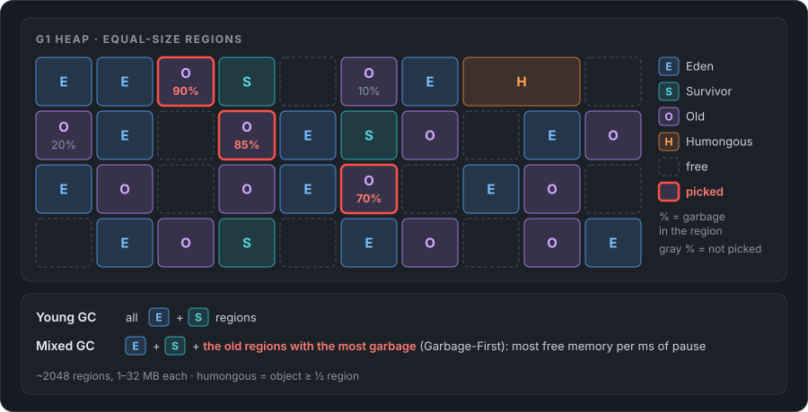
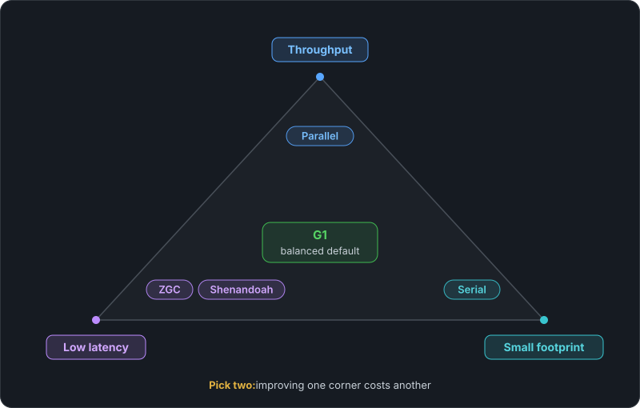
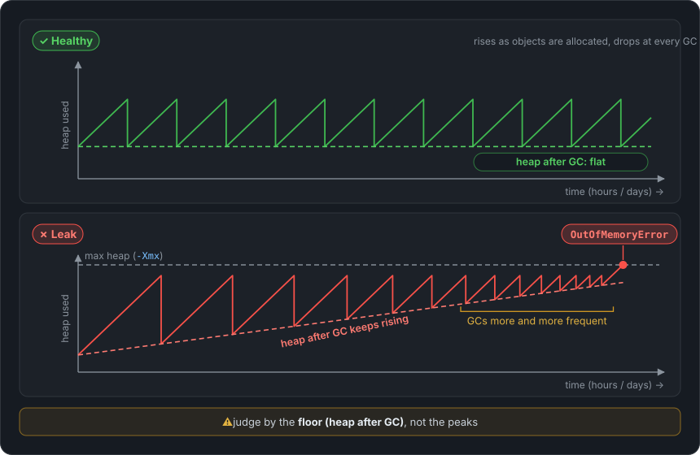
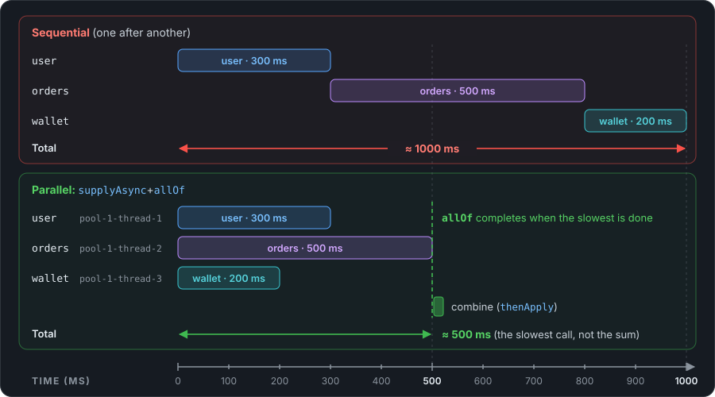

# Java

Interview-prep notes on Java internals. Written for modern Java (17 / 21 / 25 LTS), with notes where Java 8 differs.

## 📚 Table of Contents

**JVM Memory Model**

1. [What "Java memory model" means](#1-what-java-memory-model-means)
2. [The JVM's memory areas](#2-the-jvms-memory-areas)
3. [Stack vs heap: a walkthrough](#3-stack-vs-heap-a-walkthrough)
4. [The heap and its generations](#4-the-heap-and-its-generations)
5. [An object's life: Eden to Old](#5-an-objects-life-eden-to-old)
6. [Metaspace](#6-metaspace)
7. [Memory outside the heap](#7-memory-outside-the-heap)
8. [OutOfMemoryError: which area ran out?](#8-outofmemoryerror-which-area-ran-out)
9. [The JMM: visibility between threads](#9-the-jmm-visibility-between-threads)
10. [Memory interview questions](#10-memory-interview-questions)
11. [Memory cheat sheet](#11-memory-cheat-sheet)

**Garbage Collection**

1. [What is garbage collection?](#1-what-is-garbage-collection)
2. [How the GC finds garbage: GC roots](#2-how-the-gc-finds-garbage-gc-roots)
3. [The three basic algorithms](#3-the-three-basic-algorithms)
4. [Generational GC: minor, major, full](#4-generational-gc-minor-major-full)
5. [Stop-the-world pauses and safepoints](#5-stop-the-world-pauses-and-safepoints)
6. [Pros and cons of garbage collection](#6-pros-and-cons-of-garbage-collection)
7. [GC vs other ways to manage memory](#7-gc-vs-other-ways-to-manage-memory)
8. [The collectors: Serial to ZGC, pros and cons](#8-the-collectors-serial-to-zgc-pros-and-cons)
9. [G1, the default, in more detail](#9-g1-the-default-in-more-detail)
10. [Memory leaks: what GC can't fix](#10-memory-leaks-what-gc-cant-fix)
11. [Reference types: strong, soft, weak, phantom](#11-reference-types-strong-soft-weak-phantom)
12. [Choosing and tuning a collector](#12-choosing-and-tuning-a-collector)
13. [GC interview questions](#13-gc-interview-questions)
14. [GC cheat sheet](#14-gc-cheat-sheet)

**Memory Leaks**

1. [What is a memory leak in Java?](#1-what-is-a-memory-leak-in-java)
2. [Leak or something else?](#2-leak-or-something-else)
3. [Symptoms](#3-symptoms)
4. [Common causes, and how to fix each](#4-common-causes-and-how-to-fix-each)
5. [How to find a leak: the playbook](#5-how-to-find-a-leak-the-playbook)
6. [Reading a heap dump in Eclipse MAT](#6-reading-a-heap-dump-in-eclipse-mat)
7. [Flame graphs: finding the code that allocates](#7-flame-graphs-finding-the-code-that-allocates)
8. [Thread dumps: when threads are the problem](#8-thread-dumps-when-threads-are-the-problem)
9. [Off-heap (native) leaks](#9-off-heap-native-leaks)
10. [Fixing and preventing leaks](#10-fixing-and-preventing-leaks)
11. [Interview story: how I found and fixed a memory leak](#11-interview-story-how-i-found-and-fixed-a-memory-leak)
12. [Leak interview questions](#12-leak-interview-questions)
13. [Leak cheat sheet](#13-leak-cheat-sheet)

**JVM Warm-up: Why a Fresh App Is Slow**

1. [The symptom](#1-the-symptom)
2. [Why it's slow: the cold-start causes](#2-why-its-slow-the-cold-start-causes)
3. [How to confirm it's warm-up](#3-how-to-confirm-its-warm-up)
4. [How to fix it](#4-how-to-fix-it)
5. [Warm-up interview questions](#5-warm-up-interview-questions)
6. [Warm-up cheat sheet](#6-warm-up-cheat-sheet)

**Thread Pools and ThreadPoolExecutor**

1. [Why use a thread pool?](#1-why-use-a-thread-pool)
2. [ExecutorService basics](#2-executorservice-basics)
3. [ThreadPoolExecutor and its parameters](#3-threadpoolexecutor-and-its-parameters)
4. [What happens when you submit a task](#4-what-happens-when-you-submit-a-task)
5. [Choosing the queue](#5-choosing-the-queue)
6. [Rejection policies](#6-rejection-policies)
7. [The Executors shortcuts, and why to be careful](#7-the-executors-shortcuts-and-why-to-be-careful)
8. [How many threads?](#8-how-many-threads)
9. [Virtual threads (Java 21)](#9-virtual-threads-java-21)
10. [Shutting a pool down](#10-shutting-a-pool-down)
11. [Common mistakes](#11-common-mistakes)
12. [Thread pool interview questions](#12-thread-pool-interview-questions)
13. [Thread pool cheat sheet](#13-thread-pool-cheat-sheet)

**CompletableFuture**

1. [Why CompletableFuture?](#1-why-completablefuture)
2. [Creating one](#2-creating-one)
3. [Chaining steps](#3-chaining-steps)
4. [Running things in parallel and combining them](#4-running-things-in-parallel-and-combining-them)
5. [Handling errors](#5-handling-errors)
6. [Timeouts (Java 9+)](#6-timeouts-java-9)
7. [Which thread runs my code?](#7-which-thread-runs-my-code)
8. [A real-world example: an aggregated dashboard](#8-a-real-world-example-an-aggregated-dashboard)
9. [Common mistakes](#9-common-mistakes)
10. [CompletableFuture interview questions](#10-completablefuture-interview-questions)
11. [CompletableFuture cheat sheet](#11-completablefuture-cheat-sheet)

**Collections Internals**

1. [How HashMap works internally](#1-how-hashmap-works-internally)
2. [How ConcurrentHashMap works internally](#2-how-concurrenthashmap-works-internally)
3. [How CopyOnWriteArrayList works internally](#3-how-copyonwritearraylist-works-internally)
4. [Fail-fast vs fail-safe iterators](#4-fail-fast-vs-fail-safe-iterators)
5. [Collections interview questions](#5-collections-interview-questions)
6. [Collections cheat sheet](#6-collections-cheat-sheet)

**Strings: Why String Is Immutable**

1. [What "immutable" means for String](#1-what-immutable-means-for-string)
2. [The String pool](#2-the-string-pool)
3. [Why String is immutable](#3-why-string-is-immutable)
4. [How immutability is enforced](#4-how-immutability-is-enforced)
5. [The price, and StringBuilder](#5-the-price-and-stringbuilder)
6. [Strings interview questions](#6-strings-interview-questions)
7. [Strings cheat sheet](#7-strings-cheat-sheet)

**equals, hashCode, Immutability and Records**

1. [The equals() contract](#1-the-equals-contract)
2. [The hashCode() contract](#2-the-hashcode-contract)
3. [What breaks in a HashMap when you get it wrong](#3-what-breaks-in-a-hashmap-when-you-get-it-wrong)
4. [Writing equals and hashCode correctly](#4-writing-equals-and-hashcode-correctly)
5. [Immutable objects: why bother](#5-immutable-objects-why-bother)
6. [How to write an immutable class](#6-how-to-write-an-immutable-class)
7. [Records](#7-records)
8. [equals, hashCode and immutability interview questions](#8-equals-hashcode-and-immutability-interview-questions)
9. [equals, hashCode and immutability cheat sheet](#9-equals-hashcode-and-immutability-cheat-sheet)

**Reflection**

1. [What is reflection?](#1-what-is-reflection)
2. [The reflection API, with examples](#2-the-reflection-api-with-examples)
3. [Annotations + reflection: how frameworks work](#3-annotations--reflection-how-frameworks-work)
4. [Dynamic proxies](#4-dynamic-proxies)
5. [The costs and limits](#5-the-costs-and-limits)
6. [Reflection interview questions](#6-reflection-interview-questions)
7. [Reflection cheat sheet](#7-reflection-cheat-sheet)

**What's New in Java 8, 11, 17 and 21**

1. [Release model and the LTS versions](#1-release-model-and-the-lts-versions)
2. [Java 8 (2014): the big one](#2-java-8-2014-the-big-one)
3. [Java 11: what came after 8 (Java 9, 10, 11)](#3-java-11-what-came-after-8-java-9-10-11)
4. [Java 17: what came after 11 (Java 12 to 17)](#4-java-17-what-came-after-11-java-12-to-17)
5. [Java 21: what came after 17 (Java 18 to 21)](#5-java-21-what-came-after-17-java-18-to-21)
6. [After 21: Java 22 to 25](#6-after-21-java-22-to-25)
7. [Upgrading from Java 8: what breaks](#7-upgrading-from-java-8-what-breaks)
8. [Java versions interview questions](#8-java-versions-interview-questions)
9. [Java versions cheat sheet](#9-java-versions-cheat-sheet)

**JVM Flags Reference**

1. [How to read a JVM flag](#1-how-to-read-a-jvm-flag)
2. [Heap and memory](#2-heap-and-memory)
3. [Containers](#3-containers)
4. [Choosing a garbage collector](#4-choosing-a-garbage-collector)
5. [GC tuning](#5-gc-tuning)
6. [When things go wrong: OOM and crashes](#6-when-things-go-wrong-oom-and-crashes)
7. [Logging and diagnostics](#7-logging-and-diagnostics)
8. [JIT and startup](#8-jit-and-startup)
9. [Debugging, monitoring and app settings](#9-debugging-monitoring-and-app-settings)
10. [A production starter set](#10-a-production-starter-set)
11. [Flags interview questions](#11-flags-interview-questions)
12. [Flags cheat sheet](#12-flags-cheat-sheet)

---

# JVM Memory Model

## 1. What "Java memory model" means

People use the phrase for two different things, and interviewers mix them up too:

| Meaning | What it is about | Covered in |
|---|---|---|
| **JVM memory structure** (the "runtime data areas") | **Where** things live: heap, stack, metaspace, code cache. How memory is split, sized, and what fails when an area fills up. | Sections 2–8 |
| **The Java Memory Model (JMM)**, the spec in the JLS, chapter 17 | **When** a write by one thread becomes visible to another thread: happens-before, `volatile`, `synchronized`, `final`. | [Section 9](#9-the-jmm-visibility-between-threads) |

> [!TIP]
> **Interview tip:** if the question is just "explain the Java memory model", show you know both: *"Structurally, the JVM splits memory into a shared heap and metaspace plus a stack per thread. Formally, the JMM is the part of the language spec that defines visibility and ordering between threads through happens-before."* Then go deep on whichever one they meant.

---

## 2. The JVM's memory areas

When you run `java -jar app.jar`, the JVM is a single OS process. Inside it, memory is split into areas. Some are **shared by all threads**, the rest are **private to each thread**.


| Area | Shared? | What lives there | Size flag | When it's full |
|---|---|---|---|---|
| **Heap** | All threads | Every object and array (`new`), the String pool, static fields | `-Xms` (initial), `-Xmx` (max) | `OutOfMemoryError: Java heap space` |
| **Metaspace** | All threads | Class metadata: fields, methods, bytecode, the runtime constant pool | `-XX:MaxMetaspaceSize` (unlimited by default) | `OutOfMemoryError: Metaspace` |
| **Code cache** | All threads | Native machine code produced by the JIT compiler | `-XX:ReservedCodeCacheSize` (240 MB) | Warning *"CodeCache is full. Compiler has been disabled"*: the app keeps running, but slower |
| **Stack memory** (JVM stack) | Per thread | One **frame** per method call: local variables, operand stack, return address | `-Xss` (1 MB on 64-bit Linux) | `StackOverflowError` |
| **PC register** | Per thread | Address of the bytecode instruction the thread is executing | (none) | (cannot fill) |
| **Native method stack** | Per thread | Frames of native (C/C++) code called through JNI | (OS default) | `StackOverflowError` |

Two rules to remember:

- **The garbage collector only manages the heap** (and unloads dead classes from metaspace). Stack memory needs no GC: a frame disappears the moment its method returns.
- **Only the heap is limited by `-Xmx`.** Metaspace, code cache, thread stacks and direct buffers all come on top of it ([section 7](#7-memory-outside-the-heap)).

---

## 3. Stack vs heap: a walkthrough

```java
public class Demo {
    public static void main(String[] args) {
        int count = 3;
        Person p = new Person("Asha");
        greet(p, count);
    }

    static void greet(Person person, int times) {
        String msg = "Hi " + person.name;
        System.out.println(msg.repeat(times));
    }
}
```

Here is memory at the moment `greet` is running:


1. Each method call pushes a **frame** on the thread's stack. `main`'s frame holds `args`, `count` and `p`. Then `greet`'s frame goes on top with `person`, `times` and `msg`.
2. **Primitives** (`int count = 3`) are stored **in the frame** itself.
3. **Objects always live on the heap.** A variable like `p` holds only a **reference** (an address) to the object.
4. `greet(p, count)` **copies** both values into the new frame. For `p` the value copied is the reference, so `p` and `person` point to the **same** `Person` object.
5. The literal `"Asha"` lives in the **String pool**, which is part of the heap. `"Hi " + person.name` builds a **new** String at runtime, a normal heap object.
6. When `greet` returns, its frame is popped. Nothing references `"Hi Asha"` any more, so it becomes **garbage**, and the GC reclaims it later.

| | Stack | Heap |
|---|---|---|
| **Stores** | Frames: primitives and references to objects | All objects and arrays |
| **Owned by** | One thread (private) | All threads (shared) |
| **Lifetime** | Until the method returns | Until no longer reachable, then the GC frees it |
| **Allocation** | Push/pop a frame: extremely fast | Bump a pointer in a thread-local buffer: also fast, but the GC has to clean up |
| **Size** | Small, fixed per thread (`-Xss`, 1 MB default) | Large (`-Xmx`, default ¼ of RAM) |
| **Thread safety** | Safe: no other thread can see it | Needs synchronization if threads share objects |
| **Error** | `StackOverflowError` (recursion too deep) | `OutOfMemoryError: Java heap space` |

> [!TIP]
> **Interview tip: Java is always pass-by-value.** For objects, the *value* that gets copied is the reference. That's why a method can change the object the caller sees, but can't make the caller's variable point somewhere else:
>
> ```java
> static void rename(Person person) {
>     person.name = "Ravi";            // caller sees this: same object
>     person = new Person("Meera");    // caller does NOT see this: only the local copy changed
> }
> ```

> [!NOTE]
> **Escape analysis:** if the JIT proves an object never leaves the method (it "doesn't escape"), it may skip the heap allocation and keep the fields in registers or on the stack (*scalar replacement*). This is an optimization you can't see from the code. The language-level answer is still "objects live on the heap".

---

## 4. The heap and its generations

Most collectors split the heap into **generations**, because most objects die young (the *weak generational hypothesis*, see [GC section 4](#4-generational-gc-minor-major-full)). Collecting just the young part is cheap, so the GC does that often and touches the old part rarely.


| Part | What goes there | Collected by |
|---|---|---|
| **Eden** | Almost every new object | Minor GC (frequent, fast) |
| **Survivor S0 / S1** | Objects that survived at least one minor GC. Only one of the two is in use; the other is always empty and waits as the copy target. | Minor GC |
| **Old (Tenured)** | Objects that survived many minor GCs, plus very large objects | Major GC (rare, slower) |

**Default proportions** (Serial / Parallel GC):

- `-XX:NewRatio=2`: Old is twice Young, so Young ≈ ⅓ of the heap and Old ≈ ⅔.
- `-XX:SurvivorRatio=8`: Eden : S0 : S1 = 8 : 1 : 1.
- G1 (the default collector) doesn't use fixed, contiguous generations. It tags equal-sized **regions** as Eden, Survivor or Old and resizes young between 5% and 60% of the heap to meet its pause goal ([GC section 9](#9-g1-the-default-in-more-detail)). The idea of generations is the same.

**Why allocation is so fast: TLABs.** Each thread gets a private chunk of Eden, a **Thread-Local Allocation Buffer**. `new` only has to move a pointer forward inside that chunk: no lock and a handful of CPU instructions. This is usually faster than `malloc` in C.

| Flag | Meaning | Default |
|---|---|---|
| `-Xms` | Initial heap size | 1/64 of RAM |
| `-Xmx` | Maximum heap size | 1/4 of RAM (or of the container limit) |
| `-Xmn` | Young generation size | Derived from `NewRatio` |
| `-XX:NewRatio` | Old / Young size ratio | 2 |
| `-XX:SurvivorRatio` | Eden / one survivor ratio | 8 |
| `-XX:MaxTenuringThreshold` | Minor GCs survived before promotion to Old | 15 |

> [!TIP]
> **Interview tip:** for servers, set `-Xms` equal to `-Xmx`. The JVM then never has to grow or shrink the heap at runtime (each resize can trigger a full GC), and you find out at startup, not at 3 a.m., if the machine can't give you that memory.

---

## 5. An object's life: Eden to Old


1. `new Order()` is allocated in **Eden** (in the thread's TLAB).
2. Eden fills up → **minor GC**. Live objects in Eden and in the active survivor space (say S0) are **copied** to the empty survivor space (S1), and their **age** goes up by 1. Eden and S0 are then wiped in one go. Dead objects are never touched.
3. The next minor GC copies from Eden + S1 into S0. The two survivor spaces **swap roles** every time.
4. When an object's age reaches the **tenuring threshold** (`-XX:MaxTenuringThreshold`, default 15), the next minor GC **promotes** it to **Old** instead.
5. When Old fills up → **major GC** (Old only) or **full GC** (whole heap). These are the expensive ones.

Two shortcuts into Old:

- **Survivor overflow (premature promotion):** if the live objects don't fit in the survivor space, the rest go straight to Old, whatever their age. The JVM also lowers the threshold on its own when survivors get crowded.
- **Large objects:** a big array may be allocated directly in Old. In G1, any object of at least half a region is a **humongous object** and gets its own region(s).

> [!NOTE]
> The age lives in the object header in **4 bits**, which is why the threshold can't go above 15.

> [!WARNING]
> ⚠️ **Premature promotion** is a classic GC problem. Short-lived objects that get pushed into Old fill it with garbage, which only a major GC can clean. Frequent major/full GCs follow. The usual fix is a bigger young generation or bigger survivor spaces, so these objects die in Young where they're cheap.

---

## 6. Metaspace

Every class the JVM loads has **metadata**: its name, fields, method bytecode, the runtime constant pool. That metadata lives in **Metaspace**, which is **native (OS) memory**, outside the heap.


| | Metaspace |
|---|---|
| **Where** | Native (OS) memory, not part of `-Xmx` |
| **Holds** | Class metadata only: fields, methods, bytecode, runtime constant pool |
| **Size** | Grows as needed. Unlimited unless you set `-XX:MaxMetaspaceSize` |
| **GC trigger** | `-XX:MetaspaceSize`: when usage reaches this level, a GC runs to unload dead classes |
| **Freed when** | The GC unloads classes whose ClassLoader is unreachable |
| **Error when full** | `OutOfMemoryError: Metaspace` |

**Where do `static` fields live?** On the **heap**, inside the class's `java.lang.Class` object. The *bytecode* of static methods is metadata, so it's in metaspace.

**When are classes unloaded?** Only when their **ClassLoader** becomes unreachable. Classes loaded by the application class loader stay for the life of the JVM.

> [!WARNING]
> ⚠️ **Metaspace leaks** are ClassLoader leaks. Typical causes: hot-redeploying a web app in Tomcat while something (a thread, a JDBC driver, a `ThreadLocal`) still references the old loader; or generating classes without end (dynamic proxies, CGLIB, Groovy/script engines compiling on every request). Metaspace is unlimited by default, so such a leak eats the machine's memory. Set `-XX:MaxMetaspaceSize` in production to get a clear error instead.

---

## 7. Memory outside the heap

`-Xmx` is **not** the JVM's memory use. The process (its RSS) uses roughly:

> **total ≈ heap + metaspace + code cache + (threads × stack size) + direct buffers + GC and JIT internals**


| Area | Typical size | Notes |
|---|---|---|
| **Heap** | `-Xmx` | The only part `-Xmx` controls |
| **Metaspace** | 50–300 MB for a Spring Boot app | More classes = more metaspace |
| **Code cache** | Up to 240 MB | JIT-compiled methods |
| **Thread stacks** | threads × 1 MB | 500 threads ≈ 500 MB reserved (only touched pages count in RSS) |
| **Direct buffers** | Up to `-XX:MaxDirectMemorySize` (default ≈ `-Xmx`) | `ByteBuffer.allocateDirect`, NIO, Netty. Freed only when the owning buffer object is collected |
| **GC / JIT / symbols** | 5–15% of heap | G1's remembered sets, card tables, compiler threads |

**Containers.** Since Java 10 (and 8u191) the JVM reads the container's memory limit and sizes the default heap from it. Prefer a percentage over a fixed `-Xmx`:

```bash
java -XX:MaxRAMPercentage=75.0 -jar app.jar     # heap = 75% of the container limit
```

> [!CAUTION]
> **`-Xmx` equal to the container limit is a classic outage.** The heap fits, but heap plus everything else doesn't. The kernel's OOM killer ends the process (**exit code 137, `OOMKilled`**). The JVM gets no chance to throw `OutOfMemoryError` or write a heap dump, so the logs show nothing. Leave 25% or more headroom for non-heap memory.

> [!TIP]
> **Interview tip:** to see where non-heap memory goes, start with `-XX:NativeMemoryTracking=summary` and run `jcmd <pid> VM.native_memory summary`.

---

## 8. OutOfMemoryError: which area ran out?

The message after `OutOfMemoryError:` tells you which area ran out, and that tells you where to look:

| Message | Area | Typical cause | First thing to do |
|---|---|---|---|
| `Java heap space` | Heap | A leak (something keeps references) or a heap that's just too small | Take a heap dump and open it in Eclipse MAT |
| `GC overhead limit exceeded` | Heap | Over 98% of time spent in GC while recovering under 2% of the heap (Parallel GC). Almost always a leak | Same as above |
| `Metaspace` | Metaspace | Too many classes, or a ClassLoader leak | Count loaded classes (`jcmd <pid> VM.classloader_stats`) |
| `unable to create native thread` | Native memory / OS | Too many threads: OS limit (`ulimit -u`), container PID limit, or no memory left for stacks | Use thread pools; look for thread leaks |
| `Direct buffer memory` | Direct memory | NIO buffers not released, or a limit set too low | Check `MaxDirectMemorySize`, buffer pooling |
| `Requested array size exceeds VM limit` | Heap | An array bigger than the JVM allows (near `Integer.MAX_VALUE`) | Fix the code |
| `StackOverflowError` *(an `Error`, not an OOM)* | Thread stack | Infinite or very deep recursion | Fix the recursion; raise `-Xss` only if the depth is legitimate |

Always run production JVMs with:

```bash
-XX:+HeapDumpOnOutOfMemoryError -XX:HeapDumpPath=/dumps/   # dump the heap when it happens
-XX:+ExitOnOutOfMemoryError                                  # then exit, so the orchestrator restarts it
```

> [!IMPORTANT]
> **Key takeaway:** after an `OutOfMemoryError` the JVM is in an unknown state. Some thread died halfway through its work. Don't catch it and carry on: dump, exit, restart.

---

## 9. The JMM: visibility between threads

This is the *other* "Java memory model": the rules for what one thread is guaranteed to see of another thread's writes.

**Why rules are needed.** Each CPU core has its own caches and store buffers, and the compiler, the JIT and the CPU all **reorder** instructions when the result looks the same *to a single thread*. Without rules, a write made by one thread might reach another thread late, in a different order, or (in a loop the JIT has optimized) never.

The JMM deals with three problems:

| Problem | What goes wrong | Fixed by |
|---|---|---|
| **Visibility** | Thread B keeps reading a stale value that thread A already changed | `volatile`, `synchronized`, `Lock`, atomics |
| **Ordering** | Writes become visible in a different order than the code wrote them | `volatile`, `synchronized` (both create happens-before edges) |
| **Atomicity** | `count++` is read, add, write: two threads can interleave and lose an update | `synchronized`, `Lock`, `AtomicInteger` / `LongAdder` |

### The classic visibility bug

```java
class Worker implements Runnable {
    private boolean running = true;          // fix: private volatile boolean running

    public void stop() { running = false; }  // called by thread 2

    public void run() {
        while (running) {                    // thread 1 may never see false
            // busy work, no synchronization
        }
    }
}
```


Without `volatile`, the JIT is allowed to read `running` **once** and turn the loop into `while (true)`. The loop then never ends, even though another thread set the flag long ago. With `volatile`, every read sees the latest write.

> [!NOTE]
> The caches in the diagram are a mental model. The JMM itself says nothing about caches. It is defined in terms of **happens-before**, so the guarantees hold on any CPU.

### Happens-before

If action A **happens-before** action B, then B is guaranteed to see everything A (and everything before A in its thread) wrote. The main rules:

1. **Program order:** within one thread, each action happens-before the next one.
2. **Monitor lock:** unlocking a monitor (end of a `synchronized` block) happens-before every later lock of the **same** monitor.
3. **Volatile:** a write to a `volatile` field happens-before every later read of that field.
4. **Thread start:** `t.start()` happens-before anything the started thread does.
5. **Thread join:** everything a thread does happens-before another thread returns from `t.join()` on it.
6. **Final fields:** after a constructor finishes, other threads see the correct values of its `final` fields (as long as `this` didn't escape during construction).
7. **Transitivity:** if A happens-before B and B happens-before C, then A happens-before C.

### volatile vs synchronized vs atomics

| | Visibility | Ordering | Atomic compound actions (`x++`, check-then-act) | Blocks other threads? |
|---|---|---|---|---|
| `volatile` | ✅ | ✅ | ❌ | No |
| `synchronized` / `Lock` | ✅ | ✅ | ✅ | Yes |
| `AtomicInteger` and friends | ✅ | ✅ | ✅ for one variable (CAS) | No (lock-free) |

> [!WARNING]
> ⚠️ `volatile int count; count++` is **still a race**. `volatile` makes each read and write visible, but `++` is three steps and two threads can interleave them. Use `AtomicInteger.incrementAndGet()` or `LongAdder` (better under heavy contention).

### Double-checked locking needs volatile

```java
class Config {
    private static volatile Config instance;   // without volatile, this is broken

    static Config get() {
        if (instance == null) {                 // 1st check, no lock (fast path)
            synchronized (Config.class) {
                if (instance == null) {         // 2nd check, under the lock
                    instance = new Config();
                }
            }
        }
        return instance;
    }
}
```

`instance = new Config()` is three steps: allocate memory, run the constructor, store the reference. Without `volatile`, the store can become visible **before** the constructor has finished. Another thread then passes the first check and uses a half-built object. `volatile` forbids that reordering.

> [!TIP]
> **Interview tip:** the simplest safe lazy singleton needs no `volatile` at all. Use the holder idiom, which relies on class initialization being thread-safe, or an `enum`:
>
> ```java
> class Config {
>     private static class Holder { static final Config INSTANCE = new Config(); }
>     static Config get() { return Holder.INSTANCE; }   // loaded on first call only
> }
> ```

---

## 10. Memory interview questions

<details>
<summary><b>Q1. What are the JVM's memory areas?</b></summary>

Shared by all threads: the **heap** (objects, arrays, String pool, static fields), **metaspace** (class metadata, in native memory) and the **code cache** (JIT-compiled code). Private to each thread: the **JVM stack** (one frame per method call), the **PC register** and the **native method stack**. The GC manages the heap. Stack frames go away when their method returns.
</details>

<details>
<summary><b>Q2. What is stored on the stack and what on the heap?</b></summary>

The stack holds frames with local primitives and **references**. Every object and array lives on the heap, including objects created inside a method; only the reference to it sits in the frame. The stack is per-thread and freed on return. The heap is shared and cleaned by the GC.
</details>

<details>
<summary><b>Q3. Is Java pass-by-value or pass-by-reference?</b></summary>

Always pass-by-value. For objects the value is the reference, copied into the callee's frame. The callee can mutate the shared object, but reassigning its parameter doesn't affect the caller's variable.
</details>

<details>
<summary><b>Q4. Why is the heap split into Young and Old generations?</b></summary>

Most objects die young. Collecting just the young generation is cheap, because a copying collector only touches the few live objects. Long-lived objects are moved to Old, which is collected much less often. So most GCs are short minor GCs, and the expensive work happens rarely.
</details>

<details>
<summary><b>Q5. Why are there two survivor spaces?</b></summary>

Young GC is a copying collector: live objects are copied from Eden and one survivor space into the other, empty one, and then Eden and the source are wiped in one go. That needs an empty target every time, so there are two spaces that swap roles. The copy also compacts survivors, so Young never fragments.
</details>

<details>
<summary><b>Q6. When does an object move to the Old generation?</b></summary>

When its age (minor GCs survived) reaches the tenuring threshold, 15 by default. It also goes early when the survivor space overflows (premature promotion), and very large objects (G1: humongous, at least half a region) go to Old directly.
</details>

<details>
<summary><b>Q7. What is Metaspace, and how can it run out?</b></summary>

Metaspace holds class metadata (fields, methods, bytecode, constant pool) in native memory, outside the heap and outside `-Xmx`. It grows as needed and is unlimited by default. Classes are unloaded only when their ClassLoader becomes unreachable, so it runs out through ClassLoader leaks (hot redeploys) or endless generated classes (proxies, CGLIB, script engines). Cap it with `-XX:MaxMetaspaceSize` to get a clear `OutOfMemoryError: Metaspace` instead of eating the machine's memory.
</details>

<details>
<summary><b>Q8. A container with a 2 GB limit runs <code>-Xmx2g</code> and gets OOMKilled. Why?</b></summary>

`-Xmx` limits only the heap. Metaspace, code cache, thread stacks, direct buffers and GC structures come on top, so the process goes over 2 GB and the kernel kills it (exit 137). There's no Java `OutOfMemoryError` and no heap dump. Use `-XX:MaxRAMPercentage=75` or an `-Xmx` well below the limit.
</details>

<details>
<summary><b>Q9. StackOverflowError vs OutOfMemoryError?</b></summary>

`StackOverflowError` means one thread's stack ran out of frames, almost always from infinite or very deep recursion. `OutOfMemoryError` means some memory area (heap, metaspace, native memory for threads, direct memory) couldn't satisfy an allocation; the message names the area. Both are `Error`s, not `Exception`s.
</details>

<details>
<summary><b>Q10. What does <code>volatile</code> guarantee, and what not?</b></summary>

It guarantees visibility (every read sees the latest write) and ordering (a volatile write happens-before every later read of that field, and it can't be reordered with the writes before it). It does **not** make compound actions like `count++` or check-then-act atomic. For those, use `synchronized`, a `Lock` or an atomic class.
</details>

<details>
<summary><b>Q11. What is happens-before?</b></summary>

The JMM's core relation: if A happens-before B, B sees all of A's effects. Edges come from program order, unlock → later lock of the same monitor, volatile write → later read, `Thread.start`, `Thread.join`, and final-field freezing at the end of a constructor, and they are transitive. If two conflicting accesses aren't ordered by happens-before, you have a data race.
</details>

<details>
<summary><b>Q12. Why does double-checked locking need volatile?</b></summary>

`instance = new X()` can be reordered so that the reference is published before the constructor finishes. A second thread then sees a non-null but half-initialized object on the unlocked first check. `volatile` forbids that reordering. The holder idiom or an enum avoids the problem altogether.
</details>

---

## 11. Memory cheat sheet

| Topic | Remember |
|---|---|
| Shared areas | Heap (objects, String pool, statics), Metaspace (class metadata), Code cache (JIT code) |
| Per-thread areas | JVM stack (frames), PC register, native method stack |
| Stack holds | Primitives and references. Objects are always on the heap |
| Passing arguments | Always by value. For objects, the reference is copied |
| Heap layout | Young = Eden + S0 + S1 (8:1:1), Old. Young ≈ ⅓ by default |
| Promotion | Age 15 (`MaxTenuringThreshold`), survivor overflow, or a huge object |
| Allocation | Bump-the-pointer in a TLAB: no lock, very fast |
| Metaspace | Class metadata in native memory, unlimited by default → cap with `MaxMetaspaceSize` |
| Statics, String pool | On the heap |
| `-Xmx` | Heap only. Process memory = heap + metaspace + code cache + stacks + direct + GC |
| Containers | `-XX:MaxRAMPercentage=75`. Exit 137 = OOMKilled by the kernel |
| Production flags | `-Xms = -Xmx`, `HeapDumpOnOutOfMemoryError`, `ExitOnOutOfMemoryError`, `MaxMetaspaceSize` |
| JMM problems | Visibility, ordering, atomicity |
| `volatile` | Visibility + ordering, **no** atomicity |
| Safe lazy singleton | Holder idiom or `enum`. DCL only with `volatile` |

---

# Garbage Collection

## 1. What is garbage collection?

**Garbage collection (GC)** is automatic memory management. The JVM finds objects your program can no longer reach and reclaims their memory. You write `new`, and there is never a `free` or `delete`.

Compare that to C, where you `malloc` and must `free` by hand:

| Bug in manual memory management | What happens | With Java's GC |
|---|---|---|
| Forgetting to `free` | Memory leak | Unreachable objects are reclaimed automatically |
| Using memory after `free` (*dangling pointer*) | Reads garbage, corrupts data, security holes | Impossible: memory is only reclaimed when nothing can reach it |
| Calling `free` twice (*double free*) | Heap corruption, crash | Impossible: there's no `free` |

A garbage collector does four jobs:

1. **Allocate** memory for new objects (fast, from Eden).
2. **Find** which objects are still live (reachable).
3. **Reclaim** the memory of everything else.
4. **Compact** (most collectors): move live objects together, so free memory is one block instead of scattered holes.

---

## 2. How the GC finds garbage: GC roots

Java's GC is a **tracing** collector. It doesn't count references. Instead it starts from a set of **GC roots** and follows every reference. Whatever it reaches is **live**. Everything else is **garbage**, however many references the garbage objects hold to each other.


**GC roots** include:

- **Local variables and parameters** in the stack frames of every live thread
- **Static fields** of loaded classes
- **Active threads** themselves
- **JNI references** held by native code
- Objects used as **monitors** by `synchronized` blocks that are currently held

**When does an object become garbage?** When the last path from a root disappears: the variable goes out of scope (method returned), it's set to `null`, it's reassigned to another object, or the object is only reachable from other garbage (an **island of isolation**).

> [!TIP]
> **Interview tip: why not reference counting?** Counting can't free **cycles**: A → B → A keeps both counts at 1 forever, even when nothing else points at them. Tracing from roots handles cycles for free. Reference counting also costs an update on every pointer assignment, which is slow with threads (the counts must be atomic).

---

## 3. The three basic algorithms

Every Java collector is built from three building blocks:


| Algorithm | How | Pros | Cons | Used for |
|---|---|---|---|---|
| **Mark-sweep** | Mark live objects, then add the space of unmarked ones to a free list | Simple, objects don't move | **Fragmentation**: plenty of free memory in total, but no hole big enough for a large object. Allocation from free lists is slower | CMS old generation |
| **Mark-compact** | Mark, then slide live objects together to one end | No fragmentation, bump-pointer allocation | Moving objects and fixing all references is slow (a pause, unless done concurrently) | Old generation in Serial/Parallel, full GCs |
| **Copying** | Copy live objects to an empty space; the old space becomes entirely free | Cost depends only on **live** objects, compacts as it goes | Needs spare empty space; expensive when most objects survive | Young generation (Eden → survivor) in all collectors |

> [!IMPORTANT]
> **Key takeaway:** copying is perfect for Young, where almost everything is dead and only a few objects get copied. It's a poor fit for Old, where almost everything is alive. That's the reason for generations.

---

## 4. Generational GC: minor, major, full

**The weak generational hypothesis:** *most objects die young.* Think of the iterators, temporary strings, DTOs and lambdas created for one request and dropped right after. A few objects (caches, connection pools, Spring beans) live as long as the app.

So the heap is split ([memory section 4](#4-the-heap-and-its-generations)), and each part is collected differently:

| GC type | What it collects | How often | Cost |
|---|---|---|---|
| **Minor (young) GC** | Young generation only (Eden + survivors) | Very often (seconds or less) | Short pause, proportional to **live** young objects |
| **Major (old) GC** | Old generation | Rarely | Longer; concurrent in CMS/G1/ZGC |
| **Mixed GC** (G1 only) | Young + the old regions with the most garbage | After a concurrent mark | Short, bounded by the pause target |
| **Full GC** | The whole heap (and metaspace) | Should be very rare | Longest pause. A sign something is wrong in G1/ZGC |

**How a minor GC avoids scanning Old.** An old object may reference a young one, which makes that young object live. Scanning all of Old to find such pointers would defeat the purpose. So the JVM uses a **write barrier**: every time the app stores a reference into an old object, the JVM marks that small area of memory as "dirty" in a **card table** (G1 uses per-region *remembered sets*). A minor GC only scans the dirty cards.

---

## 5. Stop-the-world pauses and safepoints

A **stop-the-world (STW) pause** is a moment when every application thread is frozen so the GC can work. Why stop? The GC is following and moving references. If the app kept changing them at the same time, the GC could miss a live object and free it.


**Safepoints.** Threads can't be stopped at an arbitrary instruction, because the JVM must know exactly where every reference is. So the JIT puts **safepoint polls** at method returns and loop back-edges. When the GC wants a pause, it raises a flag. Each thread stops at its next poll, and the pause starts when the **last** one arrives.

> [!WARNING]
> ⚠️ **Time-to-safepoint** counts as pause time too. A long loop over an `int` counter (a *counted loop*) used to contain no poll, so one thread could keep everyone else waiting for seconds. Modern JITs insert polls in such loops (*loop strip mining*), but this is still a known cause of pauses that GC logs alone don't explain.

**Why pauses matter:**

- A request that arrives during a 500 ms pause waits 500 ms. This shows up in **p99 / p999 latency**, not in the average.
- A long pause can miss a **heartbeat**: a load balancer marks the instance unhealthy, or a Kafka consumer or ZooKeeper session times out and triggers a rebalance or failover.

**How concurrent collectors cut pauses.** CMS, G1, ZGC and Shenandoah do most of their marking (and, in ZGC/Shenandoah, also moving) **while the app runs**, using **barriers** (small pieces of code the JIT inserts on reference reads and writes) to keep track of what the app changes. They still pause, but only for short, fixed steps. The price is CPU taken from the app and more complexity.

---

## 6. Pros and cons of garbage collection


### ✅ Pros

1. **Memory safety.** No dangling pointers, no use-after-free, no double free. In C and C++ these are among the most common causes of crashes and security holes; Java removes the whole class of bugs.
2. **No forgotten frees.** You can't forget to release memory, because you never release it. (You can still leak by holding references, see the cons.)
3. **Very fast allocation.** `new` is a pointer bump in the thread's TLAB: no lock and a few instructions. That's often faster than `malloc`, which has to search free lists.
4. **No fragmentation.** Compacting and copying collectors keep live objects together, so the next allocation always finds space. As a bonus, objects allocated together sit together in memory, which helps the CPU cache.
5. **Cycles are free.** Tracing from roots collects circular structures (doubly linked lists, parent ↔ child, graphs) without any extra work.
6. **Simpler code and APIs.** No "who owns this pointer, who frees it" rules in every API. Libraries can pass objects around freely. Concurrent lock-free data structures are much easier to write, because a node is never freed while another thread may still read it.
7. **Tunable without code changes.** You can switch collector or pause goal with a JVM flag when the workload changes.

### ❌ Cons

1. **Stop-the-world pauses.** The app freezes during (parts of) a collection. That hurts tail latency, timeouts and heartbeats. Modern collectors (G1, ZGC, Shenandoah) make pauses short, but not zero.
2. **CPU overhead.** GC threads, plus read/write barriers in your own code, take CPU from the app. Low-pause collectors usually cost more CPU, not less.
3. **Memory overhead.** A GC needs headroom to work well. A heap only slightly bigger than the live data means constant collections. Rule of thumb: give the heap 2–3× the live data size. Copying needs an empty target space, and GC bookkeeping (card tables, remembered sets) costs memory too.
4. **Non-deterministic freeing.** You don't know **when** an object's memory will be reclaimed, or whether it will be at all before exit. So never rely on the GC to release **resources** like files, sockets or locks: use `try-with-resources`. `finalize()` was unreliable for exactly this reason and is deprecated for removal.
5. **Leaks are still possible.** The GC frees only what's unreachable. An object you no longer need but still reference (a static map that only grows, a listener never removed) is a leak the GC can't see ([section 10](#10-memory-leaks-what-gc-cant-fix)).
6. **Tuning is hard.** Problems tend to appear only under production load, and the knobs (heap size, generation sizes, pause targets, collector choice) interact with each other.
7. **Less control over memory.** You can't place objects exactly where you want or free them at a chosen moment. Systems that need this (databases, trading engines, Kafka, Netty) go off-heap with direct buffers or the Foreign Memory API.

> [!TIP]
> **Interview tip, a one-liner:** *"GC trades some CPU, memory headroom and pause time for memory safety and developer productivity. Modern collectors such as ZGC have made the pause part very small, so for most services the trade is clearly worth it."*

---

## 7. GC vs other ways to manage memory

| Approach | Languages | Memory safe? | Pauses | Runtime overhead | Cycles | Effort for you |
|---|---|---|---|---|---|---|
| **Manual** (`malloc` / `free`) | C | ❌ | None | Lowest | Your problem | High: every allocation needs a matching free |
| **RAII / smart pointers** | C++ (`unique_ptr`, `shared_ptr`) | Mostly | None | Low (`shared_ptr` counts are atomic) | `shared_ptr` cycles leak; use `weak_ptr` | Medium |
| **Reference counting** | Swift (ARC), CPython (+ a cycle collector), Objective-C | ✅ | None, but freeing a big structure can take a while | A count update on every reference copy | Leak without weak refs (Swift) or a backup collector (CPython) | Low–medium |
| **Ownership / borrow checker** | Rust | ✅ (checked at compile time) | None | Lowest | Need `Rc` + `Weak` | High at first: the compiler enforces the rules |
| **Tracing GC** | Java, Go, C#, JavaScript, Kotlin | ✅ | Yes (very short in modern GCs) | GC threads + barriers + headroom | ✅ handled | Lowest |

---

## 8. The collectors: Serial to ZGC, pros and cons

The JVM ships several collectors. You pick one with a flag; your code stays the same.

| Collector | Flag | Status | How it works |
|---|---|---|---|
| **Serial** | `-XX:+UseSerialGC` | Available | One GC thread, stops the world for every collection. Copying in Young, mark-compact in Old |
| **Parallel** | `-XX:+UseParallelGC` | Available. **Default in Java 8** | Like Serial, but many GC threads. Also stops the world for every collection |
| **CMS** | `-XX:+UseConcMarkSweepGC` | Deprecated in 9, **removed in 14** | Marks and sweeps Old concurrently. Doesn't compact |
| **G1** | `-XX:+UseG1GC` | **Default since Java 9** | Heap in equal regions; collects the regions with the most garbage first, aiming for a pause target |
| **ZGC** | `-XX:+UseZGC` | Production since 15. Generational since 21, the only mode since 24 | Marks **and moves** objects concurrently, using colored pointers and load barriers |
| **Shenandoah** | `-XX:+UseShenandoahGC` | Production since 15 (in OpenJDK builds, not Oracle JDK) | Concurrent moving too, using load barriers and forwarding pointers |
| **Epsilon** | `-XX:+UseEpsilonGC` | Experimental (Java 11) | Allocates, never collects. For tests and very short jobs |

### Pros and cons of each

| Collector | ✅ Pros | ❌ Cons | Best for |
|---|---|---|---|
| **Serial** | Smallest memory and CPU overhead, simple, predictable | Pause grows with heap size; uses one core | Small heaps (≤ ~100 MB), 1-CPU containers, CLI tools |
| **Parallel** | **Highest throughput**: the least total CPU spent on GC | Long pauses that grow with heap size (seconds on big heaps) | Batch jobs, data processing, anything that doesn't serve users live |
| **CMS** | Short old-gen pauses (it was the low-latency choice before G1) | No compaction → fragmentation → *concurrent mode failure* → long single-threaded full GC. High CPU. Removed | Only legacy Java 8 systems |
| **G1** | Good balance: pause target (default 200 ms), compacts incrementally, handles big heaps, little tuning needed | More CPU and memory overhead than Parallel; pauses are tens of ms, not sub-ms; humongous objects can hurt | **The default for most services**, heaps from ~4 to ~32 GB |
| **ZGC** | Pauses **under 1 ms** whatever the heap size (up to 16 TB); compacts concurrently | Uses more CPU and some more memory; somewhat lower throughput than Parallel/G1 | Latency-sensitive services, very large heaps |
| **Shenandoah** | Very short pauses, independent of heap size; also works well on smaller heaps | Load-barrier CPU cost; not in Oracle JDK builds | Low-latency services on Red Hat / OpenJDK builds |
| **Epsilon** | Zero GC overhead | The JVM dies with OOM when the heap is full | Benchmarks, measuring allocation, ultra-short-lived jobs |

> [!NOTE]
> **The default isn't always G1.** If the JVM thinks it's on a small machine (fewer than 2 CPUs **or** less than ~1792 MB of memory, which includes small containers), it picks **Serial**. Check with `java -XX:+PrintCommandLineFlags -version`.

---

## 9. G1, the default, in more detail

G1 ("Garbage-First") doesn't split the heap into one young and one old block. It cuts the heap into about **2048 equal regions** (1–32 MB each, picked from the heap size), and each region gets a role: Eden, Survivor, Old, Humongous or free.



**The G1 cycle:**

1. **Young GC (STW, parallel).** Copies live objects out of all Eden and Survivor regions into new Survivor/Old regions. G1 picks the number of Eden regions so the pause meets `-XX:MaxGCPauseMillis` (default **200 ms**).
2. **Concurrent marking.** When Old fills past a threshold (`-XX:InitiatingHeapOccupancyPercent`, 45% by default, then adapted), G1 marks live objects in Old **while the app runs**, with two short STW steps (*remark*, *cleanup*). Now G1 knows how much garbage each old region holds.
3. **Mixed GCs (STW).** The next few young GCs also take the old regions with the **most garbage**, as many as fit in the pause target. That's the *garbage-first* idea: the most free memory per millisecond of pause. Completely empty regions are freed right away.
4. **Full GC (fallback).** If the app allocates faster than G1 can clean (*evacuation failure*), G1 falls back to a full, compacting, STW collection. Seeing these in the logs means G1 needs help (more heap, an earlier IHOP, or less allocation).

> [!WARNING]
> ⚠️ **Humongous objects** (at least half a region in size) get their own contiguous region(s) directly in Old. Many short-lived big arrays (large byte buffers, big JSON strings) fill Old quickly and can trigger full GCs. Fix: a bigger region size (`-XX:G1HeapRegionSize`) or smaller objects.

> [!TIP]
> **Interview tip:** `MaxGCPauseMillis` is a **goal**, not a guarantee. A very low goal makes G1 use a tiny young generation, which means more frequent GCs and less throughput. Usually set it once, then leave the young generation size alone so G1 can adapt (setting `-Xmn` disables the pause-goal tuning).

---

## 10. Memory leaks: what GC can't fix

A Java memory leak is an object that is **still reachable but never used again**. The GC can't tell "reachable" from "useful", so it keeps it forever.

```java
public class OrderService {
    private static final Map<String, Order> CACHE = new HashMap<>();   // lives as long as the class

    public Order load(String id) {
        return CACHE.computeIfAbsent(id, this::fetch);   // grows forever: nothing is ever removed
    }
}
```

Causes, how to find a leak (heap dump, Eclipse MAT, flame graphs, thread dumps) and how to fix it are covered in the [Memory Leaks](#1-what-is-a-memory-leak-in-java) part below.

---

## 11. Reference types: strong, soft, weak, phantom

`java.lang.ref` lets you hold an object **without** fully keeping it alive, so the GC can still reclaim it.

| Type | When the GC clears it | `get()` returns | Typical use |
|---|---|---|---|
| **Strong** (normal variable) | Never, while reachable | The object | Everything by default |
| **Soft** (`SoftReference`) | Only when memory is tight, before throwing `OutOfMemoryError` | The object, or `null` once cleared | Memory-sensitive caches (but prefer a sized cache like Caffeine) |
| **Weak** (`WeakReference`) | At the next GC, once only weak references remain | The object, or `null` once cleared | `WeakHashMap` (keys), canonical maps, `ThreadLocal`'s internal keys, listeners |
| **Phantom** (`PhantomReference`) | After the object is finalized and only phantom refs remain | Always `null` | Cleanup after the object is gone: `java.lang.ref.Cleaner`, the replacement for `finalize()` |

```java
Map<Widget, Metadata> meta = new WeakHashMap<>();
meta.put(widget, new Metadata());
widget = null;   // no strong refs left: the next GC removes the entry automatically
```

---

## 12. Choosing and tuning a collector

Every collector trades between three goals. You can get two at most:



| If you need… | Pick | Why |
|---|---|---|
| A normal web service / microservice | **G1** (the default) | Balanced; pauses in the tens of ms with little tuning |
| p99 latency in single-digit ms, or a heap of tens of GB or more | **ZGC** | Sub-millisecond pauses whatever the heap size |
| Maximum throughput for a batch job | **Parallel** | Least CPU spent on GC; pauses don't matter |
| A tiny container or CLI tool | **Serial** | Lowest overhead |

**Tuning steps:**

1. **Turn on GC logging first** and measure. Never tune blind.
   ```bash
   -Xlog:gc*:file=gc.log:time,uptime,level,tags:filecount=5,filesize=20m   # Java 9+
   -XX:+PrintGCDetails -XX:+PrintGCDateStamps -Xloggc:gc.log              # Java 8
   ```
2. **Size the heap.** `-Xms = -Xmx`, about 2–3× the live data that remains after a full GC.
3. **Pick the collector** from the table above.
4. **Set one goal** (for example `-XX:MaxGCPauseMillis=100` on G1) and let the collector adapt. Avoid stacking many flags.
5. **Reduce allocation.** Fewer temporary objects means fewer GCs, and this often beats any flag. Use a profiler (JFR, async-profiler) to find allocation hot spots.
6. **Re-measure under real load**, then change one thing at a time.

**Tools:**

| Tool | What it shows |
|---|---|
| `jstat -gcutil <pid> 1000` | Occupancy of each generation and GC counts/time, every second |
| `jcmd <pid> GC.heap_info` | Current heap layout and usage |
| `jcmd <pid> GC.heap_dump <file>` | Heap dump for leak analysis |
| **JFR** (`-XX:StartFlightRecording`) + JDK Mission Control | GC pauses, allocation hot spots, low overhead enough for production |
| **GCeasy** / GCViewer | Charts and stats from a GC log |
| **Eclipse MAT** | Heap dump analysis: leak suspects, dominator tree |

> [!WARNING]
> ⚠️ **`System.gc()`** is only a hint. The JVM may ignore it, and when it doesn't, it usually triggers a **full** GC. Calling it from code is almost always wrong. `-XX:+DisableExplicitGC` turns it off. Likewise, don't use **`finalize()`**: it runs late or never, slows down GC, and has been deprecated for removal since Java 18. Use `try-with-resources` or `Cleaner`.

---

## 13. GC interview questions

<details>
<summary><b>Q1. How does the JVM decide an object is garbage?</b></summary>

By reachability. The GC starts from GC roots (locals and parameters in live stack frames, static fields, active threads, JNI references, held monitors) and follows every reference. Anything it can't reach is garbage, including cycles of objects that only reference each other. Java does not use reference counting.
</details>

<details>
<summary><b>Q2. What are the pros and cons of garbage collection?</b></summary>

Pros: memory safety (no dangling pointers or double frees), no forgotten frees, very fast bump-pointer allocation, compaction without fragmentation, cycles handled automatically, simpler code and APIs, and tunable with flags. Cons: stop-the-world pauses that hurt tail latency, CPU overhead (GC threads and barriers), extra memory headroom, non-deterministic freeing (so resources need `try-with-resources`), leaks still possible through lingering references, and tuning that's hard to get right.
</details>

<details>
<summary><b>Q3. Minor vs major vs full GC?</b></summary>

A minor GC collects only Young (Eden + survivors): frequent and short. A major GC collects Old: rare and slower (concurrent in G1/ZGC). A full GC collects the whole heap and metaspace, usually stop-the-world and compacting: the longest pause. In G1 a full GC is a fallback and a warning sign.
</details>

<details>
<summary><b>Q4. What is a stop-the-world pause, and why is it needed?</b></summary>

All application threads are frozen at a safepoint while the GC works, so references don't change while the GC traces or moves objects. Concurrent collectors shrink the pauses by doing most of the work alongside the app, using read/write barriers to track the app's changes, but they still have short pauses.
</details>

<details>
<summary><b>Q5. Why did CMS get removed, and what replaced it?</b></summary>

CMS never compacted the old generation, so it fragmented over time. When it couldn't keep up (concurrent mode failure) or couldn't find a big enough hole, it fell back to a long, single-threaded full GC. It was also complex to maintain. G1 replaced it as the default in Java 9, and CMS was removed in Java 14. ZGC and Shenandoah cover the ultra-low-latency cases.
</details>

<details>
<summary><b>Q6. G1 vs ZGC?</b></summary>

G1 is the balanced default: pause target (200 ms), pauses typically in the tens of ms, good throughput. ZGC moves objects concurrently with colored pointers and load barriers, so pauses stay under a millisecond regardless of heap size, at the cost of more CPU and memory overhead and a bit less throughput. Pick ZGC when tail latency or a very large heap matters most.
</details>

<details>
<summary><b>Q7. Can a Java program have a memory leak?</b></summary>

Yes. The GC frees only unreachable objects. Anything still referenced but no longer needed leaks: a static map that only grows, listeners that are never removed, `ThreadLocal` values in pooled threads, ClassLoader leaks on redeploy. Find it with a heap dump in Eclipse MAT.
</details>

<details>
<summary><b>Q8. What does the "Garbage-First" in G1 mean?</b></summary>

After concurrent marking, G1 knows how much garbage each old region holds. In mixed collections it picks the regions with the most garbage first, as many as fit in the pause target, to get the most free memory per millisecond of pause.
</details>

<details>
<summary><b>Q9. Soft vs weak reference?</b></summary>

A weak reference is cleared at the next GC once only weak references remain (used by `WeakHashMap` and `ThreadLocal`'s keys). A soft reference is cleared only under memory pressure, before an `OutOfMemoryError`, which made it look suitable for caches; in practice a size-bounded cache is more predictable.
</details>

<details>
<summary><b>Q10. Does <code>System.gc()</code> run a garbage collection?</b></summary>

Maybe. It's a hint the JVM may ignore, and when honored it usually causes a full GC. It's disabled by `-XX:+DisableExplicitGC`. Production code shouldn't call it.
</details>

<details>
<summary><b>Q11. Your service has p99 latency spikes every few minutes. How do you check if GC is the cause?</b></summary>

Turn on GC logging (`-Xlog:gc*`) or JFR and line up pause timestamps with the latency spikes. Look at pause type and length (young, mixed, full), allocation rate, and promotion rate. Typical fixes: a bigger heap or young generation, an earlier G1 marking start (IHOP), avoiding humongous allocations, reducing allocation, or switching to ZGC. Also check time-to-safepoint, which pauses everyone without being GC work.
</details>

<details>
<summary><b>Q12. Why is allocation in Java so cheap?</b></summary>

Each thread allocates from its own TLAB, a private chunk of Eden. Allocation just bumps a pointer: no lock, a few instructions. And since young GC copies only live objects and wipes the rest, dead short-lived objects cost almost nothing to reclaim.
</details>

---

## 14. GC cheat sheet

| Topic | Remember |
|---|---|
| Garbage = | Not reachable from GC roots (stacks, statics, threads, JNI). Cycles are collected |
| Algorithms | Mark-sweep (fragments), mark-compact (slow moves), copying (needs empty space; best for Young) |
| Hypothesis | Most objects die young → generations |
| GC types | Minor = Young · Major = Old · Mixed = Young + some Old (G1) · Full = everything |
| STW | All threads stop at a safepoint; time-to-safepoint counts too |
| Pros | Safety, no frees, fast allocation, no fragmentation, cycles, simpler code, tunable |
| Cons | Pauses, CPU, memory headroom, non-deterministic, leaks still possible, tuning |
| Defaults | Java 8: Parallel · Java 9+: G1 · small machines: Serial |
| Removed | CMS (deprecated 9, removed 14) |
| Low latency | ZGC (< 1 ms pauses, generational since 21), Shenandoah |
| G1 | Regions, `MaxGCPauseMillis=200`, IHOP 45%, mixed GCs, humongous ≥ ½ region |
| Leaks | Static collections, listeners, `ThreadLocal`, unclosed resources, ClassLoaders |
| References | Strong · Soft (before OOM) · Weak (next GC) · Phantom (cleanup, `Cleaner`) |
| Tuning | Log first, `-Xms = -Xmx`, one goal, reduce allocation, re-measure |
| Don't | Call `System.gc()`, use `finalize()`, set `-Xmx` = container limit |

---

# Memory Leaks

## 1. What is a memory leak in Java?

A **memory leak** in Java is an object you will never use again that is still **reachable** from a GC root. The GC only frees unreachable objects ([GC section 2](#2-how-the-gc-finds-garbage-gc-roots)), so it keeps these forever. The heap fills up a little more every hour. Eventually the app spends most of its time in GC and dies with `OutOfMemoryError`.

- In C, a leak means you **forgot to `free`** memory.
- In Java, a leak means you **forgot to drop a reference**.



**How to read a heap graph.** Heap usage is always a sawtooth: it climbs as objects are allocated and drops at every GC. What matters is the **floor**, the heap used right **after** a GC, which is roughly the live data:

- **Flat floor:** healthy, however high the peaks go.
- **Floor rising for hours or days:** a leak.

> [!IMPORTANT]
> **Key takeaway:** judge by **heap after GC**, never by "heap used". A JVM using 90% of its heap is often perfectly healthy: it simply hasn't needed to collect yet.

---

## 2. Leak or something else?

Not every memory problem is a leak. The shape of the graph tells you which one you have:

| What you see | Likely cause | What to do |
|---|---|---|
| Heap-after-GC floor rises steadily for hours or days, never drops | **Heap leak** | This part: [find it](#5-how-to-find-a-leak-the-playbook) |
| Heap jumps suddenly, OOM within minutes | **Allocation spike**: a huge DB result, a whole file read into memory, an unbounded request body | Stream or paginate; limit sizes. Not a leak |
| Floor flat but high, GCs very frequent | **Heap too small** for the live data | Give it more heap |
| Heap flat, but process memory (RSS) keeps growing, container gets **OOMKilled** | **Native / off-heap leak**: direct buffers, threads, Metaspace, native libraries | [Section 9](#9-off-heap-native-leaks) |
| Thread count keeps rising | **Thread leak** | [Section 8](#8-thread-dumps-when-threads-are-the-problem) |
| Memory grows only under load and drops when load stops | **Backlog**: an unbounded queue filling faster than it drains | Bound the queue ([4.8](#48-unbounded-queues-backlog)) |

---

## 3. Symptoms

- The **old generation after each full GC** keeps growing.
- GCs get **more frequent and longer**, and more CPU goes to GC.
- **p99 latency rises** and throughput falls: the app is busy collecting instead of serving.
- In the end: `OutOfMemoryError: Java heap space` or `GC overhead limit exceeded`. For native leaks, the container is **OOMKilled** (exit 137) with no Java error at all.
- **A restart "fixes" it for a while.** Pods that restart every few days at a regular interval are the classic sign of a leak.

---

## 4. Common causes, and how to fix each

| # | Cause | Why the GC can't free it | Fix |
|---|---|---|---|
| 4.1 | Static / long-lived collections that only grow | A static field is a GC root | Remove entries, or use a bounded cache |
| 4.2 | Caches with no size limit or expiry | Every entry stays reachable forever | Caffeine with `maximumSize` / `expireAfter…` |
| 4.3 | Missing `equals`/`hashCode`, or mutable map keys | Duplicates pile up; entries can't be found to remove | Implement both; use immutable keys (records) |
| 4.4 | `ThreadLocal` in thread pools | Pool threads live forever, so do their values | `remove()` in `finally` |
| 4.5 | Listeners / callbacks never removed | The event source keeps a reference | Unregister on close |
| 4.6 | Unclosed resources (streams, connections, `ResultSet`) | Pools/drivers keep buffers and native handles | `try-with-resources` |
| 4.7 | Threads / executors created per request | Every live thread is a GC root, plus 1 MB of stack | One shared pool; shut it down |
| 4.8 | Unbounded queues (backlog) | Queued tasks are reachable from the queue | Bounded queue + rejection policy |
| 4.9 | Inner classes / lambdas holding the outer object | Implicit reference to `this` | Static nested classes; don't capture `this` |
| 4.10 | ClassLoader leaks on redeploy | One stray reference keeps every class of the old app | Stop threads, deregister drivers, clear `ThreadLocal`s |
| 4.11 | Off-heap: direct buffers, Netty `ByteBuf` | Released only when freed explicitly or the owner is collected | `release()`; Netty leak detector |

### 4.1 Static collections that only grow

```java
public class AuditService {
    private static final List<AuditEvent> EVENTS = new ArrayList<>();   // GC root, lives forever

    public void record(AuditEvent e) {
        EVENTS.add(e);              // added on every request, never removed
    }
}
```

**Fix:** don't keep data in memory that belongs in a database, a log or a queue. If you do need it in memory, bound it (keep the last N) or remove entries when you're done with them.

### 4.2 Caches with no eviction

A `HashMap` used as a cache is a leak waiting to happen: there's nothing to ever remove an entry. Use a real cache with limits:

```java
Cache<String, User> users = Caffeine.newBuilder()
        .maximumSize(10_000)                          // evicts least-used entries beyond this
        .expireAfterWrite(Duration.ofMinutes(10))     // and anything older than 10 minutes
        .build();

User u = users.get(id, this::loadFromDb);
```

### 4.3 Missing equals/hashCode, or mutable keys

```java
class CacheKey {                       // no equals() / hashCode()
    final String id;
    CacheKey(String id) { this.id = id; }
}

map.put(new CacheKey("42"), value);    // every call adds a NEW entry:
map.put(new CacheKey("42"), value);    // two keys with the same id are "different" objects
```

The map never finds the old entry, so it grows on every call. A **mutable** key is just as bad: change a field used by `hashCode()` after `put`, and the entry sits in the wrong bucket, where neither `get` nor `remove` can find it.

**Fix:** implement `equals` and `hashCode` (or use a `record`, which does it for you), and never mutate a key after inserting it.

### 4.4 ThreadLocal in thread pools

```java
private static final ThreadLocal<UserContext> CTX = new ThreadLocal<>();

void handle(Request req) {
    CTX.set(loadContext(req));
    try {
        process(req);
    } finally {
        CTX.remove();      // without this, the pooled thread keeps the last context forever
    }
}
```

Pool threads never die, so whatever they hold in a `ThreadLocal` stays reachable. Forgetting `remove()` is also a **security bug**: the next request on that thread can see the previous user's context.

### 4.5 Listeners and callbacks never removed

```java
eventBus.register(this::onPriceChange);   // the bus now references this object
// ... the object is "done", but the bus still holds it: it can never be collected
```

**Fix:** unregister in a `close()` / `@PreDestroy` method, or use a bus that holds listeners weakly.

### 4.6 Unclosed resources

```java
// ❌ if executeQuery throws, nothing gets closed
Connection c = dataSource.getConnection();
ResultSet rs = c.createStatement().executeQuery(sql);

// ✅ closed automatically, in reverse order, even on exceptions
try (Connection c = dataSource.getConnection();
     Statement st = c.createStatement();
     ResultSet rs = st.executeQuery(sql)) {
    // use rs
}
```

### 4.7 Thread and executor leaks

```java
void handle(Request req) {
    ExecutorService pool = Executors.newFixedThreadPool(4);   // a NEW pool on every request
    pool.submit(() -> work(req));
    // never shut down: its 4 threads (and everything they reference) live forever
}
```

Every live thread is a GC root and owns about 1 MB of stack. This leak shows up as a thread count that only goes up, and eventually `OutOfMemoryError: unable to create native thread`.

**Fix:** create one pool for the whole app (a Spring bean, or a `static final` field) and reuse it. If you really need a short-lived pool, shut it down (`ExecutorService` is `AutoCloseable` since Java 19, so `try-with-resources` works).

### 4.8 Unbounded queues (backlog)

`Executors.newFixedThreadPool(n)` puts waiting tasks in an **unbounded** `LinkedBlockingQueue`. If tasks arrive faster than the workers finish them (say the database slowed down), the queue grows until the heap is gone.

```java
ExecutorService pool = new ThreadPoolExecutor(
        8, 8, 0L, TimeUnit.MILLISECONDS,
        new ArrayBlockingQueue<>(1_000),               // bounded: at most 1,000 waiting tasks
        new ThreadPoolExecutor.CallerRunsPolicy());    // when full, the caller runs the task: natural backpressure
```

### 4.9 Inner classes and lambdas holding the outer object

A non-static inner class (and an anonymous class) carries a hidden reference to its outer instance. If the inner object lives long (registered as a callback, stored in a static map), it keeps the whole outer object alive, with everything it references. Lambdas capture `this` only when they use instance members.

**Fix:** make it a `static` nested class and pass in only what it needs.

### 4.10 ClassLoader leaks on redeploy

In app servers that hot-redeploy (Tomcat), each deployment gets its own ClassLoader. One stray reference from outside (a thread the app started, a JDBC driver registered with `DriverManager`, a `ThreadLocal` on a server thread) keeps the old loader alive, and with it **every class and static field** of the old version. Metaspace and heap grow with each redeploy. Spring Boot fat JARs, which restart the whole JVM, mostly avoid this.

### 4.11 Off-heap leaks: direct buffers and Netty

Direct `ByteBuffer`s live outside the heap. Netty's pooled `ByteBuf`s are **reference counted**: whoever consumes one must call `release()`. Forget it, and native memory grows while the heap looks perfectly fine. Run tests with `-Dio.netty.leakDetection.level=paranoid` to get a log line with the allocation site of every leaked buffer. See [section 9](#9-off-heap-native-leaks).

---

## 5. How to find a leak: the playbook


### Step 1: Confirm the trend

Look at **heap after GC** over hours or days, never at a single moment.

- **Metrics (best):** with Micrometer / Spring Boot Actuator and Prometheus, graph `jvm_gc_live_data_size_bytes` (old generation size after GC) and `jvm_memory_used_bytes{area="heap"}`.
- **GC log:** in each line, the number after `->` is the heap after that GC:
  ```text
  [2026-10-25T10:15:02.114+0000] GC(842) Pause Young (Normal) (G1 Evacuation Pause) 3100M->1180M(4096M) 14.2ms
  [2026-10-25T14:15:09.871+0000] GC(1931) Pause Young (Normal) (G1 Evacuation Pause) 3240M->1610M(4096M) 15.0ms
  ```
  1180M → 1610M in four hours, under the same traffic: suspicious.
- **Live, on the box:** `jstat -gcutil <pid> 5s` prints occupancy every 5 seconds. Watch the `O` (old %) column right after each GC.

### Step 2: Heap or native?

Compare heap-after-GC with the **process memory** (RSS: `ps -o rss= -p <pid>`, or the container memory metric).

- Both grow together → **heap leak**, continue with step 3.
- Heap flat but RSS grows → **native leak**, go to [section 9](#9-off-heap-native-leaks).
- Thread count grows → **thread leak**, go to [section 8](#8-thread-dumps-when-threads-are-the-problem).

### Step 3: Class histogram diff (quick and cheap)

A histogram lists instance counts and bytes per class. Take two, some time apart, and see what grows:

```bash
jcmd <pid> GC.class_histogram > histo-1.txt
# wait 15–30 minutes under normal traffic
jcmd <pid> GC.class_histogram > histo-2.txt
```

```text
 num     #instances         #bytes  class name (module)
-------------------------------------------------------
   1:       4520311      361624880  java.util.HashMap$Node (java.base@21)
   2:       4518220      216874560  com.shop.session.UserSession
   3:        912004       43776192  java.lang.String (java.base@21)
```

Low-level classes like `byte[]`, `String` and `HashMap$Node` are always at the top. Look for **your own classes** whose counts keep climbing (`UserSession` here). Note: `GC.class_histogram` runs a full GC first, which is a short pause.

### Step 4: Take a heap dump

A heap dump is a file with **every live object** in the heap, its fields and its references. It's the main evidence.

```bash
jcmd <pid> GC.heap_dump /tmp/heap.hprof                 # live objects only (runs a full GC first)
jmap -dump:live,format=b,file=/tmp/heap.hprof <pid>     # older tool, same result

# automatically when the JVM dies of OOM (always set this in production)
-XX:+HeapDumpOnOutOfMemoryError -XX:HeapDumpPath=/dumps/

# Spring Boot Actuator (if the heapdump endpoint is exposed)
curl -o heap.hprof http://localhost:8080/actuator/heapdump

# Kubernetes (the JVM is usually PID 1 in the container)
kubectl exec <pod> -- jcmd 1 GC.heap_dump /tmp/heap.hprof
kubectl cp <pod>:/tmp/heap.hprof ./heap.hprof
```

> [!WARNING]
> ⚠️ **Heap dumps hurt a bit.** Writing one is a **stop-the-world pause** (seconds for a few GB, longer for big heaps), and the file is as big as the live heap. Take the instance **out of the load balancer** first, and check the disk has room. The dump holds **every value in memory**, including passwords, tokens and personal data, so treat the file as sensitive.

> [!TIP]
> Take **two dumps** some time apart. Whatever grew between them is your leak, and MAT can compare them directly.

### Step 5: Analyze the dump in Eclipse MAT

Find **what** is taking the memory and **which chain of references** keeps it alive. See [section 6](#6-reading-a-heap-dump-in-eclipse-mat).

### Step 6: Find the code that allocates it

A heap dump shows what is held, but not which code created it. Use an allocation profiler and a **flame graph**: [section 7](#7-flame-graphs-finding-the-code-that-allocates).

### Step 7: Fix and verify

Fix the code, then run the same load for hours (a **soak test**) and check that heap-after-GC stays flat. A fix you haven't seen flatten the graph isn't proven.

### The tools at a glance

| Tool | Shows | Use it when | Command | Cost |
|---|---|---|---|---|
| **GC log / metrics** | Heap after GC over time | Always on: spot the trend | `-Xlog:gc*`, `jvm_gc_live_data_size_bytes` | ~free |
| **Class histogram** | Instance count and bytes per class | Quick first look at what grows | `jcmd <pid> GC.class_histogram` | Full GC pause |
| **Heap dump** | Every live object and its references | Find what's held and why | `jcmd <pid> GC.heap_dump <file>` | Long pause, big file |
| **Allocation flame graph** | Which code allocates the most (or what stays live) | Find the code to fix | `asprof -e alloc --live …` | Low |
| **JFR** | GC, allocations, old-object samples with stack traces | Production-safe continuous recording | `jcmd <pid> JFR.start …` | ~1–2% |
| **Thread dump** | Every thread's state and stack | Thread leaks, stuck workers, deadlocks | `jcmd <pid> Thread.print` | Very short pause |
| **NMT** | Native memory per JVM area | RSS grows but heap doesn't | `jcmd <pid> VM.native_memory summary.diff` | 5–10% when enabled |

---

## 6. Reading a heap dump in Eclipse MAT

**Eclipse MAT** (Memory Analyzer Tool) is the standard free tool. VisualVM, IntelliJ IDEA and JDK Mission Control can also open `.hprof` files.

Two numbers matter for every object:

- **Shallow heap:** the object's **own** size (header + fields). A `HashMap` object itself is only about 48 bytes.
- **Retained heap:** how much memory would be freed if **this object** were collected: itself plus everything reachable **only** through it. That same `HashMap` can retain 1.9 GB.


An object **X dominates Y** if every path from the GC roots to Y goes through X. MAT's **dominator tree** lists objects by retained size, so whatever holds the most memory comes out on top.

**The MAT workflow:**

1. Open the `.hprof` and run the **Leak Suspects** report. It often names the culprit right away: *"One instance of `java.util.concurrent.ConcurrentHashMap` loaded by `<app class loader>` occupies 1,912,603,440 (78.4%) bytes."*
2. Open the **Dominator Tree** and sort by retained heap. Expand the biggest entries to see what they hold.
3. Right-click the suspect → **Path To GC Roots → exclude weak/soft references**. This shows the chain that keeps it alive, e.g. `class SessionRegistry` → `static SESSIONS` → `ConcurrentHashMap` → `Node[]` → `UserSession`. The first field in that chain that you own is usually where the fix goes.
4. Use the **Histogram** (group by class) and compare it with the second dump to confirm what grows.
5. For specific questions, use **OQL**, MAT's SQL-like query language:
   ```sql
   SELECT * FROM java.util.HashMap h WHERE h.size > 100000
   ```

> [!TIP]
> **Interview tip:** "Shallow heap is the object's own size; retained heap is what the GC would free if that object went away. For leaks I sort the dominator tree by retained heap and follow the path to GC roots."

---

## 7. Flame graphs: finding the code that allocates

A heap dump tells you **what** is held and **who** holds it. To find the **line of code** that keeps creating it, profile allocations. The result is usually shown as a **flame graph**.

**async-profiler** (low overhead, can be used in production):

```bash
asprof -e alloc -d 60 -f alloc.html <pid>            # all allocations during 60 s
asprof -e alloc --live -d 300 -f live.html <pid>     # only objects still alive at the end: leak candidates
asprof -e cpu -d 30 -f cpu.html <pid>                # CPU flame graph (shows time spent in GC too)
```

**Java Flight Recorder (JFR)**, built into the JDK:

```bash
jcmd <pid> JFR.start name=leak settings=profile
# ... let it run under real traffic for a while ...
jcmd <pid> JFR.dump name=leak path-to-gc-roots=true filename=/tmp/leak.jfr
jfr print --events OldObjectSample /tmp/leak.jfr     # or open the file in JDK Mission Control
```

JFR's **OldObjectSample** event samples allocated objects that stay alive for a long time. For each one it records the **allocation stack trace** and, with `path-to-gc-roots=true`, the reference chain that keeps it alive. That's often the whole answer in one file.

### How to read a flame graph


- Each box is one **stack frame** (a method). The **caller is below**, the **callee above**, so one column from bottom to top is a call stack.
- **Width** is what matters: the share of samples. In an allocation graph that's bytes allocated; in a CPU graph, CPU time.
- **Left-to-right order means nothing.** Frames are sorted alphabetically, not by time.
- Look for **wide boxes near the top**: code that itself does a lot of allocating. Then read **down** the tower to find which of your methods called it.
- Colors only mark the frame type (Java, native, kernel). They don't mean hot or cold.

---

## 8. Thread dumps: when threads are the problem

A **thread dump** is a snapshot of every thread in the JVM: its name, state and current stack trace. It doesn't show memory, but it answers questions that explain memory growth:

- Is the **thread count** growing (a thread leak)?
- Are workers **stuck** (blocked on a lock, the DB, a slow API) while a queue grows behind them?
- Is there a **deadlock**? Thread dumps detect it and report *"Found one Java-level deadlock"*.

```bash
jcmd <pid> Thread.print > threads.txt          # or: jstack -l <pid>
kill -3 <pid>                                   # prints the dump to the app's stdout / log
curl http://localhost:8080/actuator/threaddump  # Spring Boot Actuator
```

A piece of a dump from a thread-leak case:

```text
"pool-847-thread-1" #9123 prio=5 os_prio=0 tid=0x00007f3a4c0a1800 nid=0x5e21 waiting on condition
   java.lang.Thread.State: WAITING (parking)
        at jdk.internal.misc.Unsafe.park(Native Method)
        at java.util.concurrent.locks.LockSupport.park(LockSupport.java:371)
        at java.util.concurrent.LinkedBlockingQueue.take(LinkedBlockingQueue.java:435)
        at java.util.concurrent.ThreadPoolExecutor.getTask(ThreadPoolExecutor.java:1070)
```

`pool-847` means the app has created **847 thread pools**, all idle and never shut down: the per-request executor leak from [4.7](#47-thread-and-executor-leaks).

Handy one-liners:

```bash
jcmd <pid> Thread.print | grep -c '^"'                                          # number of threads
jcmd <pid> Thread.print | grep -o '^"[a-zA-Z_-]*' | sort | uniq -c | sort -rn   # threads grouped by name prefix
```

| Thread state | Meaning |
|---|---|
| `RUNNABLE` | Running, or ready to run (also shown for threads in native I/O) |
| `BLOCKED` | Waiting to enter a `synchronized` block another thread holds |
| `WAITING` | Waiting with no timeout: `park()`, `wait()`, `join()` (e.g. idle pool threads) |
| `TIMED_WAITING` | Same, with a timeout: `sleep()`, `poll(timeout)` |

> [!TIP]
> Take **three dumps about 10 seconds apart**. A thread that sits at the same line in all three is stuck, not just slow. Tools like fastThread or IntelliJ group identical stacks so you can read hundreds of threads at once.

---

## 9. Off-heap (native) leaks

**The sign:** heap-after-GC is flat, but the process memory (RSS) keeps growing until the container is **OOMKilled**. A heap dump won't help here, because the memory isn't in the heap.

| Native area | Typical leak | How to see it |
|---|---|---|
| **Direct buffers** | `ByteBuffer.allocateDirect`, Netty `ByteBuf` not released | `jvm_buffer_memory_used_bytes{id="direct"}`; Netty leak detector |
| **Thread stacks** | Thread leak, ~1 MB each | `jvm_threads_live_threads`, thread dump |
| **Metaspace** | ClassLoader leak, endlessly generated classes | `jvm_memory_used_bytes{id="Metaspace"}` |
| **Native libraries / JNI** | Memory allocated by C code and never freed | NMT doesn't see it: use jemalloc profiling or `pmap` |

**Native Memory Tracking (NMT)** shows the JVM's own native memory by area:

```bash
java -XX:NativeMemoryTracking=summary -jar app.jar     # turn it on at startup (5–10% overhead)

jcmd <pid> VM.native_memory baseline                   # take a baseline
# ... wait under load ...
jcmd <pid> VM.native_memory summary.diff               # which area grew: Thread, Class, Other (direct buffers), ...
```

> [!NOTE]
> If RSS grows but NMT shows nothing growing, the memory is being allocated outside the JVM's knowledge: native libraries, or glibc `malloc` arena fragmentation with many threads. Setting `MALLOC_ARENA_MAX=2` or using jemalloc often helps with the latter.

---

## 10. Fixing and preventing leaks

**In code:**

- **Bound everything:** caches (Caffeine with `maximumSize` / expiry), queues (`ArrayBlockingQueue`), thread pools, in-memory collections.
- **Close what you open:** `try-with-resources` for streams, connections, statements, executors.
- **Clean up per-thread state:** `ThreadLocal.remove()` in `finally`.
- **Undo registrations:** remove listeners and callbacks in `close()` / `@PreDestroy`.
- **Prefer `static` nested classes** for anything long-lived, so it doesn't capture the outer object.
- **Correct keys:** `equals`/`hashCode` (or `record`s), immutable keys.
- **One shared executor**, never one per request.

**In production:**

- **Alert on the trend**: heap after GC (`jvm_gc_live_data_size_bytes`) rising for hours, thread count rising, RSS close to the container limit.
- **Always run with** `-XX:+HeapDumpOnOutOfMemoryError -XX:HeapDumpPath=… -XX:+ExitOnOutOfMemoryError`, so you get evidence and a clean restart.
- **Cap Metaspace** (`-XX:MaxMetaspaceSize`) so a ClassLoader leak fails clearly.
- **Soak tests:** run staging under realistic load for hours (not minutes) before big releases. Leaks don't show up in short tests.
- **Static analysis** (SpotBugs, Sonar) catches unclosed resources and some `ThreadLocal` misuse.

---

## 11. Interview story: how I found and fixed a memory leak

*"Tell me about a time you fixed a memory leak"* is a very common behavioral + technical question. Below is a complete story in **STAR** form (Situation, Task, Action, Result), told in the first person, plus a short version and the follow-ups interviewers usually ask.

> [!NOTE]
> Adapt the details (service, numbers, tools) to a system you actually worked on. Interviewers dig into details, and the story only holds up if you can answer them from experience.

### Situation

> "I was on the team that owned the **order service**: Spring Boot 3 on Java 21, running as 6 pods on Kubernetes, each with a 4 GB heap and G1. About three weeks after a release, pods started **restarting every two to three days** with `OutOfMemoryError: Java heap space`. In the hours before each restart, **p99 latency climbed from about 120 ms to 900 ms**, and on-call was getting paged at night."

### Task

> "I was asked to find the root cause and stop the restarts, without making things worse for users while I investigated."

### Action

**1. Confirm it's really a leak, not load.**

> "First I checked whether it was a leak or just more traffic. Traffic in Grafana was flat. But the **heap after GC**, the `jvm_gc_live_data_size_bytes` metric, was rising by about **400 MB a day** on every pod and never came back down, and each restart lined up with that floor reaching the 4 GB max. The GC logs told the same story: young pauses getting longer, and in the last hours before a crash, `Pause Full` lines that freed almost nothing. That's a leak: live data growing without more load."

**2. Heap or native memory?**

> "Container memory rose together with the heap, and the JVM died with a *Java heap space* error rather than an OOMKill. So it was a **heap** leak, not a native one, and I didn't need Native Memory Tracking."

**3. Narrow it down with class histograms.**

> "I ran `jcmd <pid> GC.class_histogram` on one pod, waited 30 minutes, and ran it again. Most classes were stable, but two grew by the same amount: **`UserSession` +180,000 instances** and **`ConcurrentHashMap$Node` +180,000**. So something was putting sessions into a map and never taking them out."

**4. Take a heap dump, safely.**

> "A heap dump pauses the JVM, so I first took one pod **out of the load balancer** by failing its readiness check, then ran `jcmd 1 GC.heap_dump /tmp/heap.hprof`. The file was about 2.5 GB. I copied it off with `kubectl cp` and handled it as sensitive data, because a heap dump contains user data. I also had `-XX:+HeapDumpOnOutOfMemoryError` set, so the next crash would give me a second dump to compare."

**5. Analyze it in Eclipse MAT.**

> "I opened it in **Eclipse MAT**. The **Leak Suspects** report pointed straight at one `ConcurrentHashMap` retaining **1.9 GB, 78% of the heap**. In the **Dominator Tree** it was at the top by retained size. **Path to GC Roots**, excluding weak and soft references, showed the chain: `class SessionRegistry` → `static SESSIONS` → the map → `UserSession` objects. When I looked inside a few sessions, their last-access timestamps were days old."

**6. Find the code that creates them.**

> "To be sure where they came from, I ran a **JFR** recording with the `profile` settings on another pod for 20 minutes and dumped it with `path-to-gc-roots=true`. The **OldObjectSample** events showed the allocation stack: `LoginController.login` → `SessionRegistry.register`. In the code, sessions were removed only in `logout()`. Our **mobile app never calls logout**, it just stays signed in, so those sessions stayed in the map forever. `git blame` showed the map came in with the *remember this device* feature, three weeks earlier, exactly when the restarts began."

**7. Mitigate first, then fix.**

> "As a stop-gap, we scheduled a rolling restart every 24 hours, so nobody got paged while the fix went through review. The real fix was to replace the static map with a **Caffeine** cache: `expireAfterAccess(30 minutes)` plus `maximumSize(500,000)` as a hard cap, so even a burst of logins can't take the heap. I also added a gauge for the cache size."

**8. Verify before calling it fixed.**

> "In staging I replayed production-like traffic for **48 hours** (a soak test): live data stayed flat at about **600 MB**. Then I deployed to **one canary pod** and compared its heap-after-GC graph with the other five for a day. It stayed flat while theirs climbed, so we rolled out everywhere."

### Result

> "No OOM restarts since. p99 went back to about 120 ms, and the CPU spent in GC dropped from around **18% to 3%**. We also added an alert on the *slope* of heap-after-GC, so a leak now pages us days before it crashes anything, and we added a soak test to the release pipeline."

### The 60-second version

> "Our Spring Boot order service on Kubernetes was dying with `OutOfMemoryError` every two to three days. In Grafana, the heap after GC rose about 400 MB a day while traffic was flat, so it was a leak. Two class histograms 30 minutes apart showed `UserSession` objects growing. I took a heap dump from a pod I'd pulled out of rotation and opened it in Eclipse MAT: one static `ConcurrentHashMap` held 1.9 GB, and the path to GC roots led to a session registry. A JFR recording showed the sessions were created at login and removed only at logout, which our mobile app never calls. I replaced the map with a Caffeine cache with expiry and a size cap, verified with a 48-hour soak test and a canary, and the restarts stopped. Afterwards we added an alert on heap-after-GC growth."

### Follow-up questions to expect

<details>
<summary><b>"Why not just give it a bigger heap?"</b></summary>

That only delays the crash: with a leak, any heap fills up eventually. A bigger heap also makes each full GC slower. It's fine as a short-term mitigation, together with scheduled restarts, while the real fix ships.
</details>

<details>
<summary><b>"Why a Caffeine cache and not a WeakHashMap?"</b></summary>

A `WeakHashMap` drops an entry when its **key** is no longer strongly referenced. Our keys were session-ID strings that the client re-sends, so the lifetime we needed was "inactive for 30 minutes", not "key unreachable". Expiry plus a size limit expresses that exactly, is predictable, and gives metrics.
</details>

<details>
<summary><b>"How did you make sure the investigation didn't hurt users?"</b></summary>

I took the heap dump only from a pod I had first taken out of the load balancer, ran the JFR recording (about 1–2% overhead) on a single pod, and used scheduled restarts as a mitigation while the fix was in review.
</details>

<details>
<summary><b>"How did you know it was fixed and not just delayed?"</b></summary>

By the trend, not a snapshot: a 48-hour soak test with a flat heap-after-GC, then a canary compared side by side with the old pods for a day. After that, the leak alert stayed quiet.
</details>

<details>
<summary><b>"What would you do differently?"</b></summary>

Catch it before production: a soak test in the release pipeline, an alert on the heap-after-GC slope, and a code-review rule that any static or long-lived collection needs an eviction policy.
</details>

---

## 12. Leak interview questions

<details>
<summary><b>Q1. Can a garbage-collected language like Java have memory leaks?</b></summary>

Yes. The GC frees only **unreachable** objects. A leak in Java is an object that is still reachable (from a static field, a long-lived collection, a thread, a listener list) but will never be used again. The GC can't know you're done with it.
</details>

<details>
<summary><b>Q2. What are the most common causes?</b></summary>

Static or long-lived collections that only grow, caches without eviction, missing `equals`/`hashCode` or mutable map keys, `ThreadLocal` not removed in thread pools, listeners never unregistered, unclosed resources, thread pools created per request, unbounded queues, inner classes holding the outer object, ClassLoader leaks on redeploy, and off-heap buffers never released.
</details>

<details>
<summary><b>Q3. How do you tell a leak from a heap that's just too small?</b></summary>

Look at heap **after GC** over time. With a leak, the floor keeps rising for hours or days and never comes down. With a heap that's too small, the floor is flat but close to the max, and GCs are very frequent. A sudden jump followed by OOM in minutes is an allocation spike (a huge query or file), not a leak.
</details>

<details>
<summary><b>Q4. Walk me through finding a memory leak in production.</b></summary>

Confirm the trend with heap-after-GC metrics or GC logs. Check heap vs RSS to decide between a heap and a native leak. Take two class histograms some time apart to see which classes grow. Take a heap dump (instance out of rotation) and open it in Eclipse MAT: Leak Suspects, dominator tree by retained heap, path to GC roots. Find the allocating code with JFR's OldObjectSample or an async-profiler `--live` allocation flame graph. Fix, then verify with a soak test that heap-after-GC stays flat.
</details>

<details>
<summary><b>Q5. Heap dump vs thread dump?</b></summary>

A heap dump is every live object with its fields and references, used to find what memory is held and why. It's big and causes a long pause. A thread dump is every thread's name, state and stack trace, used for thread leaks, stuck workers, deadlocks and high CPU. It's small and quick. Leaks are mostly found with heap dumps; thread dumps help when the thread count grows or a backlog builds up behind stuck workers.
</details>

<details>
<summary><b>Q6. Shallow heap vs retained heap?</b></summary>

Shallow heap is an object's own size: header and fields. Retained heap is everything that would be freed if that object were collected, meaning itself plus everything reachable only through it. A `HashMap` has a tiny shallow size but can retain gigabytes. Leaks are found by sorting on retained heap.
</details>

<details>
<summary><b>Q7. What is a flame graph and how do you read it?</b></summary>

A visualization of sampled stack traces. Each box is a method; callers are below, callees above; the width is the share of samples (CPU time, or bytes allocated in an allocation profile). Left-to-right order is alphabetical, not time. You look for wide boxes near the top and read down the tower to your own code. For leaks, use an allocation profile, ideally async-profiler's `--live` mode, which keeps only objects that are still alive.
</details>

<details>
<summary><b>Q8. The heap is flat but the container keeps getting OOMKilled. What do you check?</b></summary>

Native memory. Enable Native Memory Tracking and compare `summary.diff` against a baseline to see which area grows (threads, class metadata, direct buffers). Check the thread count and direct buffer metrics. Check Netty buffer releases with its leak detector. If NMT shows nothing growing, suspect native libraries or malloc fragmentation. Also confirm the heap plus non-heap memory fits in the container limit.
</details>

<details>
<summary><b>Q9. Why is ThreadLocal a classic leak source?</b></summary>

Values live in a map owned by the thread. Thread-pool threads never die, so a value set and never removed stays reachable for the life of the app, and the next task on that thread may see stale data. Always call `remove()` in a `finally` block.
</details>

<details>
<summary><b>Q10. How do you prevent leaks in the first place?</b></summary>

Bound every cache, queue and pool; use `try-with-resources`; remove `ThreadLocal`s and listeners; use correct keys. In production: alert on heap-after-GC and thread count trends, always enable `HeapDumpOnOutOfMemoryError`, cap Metaspace, and run soak tests for hours before releases.
</details>

---

## 13. Leak cheat sheet

| Topic | Remember |
|---|---|
| Leak = | Reachable but never used again. The GC can't free it |
| Sign | **Heap after GC** keeps rising; regular restarts "fix" it |
| Not a leak | Sudden spike (big query/file), heap simply too small |
| Top causes | Static collections, caches without eviction, bad keys, `ThreadLocal`, listeners, unclosed resources, per-request executors, unbounded queues |
| Step 1 | Confirm the trend: `jvm_gc_live_data_size_bytes`, GC log (`->` value) |
| Step 2 | Heap vs RSS: heap leak or native leak? |
| Step 3 | `jcmd <pid> GC.class_histogram` twice → which class grows |
| Step 4 | `jcmd <pid> GC.heap_dump file.hprof` (out of rotation; sensitive data) |
| Step 5 | Eclipse MAT: Leak Suspects → Dominator Tree (retained heap) → Path to GC Roots |
| Step 6 | Allocation site: JFR OldObjectSample, `asprof -e alloc --live` flame graph |
| Step 7 | Fix + soak test until heap-after-GC is flat |
| Thread dump | `jcmd <pid> Thread.print`: thread leaks, stuck workers, deadlocks. Take 3, 10 s apart |
| Native leak | Heap flat, RSS grows: NMT `baseline` + `summary.diff`, direct buffers, threads |
| Always on | `HeapDumpOnOutOfMemoryError`, `ExitOnOutOfMemoryError`, `MaxMetaspaceSize`, trend alerts |

---

# JVM Warm-up: Why a Fresh App Is Slow

## 1. The symptom

Right after a deploy, a restart or a scale-out, a Java service is **slow for its first requests or minutes**. p99 latency spikes, some requests time out, and calls to **downstream APIs and the database look slow** too. A few minutes later, with the same traffic, everything is fast. Nothing is broken: the JVM and the app are **cold**.


> [!IMPORTANT]
> **Key takeaway:** a JVM gets **faster the longer it runs**. At startup, code is interpreted, classes aren't loaded yet, caches are empty and no connections are open. A fresh pod that receives its full share of traffic right away serves that traffic at its worst.

---

## 2. Why it's slow: the cold-start causes

| # | Cause | What happens on the first requests |
|---|---|---|
| 1 | **JIT not done yet** | Code runs in the **interpreter** first and gets compiled only after it has been called many times. Compiler threads also compete with request threads for CPU |
| 2 | **Class loading** | Classes load lazily, on first use. The first request through a code path loads, verifies and initializes hundreds of classes |
| 3 | **Lazy framework init** | Spring's `DispatcherServlet` initializes on the first request; Jackson builds a serializer per type on first use; Hibernate, Spring Security, template engines and regex patterns set themselves up lazily |
| 4 | **No open connections** | DB and HTTP connection pools start empty or small. The first calls pay for **DNS lookup + TCP connect + TLS handshake + DB login** |
| 5 | **Empty caches** | Local caches (Caffeine, Hibernate second-level), the DNS cache and connection keep-alive are all empty. Every request misses |
| 6 | **Threads created lazily** | Tomcat starts with 10 threads and creates more under load; executors create threads on demand |
| 7 | **Heap still growing** | If `-Xms` < `-Xmx`, the heap grows step by step with extra GCs, and G1 hasn't learned the right young size yet |
| 8 | **CPU throttling** | JIT compilation, GC and class loading all need CPU at once. With a low Kubernetes CPU limit, the pod gets **throttled** and *everything* slows down |
| 9 | **Full traffic at once** | The load balancer gives the new pod its full share immediately, often during the peak that made the autoscaler add it |

### The JIT: why "the same code" gets faster


HotSpot uses **tiered compilation**:

1. **Tier 0, interpreter:** runs bytecode directly. Slow, but it starts immediately.
2. **Tier 3, C1 with profiling:** after about **200 calls** (or many loop iterations), the quick C1 compiler makes native code that also records a **profile**: which branches are taken, which types actually show up.
3. **Tier 4, C2:** after about **5,000 calls**, the C2 compiler recompiles the method using that profile: inlining, escape analysis, loop optimizations. This is the fast steady-state code.
4. **Deoptimization:** if an assumption from the profile stops holding (a new subclass shows up, say), the method falls back to the interpreter and gets compiled again later.

So the first few thousand calls of every hot method run slowly, and compiling them costs CPU right when the pod is busiest.

### Why downstream calls look slow after startup


The downstream service isn't slower. **Your side** of the call is cold:

- **New connection every time at first:** DNS lookup, TCP handshake (1 round trip), TLS handshake (1–2 more round trips), and for a database, authentication as well. Once the pool is full and keep-alive kicks in, all of that disappears.
- **First-use setup in the client:** the HTTP client, its connection pool, the JSON mapper's serializer for each DTO type, and all the classes involved load and initialize on the first call.
- **Interpreted code:** request building and response parsing run in the interpreter until the JIT has compiled them.
- **CPU throttling** slows all of the above.
- **The downstream may be cold too**, if it was deployed or scaled out at the same time.

> [!TIP]
> **Interview tip:** client-side metrics such as `http_client_requests_seconds` time the **whole** call, connection setup included. So after a deploy, dashboards blame the downstream. Compare with the **downstream's server-side latency** or a trace span breakdown (connect vs wait vs read) to show the time is spent on your side.

---

## 3. How to confirm it's warm-up

- **The pattern:** slow only for the first minutes after start, on every new pod, then normal. Check whether latency spikes line up with deploys and scale-outs.
- **Traces** (OpenTelemetry, Zipkin): the first calls show long *connect* / *TLS* spans before the actual request.
- **Connection pools:** HikariCP's `hikaricp_connections_acquire_seconds` and `hikaricp_connections_creation_seconds` are high at startup.
- **JIT and class loading:** a JFR recording at startup shows compilation and class-loading events. `-Xlog:class+load` counts loaded classes, and `jcmd <pid> Compiler.queue` shows the compilation backlog.
- **CPU throttling:** in Kubernetes, `container_cpu_cfs_throttled_periods_total` jumps during startup.

---

## 4. How to fix it

### Warm up before taking traffic

Exercise the main code paths **before** the pod reports ready, so the slow phase happens while it isn't serving users:

```java
@Component
class WarmUp implements ApplicationRunner {
    private final OrderClient orders;      // HTTP client for a downstream API
    private final ObjectMapper mapper;

    WarmUp(OrderClient orders, ObjectMapper mapper) {
        this.orders = orders;
        this.mapper = mapper;
    }

    @Override
    public void run(ApplicationArguments args) throws Exception {
        for (int i = 0; i < 2_000; i++) {             // enough calls for the JIT to kick in
            mapper.writeValueAsString(sampleOrder());   // Jackson serializers + JIT
            orders.health();                            // opens and keeps downstream connections
        }
    }   // Spring Boot marks the app ready only after all ApplicationRunners have finished
}
```

Spring Boot calls `ApplicationRunner`s **before** it switches readiness to `ACCEPTING_TRAFFIC`. If the Kubernetes readiness probe points at `/actuator/health/readiness`, the pod gets no traffic until warm-up is done. The embedded server is already listening at that point, so the runner can also send real HTTP requests to the app's own endpoints. Use read-only or test data, so warm-up never changes anything real.

### Open connections early

- **DB pool:** with HikariCP, set `minimumIdle` equal to `maximumPoolSize` (a fixed-size pool), so all connections are opened at startup instead of on the first requests.
- **HTTP clients:** use a pooled client with keep-alive, and make a few calls during warm-up so connections (and TLS sessions) already exist.
- **Initialize eagerly:** `spring.mvc.servlet.load-on-startup=1` initializes the `DispatcherServlet` at startup. Don't enable `spring.main.lazy-initialization` in production.

### Send traffic gradually

- **Readiness and startup probes:** a pod should only become ready after warm-up, not merely after the port opens.
- **Slow start in the load balancer:** AWS ALB (`slow_start.duration_seconds`), Envoy / Istio and NGINX Plus can ramp traffic to a new instance over 30–120 seconds instead of sending its full share at once.
- **Rolling deploys** that replace a few pods at a time; **scale out earlier** (on a predictive or lower threshold), not in the middle of a peak.

### Give startup enough CPU

JIT compilation needs CPU exactly when the pod starts. A tight CPU limit throttles it and stretches warm-up from seconds to minutes. Use a higher CPU limit, or none (just a request). Keep `-Xms` equal to `-Xmx`; `-XX:+AlwaysPreTouch` maps all heap pages at startup, which makes startup slower but avoids page faults later.

### Make the JVM start warmer

| Technique | What it does | Trade-off |
|---|---|---|
| **CDS / AppCDS** (Class Data Sharing) | Saves parsed, verified classes to an archive and memory-maps it at startup. Spring Boot 3.3+ can create one for you | Faster startup; doesn't do the JIT's work |
| **AOT cache** (Java 24+, JEP 483 / 514 / 515) | A training run records loaded and linked classes, and since Java 25 also method profiles, into a cache. Create it with `-XX:AOTCacheOutput=app.aot`, use it with `-XX:AOTCache=app.aot` | Faster startup **and** faster JIT warm-up; needs a training run in the build |
| **CRaC** (Coordinated Restore at Checkpoint) | Snapshots a fully **warmed-up** JVM and restores it in milliseconds. Supported by Spring Boot 3.2+ on CRaC-enabled JDKs (e.g. Azul) | Near-instant warm start; Linux only; open connections must be closed before the snapshot and reopened after |
| **GraalVM native image** | Compiles the app ahead of time into a native executable: starts in milliseconds, no warm-up phase | Lower peak throughput than a warmed-up C2, longer builds, reflection needs configuration |

---

## 5. Warm-up interview questions

<details>
<summary><b>Q1. Why is a Java service slow right after it starts?</b></summary>

The JVM is cold. Code runs in the interpreter until the JIT compiles hot methods (C1 after ~200 calls, C2 after ~5,000). Classes load lazily on first use. Frameworks initialize lazily (DispatcherServlet, Jackson serializers, Hibernate). Connection pools are empty, so the first calls pay for DNS, TCP and TLS. Caches are empty. And with a low CPU limit, JIT and GC threads get the pod throttled.
</details>

<details>
<summary><b>Q2. After a deploy, calls to a downstream API look slow for a few minutes. Is the downstream slow?</b></summary>

Usually not. The client side is cold: new connections (DNS, TCP, TLS handshake), first-use setup of the HTTP client and serializers, and interpreted code. The client-side timer includes all of that. Check the downstream's own server-side latency or the trace spans (connect vs server time). Fix with connection pre-warming, keep-alive pools and warm-up before readiness.
</details>

<details>
<summary><b>Q3. What is tiered compilation?</b></summary>

HotSpot starts every method in the interpreter (tier 0). Hot methods are compiled quickly by C1 with profiling (tier 3), then recompiled by C2 (tier 4) with aggressive optimizations based on that profile. If an optimistic assumption breaks, the method is deoptimized and compiled again later.
</details>

<details>
<summary><b>Q4. How do you warm up a Spring Boot service?</b></summary>

Run representative calls (serialization, main service paths, a few downstream calls) at startup, before readiness flips to accepting traffic. Pre-fill the DB pool (`minimumIdle = maximumPoolSize`), initialize the DispatcherServlet at startup, give the pod enough CPU, and ramp traffic with a load-balancer slow start. For faster startup itself, use CDS / the AOT cache, CRaC or a native image.
</details>

<details>
<summary><b>Q5. GraalVM native image vs a warmed-up JVM?</b></summary>

A native image starts in milliseconds with no warm-up, using less memory, which is great for serverless and fast scale-out. A warmed-up JVM with C2 usually reaches higher peak throughput, because it optimizes with real runtime profiles. Native images also have longer builds and need reflection/proxy configuration.
</details>

<details>
<summary><b>Q6. How do you prove a latency spike is a warm-up problem?</b></summary>

Spikes line up with deploys, restarts and scale-outs, and only on new pods. Traces show connect/TLS time on first calls, Hikari connection-creation metrics are high at start, JFR shows heavy compilation and class loading, and CPU throttling metrics jump at startup. After a few minutes the same traffic is fast.
</details>

---

## 6. Warm-up cheat sheet

| Topic | Remember |
|---|---|
| Symptom | Slow first minutes after deploy/scale-out; downstream calls look slow; then normal |
| JIT | Interpreter → C1 (~200 calls, with profiling) → C2 (~5,000 calls, optimized). Deopt on broken assumptions |
| Other causes | Lazy class loading, lazy framework init, empty pools (DNS + TCP + TLS), empty caches, CPU throttling, full traffic at once |
| Downstream "slow" | Client-side timer includes connection setup + cold code; check server-side latency or trace spans |
| Confirm | Spikes on new pods only; traces, Hikari creation time, JFR compilation events, CPU throttling |
| Warm up | Exercise main paths at startup, **then** flip readiness |
| Connections | Hikari `minimumIdle = maximumPoolSize`; keep-alive HTTP pools; warm-up calls |
| Traffic | Readiness gate, LB slow start, rolling deploys, scale out early |
| CPU | Don't throttle startup; `-Xms = -Xmx` |
| Start warmer | CDS / AppCDS, AOT cache (Java 24+), CRaC, GraalVM native image |

---

# Thread Pools and ThreadPoolExecutor

## 1. Why use a thread pool?

The simplest way to run work in the background is a new thread per task:

```java
for (Request req : requests) {
    new Thread(() -> handle(req)).start();   // one new thread for every request
}
```

That breaks down under load:

- **Threads are expensive.** Each platform thread is an OS thread with its own stack (~1 MB reserved). Creating one takes a system call.
- **No upper limit.** 10,000 requests means 10,000 threads: gigabytes of stacks, the CPU busy switching between threads instead of working, and eventually `OutOfMemoryError: unable to create native thread`.
- **No control.** You can't queue work, limit it, or stop it cleanly.

A **thread pool** creates a fixed set of worker threads **once** and **reuses** them. New tasks wait in a **queue** until a worker is free.


---

## 2. ExecutorService basics

You rarely touch threads directly. You hand **tasks** to an `ExecutorService`, and it decides which thread runs them.

```java
ExecutorService pool = Executors.newFixedThreadPool(4);   // 4 worker threads

// Runnable: no result
pool.execute(() -> System.out.println("hello from " + Thread.currentThread().getName()));

// Callable: returns a result, wrapped in a Future
Future<Integer> future = pool.submit(() -> {
    Thread.sleep(500);        // pretend this is a slow call
    return 42;
});

Integer answer = future.get();   // blocks until the task is done → 42

pool.shutdown();                 // stop accepting tasks; let queued ones finish
```

| Method | Takes | Returns | If the task throws |
|---|---|---|---|
| `execute(Runnable)` | `Runnable` | nothing | Goes to the thread's uncaught-exception handler (printed to stderr) |
| `submit(Runnable / Callable)` | either | `Future<T>` | **Stored in the `Future`**. You only see it when you call `get()` |
| `invokeAll(tasks)` | collection of `Callable` | `List<Future<T>>` | Each `Future` holds its own result or error |

> [!WARNING]
> ⚠️ With `submit`, an exception is **silently swallowed** unless someone calls `future.get()`. If you fire and forget, catch and log inside the task, or use `execute`.

---

## 3. ThreadPoolExecutor and its parameters

`Executors.newFixedThreadPool(...)` and friends are just shortcuts. Behind all of them is **`ThreadPoolExecutor`**, and in production you usually build it yourself so every limit is explicit:

```java
AtomicInteger counter = new AtomicInteger();
ThreadFactory namedThreads = r -> new Thread(r, "order-worker-" + counter.incrementAndGet());

ThreadPoolExecutor pool = new ThreadPoolExecutor(
        4,                                          // corePoolSize
        8,                                          // maximumPoolSize
        60, TimeUnit.SECONDS,                       // keepAliveTime for extra threads
        new ArrayBlockingQueue<>(100),              // workQueue: bounded, max 100 waiting tasks
        namedThreads,                               // threadFactory: readable names in thread dumps
        new ThreadPoolExecutor.CallerRunsPolicy()); // handler: what to do when everything is full
```

| Parameter | Meaning |
|---|---|
| **corePoolSize** | Threads the pool keeps alive, even when idle |
| **maximumPoolSize** | Hard cap on threads. Threads above core are created **only when the queue is full** |
| **keepAliveTime** | How long an extra (non-core) thread may sit idle before it's removed |
| **workQueue** | Where tasks wait for a free thread |
| **threadFactory** | Creates the threads: give them names (`order-worker-3`) so thread dumps and logs make sense |
| **handler** | The rejection policy, used when the queue is full **and** there are already `maximumPoolSize` threads |

---

## 4. What happens when you submit a task

This order surprises most people:


1. Fewer than **core** threads running? → start a new core thread for this task.
2. Otherwise, room in the **queue**? → the task waits in the queue.
3. Queue full, but fewer than **max** threads? → start an **extra** thread for this task.
4. Queue full **and** max threads reached? → the **rejection handler** decides.

> [!IMPORTANT]
> **Key takeaway:** the pool grows past `corePoolSize` **only when the queue is full**. With an unbounded queue (`new LinkedBlockingQueue<>()`, which is what `newFixedThreadPool` uses), the queue is never full, so `maximumPoolSize` never matters and tasks pile up without limit.

### Try it yourself

```java
import java.util.concurrent.*;

public class PoolDemo {
    public static void main(String[] args) throws InterruptedException {
        ThreadPoolExecutor pool = new ThreadPoolExecutor(
                2, 4, 30, TimeUnit.SECONDS,
                new ArrayBlockingQueue<>(2),               // room for 2 waiting tasks
                new ThreadPoolExecutor.AbortPolicy());     // reject by throwing

        for (int i = 1; i <= 7; i++) {
            int id = i;
            try {
                pool.execute(() -> {
                    System.out.println("  task " + id + " running on " + Thread.currentThread().getName());
                    sleep(2000);
                });
                System.out.printf("submitted %d -> threads=%d, queued=%d%n",
                        id, pool.getPoolSize(), pool.getQueue().size());
            } catch (RejectedExecutionException e) {
                System.out.println("task " + id + " REJECTED");
            }
        }

        pool.shutdown();
        pool.awaitTermination(1, TimeUnit.MINUTES);
    }

    static void sleep(long ms) {
        try { Thread.sleep(ms); } catch (InterruptedException e) { Thread.currentThread().interrupt(); }
    }
}
```

Output (the "running" lines can interleave differently):

```text
submitted 1 -> threads=1, queued=0
submitted 2 -> threads=2, queued=0
submitted 3 -> threads=2, queued=1
submitted 4 -> threads=2, queued=2
submitted 5 -> threads=3, queued=2
submitted 6 -> threads=4, queued=2
task 7 REJECTED
  task 1 running on pool-1-thread-1
  task 2 running on pool-1-thread-2
  task 5 running on pool-1-thread-3
  task 6 running on pool-1-thread-4
  task 3 running on pool-1-thread-1      ← about 2 s later, when a thread frees up
  task 4 running on pool-1-thread-2
```

Tasks 5 and 6 run **before** 3 and 4: the extra threads take the *new* task, not the oldest one in the queue.

---

## 5. Choosing the queue

| Queue | Behavior | Use it for |
|---|---|---|
| `ArrayBlockingQueue(n)` | Bounded, fixed size | **Most services**: a clear limit and backpressure |
| `LinkedBlockingQueue(n)` | Bounded linked list | Same, when the bound is large |
| `LinkedBlockingQueue()` | **Unbounded** | Only when the producer can't outrun the workers. Otherwise a slow dependency fills the heap ([leaks 4.8](#48-unbounded-queues-backlog)) |
| `SynchronousQueue` | Holds nothing: hands the task straight to a thread, or a new thread is created | `newCachedThreadPool`. Grows threads fast, so set a sane max |
| `PriorityBlockingQueue` | Unbounded, ordered by priority | When some tasks must jump the line |

---

## 6. Rejection policies

When both the queue and the threads are full, the pool calls its `RejectedExecutionHandler`:

| Policy | What happens | Task lost? | Good for |
|---|---|---|---|
| `AbortPolicy` *(default)* | Throws `RejectedExecutionException` | Yes, unless the caller handles it | Fail fast: return HTTP 503 / "try later" |
| `CallerRunsPolicy` | The **submitting thread runs the task itself** | No | **Backpressure**: the producer slows down because it's busy working |
| `DiscardPolicy` | Silently drops the new task | Yes | Truly optional work (some metrics) |
| `DiscardOldestPolicy` | Drops the oldest queued task, retries the new one | Yes (the oldest) | "Latest value wins" (live prices) |
| Custom | Whatever you write | You decide | Log + metric, or send to a dead-letter queue |

```java
RejectedExecutionHandler logAndDrop = (task, executor) -> {
    log.warn("Rejected task: active={}, queued={}", executor.getActiveCount(), executor.getQueue().size());
    rejectedCounter.increment();
};
```

> [!TIP]
> **Interview tip:** `CallerRunsPolicy` is the usual production choice for internal work. Nothing is lost, and because the caller is busy running the task, it naturally submits less: built-in backpressure. For user-facing requests, `AbortPolicy` + a fast 503 is often better than making callers wait.

---

## 7. The Executors shortcuts, and why to be careful

| Factory | Threads | Queue | The catch |
|---|---|---|---|
| `newFixedThreadPool(n)` | n | **Unbounded** `LinkedBlockingQueue` | Tasks pile up forever if workers are slow → OOM |
| `newSingleThreadExecutor()` | 1 | **Unbounded** | Same; but useful when tasks must run in order |
| `newCachedThreadPool()` | 0 → **unlimited** | `SynchronousQueue` | A burst can create thousands of threads |
| `newScheduledThreadPool(n)` | n | Delay queue | For delayed / periodic tasks (`schedule`, `scheduleAtFixedRate`) |
| `newVirtualThreadPerTaskExecutor()` *(Java 21)* | One **virtual** thread per task | none | See [section 9](#9-virtual-threads-java-21) |

Fine for tests, demos and small tools. In a service, build a `ThreadPoolExecutor` with a **bounded** queue, named threads and an explicit rejection policy.

**Scheduling example:**

```java
ScheduledExecutorService scheduler = Executors.newScheduledThreadPool(1);

scheduler.schedule(() -> sendReminder(), 10, TimeUnit.SECONDS);                     // once, after 10 s
scheduler.scheduleAtFixedRate(() -> refreshCache(), 0, 5, TimeUnit.MINUTES);       // every 5 min
```

---

## 8. How many threads?

It depends on what the tasks do:

| Task type | Example | Rule of thumb |
|---|---|---|
| **CPU-bound** | Image resizing, hashing, JSON parsing big payloads | **≈ number of cores** (`Runtime.getRuntime().availableProcessors()`). More threads only add switching |
| **I/O-bound** | Calling APIs, DB queries | **cores × (1 + wait time / compute time)**. Threads spend most of their time waiting, so you need more |

Example: 8 cores, each task waits 100 ms on an API and computes for 10 ms → 8 × (1 + 100/10) = **88 threads**.

Then **measure and adjust**: watch CPU usage, queue length and latency under load. And remember the pool can't be bigger than what the **downstream** can take: 88 threads all hitting a database with a 20-connection pool will just wait on the pool.

---

## 9. Virtual threads (Java 21)

**Virtual threads** are very cheap threads managed by the JVM, not the OS. When a virtual thread blocks on I/O, the JVM parks it and frees the underlying OS thread for other work. You can have **millions** of them.

```java
try (ExecutorService exec = Executors.newVirtualThreadPerTaskExecutor()) {
    for (int i = 0; i < 10_000; i++) {
        int id = i;
        exec.submit(() -> callSlowApi(id));    // 10,000 blocking calls at once: fine
    }
}   // close() waits for all tasks to finish
```

- Great for **I/O-bound** work: plain blocking code, without sizing a pool.
- **Don't pool them**: create one per task.
- They don't make CPU-bound work faster. Keep a normal pool sized to cores for that.
- Unlimited concurrency can overload a downstream service. Limit it with a `Semaphore` (e.g. at most 50 calls at once).

---

## 10. Shutting a pool down

A pool's threads keep the JVM alive. Always shut it down when you're done (for example in `@PreDestroy`):

```java
void shutdownGracefully(ExecutorService pool) {
    pool.shutdown();                                        // no new tasks; queued ones still run
    try {
        if (!pool.awaitTermination(30, TimeUnit.SECONDS)) { // wait for them to finish
            pool.shutdownNow();                             // then interrupt whatever is still running
            pool.awaitTermination(10, TimeUnit.SECONDS);
        }
    } catch (InterruptedException e) {
        pool.shutdownNow();
        Thread.currentThread().interrupt();
    }
}
```

| Method | Effect |
|---|---|
| `shutdown()` | Stops accepting new tasks; already-queued tasks still run |
| `shutdownNow()` | Interrupts running tasks and returns the queued ones that never started |
| `awaitTermination(t)` | Blocks until all tasks finish or the timeout passes |
| `close()` *(Java 19+)* | `shutdown()` + wait, so `try-with-resources` works |

Lifecycle: **RUNNING → SHUTDOWN** (after `shutdown`) or **STOP** (after `shutdownNow`) **→ TIDYING → TERMINATED**.

---

## 11. Common mistakes

1. **A new pool per request** that is never shut down → thread leak ([leaks 4.7](#47-thread-and-executor-leaks)). Create one pool and reuse it.
2. **Unbounded queues** → tasks pile up until OOM when a dependency slows down ([leaks 4.8](#48-unbounded-queues-backlog)).
3. **Swallowed exceptions with `submit`**: nobody calls `get()`, so errors vanish. Log inside the task.
4. **Unnamed threads** (`pool-7-thread-3`): thread dumps become useless. Use a `ThreadFactory`.
5. **Pool-induced deadlock**: a task submits a subtask to the **same** pool and waits for it. If every thread is waiting, nobody runs the subtasks. Use a separate pool, or don't block.
6. **`ThreadLocal` without `remove()`**: pooled threads keep the values forever ([leaks 4.4](#44-threadlocal-in-thread-pools)).
7. **One shared pool for everything**: a slow dependency eats all threads and starves unrelated work. Give each dependency its own pool (the **bulkhead** pattern).

---

## 12. Thread pool interview questions

<details>
<summary><b>Q1. Why use a thread pool instead of creating threads?</b></summary>

Creating a platform thread is expensive (an OS thread plus ~1 MB of stack) and unbounded thread creation can exhaust memory and CPU. A pool reuses a fixed set of threads, queues extra work, limits concurrency, and gives you one place to apply backpressure and shut everything down.
</details>

<details>
<summary><b>Q2. Explain corePoolSize, maximumPoolSize and the queue.</b></summary>

Up to `corePoolSize`, each new task starts a new thread. After that, tasks go into the queue. Only when the queue is full does the pool add threads, up to `maximumPoolSize`. When both are full, the rejection handler runs. Extra threads above core die after `keepAliveTime` of idleness.
</details>

<details>
<summary><b>Q3. Why is <code>Executors.newFixedThreadPool</code> risky in production?</b></summary>

It uses an unbounded `LinkedBlockingQueue`. If tasks arrive faster than they finish, the queue grows without limit until the heap runs out, and `maximumPoolSize` never comes into play. Prefer a `ThreadPoolExecutor` with a bounded queue and an explicit rejection policy.
</details>

<details>
<summary><b>Q4. What rejection policies exist? Which would you use?</b></summary>

Abort (throw, the default), CallerRuns (the submitter runs the task: backpressure), Discard (drop silently), DiscardOldest (drop the oldest queued task), or a custom handler. CallerRuns for internal pipelines where nothing may be lost; Abort with a fast 503 for user-facing overload.
</details>

<details>
<summary><b>Q5. How do you size a thread pool?</b></summary>

CPU-bound: about the number of cores. I/O-bound: cores × (1 + wait/compute), because threads spend most of their time waiting. Then measure under load (CPU, queue length, latency) and respect downstream limits such as DB connection pools.
</details>

<details>
<summary><b>Q6. <code>execute</code> vs <code>submit</code>?</b></summary>

`execute` takes a `Runnable` and returns nothing; an exception goes to the thread's uncaught-exception handler. `submit` returns a `Future`, and an exception is stored in it: you only see it when you call `get()`, so unchecked fire-and-forget errors disappear.
</details>

<details>
<summary><b>Q7. <code>shutdown</code> vs <code>shutdownNow</code>?</b></summary>

`shutdown` stops accepting new tasks but lets queued and running ones finish. `shutdownNow` interrupts running tasks and returns the queued ones that never started. The usual pattern is `shutdown`, `awaitTermination` with a timeout, then `shutdownNow`.
</details>

<details>
<summary><b>Q8. When would you use virtual threads instead of a pool?</b></summary>

For lots of blocking I/O (HTTP calls, DB queries) on Java 21+: one virtual thread per task, plain blocking code, no pool sizing. Not for CPU-bound work, and limit concurrency to downstream services with a `Semaphore`.
</details>

---

## 13. Thread pool cheat sheet

| Topic | Remember |
|---|---|
| Why | Reuse threads, limit concurrency, queue bursts, backpressure |
| Submit order | core threads → queue → extra threads up to max → reject |
| Big gotcha | Unbounded queue ⇒ `maximumPoolSize` ignored, tasks pile up |
| Production pool | `ThreadPoolExecutor` + bounded queue + named threads + explicit policy |
| Policies | Abort (default) · CallerRuns (backpressure) · Discard · DiscardOldest · custom |
| Sizing | CPU-bound ≈ cores · I/O-bound ≈ cores × (1 + wait/compute) |
| `submit` | Exceptions hidden in the `Future` until `get()` |
| Shutdown | `shutdown` → `awaitTermination` → `shutdownNow` |
| Java 21 | `newVirtualThreadPerTaskExecutor()` for blocking I/O; don't pool virtual threads |
| Mistakes | Pool per request, unbounded queue, same-pool deadlock, unnamed threads, `ThreadLocal` |

---

# CompletableFuture

## 1. Why CompletableFuture?

A plain `Future` (Java 5) is just a handle to a result that will arrive later. The only way to use the result is to **block** and wait:

```java
Future<User> future = pool.submit(() -> userService.find(id));
User user = future.get();        // this thread does nothing until the user arrives
```

With a `Future` you can't say *"when it's done, do this next"*, can't combine two of them, and can't complete one yourself.

**`CompletableFuture<T>`** (Java 8) is a future you can **build pipelines with**: attach the next step, combine several futures, handle errors and timeouts, all without blocking.

```java
CompletableFuture.supplyAsync(() -> userService.find(id), pool)
        .thenApply(User::email)                          // when the user arrives, take the email
        .thenAccept(email -> mailer.sendWelcome(email)); // then send the mail; nothing blocks
```

| | `Future` | `CompletableFuture` |
|---|---|---|
| Get the result | `get()`: blocks | Callbacks (`thenApply`, `thenAccept`), or `join()` |
| Chain the next step | ❌ | ✅ `thenApply`, `thenCompose` |
| Combine several | ❌ by hand | ✅ `thenCombine`, `allOf`, `anyOf` |
| Handle errors | try/catch around `get()` | ✅ `exceptionally`, `handle` |
| Timeouts | only on `get(timeout)` | ✅ `orTimeout`, `completeOnTimeout` |
| Complete it yourself | ❌ | ✅ `complete()`, `completeExceptionally()` |

---

## 2. Creating one

```java
ExecutorService io = Executors.newFixedThreadPool(10);   // your own pool for I/O work

// returns a value
CompletableFuture<User> user = CompletableFuture.supplyAsync(() -> userService.find(42), io);

// returns nothing
CompletableFuture<Void> audit = CompletableFuture.runAsync(() -> auditLog.write("login"), io);

// already done: handy for tests, defaults and cache hits
CompletableFuture<String> cached = CompletableFuture.completedFuture("from-cache");
```

**Completing one yourself**, for example to wrap an old callback-style API:

```java
CompletableFuture<String> fetch(String id) {
    CompletableFuture<String> result = new CompletableFuture<>();
    legacyClient.fetch(id, new Callback() {
        public void onSuccess(String body) { result.complete(body); }
        public void onError(Exception e)   { result.completeExceptionally(e); }
    });
    return result;           // callers can now chain on it like any other future
}
```

> [!WARNING]
> ⚠️ Without an executor argument, `supplyAsync` / `runAsync` use the JVM-wide **`ForkJoinPool.commonPool()`**, which has only *cores − 1* threads and is shared with parallel streams. Blocking I/O there starves everyone. **Always pass your own executor for I/O work.**

---

## 3. Chaining steps

| Method | Gets | Returns | Like |
|---|---|---|---|
| `thenApply(fn)` | the result `T` | a new value `U` | `map` |
| `thenAccept(fn)` | the result `T` | nothing | `forEach` |
| `thenRun(fn)` | nothing | nothing | "then do this" |
| `thenCompose(fn)` | the result `T` | **another `CompletableFuture<U>`** | `flatMap` |

```java
CompletableFuture.supplyAsync(() -> orderService.find(orderId), io)
        .thenApply(order -> order.total())                  // Order → BigDecimal
        .thenApply(total -> total.multiply(TAX_RATE))       // BigDecimal → BigDecimal
        .thenAccept(tax -> log.info("tax = {}", tax))       // consume it
        .thenRun(() -> metrics.increment("tax.calculated"));// side step, no value
```

### thenApply vs thenCompose

Use `thenCompose` when the next step is **itself async** (returns a `CompletableFuture`):

```java
CompletableFuture<User> findUser(long id)            { return CompletableFuture.supplyAsync(() -> users.find(id), io); }
CompletableFuture<List<Order>> findOrders(User user) { return CompletableFuture.supplyAsync(() -> orders.findBy(user), io); }

// ❌ thenApply nests the futures
CompletableFuture<CompletableFuture<List<Order>>> nested = findUser(42).thenApply(this::findOrders);

// ✅ thenCompose flattens them
CompletableFuture<List<Order>> orders = findUser(42).thenCompose(this::findOrders);
```

---

## 4. Running things in parallel and combining them

The real win: start independent calls **at the same time** and combine the results when they're all back.



### Two futures: thenCombine

```java
CompletableFuture<User>  user  = CompletableFuture.supplyAsync(() -> users.find(id), io);
CompletableFuture<Wallet> wallet = CompletableFuture.supplyAsync(() -> wallets.find(id), io);

CompletableFuture<String> summary = user.thenCombine(wallet,
        (u, w) -> u.name() + " has " + w.balance());      // runs when BOTH are done
```

### Many futures: allOf

`allOf` returns `CompletableFuture<Void>`: it only tells you *when* everything is done. Read the values with `join()`, which won't block any more at that point:

```java
List<CompletableFuture<Price>> futures = productIds.stream()
        .map(pid -> CompletableFuture.supplyAsync(() -> priceClient.get(pid), io))
        .toList();                                                     // all calls start now

CompletableFuture<List<Price>> allPrices = CompletableFuture
        .allOf(futures.toArray(new CompletableFuture[0]))
        .thenApply(done -> futures.stream().map(CompletableFuture::join).toList());
```

### First one wins: anyOf

```java
CompletableFuture<Object> fastest = CompletableFuture.anyOf(
        CompletableFuture.supplyAsync(() -> mirrorA.download(file), io),
        CompletableFuture.supplyAsync(() -> mirrorB.download(file), io));

byte[] data = (byte[]) fastest.join();    // anyOf returns Object, so cast
```

### Try it yourself

```java
import java.util.concurrent.*;

public class CfDemo {
    public static void main(String[] args) {
        ExecutorService io = Executors.newFixedThreadPool(4);
        long start = System.currentTimeMillis();

        CompletableFuture<String> user   = CompletableFuture.supplyAsync(() -> slowCall("user", 300), io);
        CompletableFuture<String> orders = CompletableFuture.supplyAsync(() -> slowCall("orders", 500), io);
        CompletableFuture<String> wallet = CompletableFuture.supplyAsync(() -> slowCall("wallet", 200), io);

        String page = CompletableFuture.allOf(user, orders, wallet)
                .thenApply(done -> user.join() + " | " + orders.join() + " | " + wallet.join())
                .join();                                   // block only here, at the very end

        System.out.println(page);
        System.out.println("took " + (System.currentTimeMillis() - start) + " ms");
        io.shutdown();
    }

    static String slowCall(String name, long ms) {
        System.out.println(name + " started on " + Thread.currentThread().getName());
        try { Thread.sleep(ms); } catch (InterruptedException e) { throw new RuntimeException(e); }
        return name + "-data";
    }
}
```

```text
user started on pool-1-thread-1
orders started on pool-1-thread-2
wallet started on pool-1-thread-3
user-data | orders-data | wallet-data
took 507 ms                              ← the slowest call (500 ms), not the sum (1000 ms)
```

---

## 5. Handling errors

If a stage throws, the following `thenApply` / `thenAccept` stages are **skipped**, and the exception travels down the chain until something handles it:


```java
CompletableFuture.supplyAsync(() -> loadCount(), io)      // throws: "database down"
        .thenApply(count -> count + 1)                     // skipped
        .thenApply(count -> count * 2)                     // skipped
        .exceptionally(ex -> {                             // runs only on failure
            log.warn("count failed: {}", ex.getMessage());
            return 0;                                      // fallback value: the chain continues
        })
        .thenAccept(count -> System.out.println("count = " + count));   // prints "count = 0"
```

| Method | Runs when | Can change the result? | Use for |
|---|---|---|---|
| `exceptionally(ex -> …)` | Only on failure | ✅ returns a fallback | Default value on error |
| `handle((result, ex) -> …)` | Always | ✅ returns a new value | One place for both success and failure |
| `whenComplete((result, ex) -> …)` | Always | ❌ passes the original on | Logging, metrics |

```java
CompletableFuture<String> greeting = CompletableFuture.supplyAsync(() -> users.find(id), io)
        .handle((user, ex) -> ex == null ? "Hi " + user.name() : "Hi guest");
```

> [!NOTE]
> The exception you receive is usually a **`CompletionException`** wrapping the real one. Use `ex.getCause()` to get the original (e.g. your `IllegalStateException`).

---

## 6. Timeouts (Java 9+)

A future can wait forever if a downstream call hangs. Put a time limit on it:

```java
// fail with TimeoutException after 800 ms
CompletableFuture<Price> strict = CompletableFuture
        .supplyAsync(() -> priceClient.get(id), io)
        .orTimeout(800, TimeUnit.MILLISECONDS);

// or use a default value after 800 ms
CompletableFuture<Price> lenient = CompletableFuture
        .supplyAsync(() -> priceClient.get(id), io)
        .completeOnTimeout(Price.UNKNOWN, 800, TimeUnit.MILLISECONDS);
```

> [!WARNING]
> ⚠️ A timeout completes the **future**, but doesn't stop the **work**: the thread is still stuck in `priceClient.get`. Also set timeouts on the HTTP / DB client itself, so threads are actually freed.

---

## 7. Which thread runs my code?

| Variant | Runs on |
|---|---|
| `thenApply(fn)` | The thread that completed the previous stage, or the **calling** thread if it was already done |
| `thenApplyAsync(fn)` | A thread from `ForkJoinPool.commonPool()` |
| `thenApplyAsync(fn, executor)` | A thread from **your** executor |

The same three variants exist for `thenAccept`, `thenCompose`, `thenCombine`, `handle` and the rest. Use the plain version for quick transformations. Use `…Async(fn, executor)` when the step is slow or blocking, so it doesn't hold up the thread that finished the previous step.

### join() vs get()

| | `join()` | `get()` |
|---|---|---|
| Checked exceptions | None | `InterruptedException`, `ExecutionException` |
| Error wrapped in | `CompletionException` (unchecked) | `ExecutionException` (checked) |
| Timeout version | none (use `orTimeout`) | `get(timeout, unit)` |

Prefer `join()` inside lambdas and streams; both block, so call them **only at the end** (or not at all, if you can return the future).

---

## 8. A real-world example: an aggregated dashboard

```java
public CompletableFuture<Dashboard> loadDashboard(long userId) {
    CompletableFuture<Profile> profile = CompletableFuture
            .supplyAsync(() -> profileClient.get(userId), io)
            .orTimeout(500, TimeUnit.MILLISECONDS);                  // required: fail if slow

    CompletableFuture<List<Order>> orders = CompletableFuture
            .supplyAsync(() -> orderClient.recent(userId), io)
            .completeOnTimeout(List.of(), 500, TimeUnit.MILLISECONDS) // optional: empty if slow
            .exceptionally(ex -> List.of());                          // or failing

    CompletableFuture<Wallet> wallet = CompletableFuture
            .supplyAsync(() -> walletClient.balance(userId), io)
            .exceptionally(ex -> Wallet.UNKNOWN);                     // optional: placeholder

    return CompletableFuture.allOf(profile, orders, wallet)
            .thenApply(done -> new Dashboard(profile.join(), orders.join(), wallet.join()));
}
```

All three calls run in parallel. The page takes as long as the slowest call (capped at ~500 ms). Optional parts degrade to a placeholder instead of failing the whole page, while a missing profile still fails it.

---

## 9. Common mistakes

```java
// ❌ join() right after each call: this is sequential again (300 + 500 + 200 ms)
User u    = CompletableFuture.supplyAsync(() -> users.find(id), io).join();
Orders o  = CompletableFuture.supplyAsync(() -> orders.find(id), io).join();

// ✅ start everything first, join at the end (max of the three)
var uf = CompletableFuture.supplyAsync(() -> users.find(id), io);
var of = CompletableFuture.supplyAsync(() -> orders.find(id), io);
User u2 = uf.join();
Orders o2 = of.join();
```

1. **Joining too early** turns parallel code back into sequential code (above).
2. **Blocking I/O on the common pool**: pass your own executor.
3. **No error handling and nobody joins**: the exception is stored in the future and never seen. End chains with `exceptionally` / `handle` / `whenComplete`, or return the future to someone who handles it.
4. **No timeouts**: one hanging dependency hangs the request forever.
5. **`thenApply` with an async function** → `CompletableFuture<CompletableFuture<T>>`. Use `thenCompose`.
6. **`cancel(true)` doesn't interrupt** the running task. It only completes the future with a `CancellationException`.
7. **Waiting inside the same pool** (a task in `io` calling `join()` on another task in `io`) can deadlock when the pool is full.

> [!NOTE]
> **With Java 21 virtual threads**, plain blocking code ("call A, then B") is cheap again, so you need `CompletableFuture` less for simple request/response code. It's still the standard tool for running things **in parallel**, combining results, timeouts, and APIs that return futures (Spring's `@Async`, HTTP clients).

---

## 10. CompletableFuture interview questions

<details>
<summary><b>Q1. What's the difference between Future and CompletableFuture?</b></summary>

**Short answer:** a `Future` (Java 5) is a read-only handle you can only **wait on**. A `CompletableFuture` (Java 8) implements both `Future` and `CompletionStage`, so you can **react** to the result: chain steps, combine futures, handle errors and timeouts without blocking, and even complete it yourself.

| | `Future<T>` | `CompletableFuture<T>` |
|---|---|---|
| Since | Java 5 | Java 8 |
| Style | **Pull**: you ask for the result (`get()` blocks, or poll `isDone()`) | **Push**: callbacks run when the result arrives |
| Chain the next step | ❌ call `get()`, then submit the next task | ✅ `thenApply`, `thenAccept`, `thenCompose` |
| Combine several | ❌ loop over them and `get()` each | ✅ `thenCombine`, `allOf`, `anyOf` |
| Errors | `ExecutionException` from `get()`, in a try/catch | ✅ `exceptionally`, `handle`, `whenComplete` in the chain |
| Timeouts | only `get(timeout, unit)`, which blocks | ✅ `orTimeout`, `completeOnTimeout` (non-blocking) |
| Complete it yourself | ❌ only the executor completes it | ✅ `complete(value)`, `completeExceptionally(ex)` |
| Cancel | `cancel(true)` can interrupt the running task | `cancel` only completes the future; it doesn't interrupt the work |
| Created by | `executor.submit(callable)` | `supplyAsync`, `runAsync`, `new CompletableFuture<>()` |

```java
// Future: the calling thread blocks at every step
Future<User> uf = pool.submit(() -> users.find(id));
User user = uf.get();                                   // wait
Future<List<Order>> of = pool.submit(() -> orders.findBy(user));
List<Order> list = of.get();                            // wait again

// CompletableFuture: describe the pipeline, nothing blocks
CompletableFuture.supplyAsync(() -> users.find(id), pool)
        .thenCompose(u -> CompletableFuture.supplyAsync(() -> orders.findBy(u), pool))
        .orTimeout(1, TimeUnit.SECONDS)
        .exceptionally(ex -> List.of())
        .thenAccept(this::render);
```

**One-liner for the interview:** *"Future lets me wait for a result; CompletableFuture lets me say what should happen when the result arrives, and compose many async steps without blocking threads."*
</details>

<details>
<summary><b>Q2. thenApply vs thenCompose?</b></summary>

`thenApply` maps the result to a plain value (like `map`). `thenCompose` is for a function that returns another `CompletableFuture` and flattens it (like `flatMap`). Using `thenApply` there gives a nested `CompletableFuture<CompletableFuture<T>>`.
</details>

<details>
<summary><b>Q3. How do you run three calls in parallel and combine them?</b></summary>

Start all three with `supplyAsync(…, executor)`, then `CompletableFuture.allOf(a, b, c).thenApply(v -> combine(a.join(), b.join(), c.join()))`. For exactly two, `a.thenCombine(b, (x, y) -> …)`. Total time is the slowest call, not the sum.
</details>

<details>
<summary><b>Q4. exceptionally vs handle vs whenComplete?</b></summary>

`exceptionally` runs only on failure and returns a fallback. `handle` always runs, gets both result and exception, and returns a new result. `whenComplete` always runs for side effects (logging) and passes the original result or exception through unchanged.
</details>

<details>
<summary><b>Q5. Which thread runs supplyAsync and thenApply?</b></summary>

`supplyAsync` without an executor runs on `ForkJoinPool.commonPool()`; with one, on that executor. `thenApply` runs on whichever thread completed the previous stage, or the caller's thread if it was already complete. `thenApplyAsync` moves it to the common pool or a given executor.
</details>

<details>
<summary><b>Q6. Why pass a custom executor?</b></summary>

The common pool is small (cores − 1) and shared by the whole JVM, including parallel streams. Blocking I/O on it starves everything else. A dedicated, sized executor per kind of work (or per dependency) keeps them isolated.
</details>

<details>
<summary><b>Q7. join() vs get()?</b></summary>

Both block. `get()` throws checked `InterruptedException` / `ExecutionException` and has a timeout overload. `join()` throws unchecked `CompletionException`, which makes it convenient in lambdas and streams.
</details>

<details>
<summary><b>Q8. How do you add a timeout?</b></summary>

`orTimeout(d, unit)` fails the future with `TimeoutException`; `completeOnTimeout(value, d, unit)` completes it with a default. Neither stops the underlying work, so the client call also needs its own timeout.
</details>

---

## 11. CompletableFuture cheat sheet

| Topic | Remember |
|---|---|
| Start | `supplyAsync(fn, executor)` (value) · `runAsync(fn, executor)` (no value) · `completedFuture(v)` |
| Transform | `thenApply` T→U · `thenAccept` T→void · `thenRun` ()→void |
| Async step | `thenCompose` T → `CompletableFuture<U>` (flatMap) |
| Combine | `thenCombine` (2) · `allOf` (all, then `join` each) · `anyOf` (first, returns Object) |
| Errors | `exceptionally` (fallback) · `handle` (both) · `whenComplete` (side effect). Unwrap `CompletionException` |
| Timeouts | `orTimeout` (fail) · `completeOnTimeout` (default). Also set client timeouts |
| Threads | plain = completing thread · `Async` = common pool · `Async(fn, ex)` = your pool |
| Executor | Always your own for I/O. Common pool = cores − 1, shared |
| Blocking | `join()` (unchecked) / `get()` (checked): only at the very end |
| Mistakes | Joining early, common pool for I/O, unhandled errors, no timeouts, nested futures |

---

# Collections Internals: HashMap, ConcurrentHashMap, CopyOnWriteArrayList

## 1. How HashMap works internally

A `HashMap` is an **array of buckets**. Each bucket holds the entries whose keys hash to that slot: as a small **linked list**, or, once it gets crowded, as a **red-black tree**.

```java
// simplified from java.util.HashMap
class Node<K, V> {
    final int hash;      // the (spread) hash of the key, stored so it's never recomputed
    final K key;
    V value;
    Node<K, V> next;     // next entry in the same bucket
}

Node<K, V>[] table;      // the buckets: 16 by default, always a power of 2
```


### What put(key, value) does

1. **Hash the key:** `h = key.hashCode()`, then `hash = h ^ (h >>> 16)`. Mixing the high bits into the low bits matters because only the low bits pick the bucket. A `null` key gets hash 0 (bucket 0).
2. **Pick the bucket:** `index = (n - 1) & hash`, where `n` is the table size. Because `n` is a power of 2, this equals `hash % n`, just faster.
3. **Empty bucket?** Put a new node there.
4. **Otherwise walk the bucket.** If a node has the same hash **and** `equals()` the key, **replace its value** (the key is already in the map). If not, **append** a new node at the end.
5. **Too crowded?** If the bucket now has **more than 8** nodes (`TREEIFY_THRESHOLD = 8`), it's converted into a **red-black tree**, but only if the table has at least **64** buckets (`MIN_TREEIFY_CAPACITY`). A smaller table is resized instead, which spreads the entries out.
6. **Too full?** If `size > capacity × loadFactor` (16 × 0.75 = **12** at first), the table **doubles** (resize).

### What get(key) does

Same hash, same bucket. Then compare the first node; if it's a tree, search the tree (**O(log n)**); otherwise walk the list using `equals()`.

### Collisions, and why some buckets become trees

Two different keys can land in the same bucket. Sometimes they even have the **same hashCode**:

```java
System.out.println("Aa".hashCode());   // 2112
System.out.println("BB".hashCode());   // 2112: same bucket, told apart only by equals()

Map<String, Integer> m = new HashMap<>();
m.put("Aa", 1);
m.put("BB", 2);                        // both live in one bucket, as a 2-node list
System.out.println(m.get("BB"));       // 2
```

A long list makes `get` O(n). That happens with a bad `hashCode()` (say, one that returns a constant) or with an attacker sending many keys that collide on purpose (hash flooding). So since Java 8 a bucket with **more than 8** entries becomes a **red-black tree** (a balanced binary search tree), and lookups in that bucket stay **O(log n)**. When a tree bucket shrinks to **6** or fewer entries during a resize, it turns back into a list (`UNTREEIFY_THRESHOLD = 6`). The tree orders nodes by hash, then by `compareTo` if the keys are `Comparable`.

### Resizing


When the map passes its threshold, the table doubles (16 → 32 → 64 …). Each node either **stays at its index `i`** or **moves to `i + oldCapacity`**, depending on one bit of its stored hash (`hash & oldCapacity`). No hashes are recomputed, and the order inside each bucket is kept.

Resizing copies every entry, so if you know the size up front, create the map big enough:

```java
Map<String, User> users = HashMap.newHashMap(10_000);    // Java 19+: sized for 10,000 entries, no resizes
Map<String, User> old   = new HashMap<>(13_334);          // older way: expected / 0.75, rounded up
```

### Rules that follow from this

- **`equals()` and `hashCode()` must agree.** Equal objects need the same hash, or `get` looks in the wrong bucket. Implement both together (or use a `record`).
- **Don't mutate a key** after putting it in: its hash changes, but the node stays in the old bucket, where nobody finds it ([leaks 4.3](#43-missing-equalshashcode-or-mutable-keys)).
- **One `null` key** is allowed, and so are `null` values.
- **Not thread-safe.** Concurrent `put`s can lose entries or corrupt the size, and changing the map while iterating over it throws `ConcurrentModificationException` (*fail-fast* iterators, using a modification counter).

| Operation | Average | Worst case |
|---|---|---|
| `get` / `put` / `remove` | O(1) | O(log n) in a tree bucket (O(n) for a long list bucket in a small table) |
| Resize | O(n), but rare: amortized O(1) per `put` | |

---

## 2. How ConcurrentHashMap works internally

Sharing a `HashMap` between threads breaks it. The old fixes, `Hashtable` and `Collections.synchronizedMap`, put **one lock around the whole map**, so only one thread can use it at a time.

`ConcurrentHashMap` uses the **same table of buckets** as `HashMap` (including tree buckets), but makes it safe with much finer tools:


| Operation | How it's made thread-safe |
|---|---|
| **put into an empty bucket** | **CAS** (compare-and-swap): an atomic CPU instruction places the node only if the slot is still empty. No lock |
| **put into a non-empty bucket** | `synchronized` on the bucket's **first node only**. Threads writing to *other* buckets aren't blocked |
| **get** | **No lock at all.** The table slots, `value` and `next` fields are read with `volatile` semantics, so a reader always sees fully written entries |
| **resize** | The table is doubled **cooperatively**: threads that try to write during a resize **help move buckets**. A moved bucket is marked with a `ForwardingNode`, and reads that hit one are redirected to the new table |
| **size()** | No single counter that every thread fights over: a base count plus an array of counter cells (the same idea as `LongAdder`). Under concurrent updates the result is an estimate |

Other behavior to know:

- **No `null` keys or values.** With threads, `get` returning `null` must mean "not there". With null values you couldn't tell "absent" from "present with value null".
- **Iterators are weakly consistent.** They never throw `ConcurrentModificationException`, and may or may not show updates made while you iterate.
- **Use the atomic methods** for read-modify-write. A `get` followed by a `put` is still a race, even on a `ConcurrentHashMap`:

```java
ConcurrentHashMap<String, Integer> hits = new ConcurrentHashMap<>();

// ❌ race: two threads both read 5, both write 6 → one hit is lost
Integer old = hits.get(page);
hits.put(page, old == null ? 1 : old + 1);

// ✅ atomic for that key
hits.merge(page, 1, Integer::sum);

// ✅ other atomic helpers
hits.putIfAbsent(page, 0);
hits.compute(page, (k, v) -> v == null ? 1 : v + 1);
Connection c = pools.computeIfAbsent(host, h -> openConnection(h));   // created once per key

// ✅ high-traffic counters: one LongAdder per key
ConcurrentHashMap<String, LongAdder> counts = new ConcurrentHashMap<>();
counts.computeIfAbsent(page, k -> new LongAdder()).increment();
```

> [!WARNING]
> ⚠️ The function you pass to `computeIfAbsent` / `compute` / `merge` runs **while the bucket is locked**. Keep it short, and never modify the same map from inside it: that can block other writers or fail with `IllegalStateException: Recursive update`.

| | `HashMap` | `Hashtable` / `synchronizedMap` | `ConcurrentHashMap` |
|---|---|---|---|
| Thread-safe | ❌ | ✅ | ✅ |
| Locking | none | **one lock for the whole map** | CAS + lock per bucket; reads lock-free |
| Parallel writers | ❌ | ❌ one at a time | ✅ on different buckets |
| `null` keys / values | ✅ | ❌ (`synchronizedMap` allows them) | ❌ |
| Iterator | fail-fast (CME) | fail-fast; you must lock manually while iterating | weakly consistent, never CME |
| Use when | one thread | legacy code | **any map shared between threads** |

---

## 3. How CopyOnWriteArrayList works internally

`CopyOnWriteArrayList` takes a very different approach: **never change the array that readers see**. Every write makes a **new copy**.

```java
// simplified from java.util.concurrent.CopyOnWriteArrayList
private volatile Object[] array;

public boolean add(E e) {
    synchronized (lock) {                                   // writers take turns
        Object[] old = array;
        Object[] copy = Arrays.copyOf(old, old.length + 1); // copy the WHOLE array
        copy[old.length] = e;
        array = copy;                                       // publish: one volatile write
        return true;
    }
}

public E get(int index) {
    return (E) array[index];                                // no lock at all
}
```


- **Reads** (`get`, `size`, `contains`, iteration) take **no lock**: they read whatever array the `volatile` reference points to.
- **Writes** (`add`, `set`, `remove`) lock, **copy the whole array**, change the copy, then swap the reference.
- **Iterators work on a snapshot**: the array as it was when the iterator was created. They never throw `ConcurrentModificationException` and don't see later changes. `iterator.remove()` isn't supported.

```java
List<OrderListener> listeners = new CopyOnWriteArrayList<>();

listeners.add(auditListener);              // rare: copies the array

void publish(OrderEvent event) {
    for (OrderListener l : listeners) {    // frequent: no lock, no CME,
        l.onOrder(event);                  // even if another thread adds or removes a listener right now
    }
}
```

Compare with a plain `ArrayList`, where adding while another thread iterates throws `ConcurrentModificationException` (or silently corrupts data), and `Collections.synchronizedList`, where you must wrap the whole loop in `synchronized (list) { … }` yourself.

| ✅ Good for | ❌ Bad for |
|---|---|
| Lists read **far more often** than written: event listeners, subscribers, config, routing tables | Write-heavy lists: every write copies everything (O(n)) and creates garbage |
| Small to medium lists | Large lists: each copy can be megabytes |
| Iterating while other threads modify | Code that needs to see changes immediately during iteration |

`CopyOnWriteArraySet` is built on the same idea.

---

## 4. Fail-fast vs fail-safe iterators

What happens if a collection changes **while you're iterating over it**? There are three behaviours:


| Kind | Collections | On a change during iteration | Sees the change? |
|---|---|---|---|
| **Fail-fast** | `ArrayList`, `HashMap`, `HashSet`, `LinkedList`, `TreeMap` | Throws `ConcurrentModificationException` (CME) on the next `next()` | — |
| **Snapshot** | `CopyOnWriteArrayList`, `CopyOnWriteArraySet` | Nothing: the iterator reads a frozen copy | ✗ Never |
| **Weakly consistent** | `ConcurrentHashMap`, `ConcurrentLinkedQueue`, `ConcurrentSkipListMap`, `LinkedBlockingQueue` | Nothing: the iterator walks the live structure | Maybe |

The last two are often called **"fail-safe"** in interviews. That isn't an official Java term; the JDK docs say *snapshot* and *weakly consistent*. It's worth saying so in the interview.

### How fail-fast works: modCount

Every fail-fast collection keeps a counter, `modCount`, that goes up on every **structural** change (add, remove, clear, resize; `set()` on a list doesn't count). The iterator remembers the value it started with and checks it on every step:

```java
// simplified from ArrayList.Itr
int expectedModCount = modCount;          // taken when the iterator is created

public E next() {
    if (modCount != expectedModCount)     // someone changed the list behind my back
        throw new ConcurrentModificationException();
    ...
}
```

The classic way to hit it needs **no threads at all**:

```java
List<String> names = new ArrayList<>(List.of("Asha", "Ravi", "Meera", "John"));

for (String name : names) {                 // for-each uses an Iterator under the hood
    if (name.startsWith("R")) {
        names.remove(name);                 // ❌ modCount++ → next() throws CME
    }
}
```

The fixes:

```java
// 1. removeIf: the simplest (Java 8+)
names.removeIf(name -> name.startsWith("R"));

// 2. remove through the iterator itself: it updates expectedModCount
Iterator<String> it = names.iterator();
while (it.hasNext()) {
    if (it.next().startsWith("R")) {
        it.remove();                        // ✓ allowed
    }
}

// 3. build a new list instead of changing the old one
List<String> kept = names.stream().filter(n -> !n.startsWith("R")).toList();
```

> [!WARNING]
> ⚠️ Fail-fast is **best effort**, not a guarantee. Without synchronization another thread's change may not be visible in time, so you can get no exception and corrupted data instead. And there's a famous trap: removing the **second-to-last** element inside a for-each loop throws nothing. `hasNext()` checks `cursor != size`, the size just shrank to match the cursor, the loop simply ends, and the last element is never visited. CME is a bug detector, never something to rely on.

### How "fail-safe" works

- **Snapshot (`CopyOnWriteArrayList`):** every write creates a new array; the iterator holds a reference to the old one. It can't throw and never sees changes made after it started. `iterator.remove()` throws `UnsupportedOperationException`. See [how CopyOnWriteArrayList works](#3-how-copyonwritearraylist-works-internally).
- **Weakly consistent (`ConcurrentHashMap`):** the iterator walks the real table without locking. It never throws, visits every element that existed when it started **exactly once**, and may or may not show elements added or removed during the walk.

```java
Map<String, Integer> stock = new ConcurrentHashMap<>(Map.of("apple", 5, "pear", 0));

for (String fruit : stock.keySet()) {
    if (stock.get(fruit) == 0) {
        stock.remove(fruit);                // ✓ fine on ConcurrentHashMap, CME on HashMap
    }
}
```

| | Fail-fast | Fail-safe (snapshot / weakly consistent) |
|---|---|---|
| Throws CME | ✓ | ✗ |
| Works on | The live collection | A copy (snapshot) or the live structure (weakly consistent) |
| Memory | No extra | Snapshot: a full copy per write |
| Sees concurrent changes | — | Snapshot: never · weakly consistent: maybe |
| Thread-safe | ✗ | ✓ |

> [!NOTE]
> Don't confuse CME with `UnsupportedOperationException`. `List.of(...)`, `Map.of(...)`, `Stream.toList()` and `Collections.unmodifiableList(...)` throw `UnsupportedOperationException` on **any** change, iterating or not, because they're unmodifiable.

---

## 5. Collections interview questions

<details>
<summary><b>Q1. How does HashMap work internally?</b></summary>

It's an array of buckets (16 by default, always a power of 2). `put` computes `hashCode()`, spreads it (`h ^ (h >>> 16)`), picks the bucket with `(n - 1) & hash`, then either adds a node or replaces the value of the node whose key is `equals()`. Collisions form a linked list; a bucket with more than 8 entries (in a table of at least 64) becomes a red-black tree. When size exceeds capacity × 0.75, the table doubles.
</details>

<details>
<summary><b>Q2. Why does a HashMap bucket turn into a tree?</b></summary>

To bound the worst case. Many keys in one bucket (a poor `hashCode` or a hash-flooding attack) make a list lookup O(n). A red-black tree keeps it O(log n). It happens above 8 entries per bucket and only once the table has 64+ buckets; below 6 it turns back into a list.
</details>

<details>
<summary><b>Q3. What happens when two keys have the same hashCode?</b></summary>

They go to the same bucket and are told apart by `equals()`. That's why `equals` and `hashCode` must be consistent: equal objects must have equal hash codes, otherwise lookups search the wrong bucket.
</details>

<details>
<summary><b>Q4. Why is HashMap's capacity a power of 2?</b></summary>

So the bucket index can be computed with a fast bit mask, `(n - 1) & hash`, instead of `%`, and so a resize can split each bucket with one bit check (stay at `i` or move to `i + oldCap`) without recomputing hashes.
</details>

<details>
<summary><b>Q5. How does ConcurrentHashMap achieve thread safety without locking the whole map?</b></summary>

Reads take no lock (volatile reads of the table and node fields). Inserting into an empty bucket is a lock-free CAS. Writing to a non-empty bucket locks only that bucket's first node with `synchronized`, so writes to other buckets proceed in parallel. Resizes are done cooperatively by the writing threads, with `ForwardingNode`s marking moved buckets, and the size is kept in striped counters like `LongAdder`.
</details>

<details>
<summary><b>Q6. Why doesn't ConcurrentHashMap allow null?</b></summary>

Because `get(key) == null` must unambiguously mean "absent". With concurrent updates you can't follow it with a separate `containsKey` check and trust the answer, so null values would make the result ambiguous.
</details>

<details>
<summary><b>Q7. Is <code>if (!map.containsKey(k)) map.put(k, v)</code> safe on a ConcurrentHashMap?</b></summary>

No. Each call is thread-safe, but the pair isn't atomic: two threads can both see "absent" and both put. Use `putIfAbsent`, `computeIfAbsent`, `compute` or `merge`, which do the whole step atomically for that key.
</details>

<details>
<summary><b>Q8. ConcurrentHashMap vs Collections.synchronizedMap?</b></summary>

`synchronizedMap` wraps every method in one lock, so only one thread works at a time, and you must lock manually while iterating. `ConcurrentHashMap` has lock-free reads, per-bucket locking for writes, weakly consistent iterators without CME, and atomic compound operations. It scales much better under contention.
</details>

<details>
<summary><b>Q9. How does CopyOnWriteArrayList work, and when would you use it?</b></summary>

It keeps a `volatile` array. Reads and iteration use the current array with no locking. Every write locks, copies the whole array, modifies the copy and swaps the reference. Iterators see a snapshot and never throw CME. Use it for small lists that are read far more often than written, like listener lists; avoid it for write-heavy or large lists.
</details>

<details>
<summary><b>Q10. What is a fail-fast vs a weakly consistent iterator?</b></summary>

A fail-fast iterator (`ArrayList`, `HashMap`) checks a modification counter and throws `ConcurrentModificationException` if the collection changes during iteration (other than through the iterator itself). A weakly consistent iterator (`ConcurrentHashMap`) never throws, and may or may not reflect concurrent changes. `CopyOnWriteArrayList` iterators are snapshot iterators: they never reflect later changes. The last two are what interviewers call "fail-safe". See [Fail-fast vs fail-safe iterators](#4-fail-fast-vs-fail-safe-iterators).
</details>

---

## 6. Collections cheat sheet

| Topic | Remember |
|---|---|
| HashMap layout | Array of buckets (16, power of 2), each a list or a red-black tree |
| put | `hashCode` → `h ^ (h >>> 16)` → `(n - 1) & hash` → add, or replace if `equals` |
| Treeify | Bucket > 8 entries **and** table ≥ 64 → red-black tree; ≤ 6 → back to list |
| Resize | size > capacity × 0.75 → double; each node stays at `i` or moves to `i + oldCap` |
| Complexity | O(1) average; O(log n) worst case in a tree bucket |
| Keys | Consistent `equals`/`hashCode`; never mutate a key in a map |
| HashMap threads | Not safe; fail-fast iterators (CME) |
| ConcurrentHashMap | Lock-free reads, CAS into empty bucket, `synchronized` on one bucket, cooperative resize |
| CHM rules | No nulls; weakly consistent iterators; use `merge` / `compute` / `computeIfAbsent` |
| CopyOnWriteArrayList | Volatile array; writes copy the whole array; reads/iterators lock-free on a snapshot |
| COW use | Read-mostly small lists (listeners); never write-heavy |
| Fail-fast | `modCount` check → CME; remove with `iterator.remove()` / `removeIf` |
| "Fail-safe" | Snapshot (COW: never sees changes) or weakly consistent (CHM: may see them); never CME |

---

# Strings: Why String Is Immutable

## 1. What "immutable" means for String

Once a `String` object is created, its characters **can never change**. Every method that looks like it modifies a string returns a **new** `String` and leaves the original alone.

```java
String s = "hello";
s.toUpperCase();              // creates "HELLO" and throws it away
System.out.println(s);        // hello: unchanged

s = s.toUpperCase();          // the VARIABLE now points to a new object
System.out.println(s);        // HELLO
```

The variable `s` can be reassigned; the **object** can't be changed. `concat`, `replace`, `substring`, `trim`, `strip` all work this way.

---

## 2. The String pool

String literals are stored once in the **String pool** (a table on the heap). Every identical literal in the program points to the same object.

```java
String s1 = "hello";              // put in the pool
String s2 = "hello";              // reuses the pooled object
String s3 = new String("hello");  // forces a NEW object outside the pool
String s4 = s3.intern();          // returns the pooled "hello"

s1 == s2        // true:  same object
s1 == s3        // false: different objects
s1.equals(s3)   // true:  same characters
s1 == s4        // true:  intern() gave back the pooled one
```


> [!WARNING]
> ⚠️ Always compare strings with `equals()`, never `==`. `==` compares references, so it "works" for literals and fails for strings built at runtime (from input, a database, `substring`…).

---

## 3. Why String is immutable

Five reasons, and they all come back to strings being **shared everywhere**:

1. **The String pool needs it.** `s1` and `s2` above are the same object. If `s2` could change it to `"HELLX"`, `s1` would silently change too, and so would every other `"hello"` in the JVM. Sharing is only safe because nobody can modify the object.
2. **Security.** Strings carry file paths, URLs, hostnames, class names, SQL and usernames. Code checks a value and then uses it:
   ```java
   if (isAllowed(path)) {        // check "/home/app/report.txt"
       openFile(path);           // if path could change in between: "/etc/passwd"
   }
   ```
   With a mutable string, another piece of code (or thread) holding the same reference could change it **after the check and before the use**. Immutability closes that hole.
3. **Thread safety for free.** An object that never changes can be shared by any number of threads with no locks and no visibility problems.
4. **Cached hashCode, so fast HashMap keys.** `String` computes its `hashCode()` once and stores it in a field. Because the content can't change, the cached value stays correct forever. That makes strings ideal `HashMap` keys. A mutable key would break the map (see [What breaks in a HashMap](#3-what-breaks-in-a-hashmap-when-you-get-it-wrong)).
5. **Class loading.** The JVM loads classes by name (`"java.lang.String"`, `"com.example.Order"`). If a class name could change after the security check, you could trick the loader into loading a different class.

> [!IMPORTANT]
> Interview one-liner: **"String is immutable so it can be safely shared: the String pool reuses one object for every equal literal, its hashCode can be cached so it's a fast and safe HashMap key, any thread can read it without locks, and a value can't change between a security check and its use."**

---

## 4. How immutability is enforced

Simplified from the JDK source:

```java
public final class String implements Comparable<String>, CharSequence {   // final: no subclass can add mutability

    private final byte[] value;   // the characters; private and final
    private final byte coder;     // LATIN1 (1 byte per char) or UTF16 (2 bytes per char)
    private int hash;             // cached hashCode, 0 until first computed

    // no setters; every "modifying" method copies into a NEW array and returns a NEW String
}
```

- **`final` class**: nobody can write a `MutableString extends String`.
- **`private final` array**: the reference can't be swapped, and the array never leaks out. `toCharArray()` and `getBytes()` return **copies**.
- **No mutators**: every method that "changes" the string returns a new one.

Since Java 9 strings use **compact strings**: text that fits in Latin-1 is stored with one byte per character instead of two, which roughly halves the memory of typical strings.

---

## 5. The price, and StringBuilder

Immutability means every change creates a new object. In a loop that adds up:

```java
// ❌ O(n²): each += copies everything built so far into a new String
String csv = "";
for (Order o : orders) {
    csv += o.id() + ",";
}

// ✓ O(n): one growing buffer, one final String
StringBuilder sb = new StringBuilder();
for (Order o : orders) {
    sb.append(o.id()).append(',');
}
String csv = sb.toString();

// ✓ or simply
String csv = orders.stream().map(o -> String.valueOf(o.id())).collect(Collectors.joining(","));
```

A single expression like `"Hi " + name + "!"` is fine. The compiler turns it into one efficient concatenation; the problem is only `+=` in a loop.

| | `String` | `StringBuilder` | `StringBuffer` |
|---|---|---|---|
| Mutable | ✗ | ✓ | ✓ |
| Thread-safe | ✓ (immutable) | ✗ | ✓ (every method `synchronized`) |
| Speed | New object per change | Fast | Slower (locking) |
| Use | Values, keys, constants | Building strings in one thread (almost always) | Legacy code; rarely needed |

---

## 6. Strings interview questions

<details>
<summary><b>Q1. Why is String immutable in Java?</b></summary>

So it can be shared safely. The String pool gives every equal literal the same object, which only works if nobody can change it. Immutability also makes strings thread-safe without locks, lets `hashCode` be cached (fast, reliable `HashMap` keys), and prevents a value from changing between a security check and its use (file paths, URLs, class names).
</details>

<details>
<summary><b>Q2. How many objects does <code>new String("hello")</code> create?</b></summary>

Up to two. The literal `"hello"` goes into the String pool the first time that line runs (if it isn't there already), and `new` always creates one more `String` object on the heap. So: one new object at runtime, plus the pooled literal if it didn't exist yet. There's almost never a reason to write `new String("...")`.
</details>

<details>
<summary><b>Q3. == vs equals() for strings?</b></summary>

`==` checks whether two references point to the same object. `equals()` checks whether the characters are the same. Literals happen to share one pooled object, so `==` seems to work for them, but strings created at runtime are separate objects. Always use `equals()` (or `Objects.equals(a, b)` when either may be null).
</details>

<details>
<summary><b>Q4. What does intern() do?</b></summary>

It returns the pooled copy of the string, adding it to the pool first if needed. Two interned equal strings are then `==`. It can save memory when you have millions of duplicate strings, but G1's `-XX:+UseStringDeduplication` usually does that better without code changes.
</details>

<details>
<summary><b>Q5. Why is char[] preferred over String for passwords?</b></summary>

A `String` can't be wiped: it stays in memory (and maybe in the pool) until the GC collects it, and it may show up in a heap dump or a log. A `char[]` can be overwritten with `Arrays.fill(password, '\0')` right after use. That's why `JPasswordField.getPassword()` and `Console.readPassword()` return `char[]`.
</details>

<details>
<summary><b>Q6. StringBuilder vs StringBuffer?</b></summary>

Same API. `StringBuffer` synchronizes every method, so it's thread-safe but slower. `StringBuilder` doesn't. Building a string is almost always done by one thread, so use `StringBuilder`.
</details>

<details>
<summary><b>Q7. Is String really impossible to change?</b></summary>

Through its public API, yes. Older Java versions allowed hacking the private `value` array with reflection; since Java 17 the JDK's internals are strongly encapsulated, and `setAccessible(true)` on `String.value` throws `InaccessibleObjectException` unless you open the module with `--add-opens`.
</details>

---

## 7. Strings cheat sheet

| Topic | Remember |
|---|---|
| Immutable | Every "change" returns a new String; the original never changes |
| Why | Pool sharing · security · thread safety · cached hashCode · class loading |
| Enforced by | `final` class, `private final byte[] value`, no setters, copies out |
| String pool | Literals stored once on the heap; `intern()` returns the pooled copy |
| Compare | `equals()`, never `==` |
| `new String("x")` | One new object (+ the pooled literal if new). Avoid |
| Compact strings | Java 9+: Latin-1 text uses 1 byte per char |
| Building strings | `StringBuilder` in loops; `+` is fine in one expression |
| `StringBuffer` | Synchronized `StringBuilder`; rarely needed |
| Passwords | `char[]`, wiped after use |

---

# equals, hashCode, Immutability and Records

## 1. The equals() contract

`Object.equals` by default means **same object** (`==`). You override it when two different objects should count as equal because they hold the same value, like two `Money(100, "INR")` objects.

An `equals` implementation must be:

| Rule | Meaning |
|---|---|
| **Reflexive** | `a.equals(a)` is `true` |
| **Symmetric** | `a.equals(b)` ⇔ `b.equals(a)` |
| **Transitive** | `a.equals(b)` and `b.equals(c)` ⇒ `a.equals(c)` |
| **Consistent** | Same answer on every call, as long as the objects don't change |
| **Non-null** | `a.equals(null)` is `false`, never an exception |

---

## 2. The hashCode() contract

1. **Equal objects must have equal hash codes.** If `a.equals(b)`, then `a.hashCode() == b.hashCode()`.
2. Unequal objects **may** share a hash code (a collision). That's allowed, just slower.
3. The value must stay the same while the fields used by `equals` don't change.

So: **override `equals` → you must override `hashCode`, using the same fields.** Rule 1 is the one people break.

---

## 3. What breaks in a HashMap when you get it wrong

`HashMap` first uses `hashCode()` to pick a **bucket**, then `equals()` to find the key **inside** that bucket (see [how HashMap works](#1-how-hashmap-works-internally)). Break the contract and it looks in the wrong bucket.

![Three ways to break a HashMap: equals() without hashCode() puts new Emp(1, "Asha") in bucket 3 by identity hash, and get with an equal but new Emp looks in bucket 11 and returns null, so HashSet keeps duplicates; a mutable key whose id changes after put() now hashes to bucket 7, so get() returns null while the entry is stuck in bucket 3 as an unreachable entry and memory leak; a hashCode() that returns a constant puts every entry in bucket 0, which is still correct but O(n) or O(log n) instead of O(1)](svg/java/d031-hashmap-broken-equals-hashcode.svg)

**Bug 1: `equals` without `hashCode`.**

```java
class Emp {
    final int id; final String name;
    Emp(int id, String name) { this.id = id; this.name = name; }

    @Override public boolean equals(Object o) {
        return o instanceof Emp e && id == e.id && name.equals(e.name);
    }
    // ❌ no hashCode(): inherits Object's identity hash
}

Map<Emp, String> roles = new HashMap<>();
roles.put(new Emp(1, "Asha"), "dev");
roles.get(new Emp(1, "Asha"));              // null: the equal key hashed to a different bucket

Set<Emp> set = new HashSet<>();
set.add(new Emp(1, "Asha"));
set.add(new Emp(1, "Asha"));
set.size();                                 // 2: "duplicates" in a Set
```

**Bug 2: a mutable key changed after `put`.**

```java
class Key {
    int id;                                         // mutable, and used in hashCode
    Key(int id) { this.id = id; }
    @Override public boolean equals(Object o) { return o instanceof Key k && id == k.id; }
    @Override public int hashCode() { return Integer.hashCode(id); }
}

Map<Key, String> map = new HashMap<>();
Key key = new Key(1);
map.put(key, "first");                      // stored in the bucket for id = 1

key.id = 2;                                 // ❌ hash changes; the entry doesn't move
map.get(key);                               // null: searches the bucket for id = 2
map.get(new Key(1));                        // null: right bucket, but equals fails (id is 2 now)
map.size();                                 // 1: the entry is still there, unreachable: a memory leak
```

**Bug 3: a constant `hashCode`.** `return 42;` is technically legal, so the map still works, but every entry lands in one bucket, and lookups degrade from O(1) to O(n). (Once the bucket becomes a tree it's O(log n), but only if the keys are `Comparable`.)

The rules that avoid all three:

- Override **both** methods, using the **same fields**.
- Use **immutable** keys (`String`, `Integer`, records, your own immutable classes).
- Never change a field used in `hashCode` while the object is in a `HashMap` or `HashSet`.

---

## 4. Writing equals and hashCode correctly

```java
public final class Money {
    private final long amount;
    private final String currency;

    public Money(long amount, String currency) {
        this.amount = amount;
        this.currency = Objects.requireNonNull(currency);
    }

    @Override
    public boolean equals(Object o) {
        if (this == o) return true;                         // fast path
        if (!(o instanceof Money other)) return false;      // also handles null
        return amount == other.amount && currency.equals(other.currency);
    }

    @Override
    public int hashCode() {
        return Objects.hash(amount, currency);              // same fields as equals
    }
}
```

- `instanceof` with a pattern (Java 16+) checks the type, handles `null` and casts in one go.
- `Objects.hash(...)` combines fields; `Objects.equals(a, b)` compares fields that may be null.
- Use `getClass() != o.getClass()` instead of `instanceof` if subclasses must never equal the parent; otherwise symmetry can break when a subclass adds fields. Making the class `final` avoids the question.
- Or let the IDE generate both, or just use a **record**, which does it for you (section 7).

---

## 5. Immutable objects: why bother

An **immutable** object's state can't change after construction. `String`, `Integer`, `LocalDate`, `BigDecimal`, `List.of(...)` and records are all immutable.

| Benefit | Why |
|---|---|
| **Thread-safe** | No writes, so no races and no locks. Share it freely between threads |
| **Safe map / set keys** | `hashCode` can't change, so Bug 2 above can't happen |
| **No defensive copies needed** | Pass it anywhere; nobody can change it behind your back |
| **Easy to reason about** | Validated once in the constructor, valid forever |
| **Cacheable** | Can be reused and shared, e.g. `Integer.valueOf(42)`, `LocalDate.MIN` |

The cost: every change means a new object, so heavy updates create garbage (that's why `StringBuilder` exists).

---

## 6. How to write an immutable class

The checklist:

1. Make the class **`final`** (or the constructor private with a factory), so a subclass can't add mutable state.
2. Make every field **`private final`**.
3. **No setters.** Methods that "change" something return a new object (`withX(...)`).
4. **Defensive copy mutable inputs** in the constructor, so the caller can't change them afterwards.
5. **Never hand out internal mutable objects.** Return copies or unmodifiable views.
6. Prefer immutable field types (`Instant`, `LocalDate`, `List.copyOf`) over mutable ones (`Date`, `ArrayList`).

```java
public final class Order {                                    // 1. final
    private final String id;                                  // 2. private final
    private final Instant createdAt;                          //    Instant is immutable (Date isn't)
    private final List<String> items;

    public Order(String id, Instant createdAt, List<String> items) {
        this.id = Objects.requireNonNull(id);
        this.createdAt = Objects.requireNonNull(createdAt);
        this.items = List.copyOf(items);                      // 4. defensive, unmodifiable copy
    }

    public String id()            { return id; }
    public Instant createdAt()    { return createdAt; }
    public List<String> items()   { return items; }           // 5. safe: List.copyOf is unmodifiable

    public Order withItem(String item) {                      // 3. "change" = new object
        List<String> more = new ArrayList<>(items);
        more.add(item);
        return new Order(id, createdAt, more);
    }
}
```

What goes wrong without step 4:

```java
List<String> list = new ArrayList<>(List.of("pen"));
Order order = new Order("o-1", Instant.now(), list);
list.add("laptop");          // with `this.items = items;` the Order would now contain "laptop" too
```

> [!WARNING]
> ⚠️ **`final` is not immutable.** `private final List<String> items` stops you from pointing `items` at another list, but the list itself can still be changed with `items.add(...)`. Immutability needs final fields **and** immutable (or copied, never exposed) contents.

---

## 7. Records

A **record** (Java 16, standard in Java 17 LTS) is a class for **immutable data**. You list the fields once; the compiler writes the rest.

```java
public record Point(int x, int y) { }

Point p = new Point(1, 2);
p.x();                         // 1  (accessor is x(), not getX())
p.equals(new Point(1, 2));     // true
p.toString();                  // Point[x=1, y=2]
```

![What the compiler generates for record Point(int x, int y): a final class extending java.lang.Record with one private final field per component, a canonical constructor, accessors x() and y(), and equals, hashCode and toString built from every component; records can add methods, static fields, extra constructors and implement interfaces, but can't extend a class or add instance fields, and are only shallowly immutable, so List components should be copied with List.copyOf in the compact constructor](svg/java/d032-record-generated-members.svg)

That one line replaces a class of 40+ lines: private final fields, constructor, accessors, `equals`, `hashCode` and `toString`.

### Validation: the compact constructor

```java
public record Money(long amount, String currency) {

    public Money {                                            // compact constructor: no parameter list
        if (amount < 0) throw new IllegalArgumentException("amount must be >= 0");
        Objects.requireNonNull(currency);
        currency = currency.toUpperCase();                    // you can normalise the parameters
    }                                                         // fields are assigned after this block

    public static Money inr(long amount) {                    // static factories are allowed
        return new Money(amount, "INR");
    }

    public Money plus(Money other) {                          // so are normal methods
        if (!currency.equals(other.currency)) throw new IllegalArgumentException("currency mismatch");
        return new Money(amount + other.amount, currency);
    }
}
```

### Records are only shallowly immutable

```java
public record Cart(String id, List<String> items) {
    public Cart {
        items = List.copyOf(items);   // ✓ without this, the caller's ArrayList could still be changed
    }
}
```

The `items` field is final, but the **list** is whatever object was passed in. Copy mutable components in the compact constructor.

### What records can and can't do

| ✓ Can | ✗ Can't |
|---|---|
| Implement interfaces | Extend another class (they already extend `java.lang.Record`) |
| Add methods, static fields, static methods | Add instance fields beyond the components |
| Add extra constructors (they must call the canonical one) | Have non-final fields or setters |
| Be generic: `record Pair<A, B>(A first, B second)` | Be subclassed (records are `final`) |
| Be nested or local (declared inside a method) | |

### Where to use them

- **DTOs**: API requests and responses (Jackson supports records), Spring `@ConfigurationProperties`.
- **Value objects**: `Money`, `Point`, `DateRange`.
- **Map keys and set elements**: correct `equals`/`hashCode` for free, and immutable.
- **Returning several values** from a method: `record MinMax(int min, int max)`.
- **Pattern matching** (Java 21): records can be taken apart in `switch` and `instanceof`:

```java
sealed interface Shape permits Circle, Rect { }
record Circle(double r) implements Shape { }
record Rect(double w, double h) implements Shape { }

double area(Shape s) {
    return switch (s) {
        case Circle(double r)         -> Math.PI * r * r;     // record pattern: binds r directly
        case Rect(double w, double h) -> w * h;
    };                                                        // no default: the compiler knows all cases
}
```

> [!NOTE]
> Records **can't be JPA entities**: JPA needs a no-arg constructor and mutable, proxyable classes. Use records for DTOs and query projections instead, and keep entities as normal classes.

---

## 8. equals, hashCode and immutability interview questions

<details>
<summary><b>Q1. What is the equals/hashCode contract?</b></summary>

`equals` must be reflexive, symmetric, transitive, consistent and return `false` for `null`. `hashCode` must return the same value for equal objects and stay stable while the object doesn't change. Unequal objects may share a hash code. So if you override `equals`, you must override `hashCode` using the same fields.
</details>

<details>
<summary><b>Q2. What happens if you override equals but not hashCode?</b></summary>

Two equal objects get different identity hash codes, so hash-based collections put them in different buckets. `map.get(equalKey)` returns `null`, `containsKey` is `false`, and a `HashSet` happily stores both "duplicates". Lists and `equals` itself still work, which is why the bug hides until you use a map or set.
</details>

<details>
<summary><b>Q3. What happens if you change a key after putting it in a HashMap?</b></summary>

If the change affects `hashCode`, the entry stays in the bucket of the old hash. Lookups with the same key search the new bucket and fail; lookups with an equal copy of the old key find the right bucket but fail `equals`. The entry is unreachable but still counted in `size()` and still uses memory: a leak. That's why keys should be immutable.
</details>

<details>
<summary><b>Q4. Can two unequal objects have the same hashCode? Can two equal objects have different ones?</b></summary>

Unequal objects with the same hash code: yes, that's a collision, legal but slower. Equal objects with different hash codes: no, that breaks the contract and every hash-based collection.
</details>

<details>
<summary><b>Q5. How do you make a class immutable?</b></summary>

Make the class `final`, all fields `private final`, add no setters, defensively copy mutable constructor arguments (`List.copyOf`), never return internal mutable objects (return copies or unmodifiable views), and prefer immutable field types like `Instant` over `Date`. "Changes" return a new instance. Or use a record and copy mutable components in its compact constructor.
</details>

<details>
<summary><b>Q6. Is a class with only final fields immutable?</b></summary>

Not necessarily. `final` only stops the field from being reassigned. If it points to a mutable object (an `ArrayList`, a `Date`, an array), that object can still be changed, by the class itself or by anyone who got the reference through the constructor or a getter.
</details>

<details>
<summary><b>Q7. What is a record and what does the compiler generate?</b></summary>

A concise, final class for immutable data. From `record Point(int x, int y)` the compiler generates private final fields, a canonical constructor, accessors `x()` and `y()`, and `equals`, `hashCode` and `toString` based on all components. You can add a compact constructor for validation, methods, static members and interfaces, but not instance fields or a superclass.
</details>

<details>
<summary><b>Q8. Record vs Lombok @Data / @Value?</b></summary>

`@Data` generates a **mutable** class (setters), `@Value` an immutable one. Records are part of the language: no annotation processor, understood by the compiler (pattern matching, serialization through the canonical constructor) and by libraries like Jackson. Lombok still helps for builders, mutable classes and JPA entities, which can't be records.
</details>

<details>
<summary><b>Q9. Are records truly immutable?</b></summary>

Shallowly. The fields are final, so they can't be reassigned, but a component that's a mutable object (a `List`, an array) can still be changed through its reference. Copy such components in the compact constructor (`items = List.copyOf(items)`) to make the record fully immutable.
</details>

---

## 9. equals, hashCode and immutability cheat sheet

| Topic | Remember |
|---|---|
| `equals` contract | Reflexive, symmetric, transitive, consistent, `false` for null |
| `hashCode` contract | Equal objects → equal hash codes. Collisions are allowed |
| Golden rule | Override both, with the same fields |
| `equals` without `hashCode` | `get` returns null; `HashSet` holds duplicates |
| Mutable key changed | Entry stuck in the old bucket: unreachable + leak |
| Constant `hashCode` | Correct but O(n) (O(log n) in a tree bucket with `Comparable` keys) |
| Writing them | `instanceof` pattern + `Objects.equals` / `Objects.hash`, or a record |
| Immutable class | `final` class, `private final` fields, no setters, defensive copies in and out |
| `final` ≠ immutable | A final reference to a mutable list is still mutable |
| Record | Final data class: fields, constructor, accessors, `equals`, `hashCode`, `toString` generated |
| Compact constructor | Validate and normalise; copy mutable components |
| Records can't | Extend classes, add instance fields, be JPA entities |

---

# Reflection

## 1. What is reflection?

Normally code knows its types at compile time: `order.getStatus()`. **Reflection** lets code inspect and use classes **at runtime**, by name, without knowing them when it was compiled: list a class's fields, read its annotations, create an instance, call a method, even read a `private` field.

Every loaded class has one **`Class` object** (created by the class loader, backed by the class metadata in metaspace). It's the entry point to reflection. Three ways to get it:

```java
Class<?> c1 = Order.class;                              // known at compile time
Class<?> c2 = order.getClass();                         // from an instance (the runtime type)
Class<?> c3 = Class.forName("com.example.shop.Order");  // from a name, e.g. read from config
```

`Class.forName` also **initializes** the class (runs its `static` blocks).

![How frameworks use reflection: Order.class bytecode is loaded by a ClassLoader into a Class object, a heap object whose class metadata lives in metaspace; reflection calls such as getDeclaredConstructors, getDeclaredFields, getDeclaredMethods, getAnnotation, setAccessible and invoke let Spring find @Component classes and inject dependencies, Jackson turn fields into JSON and back, Hibernate fill @Entity fields from database rows and JUnit run @Test methods; the costs are speed, broken encapsulation, no compile-time checks and blocked JDK internals since Java 17](svg/java/d033-reflection-frameworks.svg)

---

## 2. The reflection API, with examples

```java
public class Order {
    private String id;
    private String status = "NEW";

    public Order() { }
    public Order(String id) { this.id = id; }

    public void ship()          { status = "SHIPPED"; }
    private String secret()     { return "internal"; }
}
```

**Inspect** the class:

```java
Class<Order> c = Order.class;

for (Field f : c.getDeclaredFields())   System.out.println("field  " + f.getType().getSimpleName() + " " + f.getName());
for (Method m : c.getDeclaredMethods()) System.out.println("method " + m.getName());
for (Constructor<?> k : c.getDeclaredConstructors()) System.out.println("ctor   " + k.getParameterCount() + " params");
```

```text
field  String id
field  String status
method ship
method secret
ctor   0 params
ctor   1 params
```

(The order of fields and methods isn't guaranteed.)

**Create** an instance and **call** a method by name:

```java
Order order = c.getDeclaredConstructor(String.class).newInstance("o-1");   // new Order("o-1")

Method ship = c.getMethod("ship");
ship.invoke(order);                                                        // order.ship()
```

**Read a private field** and **call a private method**:

```java
Field status = c.getDeclaredField("status");
status.setAccessible(true);                       // switch off the private check
System.out.println(status.get(order));            // SHIPPED
status.set(order, "CANCELLED");                   // write it too

Method secret = c.getDeclaredMethod("secret");
secret.setAccessible(true);
System.out.println(secret.invoke(order));         // internal
```

| Method | Returns |
|---|---|
| `getFields()` / `getMethods()` | **Public** members, **including inherited** ones |
| `getDeclaredFields()` / `getDeclaredMethods()` | **All** members of this class (private too), **not inherited** |
| `getDeclaredConstructor(types…)` | One constructor, by parameter types |
| `getAnnotation(X.class)` / `isAnnotationPresent(X.class)` | An annotation on the class, field or method |
| `getRecordComponents()` | The components of a record (Java 16+) |

---

## 3. Annotations + reflection: how frameworks work

Annotations do **nothing** on their own. They're labels. A framework reads them with reflection and acts on them. A mini test runner in 25 lines shows the whole idea behind JUnit:

```java
@Retention(RetentionPolicy.RUNTIME)       // keep it in the class file AND visible at runtime
@Target(ElementType.METHOD)
@interface MyTest { }

class CalculatorTest {
    @MyTest void adds()     { if (2 + 2 != 4) throw new AssertionError("2 + 2 should be 4"); }
    @MyTest void fails()    { if (10 / 2 != 4) throw new AssertionError("10 / 2 should be 4"); }
    void helper()           { }                                   // not a test: no annotation
}

public class MiniRunner {
    public static void main(String[] args) throws Exception {
        Class<?> testClass = Class.forName("CalculatorTest");
        for (Method m : testClass.getDeclaredMethods()) {
            if (!m.isAnnotationPresent(MyTest.class)) continue;   // only @MyTest methods
            Object instance = testClass.getDeclaredConstructor().newInstance();   // fresh object per test
            try {
                m.invoke(instance);
                System.out.println("✓ " + m.getName());
            } catch (InvocationTargetException e) {               // the test itself threw
                System.out.println("✗ " + m.getName() + ": " + e.getCause().getMessage());
            }
        }
    }
}
```

```text
✓ adds
✗ fails: 10 / 2 should be 4
```

> [!NOTE]
> `@Retention` decides whether reflection can see an annotation: `SOURCE` (dropped by the compiler, e.g. `@Override`), `CLASS` (in the class file but not visible at runtime, the default) or `RUNTIME` (visible to reflection). Framework annotations like `@Component`, `@Entity` and `@Test` are all `RUNTIME`.

Real frameworks do the same at a bigger scale:

| Framework | What it does with reflection |
|---|---|
| **Spring** | Scans classes for `@Component`, picks the constructor, creates the object, passes in dependencies, finds `@Transactional` methods to proxy |
| **Jackson** | Reads fields and getters to write JSON; creates objects and sets fields from JSON |
| **Hibernate / JPA** | Reads `@Entity`, `@Id`, `@Column`; fills private fields from database rows |
| **JUnit** | Finds `@Test` methods and invokes them |
| **Mockito** | Creates mock subclasses and injects them into `@InjectMocks` fields |

---

## 4. Dynamic proxies

Reflection can also **create** classes at runtime. `java.lang.reflect.Proxy` generates a class that implements your interfaces and sends **every call** to one handler. This is how cross-cutting behaviour (timing, transactions, retries) is added without touching the real class.

```java
interface PaymentService {
    String pay(String orderId, long amount);
}

class StripePaymentService implements PaymentService {
    public String pay(String orderId, long amount) { return "paid " + orderId; }
}

PaymentService real = new StripePaymentService();

PaymentService timed = (PaymentService) Proxy.newProxyInstance(
        PaymentService.class.getClassLoader(),
        new Class<?>[] { PaymentService.class },          // interfaces the proxy implements
        (proxy, method, args) -> {                        // InvocationHandler: runs for EVERY call
            long start = System.nanoTime();
            try {
                return method.invoke(real, args);         // forward to the real object
            } catch (InvocationTargetException e) {
                throw e.getCause();                       // rethrow the real exception, not the wrapper
            } finally {
                System.out.printf("%s took %d µs%n", method.getName(), (System.nanoTime() - start) / 1_000);
            }
        });

timed.pay("o-1", 500);               // prints "pay took 35 µs", returns "paid o-1"
timed.getClass().getName();          // e.g. jdk.proxy1.$Proxy0: a class generated at runtime
```

![Dynamic proxy: the caller holds a PaymentService that is really $Proxy12, a class generated at runtime by Proxy.newProxyInstance; every method call goes to InvocationHandler.invoke(proxy, method, args), which runs before-logic such as starting a timer or a transaction, calls method.invoke on the real StripePaymentService and runs after-logic such as logging or commit before returning; JDK proxies need an interface, Spring uses CGLIB subclasses otherwise, and this is how @Transactional, @Async and Spring Data repositories work](svg/java/d034-dynamic-proxy.svg)

- **JDK dynamic proxies** only work with **interfaces**.
- For classes without an interface, libraries generate a **subclass** with bytecode tools: **CGLIB** (Spring Boot uses it by default, even when there is an interface) or **ByteBuddy** (Mockito, Hibernate).
- This is exactly how Spring's `@Transactional`, `@Async` and `@Cacheable` work, and how a Spring Data repository interface gets an implementation without you writing one. It's also why calling such a method from inside the same class skips the annotation (see the self-invocation section in the Spring Boot notes).

---

## 5. The costs and limits

| Cost | Detail |
|---|---|
| **Slower** | Looking up a `Method` / `Field` is expensive; invoking is slower than a direct call. Frameworks cache the lookups. Since Java 18 core reflection runs on method handles, so it's faster than it used to be |
| **Breaks encapsulation** | `setAccessible(true)` reads and writes `private` state the class author meant to protect |
| **No compile-time safety** | A typo in `getMethod("shp")` or a renamed field is a runtime `NoSuchMethodException`, not a compile error. IDE refactoring can't see string names |
| **Blocked for JDK internals** | Since Java 16/17 the JDK is strongly encapsulated: `setAccessible(true)` on, say, `String`'s private field throws `InaccessibleObjectException` unless you add `--add-opens java.base/java.lang=ALL-UNNAMED`. Your own classes on the classpath are fine |
| **Native images** | GraalVM native images must know reflective access at build time (Spring AOT generates that config) |

**Alternatives** when you want to avoid reflection: `MethodHandle` / `VarHandle` (access checked once at lookup, JIT-friendly), or **compile-time code generation** with annotation processors (Lombok, MapStruct, Dagger, Micronaut): the work is done by the compiler, so there's no runtime reflection at all.

---

## 6. Reflection interview questions

<details>
<summary><b>Q1. What is reflection, and where is it used?</b></summary>

The ability to inspect and use classes at runtime: list fields, methods, constructors and annotations, create objects, call methods and access private members, all by name. Frameworks are built on it: Spring (component scanning, dependency injection, proxies), Jackson (JSON mapping), Hibernate (entity mapping), JUnit (finding `@Test` methods), Mockito (mocks). Application code rarely needs it directly.
</details>

<details>
<summary><b>Q2. What are the drawbacks of reflection?</b></summary>

It's slower than direct calls (especially the lookups), it bypasses encapsulation, it has no compile-time checking (names are strings, refactoring breaks them at runtime), it's blocked on JDK internals by the module system since Java 16/17, and it complicates native images. Use it for framework-style generic code, not everyday logic.
</details>

<details>
<summary><b>Q3. Can reflection access private members? Can it change a final field?</b></summary>

Private members: yes, with `setAccessible(true)`, as long as the module allows it (your own classpath classes do; JDK internals don't, since Java 17). Final fields: a non-static `final` field of a normal class can still be changed after `setAccessible(true)`, but `static final` fields and the fields of records and hidden classes can't. Newer JDKs are moving to "final means final" and warn about such writes.
</details>

<details>
<summary><b>Q4. How can reflection break a singleton, and how do you prevent it?</b></summary>

Get the private constructor with `getDeclaredConstructor()`, call `setAccessible(true)` and `newInstance()`: now there are two instances. Prevent it by throwing from the constructor if the instance already exists, or better, use an **enum singleton**: the JVM forbids creating enum instances reflectively (`newInstance` throws `IllegalArgumentException`), and enums are also safe against serialization tricks.

```java
public enum IdGenerator {
    INSTANCE;
    private final AtomicLong next = new AtomicLong();
    public long nextId() { return next.incrementAndGet(); }
}
```
</details>

<details>
<summary><b>Q5. Class.forName() vs .class vs getClass()?</b></summary>

`Order.class` needs the type at compile time and doesn't initialize the class. `obj.getClass()` returns the runtime class of an instance (could be a subclass or a proxy). `Class.forName("…")` loads a class by name at runtime and runs its static initializers, which is how JDBC drivers used to register themselves.
</details>

<details>
<summary><b>Q6. Why must an annotation have RUNTIME retention for a framework to see it?</b></summary>

Retention controls how long the annotation survives. `SOURCE` annotations are dropped by the compiler, `CLASS` (the default) are stored in the class file but not loaded for reflection, and only `RUNTIME` annotations can be read with `getAnnotation`. Spring, JPA and JUnit annotations are all `RUNTIME`.
</details>

<details>
<summary><b>Q7. What is a dynamic proxy? JDK proxy vs CGLIB?</b></summary>

A class generated at runtime that implements given interfaces and routes every call to an `InvocationHandler`, which can add logic before and after calling the real object. JDK proxies (`java.lang.reflect.Proxy`) require an interface. CGLIB/ByteBuddy generate a subclass instead, so they work on classes but can't proxy `final` classes or methods. Spring uses them for `@Transactional`, `@Async` and repositories.
</details>

---

## 7. Reflection cheat sheet

| Topic | Remember |
|---|---|
| Entry point | `Class` object: `Order.class`, `obj.getClass()`, `Class.forName("…")` |
| `getX` vs `getDeclaredX` | Public + inherited vs all of this class (incl. private), not inherited |
| Create | `getDeclaredConstructor(types).newInstance(args)` |
| Call | `method.invoke(target, args)`; exceptions arrive wrapped in `InvocationTargetException` |
| Private access | `setAccessible(true)`; JDK internals need `--add-opens` (Java 17+) |
| Annotations | Must be `@Retention(RUNTIME)` to be visible |
| Dynamic proxy | `Proxy.newProxyInstance` + `InvocationHandler`; interfaces only |
| Class proxies | CGLIB / ByteBuddy subclasses; not for `final` |
| Used by | Spring, Jackson, Hibernate, JUnit, Mockito |
| Costs | Slower, breaks encapsulation, no compile-time checks, native-image config |
| Singleton vs reflection | Enum singleton can't be instantiated reflectively |

---

# What's New in Java 8, 11, 17 and 21

## 1. Release model and the LTS versions

Since Java 10 a new version ships **every 6 months** (March and September). Most are supported only until the next one. Every 2 years (since Java 17) one is a **Long-Term Support (LTS)** release that vendors patch for years. Companies run LTS versions, so those are the ones interviews ask about.

![Java LTS timeline from 2014 to 2025: Java 8 (March 2014) with lambdas, Streams, Optional, java.time and default methods; Java 11 (September 2018) with var, List.of, modules, HttpClient and new String methods; Java 17 (September 2021) with records, sealed classes, switch expressions, text blocks and pattern matching for instanceof; Java 21 (September 2023) with virtual threads, pattern matching for switch, record patterns, sequenced collections and generational ZGC; Java 25 (September 2025) with scoped values, compact source files, flexible constructor bodies and compact object headers; a new release every 6 months since Java 10 and an LTS every 2 years since Java 17](svg/java/d035-java-lts-timeline.svg)

| LTS | Released | One-line summary |
|---|---|---|
| **Java 8** | Mar 2014 | Functional programming arrives: lambdas, Streams, `Optional`, `java.time` |
| **Java 11** | Sep 2018 | Modern basics: `var`, `List.of`, new `String` methods, `HttpClient` |
| **Java 17** | Sep 2021 | Modern data modelling: records, sealed classes, switch expressions, text blocks |
| **Java 21** | Sep 2023 | Virtual threads and full pattern matching |
| **Java 25** | Sep 2025 | Scoped values, simpler `main`, smaller object headers |

Each section below lists what arrived **since the previous LTS** (so "Java 11" includes 9 and 10).

---

## 2. Java 8 (2014): the big one

Java 8 changed how Java is written more than any release before or since.

**Lambdas and method references**: pass behaviour as a value.

```java
// before: an anonymous class
Collections.sort(names, new Comparator<String>() {
    public int compare(String a, String b) { return a.length() - b.length(); }
});

// Java 8
names.sort((a, b) -> a.length() - b.length());          // lambda
names.sort(Comparator.comparing(String::length));       // method reference
```

**Functional interfaces**: an interface with exactly one abstract method can be implemented by a lambda. `java.util.function` has the common ones:

| Interface | Shape | Example |
|---|---|---|
| `Function<T, R>` | T → R | `String::length` |
| `Predicate<T>` | T → boolean | `s -> s.isEmpty()` |
| `Consumer<T>` | T → nothing | `System.out::println` |
| `Supplier<T>` | nothing → T | `ArrayList::new` |
| `BiFunction<T, U, R>` | (T, U) → R | `(a, b) -> a + b` |

**Streams**: declarative processing of collections.

```java
List<String> bigSpenders = orders.stream()
        .filter(o -> o.amount() > 1_000)                 // intermediate (lazy)
        .map(Order::customer)                            // intermediate (lazy)
        .distinct()
        .sorted()
        .collect(Collectors.toList());                   // terminal: runs the whole pipeline

Map<String, Long> countByStatus = orders.stream()
        .collect(Collectors.groupingBy(Order::status, Collectors.counting()));
```

Intermediate operations are **lazy**: nothing runs until a terminal operation (`collect`, `forEach`, `count`, `findFirst`…). A stream can be consumed only once.

**`Optional`**: a return type that says "there may be no value", instead of returning `null`.

```java
String name = userRepository.findByEmail(email)          // Optional<User>
        .map(User::name)
        .orElse("guest");
```

**Default and static methods in interfaces**: interfaces can now have method bodies, so APIs can grow without breaking implementations (that's how `List.sort` and `Collection.stream()` were added).

```java
interface Discount {
    double apply(double price);

    default Discount then(Discount next) {               // inherited by every implementation
        return price -> next.apply(apply(price));
    }
}
```

**`java.time`**: a new, immutable, thread-safe date/time API replacing `Date` and `Calendar`.

```java
LocalDate due = LocalDate.now().plusDays(30);
Duration took = Duration.between(start, Instant.now());
ZonedDateTime india = ZonedDateTime.now(ZoneId.of("Asia/Kolkata"));
```

Also in Java 8: `CompletableFuture` (see the [CompletableFuture part](#1-why-completablefuture)), `StringJoiner` / `String.join`, `Base64`, `Map.getOrDefault` / `computeIfAbsent` / `merge`, parallel streams, and Metaspace for class metadata.

---

## 3. Java 11: what came after 8 (Java 9, 10, 11)

**Collection factory methods (9)**: short, **unmodifiable** collections.

```java
List<String> roles = List.of("admin", "user");                  // add() → UnsupportedOperationException
Set<Integer> primes = Set.of(2, 3, 5);
Map<String, Integer> ages = Map.of("Asha", 30, "Ravi", 28);
List<String> copy = List.copyOf(mutableList);                   // (10) unmodifiable copy
```

They don't allow `null` elements.

**`var` (10)**: local variable type inference. Still statically typed: the compiler works out the type.

```java
var orders = new ArrayList<Order>();          // ArrayList<Order>
for (var entry : map.entrySet()) { ... }      // Map.Entry<K, V>
```

Only for local variables with an initializer; not for fields, parameters or return types.

**New `String` methods (11)**:

```java
"  hi  ".strip();          // "hi"  (Unicode-aware trim)
"   ".isBlank();           // true
"a\nb\nc".lines().count(); // 3
"ab".repeat(3);            // "ababab"
```

**Standard `HttpClient` (11)**: HTTP/1.1 and HTTP/2, sync and async, no library needed.

```java
HttpClient client = HttpClient.newHttpClient();
HttpRequest request = HttpRequest.newBuilder(URI.create("https://api.example.com/users/1")).build();
HttpResponse<String> response = client.send(request, HttpResponse.BodyHandlers.ofString());
```

**Others worth naming:**

| Version | Feature |
|---|---|
| 9 | **Module system (JPMS)**: `module-info.java` declares what a module `requires` and `exports` |
| 9 | **JShell**: a REPL for trying Java snippets |
| 9 | Private methods in interfaces; `Stream.takeWhile` / `dropWhile` / `ofNullable`; `Optional.ifPresentOrElse` / `or` / `stream` |
| 9 | **G1 becomes the default GC**; compact strings |
| 10 | `Optional.orElseThrow()`, `Collectors.toUnmodifiableList()` |
| 11 | `Files.readString` / `writeString`; `Optional.isEmpty()`; `Predicate.not` |
| 11 | Run a single source file directly: `java Hello.java` |
| 11 | `var` in lambda parameters (so you can annotate them); Flight Recorder open-sourced; ZGC (experimental) |
| 11 | **Removed**: Java EE and CORBA modules (JAXB, JAX-WS, `javax.annotation`): add them as dependencies |

---

## 4. Java 17: what came after 11 (Java 12 to 17)

**Switch expressions (14)**: `switch` returns a value, arrows have no fall-through.

```java
String type = switch (day) {
    case SATURDAY, SUNDAY -> "weekend";
    case MONDAY -> {
        log.info("start of week");
        yield "weekday";                       // yield returns a value from a block
    }
    default -> "weekday";
};
```

**Text blocks (15)**: multi-line strings without `\n` and escaping.

```java
String json = """
        {
          "id": 1,
          "name": "Asha"
        }
        """;
```

**Records (16)**: immutable data classes in one line. See [Records](#7-records).

```java
public record Point(int x, int y) { }
```

**Pattern matching for `instanceof` (16)**: test and cast in one step.

```java
// before
if (obj instanceof String) {
    String s = (String) obj;
    System.out.println(s.length());
}

// Java 16+
if (obj instanceof String s && !s.isBlank()) {
    System.out.println(s.length());
}
```

**Sealed classes (17)**: a class or interface lists exactly which classes may extend it. The compiler then knows every possible subtype.

```java
public sealed interface Payment permits Card, Upi, Cash { }

public record Card(String number) implements Payment { }
public record Upi(String vpa)     implements Payment { }
public record Cash()              implements Payment { }
```

A permitted subclass must be `final`, `sealed` or `non-sealed`. Sealed types + records model "one of these shapes" precisely, and Java 21's pattern matching uses that to check that a `switch` covers every case.

**Helpful NullPointerExceptions (14)**: the message says **what** was null.

```text
Cannot invoke "Address.city()" because the return value of "User.address()" is null
```

**Others worth naming:**

| Version | Feature |
|---|---|
| 12 | `String.indent`, `Collectors.teeing`, compact number formatting |
| 15 | **ZGC and Shenandoah ready for production** (low-pause collectors) |
| 16 | `Stream.toList()`: shorter than `collect(Collectors.toList())`, returns an unmodifiable list |
| 17 | **Strong encapsulation of JDK internals**: reflection into `java.*` internals fails without `--add-opens` |
| 17 | Security Manager deprecated for removal; `RandomGenerator` API |

---

## 5. Java 21: what came after 17 (Java 18 to 21)

**Virtual threads (21)**: lightweight threads managed by the JVM, so blocking code scales to huge numbers of concurrent tasks. See [Virtual threads](#9-virtual-threads-java-21).

```java
try (var executor = Executors.newVirtualThreadPerTaskExecutor()) {
    for (int i = 0; i < 10_000; i++) {
        executor.submit(() -> callSlowApi());     // 10,000 blocking calls, 10,000 cheap threads
    }
}                                                 // close() waits for all tasks
```

**Pattern matching for `switch` (21)** and **record patterns (21)**: switch on type, take records apart, add conditions.

```java
String describe(Payment p) {
    return switch (p) {
        case Card c when c.number().startsWith("4") -> "Visa card";         // guard with `when`
        case Card(String number) -> "card ending " + number.substring(number.length() - 4);
        case Upi(String vpa)     -> "UPI " + vpa;                           // record pattern
        case Cash()              -> "cash";
    };                       // no default: Payment is sealed, so the compiler knows all cases
}
```

If you later add `record Wallet(...) implements Payment`, every such `switch` **stops compiling** until it handles `Wallet`. That's the big win of sealed types + pattern matching. `switch` can also handle `null` with `case null ->`.

**Sequenced collections (21)**: one interface for collections with an order, with methods that used to be missing or awkward.

```java
List<Integer> list = List.of(1, 2, 3);
list.getFirst();      // 1   (before: list.get(0))
list.getLast();       // 3   (before: list.get(list.size() - 1))
list.reversed();      // [3, 2, 1] as a view

LinkedHashMap<String, Integer> map = new LinkedHashMap<>();
map.firstEntry();  map.lastEntry();  map.pollFirstEntry();  map.putFirst("k", 1);
```

**Others worth naming:**

| Version | Feature |
|---|---|
| 18 | **UTF-8 is the default charset** everywhere |
| 18 | `jwebserver`: a tiny static file server for testing |
| 18 | Core reflection reimplemented on method handles |
| 21 | **Generational ZGC** (`-XX:+UseZGC -XX:+ZGenerational`; generational by default from 23) |
| 21 | `Math.clamp`, `StringBuilder.repeat`, `Character.isEmoji` |
| 21 (preview) | Structured concurrency, scoped values, unnamed patterns `_`, instance `main` methods |

---

## 6. After 21: Java 22 to 25

Java 25 (September 2025) is the newest LTS. Highlights since 21:

| Version | Feature |
|---|---|
| 22 | **Unnamed variables `_`**: `catch (Exception _)`, `case Card _ ->` |
| 22 | **Foreign Function & Memory API**: call native code and use off-heap memory without JNI |
| 24 | **Virtual threads no longer pinned by `synchronized`**: a blocking call inside `synchronized` now releases the carrier thread |
| 24 | **Stream gatherers**: custom intermediate operations (`Gatherers.windowFixed(3)`…) |
| 25 | **Scoped values**: an immutable, safer, cheaper alternative to `ThreadLocal`, built for virtual threads |
| 25 | **Compact source files and instance `main`**: `void main() { IO.println("Hello"); }` is a whole program |
| 25 | **Flexible constructor bodies**: validate arguments *before* calling `super(...)` |
| 25 | **Module import declarations**: `import module java.base;` |
| 25 | **Compact object headers** (`-XX:+UseCompactObjectHeaders`): smaller objects, less heap |
| 25 | Ahead-of-time cache improvements for faster startup and warm-up |

Still in preview in 25: structured concurrency and primitive types in patterns.

---

## 7. Upgrading from Java 8: what breaks

| Problem | Since | Fix |
|---|---|---|
| `ClassNotFoundException: javax.xml.bind.JAXBContext` | 11 | Java EE modules were removed: add `jakarta.xml.bind` (or the old `javax` artifacts) as dependencies |
| `InaccessibleObjectException` / "illegal reflective access" | 16–17 | Old libraries poking into JDK internals: upgrade Lombok, Mockito, ByteBuddy, Spring, etc. Last resort: `--add-opens` |
| Different default GC and memory use | 9 | G1 replaced Parallel as default. Re-check GC flags; many old ones (CMS, `PermSize`) are gone |
| Text looks garbled on some servers | 18 | Default charset is now UTF-8 everywhere. Specify charsets explicitly anyway |
| Spring Boot 3 / Jakarta EE 10 won't start | — | Boot 3 needs Java 17+ and moved `javax.*` to `jakarta.*` |

The payoff is large: better GCs (G1 improvements, ZGC), compact strings, faster startup, container awareness, records, pattern matching, virtual threads, and security updates.

---

## 8. Java versions interview questions

<details>
<summary><b>Q1. What are the main features of Java 8?</b></summary>

Lambdas and method references, functional interfaces (`Function`, `Predicate`, `Supplier`, `Consumer`), the Streams API, `Optional`, default and static methods in interfaces, the `java.time` API, `CompletableFuture`, and Metaspace for class metadata.
</details>

<details>
<summary><b>Q2. What changed between Java 8 and 11?</b></summary>

The module system and JShell (9), `List.of` / `Set.of` / `Map.of` (9), private interface methods (9), G1 as default GC (9), `var` (10), new `String` methods like `isBlank`, `strip`, `lines` and `repeat` (11), the standard `HttpClient` (11), running a single `.java` file directly (11), and the removal of the Java EE / CORBA modules (11).
</details>

<details>
<summary><b>Q3. What's new in Java 17?</b></summary>

Counting from 11: switch expressions (14), helpful NullPointerExceptions (14), text blocks (15), records (16), pattern matching for `instanceof` (16), `Stream.toList()` (16), production-ready ZGC and Shenandoah (15), sealed classes (17) and strong encapsulation of JDK internals (17).
</details>

<details>
<summary><b>Q4. What's new in Java 21?</b></summary>

Virtual threads, pattern matching for `switch`, record patterns, sequenced collections (`getFirst`, `getLast`, `reversed`), generational ZGC, and from 18: UTF-8 by default. Structured concurrency and scoped values arrived as previews.
</details>

<details>
<summary><b>Q5. Why would you upgrade from Java 8 to 17 or 21?</b></summary>

Performance for free (better G1, ZGC, compact strings, faster startup), less boilerplate (records, `var`, switch expressions, text blocks, pattern matching), virtual threads for high-concurrency I/O (21), continued security patches, and ecosystem requirements: Spring Boot 3 needs Java 17.
</details>

<details>
<summary><b>Q6. Default methods in interfaces vs abstract classes?</b></summary>

Both can hold method bodies now. An abstract class can have state (instance fields), constructors and non-public members, and a class can extend only one. An interface has no instance state, and a class can implement many. Default methods were added so interfaces could evolve (e.g. `Collection.stream()`) without breaking existing implementations. If two interfaces give the same default method, the class must override it and choose.
</details>

<details>
<summary><b>Q7. What is a functional interface?</b></summary>

An interface with exactly one abstract method (default and static methods don't count), so it can be implemented with a lambda or method reference. `@FunctionalInterface` makes the compiler enforce it. Examples: `Runnable`, `Comparator`, `Function`, `Predicate`, `Supplier`, `Consumer`.
</details>

<details>
<summary><b>Q8. map vs flatMap in streams?</b></summary>

`map` turns each element into exactly one element. `flatMap` turns each element into a stream and joins all those streams into one, flattening a level of nesting.

```java
List<List<String>> nested = List.of(List.of("a", "b"), List.of("c"));
nested.stream().map(List::size).toList();               // [2, 1]
nested.stream().flatMap(List::stream).toList();         // [a, b, c]
```
</details>

<details>
<summary><b>Q9. Intermediate vs terminal operations? Are streams lazy?</b></summary>

Intermediate operations (`filter`, `map`, `sorted`, `distinct`) return a new stream and are lazy: they only describe the pipeline. Terminal operations (`collect`, `forEach`, `count`, `findFirst`, `reduce`) run it. Elements flow through the whole pipeline one at a time, so `findFirst` can stop early. A stream can be consumed only once.
</details>

<details>
<summary><b>Q10. Does var make Java dynamically typed?</b></summary>

No. The compiler infers the type from the initializer, and the variable keeps that static type forever: `var x = 1; x = "a";` doesn't compile. It only works for local variables with an initializer, and it should be used when the type is obvious from the right-hand side.
</details>

<details>
<summary><b>Q11. What are sealed classes for?</b></summary>

To limit which classes can extend a type: `sealed interface Payment permits Card, Upi, Cash`. It models a closed set of variants (like an enum, but each variant can carry different data), and lets a pattern-matching `switch` be exhaustive without a `default`, so adding a new variant becomes a compile error everywhere it isn't handled.
</details>

<details>
<summary><b>Q12. What is an LTS release?</b></summary>

A Long-Term Support version that vendors keep patching for years, while non-LTS versions get updates for only 6 months. LTS versions so far: 8, 11, 17, 21 and 25; a new one every 2 years. Production systems normally run an LTS.
</details>

---

## 9. Java versions cheat sheet

| Version | Remember it for |
|---|---|
| **8** (LTS) | Lambdas, Streams, `Optional`, `java.time`, default methods, `CompletableFuture` |
| 9 | Modules, JShell, `List.of`, G1 default, compact strings |
| 10 | `var` |
| **11** (LTS) | `String.isBlank/strip/lines/repeat`, `HttpClient`, `java File.java`, Java EE removed |
| 14 | Switch expressions, helpful NPEs |
| 15 | Text blocks, ZGC production-ready |
| 16 | Records, `instanceof` patterns, `Stream.toList()` |
| **17** (LTS) | Sealed classes, strong encapsulation |
| 18 | UTF-8 default |
| **21** (LTS) | Virtual threads, `switch` patterns, record patterns, sequenced collections, generational ZGC |
| 22 | Unnamed variables `_`, FFM API |
| 24 | No pinning on `synchronized`, stream gatherers |
| **25** (LTS) | Scoped values, instance `main`, flexible constructors, compact object headers |

---

# JVM Flags Reference

## 1. How to read a JVM flag

| Form | Meaning | Example |
|---|---|---|
| `-Xname<value>` | Common "non-standard" option (short form) | `-Xmx4g` |
| `-XX:+Name` | Turn a boolean flag **on** | `-XX:+UseG1GC` |
| `-XX:-Name` | Turn a boolean flag **off** | `-XX:-OmitStackTraceInFastThrow` |
| `-XX:Name=value` | Set a value | `-XX:MaxGCPauseMillis=100` |
| `-Dname=value` | Set a **system property** for your app or a library (not the JVM itself) | `-Dspring.profiles.active=prod` |
| Sizes | `k`, `m`, `g` suffixes | `-Xss512k`, `-Xmx2g` |

Flags go **before** `-jar`: `java -Xmx2g -jar app.jar`. Anything after the jar name is passed to your `main` method instead.

---

## 2. Heap and memory

| Flag | What it does | Default |
|---|---|---|
| `-Xms<size>` | Initial heap size | 1/64 of RAM |
| `-Xmx<size>` | **Maximum heap size** | 1/4 of RAM (or of the container limit) |
| `-Xmn<size>` | Young generation size (Eden + both survivors). On G1, setting it disables pause-goal tuning of young | derived |
| `-Xss<size>` | Stack size **per thread** | 1 MB (64-bit Linux) |
| `-XX:NewRatio=<n>` | Old / Young size ratio (2 → young is ⅓ of the heap) | 2 |
| `-XX:SurvivorRatio=<n>` | Eden / one survivor (8 → 8:1:1) | 8 |
| `-XX:MaxTenuringThreshold=<n>` | Minor GCs an object survives before promotion to Old (max 15) | 15 |
| `-XX:MetaspaceSize=<size>` | Metaspace level that triggers the first GC to unload classes | ~20 MB |
| `-XX:MaxMetaspaceSize=<size>` | **Cap on Metaspace** | unlimited |
| `-XX:MaxDirectMemorySize=<size>` | Cap on direct (off-heap) `ByteBuffer`s | ≈ `-Xmx` |
| `-XX:ReservedCodeCacheSize=<size>` | Size of the JIT code cache | 240 MB |
| `-XX:+AlwaysPreTouch` | Touch every heap page at startup: slower start, no page faults later | off |
| `-XX:+UseCompressedOops` | 32-bit object references on 64-bit JVMs (saves memory) | on for heaps < ~32 GB |
| `-XX:+UseStringDeduplication` | GC shares the `char` arrays of equal Strings (G1, ZGC, Shenandoah…) | off |

---

## 3. Containers

| Flag | What it does | Default |
|---|---|---|
| `-XX:MaxRAMPercentage=<pct>` | **Max heap as a % of the container's memory limit.** Use instead of a fixed `-Xmx` | 25 |
| `-XX:InitialRAMPercentage=<pct>` | Initial heap as a % of the limit | 1.5625 (1/64) |
| `-XX:ActiveProcessorCount=<n>` | Override how many CPUs the JVM thinks it has (sizes GC and JIT threads, common pool) | from the container CPU limit |
| `-XX:-UseContainerSupport` | Turn **off** container detection (rarely wanted) | on |
| `JAVA_TOOL_OPTIONS` (env var) | Flags picked up by every JVM started in the container, without changing the start command | (none) |

---

## 4. Choosing a garbage collector

| Flag | Collector | Use for |
|---|---|---|
| `-XX:+UseG1GC` | G1 (**default** on most machines) | General services |
| `-XX:+UseZGC` | ZGC (generational since Java 21) | Low latency, big heaps |
| `-XX:+UseParallelGC` | Parallel | Batch / throughput |
| `-XX:+UseSerialGC` | Serial | Tiny heaps, 1 CPU |
| `-XX:+UseShenandoahGC` | Shenandoah (OpenJDK builds) | Low latency |
| `-XX:+UnlockExperimentalVMOptions -XX:+UseEpsilonGC` | Epsilon (no GC) | Tests, benchmarks |

---

## 5. GC tuning

| Flag | What it does | Default |
|---|---|---|
| `-XX:MaxGCPauseMillis=<ms>` | Pause-time **goal** (G1 sizes young gen to meet it) | 200 (G1) |
| `-XX:InitiatingHeapOccupancyPercent=<pct>` | G1: heap occupancy that starts concurrent marking (then adapted) | 45 |
| `-XX:G1HeapRegionSize=<size>` | G1 region size (1–32 MB, power of 2). Bigger → fewer humongous objects | auto (~2048 regions) |
| `-XX:G1ReservePercent=<pct>` | G1 keeps this % free as a buffer for promotions | 10 |
| `-XX:ParallelGCThreads=<n>` | Threads for stop-the-world GC work | based on CPU count |
| `-XX:ConcGCThreads=<n>` | Threads for concurrent GC work | ~¼ of ParallelGCThreads |
| `-XX:SoftMaxHeapSize=<size>` | ZGC/Shenandoah: try to stay below this, but may grow to `-Xmx` | = `-Xmx` |
| `-XX:+ZGenerational` | Generational ZGC: needed on Java 21–22 only; default from 23, the only mode from 24 | — |
| `-XX:GCTimeRatio=<n>` | Parallel GC: target app time vs GC time (99 → 1% in GC) | 99 |
| `-XX:+DisableExplicitGC` | Ignore `System.gc()` calls | off |

---

## 6. When things go wrong: OOM and crashes

| Flag | What it does |
|---|---|
| `-XX:+HeapDumpOnOutOfMemoryError` | Write a heap dump when an `OutOfMemoryError` is thrown |
| `-XX:HeapDumpPath=<dir or file>` | Where to write it (use a volume that survives restarts) |
| `-XX:+ExitOnOutOfMemoryError` | Exit right after the first OOM, so the orchestrator restarts a clean JVM |
| `-XX:+CrashOnOutOfMemoryError` | Like Exit, but also writes a crash log (`hs_err`) and core dump |
| `-XX:OnOutOfMemoryError="<cmd>"` | Run a command on OOM (e.g. notify, `kill -9 %p`) |
| `-XX:ErrorFile=<path>` | Where the JVM writes `hs_err_pid<pid>.log` if the JVM itself crashes |
| `-XX:-OmitStackTraceInFastThrow` | Keep full stack traces for exceptions thrown very often (otherwise the JIT drops them, e.g. a bare `NullPointerException`) |

---

## 7. Logging and diagnostics

| Flag | What it does |
|---|---|
| `-Xlog:gc*:file=gc.log:time,uptime,level,tags:filecount=5,filesize=20m` | Full GC log with timestamps, rotated over 5 files of 20 MB (Java 9+) |
| `-Xlog:gc` | One line per GC, to stdout |
| `-Xlog:safepoint` | Log every safepoint pause and time-to-safepoint |
| `-Xlog:class+load` | Log every class as it loads (startup analysis) |
| `-XX:+PrintCommandLineFlags` | Print the flags the JVM picked (heap size, GC) at startup |
| `-XX:+PrintFlagsFinal` | Print **every** flag and its final value (`java -XX:+PrintFlagsFinal -version`) |
| `-XX:NativeMemoryTracking=summary` | Track native memory by area, read with `jcmd <pid> VM.native_memory` (5–10% overhead) |
| `-XX:StartFlightRecording=duration=60s,filename=rec.jfr` | Start a Java Flight Recorder recording at startup |
| `-XX:+PrintCompilation` | Log every method the JIT compiles |
| `-verbose:class` / `-verbose:gc` | Older short forms of class-load and GC logging |

---

## 8. JIT and startup

| Flag | What it does |
|---|---|
| `-XX:TieredStopAtLevel=1` | Use only the C1 compiler: faster startup, lower peak speed (good for CLI tools, dev) |
| `-XX:ArchiveClassesAtExit=app.jsa` | Training run: write a CDS archive of loaded classes when the app exits |
| `-XX:SharedArchiveFile=app.jsa` | Start with that CDS archive: faster class loading |
| `-XX:AOTCacheOutput=app.aot` | Java 25+: training run that writes an AOT cache (classes + method profiles) |
| `-XX:AOTCache=app.aot` | Java 24+: start with the AOT cache: faster startup and warm-up |
| `-XX:+UnlockDiagnosticVMOptions` / `-XX:+UnlockExperimentalVMOptions` | Needed before using diagnostic or experimental flags |

---

## 9. Debugging, monitoring and app settings

| Flag | What it does |
|---|---|
| `-agentlib:jdwp=transport=dt_socket,server=y,suspend=n,address=*:5005` | Let an IDE attach a **remote debugger** on port 5005 (`suspend=y` waits for it before starting) |
| `-Dcom.sun.management.jmxremote.port=9010` (+ auth / SSL settings) | Expose JMX for JConsole / VisualVM |
| `-ea` | Enable `assert` statements (off by default) |
| `-Dspring.profiles.active=prod` | Example system property: pick a Spring profile |
| `-Duser.timezone=UTC` / `-Dfile.encoding=UTF-8` | Fix time zone / default charset regardless of the machine |
| `--add-opens java.base/java.lang=ALL-UNNAMED` | Allow reflection into JDK internals (old libraries that need it) |
| `-javaagent:/path/agent.jar` | Load a Java agent (APM tools like OpenTelemetry, Datadog, New Relic) |

---

## 10. A production starter set

```bash
java \
  -XX:MaxRAMPercentage=75.0 \
  -XX:+UseG1GC -XX:MaxGCPauseMillis=200 \
  -XX:MaxMetaspaceSize=512m \
  -XX:+HeapDumpOnOutOfMemoryError -XX:HeapDumpPath=/dumps \
  -XX:+ExitOnOutOfMemoryError \
  -Xlog:gc*:file=/logs/gc.log:time,uptime,level,tags:filecount=5,filesize=20m \
  -XX:-OmitStackTraceInFastThrow \
  -jar app.jar
```

- `MaxRAMPercentage=75.0`: heap is 75% of the container limit, leaving room for non-heap memory.
- `UseG1GC` + `MaxGCPauseMillis`: the balanced collector, chosen explicitly so a small container doesn't fall back to Serial.
- `MaxMetaspaceSize`: a ClassLoader leak fails with a clear error instead of eating the machine.
- `HeapDumpOnOutOfMemoryError` + `HeapDumpPath`, `ExitOnOutOfMemoryError`: evidence on OOM, then a clean restart.
- `-Xlog:gc*…`: a rotated GC log to look at when latency or memory looks wrong.
- `-OmitStackTraceInFastThrow`: keep full stack traces for frequent exceptions.

**How to check which flags are in effect:**

```bash
java -XX:+PrintFlagsFinal -version | grep -E 'MaxHeapSize|UseG1GC'   # defaults on this machine
jcmd <pid> VM.flags                                                   # flags of a running JVM
jcmd <pid> VM.command_line                                            # the full start command
jinfo -flag MaxHeapSize <pid>                                         # one flag of a running JVM
```

---

## 11. Flags interview questions

<details>
<summary><b>Q1. -Xmx vs -XX:MaxRAMPercentage?</b></summary>

`-Xmx` sets a fixed maximum heap. `MaxRAMPercentage` sets it as a percentage of the available memory (the container limit in Kubernetes), so the same image works for any pod size. If both are given, `-Xmx` wins.
</details>

<details>
<summary><b>Q2. Which flags would you always set in production?</b></summary>

A heap size (`MaxRAMPercentage` or `-Xms` = `-Xmx`), `HeapDumpOnOutOfMemoryError` with a persistent `HeapDumpPath`, `ExitOnOutOfMemoryError`, GC logging with rotation, and usually `MaxMetaspaceSize`. Pick the GC explicitly so a small container doesn't silently fall back to Serial.
</details>

<details>
<summary><b>Q3. What's the difference between -X, -XX and -D?</b></summary>

`-X` options are common non-standard JVM options (`-Xmx`, `-Xss`). `-XX` options are advanced HotSpot flags: `+`/`-` for booleans, `=value` for settings. `-D` sets a Java system property that your code or libraries read (`System.getProperty`); it doesn't configure the JVM itself.
</details>

<details>
<summary><b>Q4. How do you find out which GC and heap size a running JVM uses?</b></summary>

`jcmd <pid> VM.flags` (or `jinfo`) on a running process; at startup, `-XX:+PrintCommandLineFlags`. To see a machine's defaults: `java -XX:+PrintFlagsFinal -version`.
</details>

---

## 12. Flags cheat sheet

| Need | Flag |
|---|---|
| Heap size | `-Xms` / `-Xmx`, or `-XX:MaxRAMPercentage=75` in containers |
| Thread stack | `-Xss` |
| Cap Metaspace / direct memory | `-XX:MaxMetaspaceSize`, `-XX:MaxDirectMemorySize` |
| Pick GC | `-XX:+UseG1GC` · `+UseZGC` · `+UseParallelGC` · `+UseSerialGC` |
| G1 goal | `-XX:MaxGCPauseMillis` |
| OOM evidence | `HeapDumpOnOutOfMemoryError` + `HeapDumpPath`, `ExitOnOutOfMemoryError` |
| GC log | `-Xlog:gc*:file=…` |
| Native memory | `-XX:NativeMemoryTracking=summary` |
| Profiling | `-XX:StartFlightRecording=…` |
| Faster startup | CDS (`SharedArchiveFile`), AOT cache (`AOTCache`), `TieredStopAtLevel=1` |
| Remote debug | `-agentlib:jdwp=…address=*:5005` |
| Check flags | `-XX:+PrintFlagsFinal`, `jcmd <pid> VM.flags` |
