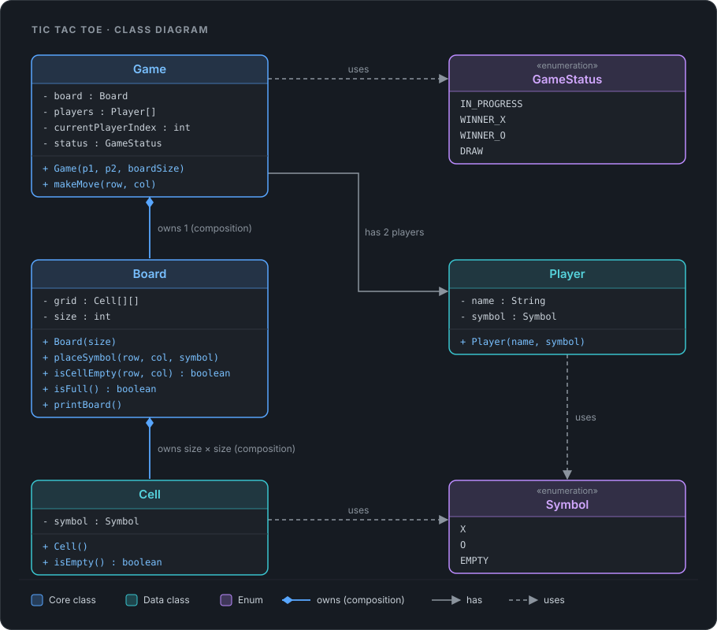

# ❌⭕ Tic Tac Toe (LLD)

## ❓ Questions to Ask the Interviewer

> Pin down the board, the players and the error handling before naming any classes.

---

### 1. Should the game support variable board sizes, such as 4x4 or 5x5?

**Why ask:** The board size decides how the `Board` is built and how a win is checked. With a fixed 3x3 board you can check 8 lines. With an N x N board, the win check has to loop over N rows, N columns and 2 diagonals.

**Interviewer Answer:** For the purpose of this interview, let's stick with the standard 3x3 board.

**Design tip:** Still keep `size` as a field on `Board` and loop up to `size`, not up to a hard-coded `3`. It costs nothing, and a 4x4 board then needs only a different constructor argument.

### 2. Is this a 2-player game, or can more than 2 players play?

**Why ask:** More players changes three things:
1. The symbols. An enum with only `X` and `O` is no longer enough; each player needs its own symbol (e.g. `X`, `O`, `▲`).
2. The turn logic. You can't just flip between two players; you rotate through a list (`current = (current + 1) % players.size()`).
3. The board. With 3+ players a 3x3 board fills up before anyone can win, so a bigger board comes with it. *(our addition)*

**Interviewer Answer:** Only 2 players, one plays `X` and the other plays `O`.

**Design tip:** Still keep the players in a list and rotate with an index. It works the same for 2 players and for N.

### 3. Should the game support both player-vs-player and player-vs-computer modes?

**Why ask:** A computer player needs logic that picks its own move. That brings in a move-picking strategy (e.g. `HumanPlayer` vs `ComputerPlayer`, using the Strategy pattern) and possibly an AI algorithm like minimax. Player-vs-player needs none of this.

**Interviewer Answer:** Let's keep it simple and focus only on the player-vs-player mode for now.

### 4. What should happen if a player tries to make an invalid move, like selecting an already filled cell?

**Why ask:** It decides where moves are validated and how errors are reported (throw an exception or return `false`). It also fixes the rule that a rejected move must not change the board and must not switch the turn.

**Interviewer Answer:** The game should reject the move and inform the player to make another selection.

---

## 🚫 Questions NOT to Ask

> The interviewer may be greedy and time is limited. If they say "yes" to these, the scope grows and you won't finish the core design. Don't ask; state the simple assumption instead.

---

### 1. How should the user input be handled? Should we take input from the console, or just hardcode a sample game sequence?

**Why not ask:** If the interviewer says "take console input", you spend time on reading and parsing input, re-prompting and input loops. None of that is class design.

**Say this instead:** "I'll hardcode a sample game sequence in a demo `main` method."

### 2. Should we track the history of moves to allow features like undo or move replay?

**Why not ask:** If the interviewer says "yes", you're done for: you now need a `Move` class, a history stack, undo logic (Command or Memento pattern) and replay. That's a second design on top of the first.

**Say this instead:** Don't mention it. If the interviewer brings it up, say "I'll keep the core game first; move history can be added later as a list of `Move` objects".

---

## 🧩 Core Entities

> Pick the nouns in the requirements that have their own data or behaviour. Not every noun becomes a class.

---

### 1. Entity types

1. **Enums:** fixed sets of values, for type safety. `Symbol`, `GameStatus`.
2. **Data classes:** hold data, almost no behaviour. `Cell`, `Player`.
3. **Core classes:** hold the main logic. `Board` manages the grid; `Game` runs the gameplay and detects the winner.

### 2. Entity list

| Entity | Type | Responsibility |
|---|---|---|
| `Symbol` | Enum | Cell values: `X`, `O` or `EMPTY` |
| `GameStatus` | Enum | Game state: `IN_PROGRESS`, `WINNER_X`, `WINNER_O`, `DRAW` |
| `Cell` | Data class | Holds a single symbol |
| `Player` | Data class | Holds the player's name and assigned symbol |
| `Board` | Core class | Manages the 3x3 grid (`size` x `size`) |
| `Game` | Core class | Runs the gameplay and detects win or draw |

**Relationships:** `Game` contains a `Board` and 2 `Player`s. `Board` contains 9 `Cell`s. `Cell` and `Player` use `Symbol`; `Game` uses `GameStatus`.

### 3. Why separate Board and Cell?

**Answer:** They have different responsibilities (single responsibility).

1. **Board** manages the whole grid: "place a symbol at (1,2)", "is the board full?", "is there a winning line?".
2. **Cell** just holds one value (one `Symbol`).
3. It keeps the code cleaner and gives new features a natural home. E.g. highlighting the winning cells later goes into `Cell`, without touching `Board`.

### 4. What are actors in LLD?

**Answer:** An actor is someone or something **outside** the system that uses it and starts actions: a person, another system or a timer. Actors come from use cases ("who does what?"); entities are the classes **inside** the system. *(our addition; the AlgoMaster page doesn't cover actors)*

1. **Actor vs entity:** an actor uses the system; an entity is part of it. Some actors also get a class, if the system has to store their data (a human player → the `Player` class with name and symbol).
2. **Tic Tac Toe:** one actor type, the **Player** (2 humans). A player starts a game and makes moves. With a computer opponent, the computer would be a second actor.
3. **Bigger LLDs:** e.g. a parking lot has a Customer, a Parking Attendant, an Admin and the System itself (it raises the "spot freed" events).

**Interview line**
> "The only actor here is the Player: two humans who take turns making moves. The Player is also an entity, because the game needs their name and symbol. Everything else, the Board, Cells and the Game, is internal."

---

## 🏛️ Designing Classes and Relationships

> For each class: what it holds (attributes) and what it does (methods). Build bottom-up: enums, then data classes, then core classes. Trivial getters and setters are skipped.

---

### 1. Enums

```text
«enum» Symbol     display
  X                'X'     → first player's marker
  O                'O'     → second player's marker
  EMPTY            '_'     → unoccupied cell

«enum» GameStatus  terminal?
  IN_PROGRESS      No      → game is still being played
  WINNER_X         Yes     → player with X won
  WINNER_O         Yes     → player with O won
  DRAW             Yes     → board full, no winner
```

1. Each `Symbol` maps to a display character for printing the board.
2. A game starts `IN_PROGRESS` and moves to exactly one terminal state (`WINNER_X`, `WINNER_O` or `DRAW`). It never goes back.
3. **Why `WINNER_X` / `WINNER_O`, not `WINNER` + a `winner` field?** The check is one comparison (`status == WINNER_X`), and the status alone tells you who won.

### 2. Player (data class, immutable)

```text
Player
  - name   : String               → player identifier, e.g. "Alice"
  - symbol : Symbol               → X or O
  + Player(name, symbol)          → rejects EMPTY (fail fast)
```

1. Both fields are `final`: a player's symbol can't be changed by mistake mid-game.

### 3. Cell (data class, mutable)

```text
Cell
  - symbol : Symbol               → X, O or EMPTY
  + Cell()                        → starts as EMPTY
  + isEmpty() : boolean           → true if symbol is EMPTY
```

1. Mutable: starts `EMPTY`, set to `X` or `O` when a player moves.
2. `cell.isEmpty()` reads better than `cell.getSymbol() == Symbol.EMPTY`.

### 4. Board (core class)

```text
Board
  - grid : Cell[][]                       → size x size cells
  - size : int                            → 3 for the standard game
  + Board(size)                           → creates size x size empty cells
  + placeSymbol(row, col, symbol)         → puts a symbol on a cell
  + isCellEmpty(row, col) : boolean       → is the cell free?
  + isFull() : boolean                    → no empty cells left?
  + printBoard()                          → prints the grid to the console
```

1. **Single responsibility:** `Board` knows nothing about players, turns or winning. It only manages the grid, so it could be reused for Connect Four or Battleship.
2. **Composition:** `Board` creates and owns its cells. No `Cell` exists outside a `Board`.
3. **Encapsulation:** `grid` is private. Other code reaches a cell through `getCell(row, col)`, which checks the bounds first.

### 5. Game (core class, the orchestrator)

```text
Game
  - board              : Board           → the game board
  - players            : Player[]        → the two players
  - currentPlayerIndex : int             → whose turn it is (0 or 1)
  - status             : GameStatus      → current game state
  + Game(p1, p2, boardSize)              → creates the board, sets IN_PROGRESS
  + makeMove(row, col)                   → validate, place, check win/draw, switch turn
```

1. `Game` owns the `Board`, knows the `Player`s, tracks whose turn it is, and checks for a winner after each move.
2. The win check (`checkWin`) is a private method in `Game`, not in `Board`, because winning is a game rule.

### 6. Full class diagram



| From | To | Relationship |
|---|---|---|
| `Game` | `Board` | Owns 1 (composition: created in the `Game` constructor) |
| `Board` | `Cell` | Owns size x size (composition) |
| `Game` | `Player` | Has 2 (association: players are created outside and passed in) |
| `Game` | `GameStatus` | Uses |
| `Player`, `Cell` | `Symbol` | Uses |
