# Node.js

Interview-prep notes on Node.js internals.

## 📚 Table of Contents

**Event Loop**

1. [Why Node needs an event loop](#1-why-node-needs-an-event-loop)
2. [The building blocks](#2-the-building-blocks)
3. [Walkthrough: the setTimeout example](#3-walkthrough-the-settimeout-example)
4. [The same example on a timeline](#4-the-same-example-on-a-timeline)
5. [The real event loop: libuv phases](#5-the-real-event-loop-libuv-phases)
6. [Microtasks: process.nextTick and Promises](#6-microtasks-processnexttick-and-promises)
7. [Where async work actually runs](#7-where-async-work-actually-runs)
8. [Blocking the event loop](#8-blocking-the-event-loop)
9. [Interview questions](#9-interview-questions)
10. [Cheat sheet](#10-cheat-sheet)

**Worker Threads**

1. [Can Node.js be multithreaded?](#1-can-nodejs-be-multithreaded)
2. [Why do we need worker threads?](#2-why-do-we-need-worker-threads)
3. [What happens if we don't use a worker thread?](#3-what-happens-if-we-dont-use-a-worker-thread)
4. [What is a worker thread?](#4-what-is-a-worker-thread)
5. [The fix: the same server with a worker](#5-the-fix-the-same-server-with-a-worker)
6. [Worker pools: don't create a worker per request](#6-worker-pools-dont-create-a-worker-per-request)
7. [worker_threads vs cluster vs child_process](#7-worker_threads-vs-cluster-vs-child_process)
8. [When not to use worker threads](#8-when-not-to-use-worker-threads)
9. [Interview questions](#9-interview-questions-1)
10. [Worker threads cheat sheet](#10-worker-threads-cheat-sheet)

**Callbacks, Promises and async/await**

1. [What is a callback?](#1-what-is-a-callback)
2. [Callback hell](#2-callback-hell)
3. [Why Promises were introduced](#3-why-promises-were-introduced)
4. [Promises in code](#4-promises-in-code)
5. [Running promises together: all, allSettled, race, any](#5-running-promises-together-all-allsettled-race-any)
6. [async / await](#6-async--await)
7. [Promise vs async/await: what's the difference?](#7-promise-vs-asyncawait-whats-the-difference)
8. [async/await on the event loop, step by step](#8-asyncawait-on-the-event-loop-step-by-step)
9. [Does async/await block the thread?](#9-does-asyncawait-block-the-thread)
10. [Sequential vs parallel await](#10-sequential-vs-parallel-await)
11. [Common mistakes](#11-common-mistakes)
12. [Interview questions on async code](#12-interview-questions-on-async-code)
13. [Async cheat sheet](#13-async-cheat-sheet)

**Prisma ORM**

1. [What is Prisma?](#1-what-is-prisma)
2. [How Prisma works](#2-how-prisma-works)
3. [A quick example](#3-a-quick-example)
4. [Why use Prisma: benefits and trade-offs](#4-why-use-prisma-benefits-and-trade-offs)
5. [Prisma interview questions](#5-prisma-interview-questions)

**Express.js**

1. [What is Express?](#1-what-is-express)
2. [What Express gives you](#2-what-express-gives-you)
3. [Middleware: the core idea](#3-middleware-the-core-idea)
4. [Routing with express.Router](#4-routing-with-expressrouter)
5. [Express + Prisma: a small REST API](#5-express--prisma-a-small-rest-api)
6. [Express interview questions](#6-express-interview-questions)

**var vs let vs const**

1. [The short answer](#1-the-short-answer)
2. [Scope: function vs block](#2-scope-function-vs-block)
3. [Hoisting and the temporal dead zone (TDZ)](#3-hoisting-and-the-temporal-dead-zone-tdz)
4. [Redeclare, reassign, and "const is not immutable"](#4-redeclare-reassign-and-const-is-not-immutable)
5. [The classic: closures in a loop](#5-the-classic-closures-in-a-loop)
6. [var / let / const interview questions](#6-var--let--const-interview-questions)

**TypeScript**

1. [What is TypeScript, and why was it introduced?](#1-what-is-typescript-and-why-was-it-introduced)
2. [Types only exist at compile time](#2-types-only-exist-at-compile-time)
3. [Basic types](#3-basic-types)
4. [Interfaces and type aliases](#4-interfaces-and-type-aliases)
5. [Classes in TypeScript](#5-classes-in-typescript)
6. [Generics (just the basics)](#6-generics-just-the-basics)
7. [TypeScript interview questions](#7-typescript-interview-questions)

**Tricky Output Questions**

1. [Event loop and timers](#1-event-loop-and-timers)
2. [Promises and async/await](#2-promises-and-asyncawait)
3. [Scope and hoisting](#3-scope-and-hoisting)
4. [JavaScript quick-fire](#4-javascript-quick-fire)

---

# Event Loop

## 1. Why Node needs an event loop

Node runs your JavaScript on **one thread**. A server still has to handle thousands of requests at once, and most of a request's time is spent **waiting**: for the disk, the database, another API.

If that one thread sat and waited on every read, the server could only serve one request at a time. So Node never waits:

1. Your code **starts** an I/O operation (`fs.readFile`, `http.get`, `setTimeout`) and hands it to Node.
2. Node does the waiting **outside JavaScript** (in libuv, a C library, or in the OS kernel).
3. Your code moves on immediately.
4. When the operation finishes, its **callback** is put in a queue.
5. The **event loop** takes callbacks from the queue and runs them, one at a time, whenever the JS thread is free.

> [!IMPORTANT]
> **Key takeaway:** the event loop is what lets one JS thread handle many concurrent operations. It is *concurrency* (interleaving), not *parallelism* (two pieces of JS running at the same instant).

---

## 2. The building blocks

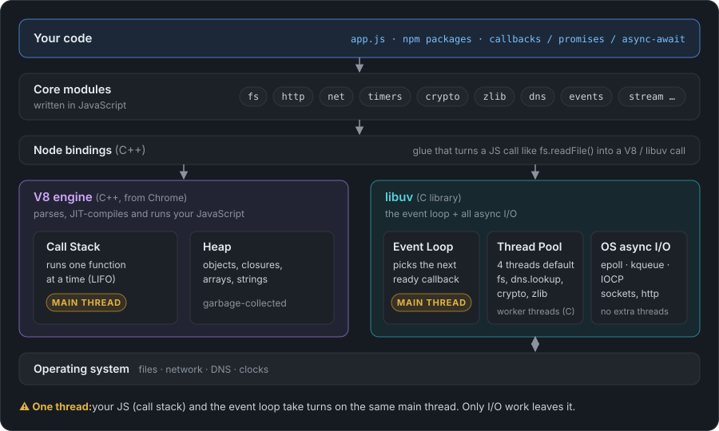

| Piece | What it is | Where it lives |
|---|---|---|
| **Call stack** | The functions running *right now*. LIFO: last pushed, first popped. Only one stack, so only one piece of JS runs at a time. | V8 |
| **Heap** | Memory for objects, closures, arrays. Garbage-collected. | V8 |
| **Node APIs** | `setTimeout`, `fs`, `http`, `crypto`… These are **not part of JavaScript or V8**. Node provides them, and libuv does the actual work. | Node + libuv |
| **Callback queue** | Callbacks whose operation finished and that are ready to run. FIFO. | libuv |
| **Event loop** | A loop on the main thread: *"if the call stack is empty, take the next ready callback and run it."* | libuv |

> [!TIP]
> **Interview tip:** V8 alone has no `setTimeout`, no file system and no network. Those come from the **host**: the browser (Web APIs) or Node (libuv). The event loop also belongs to the host, not to V8.

---

## 3. Walkthrough: the setTimeout example

```js
console.log('Starting up')

setTimeout(() => {
  console.log('Two seconds!')
}, 2000)

setTimeout(() => {
  console.log('Zero seconds!')
}, 0)

console.log('Finishing up')
```

**Output:**

```text
Starting up
Finishing up
Zero seconds!
Two seconds!
```

The surprise is that `Zero seconds!` prints **after** `Finishing up`, even with a 0 ms delay. Six steps show why.

### Step 1: Starting up

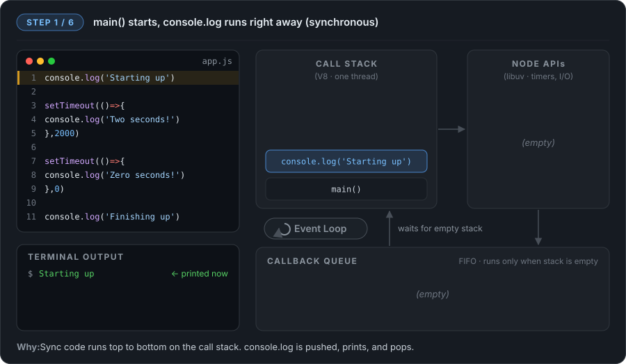

Node wraps the file in a function, shown here as `main()`, and pushes it on the call stack. `console.log` is **synchronous**: it is pushed, prints, and pops at once.

### Step 2: setTimeout(…, 2000)

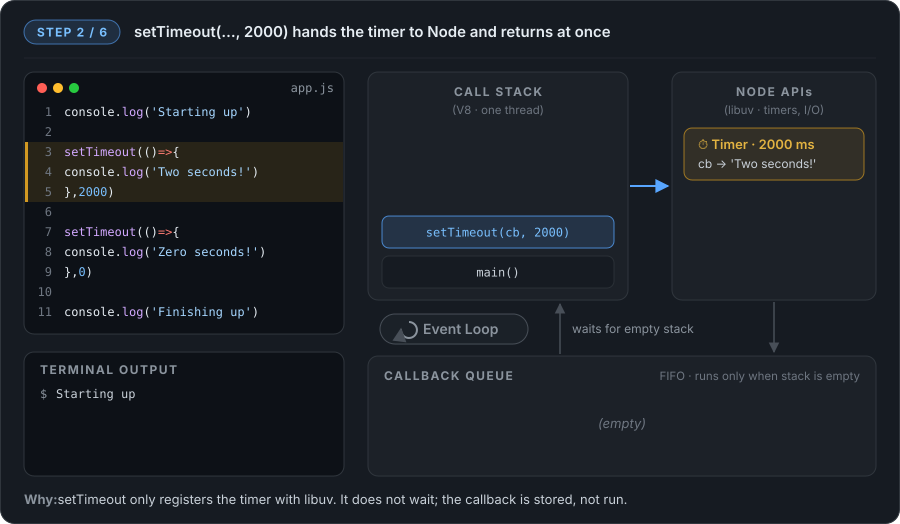

`setTimeout` does **not** wait 2 seconds. It registers a timer with libuv, stores the callback, and returns straight away. The countdown happens outside JavaScript.

### Step 3: setTimeout(…, 0)

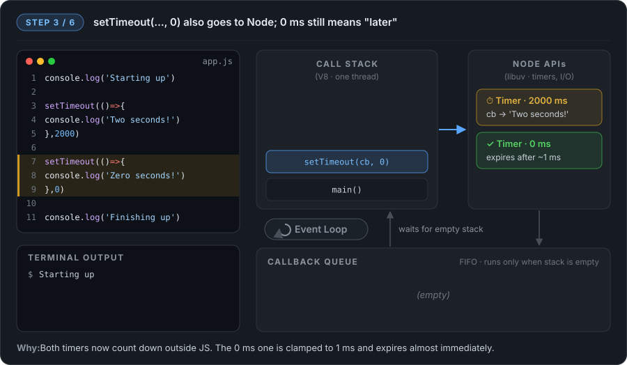

Same thing with a 0 ms delay. Node treats a delay below 1 ms as **1 ms**, so this timer expires almost at once. Expiring only makes the callback *ready*, though. It does not run it.

### Step 4: Finishing up

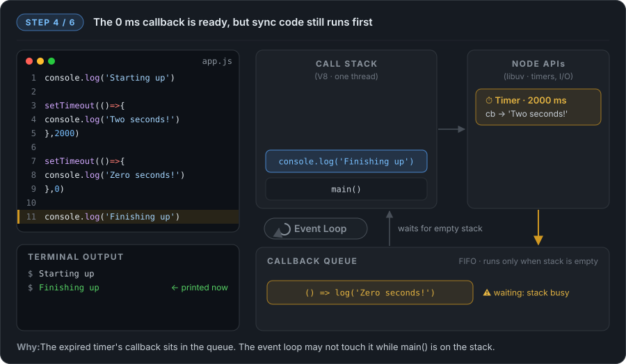

The 0 ms callback is ready and sitting in the queue, but `main()` is still on the stack. The event loop **never interrupts running code**, so `Finishing up` prints first.

### Step 5: Zero seconds!

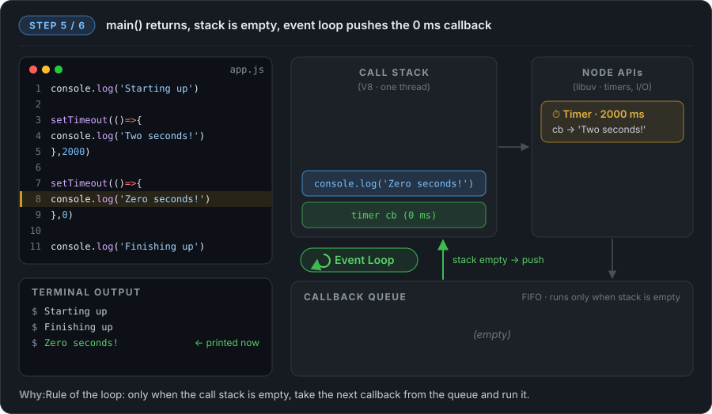

The whole script has run, so `main()` pops and the stack is **empty**. Now the event loop does its one job: take the next callback from the queue, push it on the stack, run it.

### Step 6: Two seconds!

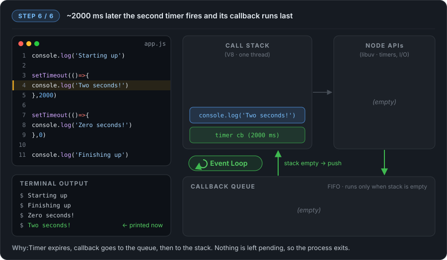

For about 2 seconds nothing happens and the thread sleeps. Then the 2000 ms timer expires, and its callback goes through the queue to the stack. Now there are no timers, sockets or other pending work, so the event loop has nothing to wait for and **the process exits**.

> [!IMPORTANT]
> **Key takeaway, the one rule:** a callback runs **only when the call stack is empty**. Sync code always finishes first, whatever the timer delays say.

---

## 4. The same example on a timeline

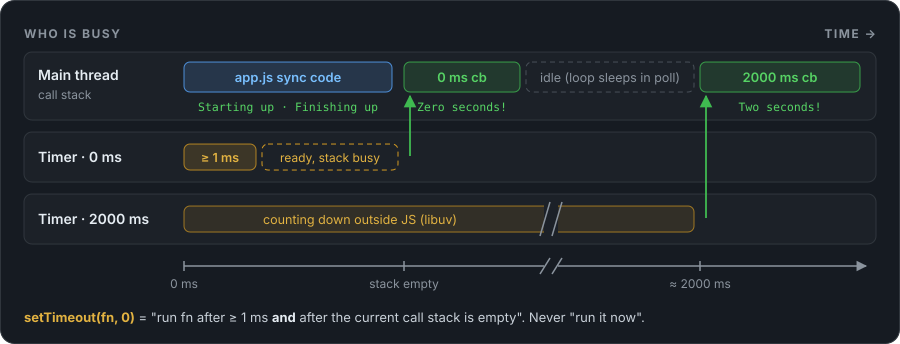

> [!WARNING]
> ⚠️ The delay in `setTimeout(fn, ms)` is a **minimum**, not a promise. `fn` runs after *at least* `ms` milliseconds, and only once the stack is free. A busy thread makes every timer late (see [section 8](#8-blocking-the-event-loop)).

---

## 5. The real event loop: libuv phases

"Call stack + one callback queue" is the right mental model for most interviews. In reality libuv has **several queues**, and the event loop visits them in a fixed order. Each full pass is one **iteration** (often called a *tick*).

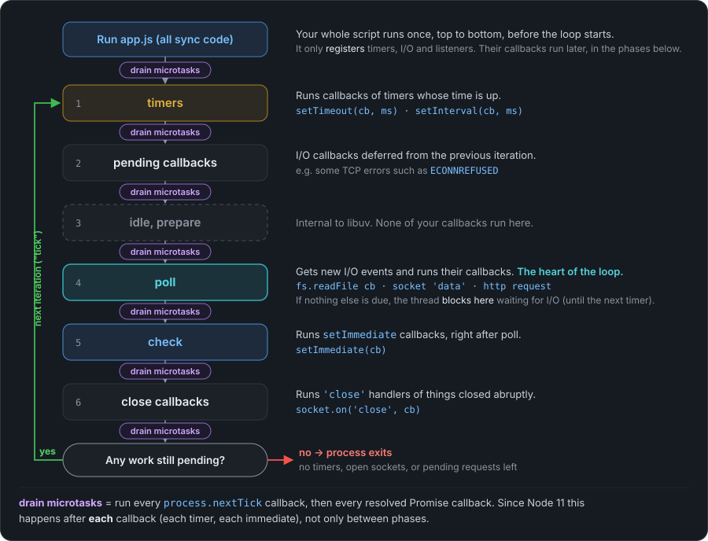

| # | Phase | What runs there | Example |
|---|---|---|---|
| 1 | **timers** | Callbacks of expired timers | `setTimeout`, `setInterval` |
| 2 | **pending callbacks** | Some I/O callbacks deferred from the last iteration | TCP `ECONNREFUSED` errors |
| 3 | **idle, prepare** | libuv internals only | (none of yours) |
| 4 | **poll** | Fetch new I/O events and run their callbacks. If nothing else is due, **block here** until I/O arrives or the next timer is due. | `fs.readFile` callback, socket `data`, incoming HTTP request |
| 5 | **check** | `setImmediate` callbacks, right after poll | `setImmediate(cb)` |
| 6 | **close callbacks** | `'close'` events | `socket.on('close', cb)` |

**When does the process exit?** At the end of each iteration, if there are no active timers, open sockets/servers, or pending requests, the loop stops. That's why a script with only `console.log` exits at once, but `http.createServer().listen()` keeps running.

> [!NOTE]
> **Node 20+ detail:** since libuv 1.45 (Node 20), timers are checked **after** the poll phase in each iteration (plus once before the loop starts), instead of before it. The cycle order above is the same; only the starting point moved. Source: [Node.js event loop guide](https://nodejs.org/en/learn/asynchronous-work/event-loop-timers-and-nexttick).

### setTimeout(fn, 0) vs setImmediate(fn)

```js
// In the main module: order is NOT guaranteed
setTimeout(() => console.log('timeout'), 0)
setImmediate(() => console.log('immediate'))
// sometimes: timeout, immediate   sometimes: immediate, timeout
```

From the main module, the order depends on whether the 1 ms timer has already expired when the loop reaches the timers phase. That comes down to process speed, so it's random.

```js
const fs = require('fs')

fs.readFile(__filename, () => {
  // inside an I/O callback: order IS guaranteed
  setTimeout(() => console.log('timeout'), 0)
  setImmediate(() => console.log('immediate'))
})
// always: immediate, timeout
```

Inside an I/O callback we are in the **poll** phase. The next phase is **check** (`setImmediate`), and timers only come in the next iteration.

> [!TIP]
> **Interview tip:** "Use `setImmediate` when you want *run right after this I/O round*. It is predictable inside I/O callbacks, and Node recommends it over `setTimeout(fn, 0)`."

---

## 6. Microtasks: process.nextTick and Promises

The phases above hold **macrotasks**. There are two more queues, the **microtask** queues, and they jump ahead of everything else:

1. **`process.nextTick` queue** (Node-only)
2. **Promise microtask queue** (`.then`, `.catch`, `.finally`, the code after `await`)

They are not phases of the loop. Node empties them **after the sync script finishes and after every single macrotask callback**: first all of nextTick, then all of Promises (repeating while new ones get added).

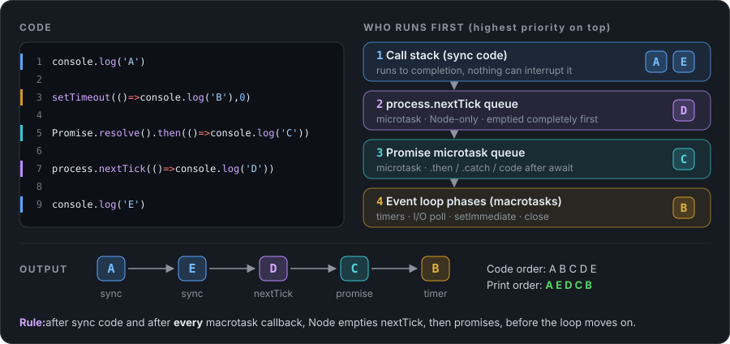

```js
console.log('A')
setTimeout(() => console.log('B'), 0)
Promise.resolve().then(() => console.log('C'))
process.nextTick(() => console.log('D'))
console.log('E')
// A E D C B
```

### Microtasks run between timer callbacks (Node 11+)

```js
setTimeout(() => {
  console.log('t1')
  Promise.resolve().then(() => console.log('p1'))
}, 0)
setTimeout(() => console.log('t2'), 0)
// Node 11+: t1 p1 t2   (same as browsers)
// Node ≤10: t1 t2 p1   (microtasks only ran between phases)
```

### async / await is just Promises

```js
async function f() {
  console.log('1')        // sync, runs immediately
  await null
  console.log('3')        // a Promise microtask
}
f()
console.log('2')
// 1 2 3
```

Everything **before** the first `await` runs synchronously. Everything **after** it is queued as a microtask.

> [!WARNING]
> ⚠️ **Starvation:** microtask queues are drained *completely* before the loop moves on. A `process.nextTick` (or promise) that keeps scheduling itself never lets the loop reach the poll phase. Timers stop firing and no I/O gets handled.
>
> ```js
> function spin() { process.nextTick(spin) }   // freezes all I/O forever
> spin()
> ```

> [!TIP]
> **Interview tip, naming trap:** `process.nextTick` runs **before** the next phase (sooner), while `setImmediate` runs in the **next check phase** (later). The names are effectively swapped, and the Node docs admit it. Prefer `setImmediate` or `queueMicrotask` unless you really need nextTick.

> [!NOTE]
> The orders above assume **CommonJS** (`require`, `.js`). In an **ES module** (`.mjs` / `"type": "module"`) the top-level code itself runs inside a microtask, so Promise callbacks can run **before** `process.nextTick` ones.

---

## 7. Where async work actually runs

"Node is single-threaded" is only half true. **Your JavaScript** runs on one thread. The waiting and the heavy I/O happen elsewhere:

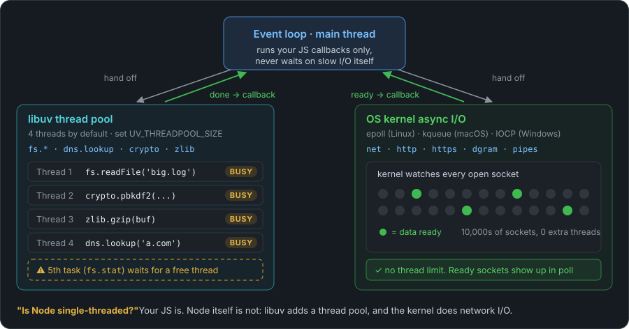

| Goes to the **thread pool** | Goes to the **OS kernel** (no thread pool) |
|---|---|
| `fs.*` (all async file ops) | TCP / UDP sockets (`net`, `dgram`) |
| `dns.lookup()` (what `http.get('a.com')` uses) | `http`, `https` request/response I/O |
| `crypto.pbkdf2`, `scrypt`, `randomBytes`, `randomFill` | pipes, `child_process` stdio |
| `zlib` async (`gzip`, `deflate`…) | `dns.resolve*()` (uses c-ares, network only) |

- Pool size defaults to **4**. Change it with the env var `UV_THREADPOOL_SIZE` (up to 1024), set before the pool is first used, usually at startup: `UV_THREADPOOL_SIZE=8 node app.js`.
- With 4 threads, the 5th concurrent `fs`/`crypto` task **queues**. So 8 parallel `pbkdf2` calls finish in two "waves".
- Network I/O scales differently: the kernel tells libuv which sockets are ready (`epoll` on Linux), so one thread can serve tens of thousands of connections.

> [!TIP]
> **Interview tip:** "How does Node handle 10k concurrent connections on one thread?" Sockets are non-blocking and watched by the kernel (epoll/kqueue/IOCP). The event loop only runs short callbacks when data is ready, so no thread ever sits waiting on one connection.

---

## 8. Blocking the event loop

The event loop can only pick the next callback once the call stack is empty. So **any long synchronous work blocks everything**: timers, other requests, health checks.

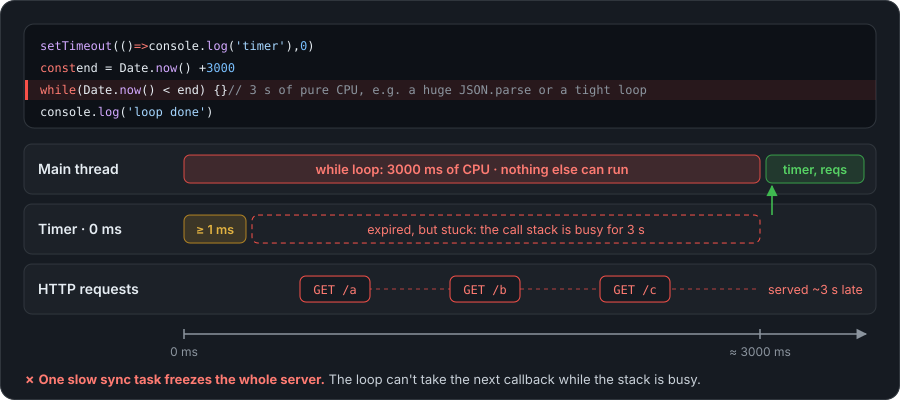

**Common ways people block the loop:**

- Sync APIs in a request handler: `fs.readFileSync`, `crypto.pbkdf2Sync`, `zlib.gzipSync`
- `JSON.parse` / `JSON.stringify` on huge payloads
- Heavy loops: image processing, sorting huge arrays, big math
- Catastrophic regex backtracking (ReDoS), e.g. `/(a+)+$/` on long input
- Recursive `process.nextTick` / promise chains (microtask starvation)

**Fixes:**

| Problem | Fix |
|---|---|
| CPU-heavy work (hashing, image resize, parsing) | Move it to **`worker_threads`** (or a job queue / separate service) |
| A long loop you must keep on the main thread | Split it into chunks and yield between them with `setImmediate` |
| Big files or payloads | **Streams** (`fs.createReadStream`, `pipe`) instead of loading everything |
| Sync APIs | Use the async/promise versions (`fs.promises.readFile`) |
| One process can't use all cores | `cluster` module or multiple processes behind a load balancer (PM2, Kubernetes) |

```js
// Measure it: how late is the loop running?
const { monitorEventLoopDelay } = require('perf_hooks')
const h = monitorEventLoopDelay({ resolution: 20 })
h.enable()
setInterval(() => console.log('p99 lag ms:', h.percentile(99) / 1e6), 5000)
```

> [!CAUTION]
> Never use `*Sync` APIs or unbounded CPU work in request-handling code. One slow request makes **every** user wait.

---

## 9. Interview questions

<details>
<summary><b>Q1. What is the event loop?</b></summary>

A loop, run by libuv on Node's main thread. While there is pending work it waits for operations to complete, then runs their callbacks one at a time, but only when the call stack is empty. It is what lets single-threaded JS do non-blocking I/O.
</details>

<details>
<summary><b>Q2. Is Node.js single-threaded?</b></summary>

Your JavaScript runs on a single thread (one call stack). Node as a whole is multi-threaded: libuv has a thread pool (4 by default) for fs, dns.lookup, crypto and zlib, and V8 uses extra threads for GC and compilation. For true parallel JS, use `worker_threads`.
</details>

<details>
<summary><b>Q3. Why does setTimeout(fn, 0) not run immediately?</b></summary>

The delay is a minimum (clamped to 1 ms). And even after the timer expires, the callback has to wait until the current sync code finishes and the stack is empty, then for the event loop to reach the timers phase.
</details>

<details>
<summary><b>Q4. process.nextTick vs setImmediate vs setTimeout(0)?</b></summary>

- `process.nextTick`: microtask, runs right after the current operation, before Promises and before any phase.
- `setTimeout(fn, 0)`: macrotask in the **timers** phase, after ≥ 1 ms.
- `setImmediate`: macrotask in the **check** phase, right after poll.
- In the main module the order of timeout vs immediate is random. Inside an I/O callback, immediate always comes first.
</details>

<details>
<summary><b>Q5. Predict the output (CommonJS)</b></summary>

```js
console.log('1')
setTimeout(() => console.log('2'), 0)
setImmediate(() => console.log('3'))
process.nextTick(() => console.log('4'))
Promise.resolve().then(() => console.log('5'))
;(async () => {
  console.log('6')
  await null
  console.log('7')
})()
console.log('8')
```

**Answer:** `1 6 8 4 5 7`, then `2 3` (usually, but `2`/`3` can swap in the main module).

- Sync: `1`, `6` (async fn body before `await`), `8`
- nextTick: `4`
- Promises in queue order: `5` was queued before the `await` continuation, then `7`
- Macrotasks: timeout `2` / immediate `3`
</details>

<details>
<summary><b>Q6. When does a Node process exit?</b></summary>

When the event loop finds nothing left to wait for: no active timers or intervals, no open servers or sockets, no pending fs/dns requests. `timer.unref()` / `server.unref()` tell Node not to keep the process alive just for that handle.
</details>

<details>
<summary><b>Q7. What happens if a request handler runs a 2-second CPU loop?</b></summary>

Every other request, timer and health check waits those 2 seconds. Throughput collapses and latency spikes. Fix it by moving the work to `worker_threads`, chunking it with `setImmediate`, or doing it in a separate service.
</details>

---

## 10. Cheat sheet

| Thing | Queue / phase | Runs |
|---|---|---|
| Sync code | call stack | first, to completion |
| `process.nextTick(fn)` | nextTick microtask queue | after current op, before Promises |
| `promise.then(fn)`, after `await`, `queueMicrotask(fn)` | Promise microtask queue | after nextTick queue is empty |
| `setTimeout` / `setInterval` | **timers** phase | after ≥ delay, when the loop gets there |
| fs / network callbacks | **poll** phase | when the I/O completes |
| `setImmediate(fn)` | **check** phase | right after poll |
| `socket.on('close')` | **close callbacks** phase | end of the iteration |

**Order to remember:** sync → `nextTick` → Promises → timers → (pending) → poll → check → close → repeat, draining microtasks after *every* callback.

---

# Worker Threads

## 1. Can Node.js be multithreaded?

> [!IMPORTANT]
> **Short answer:** Yes, but you have to opt in. Your JavaScript runs on **one main thread** by default. Node itself always uses extra threads (libuv thread pool, V8 helpers), but those never run your JS. To run JavaScript **in parallel**, use `worker_threads` (threads in the same process) or `cluster` / `child_process` (separate processes).

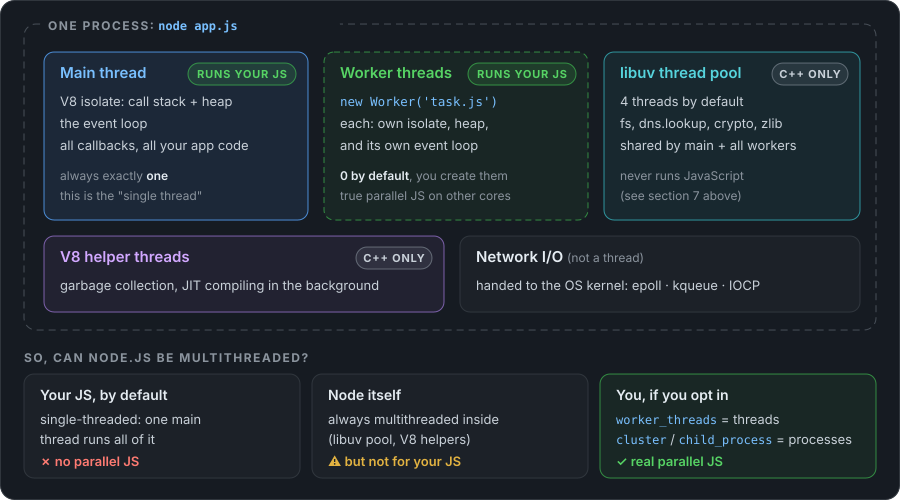

| Thread | Runs your JS? | How many | Created by |
|---|---|---|---|
| Main thread | ✅ yes | always 1 | Node, at startup |
| Worker threads | ✅ yes | 0 unless you create them | you: `new Worker(...)` |
| libuv thread pool | ❌ no (C++ only) | 4 by default | Node, on first use |
| V8 helper threads | ❌ no (GC, JIT) | a few | V8 |

So "Node is single-threaded" really means: **your JS code runs on one thread, unless you create workers.**

---

## 2. Why do we need worker threads?

The event loop is great when work is mostly **waiting** and terrible when work is mostly **computing**:

| | I/O-bound | CPU-bound |
|---|---|---|
| What the time is spent on | waiting for disk, DB, network | the CPU doing math / parsing |
| Examples | DB query, HTTP call, reading a file | image resize, big `JSON.parse`, hashing in JS, PDF generation, compression in JS |
| Who does the work | the kernel / libuv thread pool | **your JS, on the main thread** |
| Main thread during the work | free ✅ | **blocked** ❌ |
| Need worker threads? | **No**, async I/O already handles it | **Yes** |

From the Node docs: *"Workers (threads) are useful for performing CPU-intensive JavaScript operations. They do not help much with I/O-intensive work. The Node.js built-in asynchronous I/O operations are more efficient than Workers can be."*

> [!TIP]
> **Interview tip:** "Node is great for I/O-heavy apps because one thread can wait on thousands of connections. For CPU-heavy work, move it to `worker_threads` so the event loop stays responsive."

---

## 3. What happens if we don't use a worker thread?

The CPU work runs on the **main thread**. The main thread is the only thread that runs JS, so while it computes, **nothing else in the process can run**: no other request, no timer, no socket event.

Try it. A server with one heavy route and one trivial route:

```js
// server.js: CPU work on the main thread (the problem)
const http = require('node:http')

function fib(n) { return n < 2 ? n : fib(n - 1) + fib(n - 2) }

http.createServer((req, res) => {
  if (req.url === '/fib') {
    const result = fib(42)              // ~2 s of pure CPU on a modern laptop
    return res.end(`fib(42) = ${result}\n`)
  }
  res.end('ok\n')                       // /health: should take ~1 ms
}).listen(3000)
```

```bash
curl localhost:3000/fib &                               # start the heavy request
curl -w ' took %{time_total}s\n' localhost:3000/health  # then the trivial one
# ok  took ~2s   ← a 1 ms request waited for fib(42) to finish (time depends on your CPU)
```

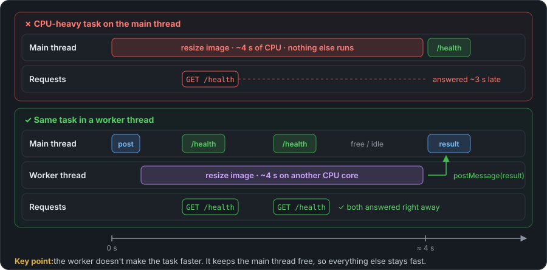

What that means in production:

- **Every user waits.** One slow request makes all concurrent requests slow, not just its own.
- **Health checks fail.** Load balancers and Kubernetes liveness probes time out, so the instance gets marked unhealthy or **restarted**, killing all in-flight requests.
- **Timers fire late.** `setTimeout`/`setInterval` callbacks can't run (see [Blocking the event loop](#8-blocking-the-event-loop)).
- **Connections drop.** WebSocket heartbeats and keep-alives miss their deadlines.
- **Cores sit idle.** On an 8-core machine, 7 cores do nothing while one is pegged at 100%.
- **Throughput collapses.** Only one CPU-heavy request is processed at a time, so latency grows with queue length.

> [!WARNING]
> ⚠️ **`async` does not fix this.** Wrapping CPU work in `async` or a `Promise` still runs it on the main thread. `async function f() { return fib(42) }` blocks exactly like `fib(42)`. Promises help you **wait** without blocking; they don't move **computation** to another thread. Only a worker (or another process) does that.

---

## 4. What is a worker thread?

A worker thread is a **real OS thread inside the same Node process** that runs its own JavaScript file with:

- its own **V8 isolate** (own heap, own garbage collector)
- its own **event loop**
- its own copy of Node's built-in modules

It's in the built-in `node:worker_threads` module, stable since Node 12. Because a worker has its own heap, it **cannot see the main thread's variables**. The two sides talk by sending messages.

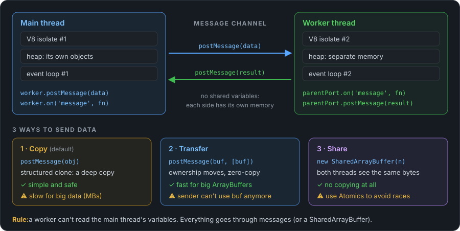

| API | Where | What it does |
|---|---|---|
| `new Worker(file, { workerData })` | main | start a worker running `file`, passing initial data |
| `worker.postMessage(msg)` / `worker.on('message', fn)` | main | send to / receive from that worker |
| `parentPort.postMessage(msg)` / `parentPort.on('message', fn)` | worker | send to / receive from the main thread |
| `workerData` | worker | the data passed in `new Worker(...)` |
| `isMainThread` | both | `true` on the main thread, `false` in a worker |
| `worker.on('error' / 'exit', fn)` | main | the worker threw / stopped |
| `worker.terminate()` | main | stop it |
| `SharedArrayBuffer` + `Atomics` | both | memory both threads can read/write at once |

---

## 5. The fix: the same server with a worker

```js
// fib-worker.js: runs on a worker thread
const { parentPort, workerData } = require('node:worker_threads')

function fib(n) { return n < 2 ? n : fib(n - 1) + fib(n - 2) }

parentPort.postMessage(fib(workerData))   // send the result back
```

```js
// server.js: the main thread only hands the work off
const http = require('node:http')
const path = require('node:path')
const { Worker } = require('node:worker_threads')

function runFib(n) {
  return new Promise((resolve, reject) => {
    const worker = new Worker(path.join(__dirname, 'fib-worker.js'), { workerData: n })
    worker.once('message', resolve)
    worker.once('error', reject)          // always listen, or an error in the worker crashes the main thread
    worker.once('exit', code => {
      if (code !== 0) reject(new Error(`worker stopped with exit code ${code}`))
    })
  })
}

http.createServer(async (req, res) => {
  if (req.url === '/fib') {
    const result = await runFib(42)       // main thread is FREE while the worker computes
    return res.end(`fib(42) = ${result}\n`)
  }
  res.end('ok\n')
}).listen(3000)
```

```bash
curl localhost:3000/fib &
curl -w ' took %{time_total}s\n' localhost:3000/health
# ok  took 0.001s   ← answered immediately, /fib still finishes a few seconds later
```

> [!NOTE]
> Pass an **absolute path** to `new Worker()`. A relative path like `'./fib-worker.js'` is resolved from the directory you ran `node` in, not from the file's folder.

---

## 6. Worker pools: don't create a worker per request

The code above starts a **new** worker for every `/fib` request. That's fine for a demo, but each worker is a whole new V8 isolate: starting one costs roughly tens of milliseconds and several MB of memory. Under load you'd create hundreds of them.

Real apps use a **pool**: start a fixed number of workers once (about one per CPU core) and queue tasks for them.

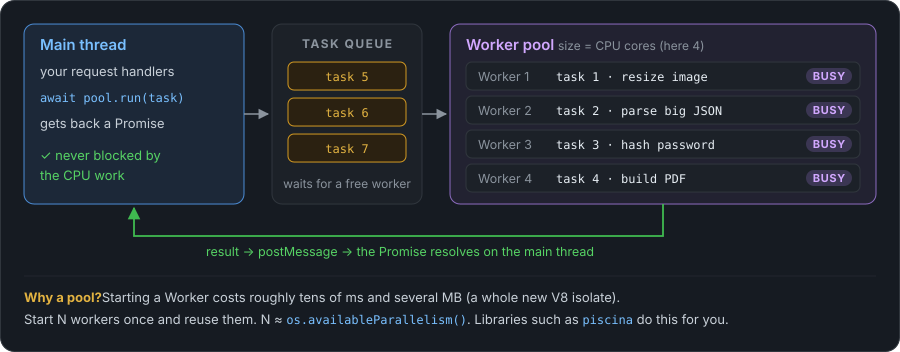

With the popular `piscina` library:

```js
// fib-task.js: the worker just exports a function
function fib(n) { return n < 2 ? n : fib(n - 1) + fib(n - 2) }
module.exports = (n) => fib(n)
```

```js
// server.js
const path = require('node:path')
const Piscina = require('piscina')

const pool = new Piscina({ filename: path.join(__dirname, 'fib-task.js') })  // sizes itself to the CPU count

// inside a request handler:
const result = await pool.run(42)
```

Why about **one worker per core**? Workers run in parallel only if each has a core. With more CPU-bound workers than cores, they just take turns and add overhead.

---

## 7. worker_threads vs cluster vs child_process

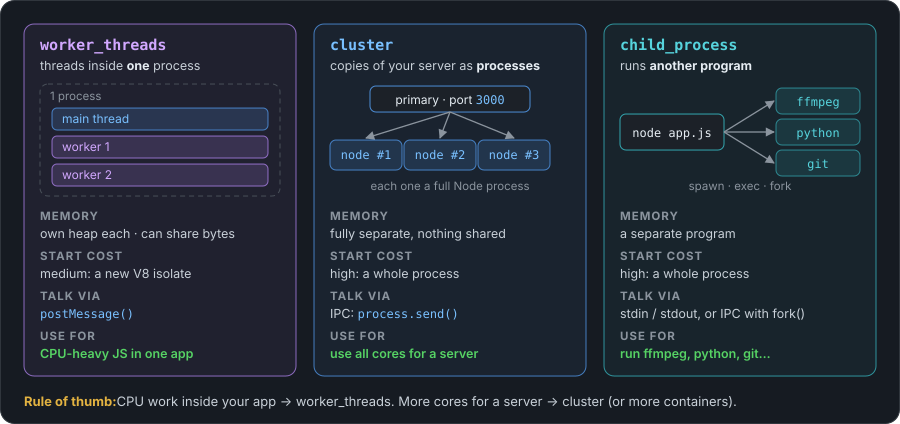

| | `worker_threads` | `cluster` | `child_process` |
|---|---|---|---|
| What you get | threads in **one** process | copies of your **server**, one process each | **another program** |
| Memory | own heap each; can share a `SharedArrayBuffer` | fully separate | fully separate |
| Communication | `postMessage` (fast, in-process) | IPC (`process.send`) | stdin/stdout, or IPC with `fork()` |
| Startup cost | medium | high | high |
| A crash takes down | the worker only (if you handle `'error'`) | that one process; the primary can start a new one | the child only |
| Use it for | CPU-heavy JS inside your app | handling more HTTP traffic on all cores | `ffmpeg`, `python`, `git`, shell commands |

> [!TIP]
> **Interview tip:** in containers you often scale with **more pods** instead of `cluster`. Worker threads are still needed for CPU work inside a single request, because more pods don't stop one request from blocking its own process.

---

## 8. When not to use worker threads

- **I/O-bound work** (DB queries, HTTP calls, file reads). It's already non-blocking, and a worker only adds overhead.
- **Tiny tasks.** Copying the message to the worker and back can cost more than the work itself.
- **A new worker per request** without a pool (see [section 6](#6-worker-pools-dont-create-a-worker-per-request)).
- **Huge objects passed by copy.** Transfer an `ArrayBuffer` or use a `SharedArrayBuffer` instead.
- **To make one task faster.** A worker doesn't speed up a single task. It runs the task **without blocking** the main thread, and runs **several** tasks in parallel.

---

## 9. Interview questions

<details>
<summary><b>Q1. Is Node.js single-threaded? Can it be multithreaded?</b></summary>

Your JavaScript runs on a single main thread by default, so in that sense yes. But Node is multithreaded internally (libuv thread pool, V8 GC and compiler threads), and you can run JS on multiple threads with `worker_threads` (or multiple processes with `cluster` / `child_process`).
</details>

<details>
<summary><b>Q2. What happens if you do CPU-heavy work without a worker?</b></summary>

It runs on the main thread and blocks the event loop. Every other request, timer and socket event in that process waits until it finishes. Health checks can time out and get the instance restarted, and the other CPU cores sit idle.
</details>

<details>
<summary><b>Q3. Does making a function <code>async</code> move it off the main thread?</b></summary>

No. `async` / Promises only change **when** code runs (after an `await`), not **where**. CPU work inside an async function still runs on the main thread and still blocks. Only workers or separate processes run it elsewhere.
</details>

<details>
<summary><b>Q4. How do the main thread and a worker communicate? Do they share memory?</b></summary>

By message passing: `postMessage` and `'message'` events. Messages are **copied** (structured clone) by default. You can **transfer** an `ArrayBuffer` (zero-copy, the sender loses it) or **share** a `SharedArrayBuffer`, using `Atomics` to avoid race conditions. Normal JS objects and variables are never shared.
</details>

<details>
<summary><b>Q5. worker_threads vs cluster?</b></summary>

Workers are threads inside one process, used for CPU-heavy tasks within one app, and can share memory. Cluster runs several copies of your server as separate processes sharing one port, used to handle more traffic on all cores, and shares nothing. They solve different problems and can be combined.
</details>

<details>
<summary><b>Q6. How many workers should you create?</b></summary>

For CPU-bound work, about one per CPU core (`os.availableParallelism()`), kept in a pool and reused. More workers than cores just time-share the CPU and add memory and switching overhead.
</details>

<details>
<summary><b>Q7. What happens if a worker throws an error?</b></summary>

The worker stops and an `'error'` event is emitted on the `Worker` object in the main thread, followed by `'exit'`. If nothing listens for `'error'`, it becomes an uncaught exception and crashes the main process, so always attach an `'error'` handler.
</details>

---

## 10. Worker threads cheat sheet

| Question | Answer |
|---|---|
| Is JS in Node single-threaded? | By default yes: one main thread runs all your JS |
| Is Node multithreaded? | Internally yes (libuv pool, V8 helpers). For your JS, opt in with `worker_threads` |
| When to use workers | CPU-bound JS: parsing, image work, hashing in JS, compression, PDF |
| When not to | I/O-bound work, tiny tasks |
| Without a worker | CPU work blocks the event loop, every request waits, health checks fail |
| `async` moves work off the thread? | **No.** Only workers or processes do |
| Communication | `postMessage`: copy (default), transfer (`ArrayBuffer`), share (`SharedArrayBuffer` + `Atomics`) |
| How many | ≈ CPU cores, in a pool (e.g. `piscina`) |
| vs `cluster` | cluster = more server processes for traffic; workers = CPU work inside one app |

---

# Callbacks, Promises and async/await

## 1. What is a callback?

A **callback** is a function you pass to another function, to be called later, "when you're done, call this".

```js
// synchronous callback: called right now, before map() returns
[1, 2, 3].map(n => n * 2)

// asynchronous callback: called later, by the event loop, after the file is read
fs.readFile('a.txt', 'utf8', (err, data) => {
  if (err) return console.error(err)
  console.log(data)
})
console.log('this prints BEFORE the file contents')
```

Node's core APIs use the **error-first callback** convention: the first argument is the error (or `null`), the rest are the results.

```js
function done(err, result) {
  if (err) { /* handle the error */ return }
  /* use the result */
}
```

Callbacks are how async work began in Node, and they still underpin it (the event loop runs callbacks). The problem shows up when async steps depend on each other.

---

## 2. Callback hell

Each step needs the previous step's result, so each callback nests inside the last one:

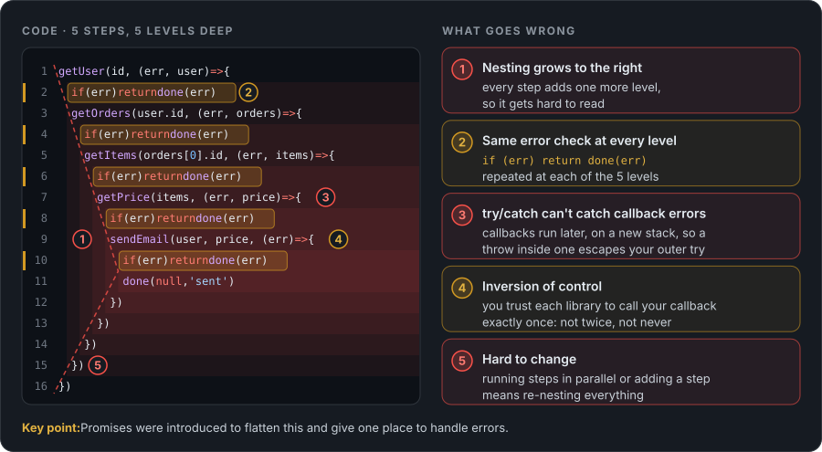

The problems, beyond "it looks ugly":

| Problem | Why it hurts |
|---|---|
| **Pyramid of doom** | every step adds a level of nesting, so the code drifts right |
| **Error handling everywhere** | `if (err) return done(err)` at every level; miss one and the error is silently lost |
| **`try/catch` doesn't work** | the callback runs later, on a fresh call stack, so the `try` has already finished |
| **Inversion of control** | you hand your continuation to someone else's code and trust it to call it **exactly once**: not twice, not never, not sometimes sync and sometimes async |
| **Hard to compose** | "run these 3 in parallel and wait for all" or "retry this step" needs manual counters and flags |

---

## 3. Why Promises were introduced

A **Promise** is an object that stands for a value that isn't ready yet. Instead of passing your callback **into** an async function, the function **returns** a promise, and you attach handlers to it. You get the control back.

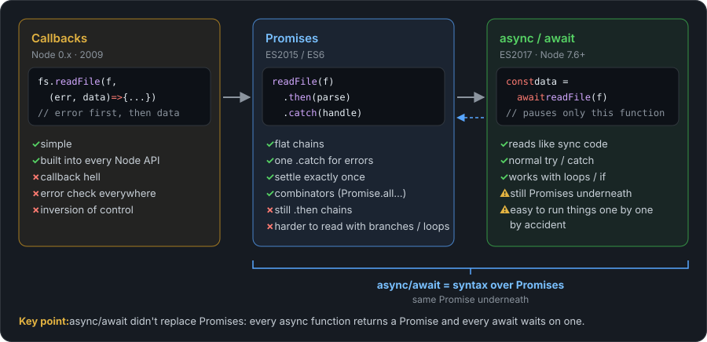

A promise is always in one of three states, and it settles **once**:

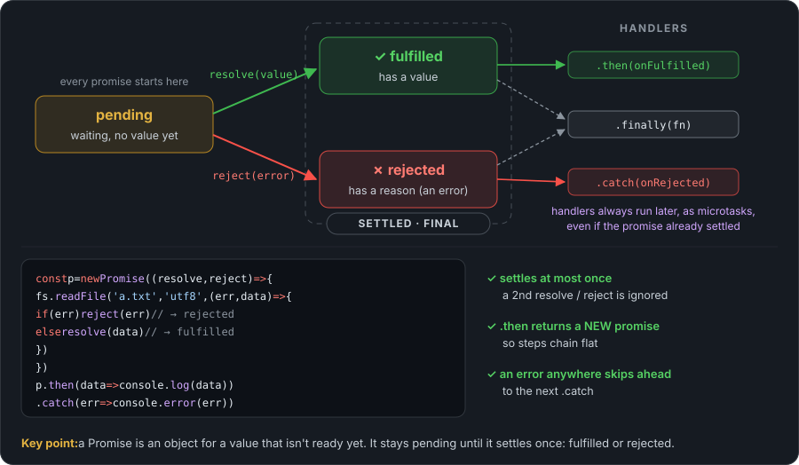

What Promises fixed:

| Callback problem | How Promises fix it |
|---|---|
| pyramid of doom | `.then()` returns a **new** promise, so steps chain **flat** |
| error check at every level | an error (or a `throw`) anywhere skips down to the **one** `.catch()` |
| `try/catch` doesn't work | `.catch()` catches both rejections **and** exceptions thrown inside `.then` |
| called twice / never | a promise settles **at most once**; later `resolve`/`reject` calls are ignored |
| sometimes sync, sometimes async | handlers **always** run async (as microtasks), even if the promise is already settled |
| hard to compose | built-in `Promise.all`, `allSettled`, `race`, `any` |

---

## 4. Promises in code

**The simplest promise:** create it, then consume it with `.then` / `.catch`.

```js
const myPromise = new Promise((resolve, reject) => {
  const success = true;

  if (success) {
    resolve("Operation successful!");   // → fulfilled: the value goes to .then
  } else {
    reject("Something went wrong!");    // → rejected: the reason goes to .catch
  }
});

myPromise
  .then((result) => {
    console.log(result);                // "Operation successful!"
  })
  .catch((error) => {
    console.error(error);               // runs only if reject() was called (set success = false)
  });
```

**Creating a promise** (wrapping a callback API):

```js
function readFileP(path) {
  return new Promise((resolve, reject) => {
    fs.readFile(path, 'utf8', (err, data) => {
      if (err) reject(err)      // → rejected
      else resolve(data)        // → fulfilled
    })
  })
}
```

In real code you rarely write `new Promise` for Node APIs. Use the promise versions or `util.promisify`:

```js
const fs = require('node:fs/promises')          // fs.readFile now returns a promise
const { promisify } = require('node:util')
const sleep = promisify(setTimeout)             // any error-first callback API → promise
```

**The callback-hell example, as a promise chain:**

```js
getUser(id)
  .then(user   => getOrders(user.id))
  .then(orders => getItems(orders[0].id))
  .then(items  => getPrice(items))
  .then(price  => sendEmail(price))
  .then(()     => console.log('sent'))
  .catch(err   => console.error('failed:', err))   // ONE place for every step's errors
  .finally(()  => console.log('cleanup'))          // runs either way
```

Rules of chaining:

- Whatever you **return** from `.then` becomes the value for the next `.then`. If you return a **promise**, the chain waits for it.
- A `throw` inside `.then` turns into a rejection and jumps to the next `.catch`.
- `.catch` returns a promise too, so the chain can **recover** and continue after it.

---

## 5. Running promises together: all, allSettled, race, any

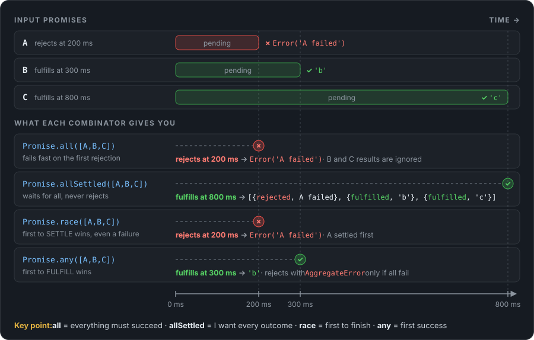

```js
const [user, orders] = await Promise.all([getUser(id), getOrders(id)])      // need all, fail fast

const results = await Promise.allSettled([sendEmail(), sendSms(), sendPush()])
results.forEach(r => r.status === 'rejected' && console.error(r.reason))     // want every outcome

const data = await Promise.race([fetchData(), timeout(2000)])               // first to finish (timeouts)

const fastest = await Promise.any([fetchFromMirror1(), fetchFromMirror2()]) // first success
```

---

## 6. async / await

### First: what's still wrong with `.then` chains

Promises fixed callback hell, but a `.then` chain is still **a chain of callbacks**. Four problems keep showing up:

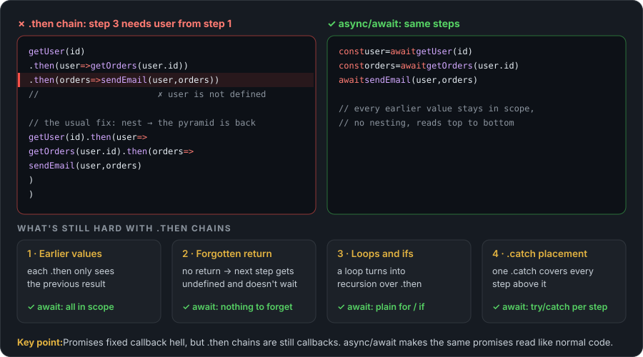

**1. A later step needs an earlier value.** Each `.then` only receives the **previous** result:

```js
getUser(id)
  .then(user => getOrders(user.id))
  .then(orders => sendEmail(user, orders))   // ✗ ReferenceError: user is not defined

// "fix" 1: nest, and the pyramid is back
getUser(id).then(user =>
  getOrders(user.id).then(orders => sendEmail(user, orders))
)

// "fix" 2: an outer variable, mutable state shared between callbacks
let user
getUser(id)
  .then(u => { user = u; return getOrders(u.id) })
  .then(orders => sendEmail(user, orders))
```

**2. Forgetting `return` silently breaks the chain.** The next step gets `undefined`, doesn't wait, and errors from the lost promise are unhandled:

```js
getUser(id)
  .then(user => { getOrders(user.id) })    // ✗ braces + no return
  .then(orders => console.log(orders))     // undefined, printed before getOrders finishes
```

**3. Loops and conditions are awkward.** "Fetch pages until there are none left" becomes recursion:

```js
// .then version: recursion
function fetchAll(page = 1, all = []) {
  return fetchPage(page).then(items =>
    items.length ? fetchAll(page + 1, all.concat(items)) : all
  )
}

// async/await version: a normal loop
async function fetchAll() {
  const all = []
  for (let page = 1; ; page++) {
    const items = await fetchPage(page)
    if (!items.length) return all
    all.push(...items)
  }
}
```

**4. Where the `.catch` sits changes what happens.** A `.catch` handles errors from **every** step above it, and the chain then **continues**:

```js
getUser(id)
  .then(user => getOrders(user.id))
  .catch(() => [])                  // catches getUser AND getOrders failures
  .then(orders => render(orders))   // still runs after an error, with []
```

With `try/catch` you choose exactly which `await`s each handler covers.

### async/await fixes it

`async`/`await` (ES2017, Node 7.6+) is **syntax on top of Promises**. It lets you write promise code that reads like normal synchronous code.

- An `async` function **always returns a promise**. `return x` fulfills it with `x`; `throw e` rejects it with `e`.
- `await p` **pauses this function** until `p` settles, then gives you the value (or throws the error).
- `await` works inside `async` functions, and at the top level of ES modules (`.mjs`).

**The same example again, with async/await:**

```js
async function notify(id) {
  try {
    const user   = await getUser(id)
    const orders = await getOrders(user.id)
    const items  = await getItems(orders[0].id)
    const price  = await getPrice(items)
    await sendEmail(price)
    console.log('sent')
  } catch (err) {
    console.error('failed:', err)     // normal try/catch works again
  } finally {
    console.log('cleanup')
  }
}
```

---

## 7. Promise vs async/await: what's the difference?

They're **the same mechanism**. `async`/`await` is built on Promises and compiles down to promise reactions. The difference is how the code reads:

```js
// Promise style
function getTotal(id) {
  return getOrders(id)
    .then(orders => orders.reduce((sum, o) => sum + o.price, 0))
    .catch(err => { log(err); return 0 })
}

// async/await style: same behaviour, same return value (a Promise)
async function getTotal(id) {
  try {
    const orders = await getOrders(id)
    return orders.reduce((sum, o) => sum + o.price, 0)
  } catch (err) {
    log(err)
    return 0
  }
}
```

| | Promises (`.then`) | async/await |
|---|---|---|
| What it is | an object + methods | syntax over that same object |
| Returns | a promise | a promise (always) |
| Reads like | a chain of callbacks | normal top-to-bottom code |
| Errors | `.catch()` | `try / catch` |
| Loops and `if`s between steps | awkward (nested `.then`s) | natural (`for`, `if`, `while`) |
| Parallel work | `Promise.all([...])` | still `await Promise.all([...])` |
| Debugging | stack traces jump around | clearer stack traces, step through like sync code |
| Easy mistake | forgetting to `return` inside `.then` | forgetting `await`, or awaiting things one by one |

> [!TIP]
> **Interview answer:** "async/await is syntactic sugar over Promises. An async function returns a Promise, and await pauses only that function until a Promise settles. I use async/await for readability and `Promise.all` / `allSettled` when things can run in parallel."

---

## 8. async/await on the event loop, step by step

### Microtask queue vs macrotask queue

- **Microtask queue:** small "finish this right after the current code" jobs: promise callbacks and the code after `await`. It's emptied **completely** every time the call stack empties.
- **Macrotask queue:** the bigger "next turn of the loop" jobs: timers, I/O callbacks, `setImmediate`. The loop runs them **one at a time**, and empties the microtask queue again after **each** one.

| | Microtask queue | Macrotask queue |
|---|---|---|
| What goes in | `.then` / `.catch` / `.finally` callbacks, code after `await`, `queueMicrotask(fn)`. (`process.nextTick` has its own queue that runs even earlier.) | `setTimeout` / `setInterval` callbacks, I/O callbacks (`fs`, sockets), `setImmediate`, `'close'` events |
| Filled by | V8, when a promise settles | libuv, when a timer expires or I/O completes |
| When it runs | as soon as the current JS finishes, **before** anything else | when the event loop reaches that phase |
| How many at once | **all** of them, including ones added meanwhile | **one**, then all microtasks again |
| Priority | higher | lower |
| Danger | an endless microtask chain starves timers and I/O | a slow callback delays everything behind it |

> [!NOTE]
> "Macrotask queue" is the common interview name. In Node there isn't literally one: each event loop **phase** has its own (timers, poll, check, close; see [the libuv phases](#5-the-real-event-loop-libuv-phases)). The rule is the same: one macrotask, then drain all microtasks.

Same style as the `setTimeout` walkthrough, but now with **both queues**. The program:

```js
console.log('A')
setTimeout(() => console.log('F'), 0)

async function main() {
  console.log('B')
  await Promise.resolve()
  console.log('D')
}
main()

Promise.resolve().then(() => console.log('E'))
console.log('C')
// Output: A B C D E F
```

### Step 1: sync code runs first

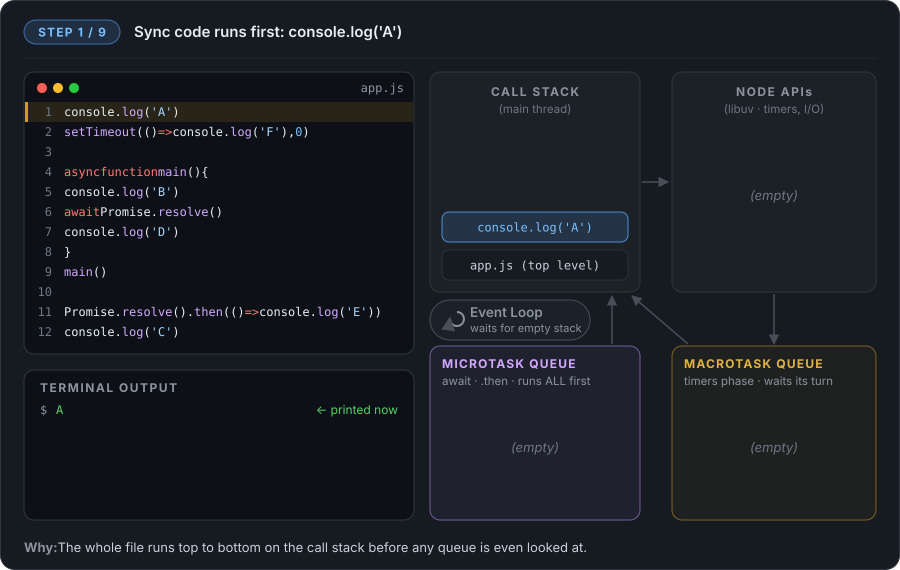

### Step 2: setTimeout schedules a macrotask

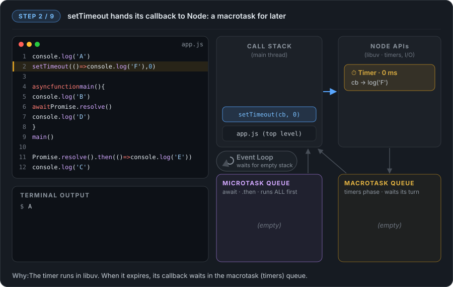

### Step 3: calling an async function runs it immediately

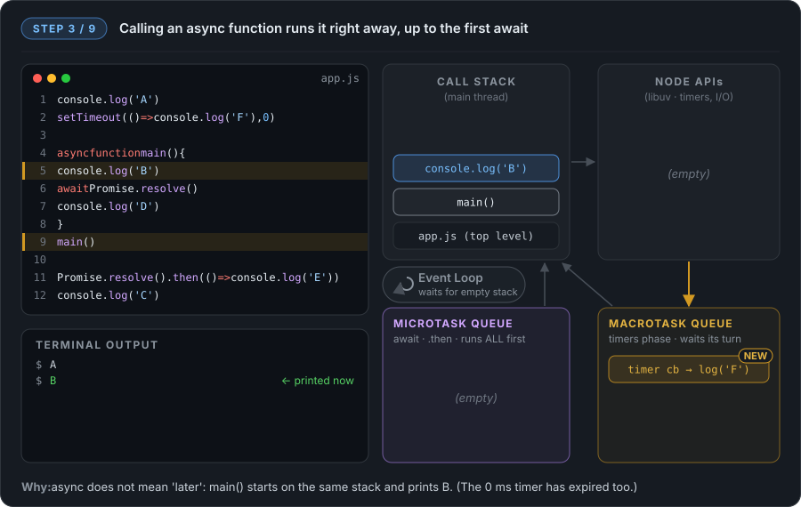

- `async` doesn't mean "run later". `main()` runs synchronously **until its first `await`**.

### Step 4: await pauses the function

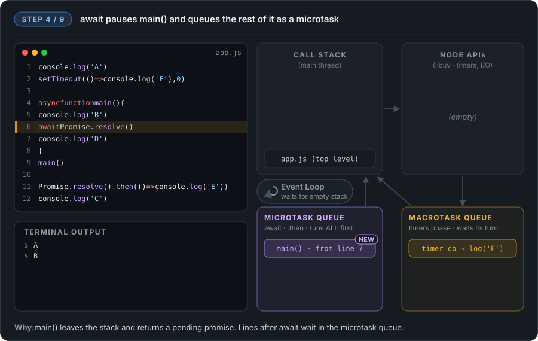

- `main()` is **popped off the stack** and immediately returns a pending promise to its caller.
- The rest of the function (line 7 onward) is saved and queued as a **microtask**, to run once the awaited promise settles (here it already has).
- The caller (the top-level script) carries on with line 11. **Nothing is blocked.**

### Step 5: .then queues another microtask

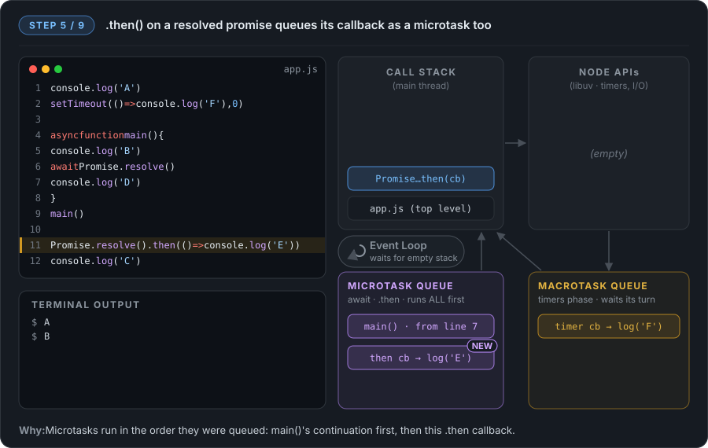

### Step 6: the rest of the sync code

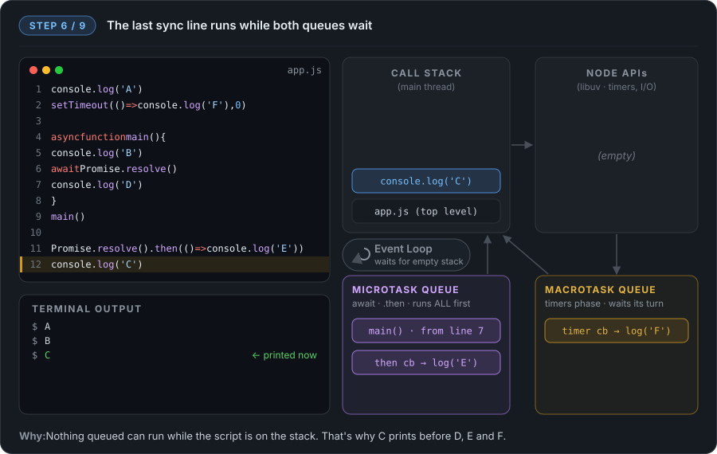

### Step 7: stack empty, microtasks first

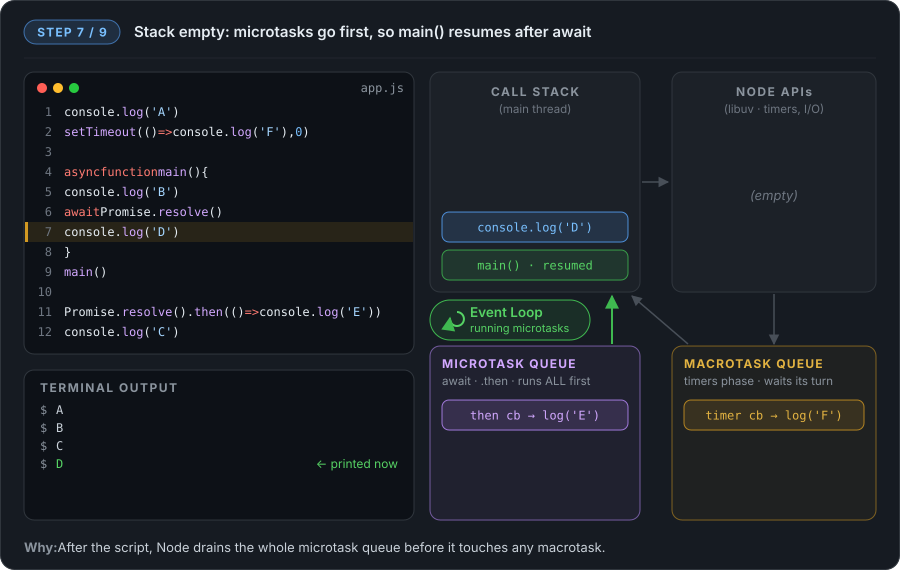

### Step 8: drain the rest of the microtasks

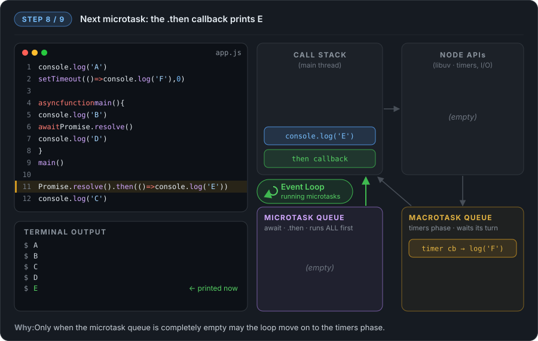

### Step 9: only then, the macrotask

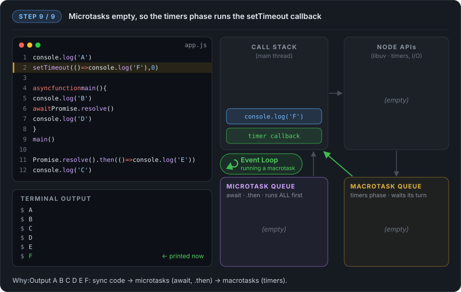

> [!IMPORTANT]
> Key takeaway: **sync code → all microtasks (`await` continuations, `.then`) → one macrotask (timer, I/O) → all microtasks → …**. An `await` is just "put the rest of this function in the microtask queue when the promise settles".

---

## 9. Does async/await block the thread?

**No, `await` never blocks the thread.** It pauses only **the async function it's in**. The function returns a pending promise to its caller, the call stack empties, and the event loop is free to run other code: other requests, timers, other callbacks. When the awaited promise settles, the rest of the function is queued as a microtask and continues where it left off.

With real I/O:


```js
async function getConfig() {
  console.log('1: reading file')
  const text = await fs.promises.readFile('config.json', 'utf8')   // pauses getConfig only
  console.log('3: got', text.length, 'chars')
}
getConfig()
console.log('2: main thread is free')
// 1: reading file
// 2: main thread is free     ← ran while the file was being read
// 3: got 247 chars
```

**But `async` does not make CPU work non-blocking.** Code inside an async function runs on the main thread like any other code. Only the **waiting** at an `await` is free. A heavy loop inside an `async` function blocks everything:

```js
const t0 = Date.now()
async function slow() {
  const end = Date.now() + 300
  while (Date.now() < end) {}          // 300 ms of pure CPU: no await, nothing to pause on
  return 'done'
}
setTimeout(() => console.log('timer fired after', Date.now() - t0, 'ms'), 0)
slow().then(v => console.log(v, 'at', Date.now() - t0, 'ms'))
console.log('sync line after slow() at', Date.now() - t0, 'ms')

// sync line after slow() at 300 ms   ← even the NEXT line waited 300 ms
// done at 301 ms
// timer fired after 301 ms           ← a 0 ms timer was 300 ms late
```

| Inside an async function | Blocks the thread? |
|---|---|
| `await` on I/O (`fs.promises`, DB query, `fetch`) | ❌ no: the function pauses, the thread is free |
| `await` on a timer (`await sleep(1000)`) | ❌ no |
| Sync code between awaits (normal short logic) | runs on the main thread (fine if short) |
| A long CPU loop, `JSON.parse` of a huge string, `*Sync` APIs | ✅ **yes**, `async` doesn't help. Use a [worker thread](#3-what-happens-if-we-dont-use-a-worker-thread). |

> [!WARNING]
> ⚠️ `await` pauses the **function**, not the **thread**. If you want CPU work off the main thread, `async` won't do it; only `worker_threads` or another process will.

---

## 10. Sequential vs parallel await

The most common async/await performance bug: awaiting independent calls one by one.

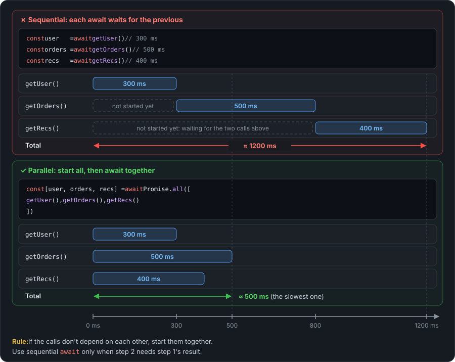

```js
// ✗ sequential: ~1200 ms
const user   = await getUser()
const orders = await getOrders()
const recs   = await getRecs()

// ✓ parallel: ~500 ms (start all, then wait for all)
const [user2, orders2, recs2] = await Promise.all([getUser(), getOrders(), getRecs()])
```

The same trap in loops:

```js
// ✗ forEach does NOT wait for async callbacks. 'all done' prints first.
ids.forEach(async id => { await save(id) })
console.log('all done')

// ✓ one at a time (when order matters or to limit load)
for (const id of ids) await save(id)

// ✓ all at once
await Promise.all(ids.map(id => save(id)))
```

---

## 11. Common mistakes

- **Forgetting `await`.** `const user = getUser()` gives you a **Promise**, not a user. `user.name` is `undefined`.
- **Unhandled rejections.** A rejected promise with no `.catch` / `try` **crashes the process** in Node 15+. Always handle errors, or add `process.on('unhandledRejection', ...)` for logging.
- **`try/catch` around a promise you didn't `await`.** `try { doAsync() } catch {}` catches nothing. Use `try { await doAsync() } catch {}`.
- **`return` vs `return await` inside `try`.** `return promise` inside `try` skips your `catch` if it rejects. Use `return await promise` there.
- **Mixing styles.** `await x.then(...)` works but is hard to read. Pick one style per function.
- **Wrapping CPU work in `async`,** thinking it becomes non-blocking (see [section 9](#9-does-asyncawait-block-the-thread)).

---

## 12. Interview questions on async code

<details>
<summary><b>Q1. Why were Promises introduced if we already had callbacks?</b></summary>

To fix callback hell: deep nesting, error handling at every level, `try/catch` not working, and inversion of control (trusting a library to call your callback exactly once). A promise is a returned object that settles exactly once, chains flat with `.then`, routes all errors to one `.catch`, always runs handlers asynchronously, and composes with `Promise.all` / `allSettled` / `race` / `any`.
</details>

<details>
<summary><b>Q1b. Promises fixed callback hell. What's still wrong with <code>.then</code> chains?</b></summary>

A later step can't see earlier values without nesting again or using outer variables. A forgotten `return` silently breaks the chain. Loops and conditions turn into recursion and nested `.then`s. And one `.catch` covers every step above it, so per-step error handling is clumsy. async/await keeps every value in scope, uses normal `for` / `if`, and scopes errors with `try/catch`.
</details>

<details>
<summary><b>Q2. What is the difference between Promises and async/await?</b></summary>

async/await is syntax over Promises, not a replacement. An async function returns a Promise, and `await` waits for one. async/await reads like synchronous code and uses `try/catch`; `.then` chains use `.catch`. Parallelism still needs `Promise.all`.
</details>

<details>
<summary><b>Q3. Does <code>await</code> block the thread?</b></summary>

No. It pauses only the async function: the function returns a pending promise, the stack unwinds, and the event loop runs other work. When the promise settles, the rest of the function runs as a microtask. But CPU-heavy code inside an async function still blocks, because it runs on the main thread like any other code.
</details>

<details>
<summary><b>Q4. Predict the output</b></summary>

```js
console.log('1')
setTimeout(() => console.log('2'), 0)
async function f() {
  console.log('3')
  await null
  console.log('4')
}
f()
Promise.resolve().then(() => console.log('5'))
console.log('6')
```

**Answer: `1 3 6 4 5 2`.** Sync first: `1`, `3` (start of `f`), `6`. Then microtasks in queue order: `4` (f's continuation was queued first), `5`. Then the timer macrotask: `2`.
</details>

<details>
<summary><b>Q5. What does an async function return if you <code>return 5</code>?</b></summary>

`Promise<5>`, a promise fulfilled with 5. An async function always returns a promise. If it throws, the promise is rejected.
</details>

<details>
<summary><b>Q6. How do you run several async calls in parallel and handle failures?</b></summary>

Start them all, then `await Promise.all([...])` if all must succeed (it rejects on the first failure), or `await Promise.allSettled([...])` to get every result and handle failures individually.
</details>

<details>
<summary><b>Q7. What happens to an unhandled promise rejection?</b></summary>

Since Node 15, it crashes the process (`--unhandled-rejections=throw` is the default). Always `.catch` or `try/await/catch`, and log `process.on('unhandledRejection')` as a last resort.
</details>

<details>
<summary><b>Q8. Concurrency vs parallelism: which one does Node do?</b></summary>

- **Concurrency** = many tasks **in progress** at the same time, taking turns. One worker switches between them.
- **Parallelism** = many tasks **running at the same instant**, on different CPU cores.

Analogy: one chef cooking 5 dishes by switching between them while things simmer is **concurrency**. Five chefs each cooking one dish is **parallelism**.

| | Concurrency | Parallelism |
|---|---|---|
| Needs multiple cores? | no | yes |
| In Node | the event loop: 10,000 requests in progress on **one** thread, each `await` hands the turn to the next | `worker_threads`, `cluster`, the libuv thread pool |
| Good for | I/O-bound work (mostly waiting) | CPU-bound work (mostly computing) |

So Node's JavaScript is **concurrent but not parallel** by default: while one request awaits the database, the loop runs another request's callback, but only one piece of JS runs at any instant. You get real **parallelism** for your JS with worker threads or multiple processes. Under the hood, Node is already parallel for I/O (thread pool and kernel work alongside the main thread).

> Interview line: *"Concurrency is about **dealing with** many things at once; parallelism is about **doing** many things at once. The event loop gives Node concurrency; worker threads and cluster give it parallelism."*
</details>

---

## 13. Async cheat sheet

| Concept | Remember |
|---|---|
| Callback | function called later; Node uses `(err, result)` error-first style |
| Callback hell | nesting + repeated error checks + no `try/catch` + inversion of control |
| Promise | object for a future value: pending → fulfilled / rejected, settles **once** |
| `.then` / `.catch` / `.finally` | handlers run as **microtasks**; `.then` returns a new promise (chaining) |
| `Promise.all` / `allSettled` / `race` / `any` | all succeed · every outcome · first to settle · first success |
| `async function` | always returns a promise; runs synchronously until the first `await` |
| `await` | pauses **the function** (not the thread); the rest runs as a microtask |
| Order | sync → all microtasks → one macrotask → all microtasks → … |
| CPU work inside `async` | still **blocks**: use `worker_threads` |
| Concurrency vs parallelism | event loop = concurrency (taking turns on 1 thread) · workers / cluster = parallelism (multiple cores) |
| Independent calls | `await Promise.all([...])`, not one by one |

---

# Prisma ORM

## 1. What is Prisma?

An **ORM** (Object-Relational Mapper) lets you work with database rows as normal objects in your code, instead of writing SQL strings by hand.

**Prisma** is the most popular ORM for Node.js and TypeScript. You describe your tables once in a `schema.prisma` file, and Prisma gives you:

| Part | What it does |
|---|---|
| **Prisma schema** | one readable file with your models, fields, types and relations: the single source of truth |
| **Prisma Client** | a generated, **fully typed** query API: `prisma.user.findMany()`, with autocomplete for every model and field |
| **Prisma Migrate** | turns schema changes into SQL migration files and applies them to the database |
| **Prisma Studio** | a browser GUI to view and edit your data |

It works with PostgreSQL, MySQL / MariaDB, SQLite, SQL Server and CockroachDB (MongoDB support depends on the version).

---

## 2. How Prisma works

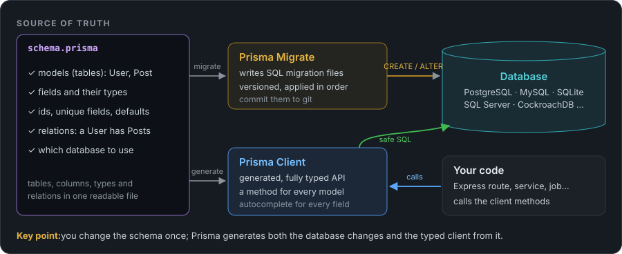

The usual workflow:

1. Edit `schema.prisma` (add a model or a field).
2. `npx prisma migrate dev --name add_posts` creates a SQL migration and applies it to your dev database.
3. `npx prisma generate` regenerates the typed client.
4. Use the new fields in code, with autocomplete and type checks.
5. In production, run `npx prisma migrate deploy` to apply the committed migrations.

| Command | What it does |
|---|---|
| `npx prisma init` | creates `prisma/schema.prisma` and the config file |
| `npx prisma migrate dev --name <name>` | schema change → new SQL migration, applied to the dev database |
| `npx prisma migrate deploy` | applies committed migrations (production / CI) |
| `npx prisma generate` | regenerates the typed Prisma Client |
| `npx prisma db pull` | builds the schema from an existing database (introspection) |
| `npx prisma studio` | opens a browser GUI to view and edit data |

---

## 3. A quick example

**Schema** (`prisma/schema.prisma`):

```prisma
generator client {
  provider = "prisma-client"            // Prisma 7. Prisma 6 and older: "prisma-client-js"
  output   = "../src/generated/prisma"
}

datasource db {
  provider = "postgresql"
}

model User {
  id    Int     @id @default(autoincrement())
  email String  @unique
  name  String?
  posts Post[]                          // one user → many posts
}

model Post {
  id        Int     @id @default(autoincrement())
  title     String
  published Boolean @default(false)
  author    User    @relation(fields: [authorId], references: [id])
  authorId  Int
}
```

**Connection** (Prisma 7 keeps the URL in `prisma.config.ts` and connects through a driver adapter):

```ts
// prisma.config.ts
import 'dotenv/config'
import { defineConfig, env } from 'prisma/config'

export default defineConfig({
  schema: 'prisma/schema.prisma',
  datasource: { url: env('DATABASE_URL') },
})
```

```ts
// src/db.ts: create ONE client and reuse it everywhere (it holds a connection pool)
import { PrismaClient } from './generated/prisma/client'
import { PrismaPg } from '@prisma/adapter-pg'

const adapter = new PrismaPg({ connectionString: process.env.DATABASE_URL })
export const prisma = new PrismaClient({ adapter })
```

> [!NOTE]
> **Prisma 6 and older:** `url = env("DATABASE_URL")` goes inside the `datasource` block, no adapter is needed, and you import with `import { PrismaClient } from '@prisma/client'`.

**Queries** (all return promises, all typed):

```ts
// create
const user = await prisma.user.create({
  data: { email: 'asha@example.com', name: 'Asha' },
})

// read with a filter + the related posts (a JOIN, without writing one)
const users = await prisma.user.findMany({
  where: { email: { endsWith: '@example.com' } },
  include: { posts: true },
  orderBy: { id: 'desc' },
  take: 10,                              // LIMIT 10
})

// update / delete
await prisma.post.update({ where: { id: 1 }, data: { published: true } })
await prisma.user.delete({ where: { id: user.id } })

// transaction: both succeed or neither does
await prisma.$transaction([
  prisma.post.deleteMany({ where: { authorId: user.id } }),
  prisma.user.delete({ where: { id: user.id } }),
])

// escape hatch for complex SQL (still parameterized, safe)
const rows = await prisma.$queryRaw`SELECT * FROM "User" WHERE id = ${user.id}`
```

---

## 4. Why use Prisma: benefits and trade-offs

| ✅ Benefits | Why it matters |
|---|---|
| **Type safety + autocomplete** | typos in field names and wrong types fail at compile time, not in production |
| **Schema as the single source of truth** | models, relations and migrations all come from one file |
| **Migrations built in** | schema changes are versioned SQL files in git, applied the same way everywhere |
| **Easy relations** | `include` / nested `create` instead of hand-written JOINs |
| **SQL injection safe by default** | values are always sent as parameters, even in `$queryRaw` tagged templates |
| **Readable queries** | `where`, `orderBy`, `take`, `skip` read like plain objects |
| **Tooling** | Prisma Studio, introspection (`prisma db pull` builds a schema from an existing database) |

| ⚠️ Trade-offs | |
|---|---|
| Very complex queries | some reports, window functions or DB-specific features need `$queryRaw` |
| Extra build step | you must re-run `prisma generate` after schema changes |
| Less control | you don't hand-tune every SQL statement |
| N+1 queries | still possible if you query inside a loop; use `include` or `in` filters |

> [!TIP]
> **Interview tip:** "Prisma is a type-safe ORM. The schema file is the source of truth: Migrate turns it into SQL migrations and generate turns it into a typed client. I get autocomplete, compile-time checks and injection-safe queries, and drop to `$queryRaw` for the rare complex query."

---

## 5. Prisma interview questions

<details>
<summary><b>Q1. What is an ORM, and why use one?</b></summary>

It maps database tables to objects in your code, so you query with method calls instead of SQL strings. You get less boilerplate, injection-safe queries, easier relations and, with Prisma, compile-time type safety. The cost is some loss of control over the exact SQL.
</details>

<details>
<summary><b>Q2. What's the difference between <code>prisma migrate dev</code> and <code>prisma migrate deploy</code>?</b></summary>

`migrate dev` (development) compares your schema with the database, **creates** a new migration file and applies it, possibly resetting the dev database. `migrate deploy` (production / CI) only **applies** the already-committed migrations, never creates new ones and never resets data.
</details>

<details>
<summary><b>Q3. Why create only one PrismaClient?</b></summary>

Each client has its own connection pool. Creating a new client per request opens new pools and quickly runs out of database connections. Create it once in a module (`db.ts`) and import it everywhere.
</details>

<details>
<summary><b>Q4. How do you handle a duplicate email?</b></summary>

Put `@unique` on the field. Prisma then throws a known error with code **`P2002`** (unique constraint failed) when you insert a duplicate. Catch it and return **409 Conflict** instead of a 500.
</details>

---

# Express.js

## 1. What is Express?

**Express** is the most widely used web framework for Node.js. It's **minimal and unopinionated**: a thin layer over Node's `http` module that adds **routing** and **middleware**, and leaves everything else (database, validation, structure) to you.

```js
import express from 'express'

const app = express()
app.use(express.json())                         // middleware: parse JSON bodies

app.get('/hello/:name', (req, res) => {         // route
  res.json({ message: `Hello ${req.params.name}` })
})

app.listen(3000, () => console.log('listening on :3000'))
```

---

## 2. What Express gives you

| Feature | What it does | Example |
|---|---|---|
| **Routing** | map HTTP method + path to a handler; path params, query strings | `app.get('/users/:id', fn)` → `req.params.id`, `req.query.page` |
| **Middleware** | functions that run in order on every request: parse, log, authenticate, validate | `app.use(fn)` |
| **Router** | split routes into modules and mount them on a prefix | `app.use('/users', usersRouter)` |
| **Request / response helpers** | short methods instead of raw `http` code | `res.json()`, `res.status(404)`, `res.send()`, `res.redirect()`, `req.body`, `req.get('Authorization')` |
| **Built-in middleware** | body parsing and static files | `express.json()`, `express.urlencoded()`, `express.static('public')` |
| **Error handling** | one central place for errors: middleware with **4 arguments** | `app.use((err, req, res, next) => …)` |
| **Template engines** | render HTML on the server | `app.set('view engine', 'ejs')`, `res.render('home')` |
| **Huge ecosystem** | ready-made middleware for almost anything | `cors`, `helmet`, `morgan`, `cookie-parser`, `express-rate-limit`, `multer`, `passport` |

---

## 3. Middleware: the core idea

A **middleware** is a function `(req, res, next)` that sits in the request pipeline. Express runs them **in the order you register them**. Each one either passes the request on with `next()`, ends it by sending a response, or reports an error with `next(err)`.

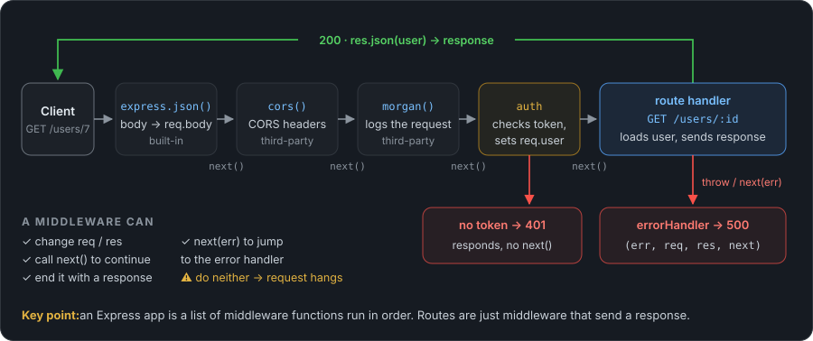

```js
// a custom logger: runs for every request, then passes it on
function logger(req, res, next) {
  const start = Date.now()
  res.on('finish', () => console.log(req.method, req.url, res.statusCode, Date.now() - start, 'ms'))
  next()                                        // forget this and the request hangs forever
}

// an auth middleware: either stops the request or adds req.user
function auth(req, res, next) {
  const token = req.get('Authorization')?.replace('Bearer ', '')
  if (!token) return res.status(401).json({ error: 'missing token' })   // ends here
  req.user = verifyToken(token)                 // available to every later middleware / route
  next()
}

// the error handler: 4 arguments, registered LAST
function errorHandler(err, req, res, next) {
  console.error(err)
  res.status(err.status ?? 500).json({ error: err.message ?? 'internal error' })
}

app.use(express.json())
app.use(logger)
app.use('/api', auth)                           // only for paths under /api
app.use('/api/users', usersRouter)
app.use(errorHandler)
```

Kinds of middleware:

| Kind | Registered with | Example |
|---|---|---|
| Application-level | `app.use(fn)` / `app.use('/path', fn)` | logger, auth for `/api` |
| Router-level | `router.use(fn)` | checks that only apply to one group of routes |
| Route-level | extra args on a route | `app.post('/users', validate(userSchema), createUser)` |
| Built-in | `express.json()`, `express.static()` | body parsing, serving files |
| Third-party | `npm install` | `cors()`, `helmet()`, `morgan('dev')`, `rateLimit()` |
| Error-handling | `app.use((err, req, res, next) => …)` | the central 500 handler |

---

## 4. Routing with express.Router

```js
// routes/users.js
import { Router } from 'express'
const router = Router()

router.get('/', listUsers)                      // GET    /api/users
router.get('/:id', getUser)                     // GET    /api/users/42
router.post('/', createUser)                    // POST   /api/users
router.patch('/:id', updateUser)                // PATCH  /api/users/42
router.delete('/:id', deleteUser)               // DELETE /api/users/42

export default router

// app.js
app.use('/api/users', usersRouter)
```

---

## 5. Express + Prisma: a small REST API

```js
import express from 'express'
import { prisma } from './db.js'

const app = express()
app.use(express.json())

app.get('/users/:id', async (req, res) => {
  const user = await prisma.user.findUnique({
    where: { id: Number(req.params.id) },
    include: { posts: true },   // also load this user's related Post rows (the User → Post relation)
                                // → user.posts is an array of posts; without include, the user has no posts field
  })
  if (!user) return res.status(404).json({ error: 'user not found' })
  res.json(user)
})

app.post('/users', async (req, res) => {
  try {
    const user = await prisma.user.create({ data: { email: req.body.email, name: req.body.name } })
    res.status(201).json(user)
  } catch (err) {
    if (err.code === 'P2002') return res.status(409).json({ error: 'email already used' })
    throw err                                   // anything else → error handler
  }
})

app.use((err, req, res, next) => {
  console.error(err)
  res.status(500).json({ error: 'something went wrong' })
})

app.listen(3000)
```

> [!IMPORTANT]
> **Express 5 vs 4:** in **Express 5** (current), if an `async` route handler throws or its promise rejects, Express passes the error to your error handler automatically. In **Express 4** an async error was **not** caught: you needed `try/catch` + `next(err)` in every handler, or the `express-async-errors` package. Express 5 also changed some path syntax: wildcards need a name, e.g. `/files/*filepath`.

---

## 6. Express interview questions

<details>
<summary><b>Q1. What is middleware in Express?</b></summary>

A function `(req, res, next)` in the request pipeline. Middleware runs in registration order and can read or modify `req`/`res`, end the request by sending a response, call `next()` to continue, or call `next(err)` to jump to the error handler. Routes are just middleware that send a response.
</details>

<details>
<summary><b>Q2. Why does the order of <code>app.use()</code> matter?</b></summary>

Express runs middleware top to bottom. `express.json()` must come before routes that read `req.body`, auth must come before the routes it protects, and the error handler must come **last**, or it never sees the errors.
</details>

<details>
<summary><b>Q3. How does Express know a middleware is an error handler?</b></summary>

By its arity: a middleware with **4 parameters** `(err, req, res, next)` is treated as an error handler. Express skips it for normal requests and calls it when something calls `next(err)` or throws.
</details>

<details>
<summary><b>Q4. What happens if a middleware neither calls <code>next()</code> nor sends a response?</b></summary>

The request hangs: the client waits until it times out. Every middleware must do one of the two.
</details>

<details>
<summary><b>Q5. Express vs plain Node <code>http</code>?</b></summary>

Plain `http` gives you only the raw request and response. You'd parse URLs, route by hand, parse bodies and set headers yourself. Express adds routing, middleware, body parsing, helpers like `res.json()` and central error handling, while staying small and unopinionated. (Opinionated alternatives: NestJS. Faster alternative: Fastify.)
</details>

---

# var vs let vs const

## 1. The short answer

| | `var` | `let` | `const` |
|---|---|---|---|
| Scope | **function** | **block** `{ }` | **block** `{ }` |
| Used before its declaration line | `undefined` (hoisted) | `ReferenceError` (TDZ) | `ReferenceError` (TDZ) |
| Redeclare in the same scope | ✓ allowed (a source of bugs) | ✗ SyntaxError | ✗ SyntaxError |
| Reassign | ✓ | ✓ | ✗ TypeError |
| Must be initialized | no | no | **yes** |
| Top-level in a browser script | becomes `window.x` | no | no |
| Introduced in | original JS | ES2015 (ES6) | ES2015 (ES6) |

> [!TIP]
> **Rule of thumb:** use `const` by default, `let` only when the value must change, and never `var` in new code.

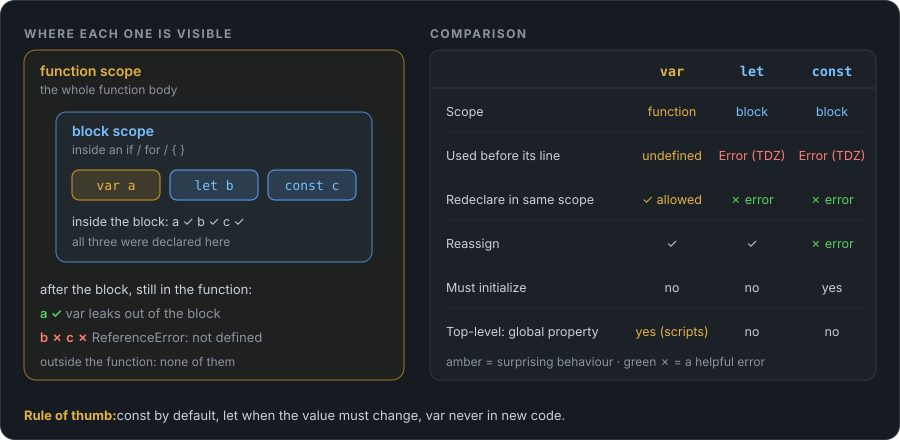

---

## 2. Scope: function vs block

```js
function demo() {
  if (true) {
    var a = 1
    let b = 2
    const c = 3
  }
  console.log(a)   // 1: var ignores the block, it belongs to the whole function
  console.log(b)   // ReferenceError: b is not defined
  console.log(c)   // (never reached)
}
```

---

## 3. Hoisting and the temporal dead zone (TDZ)

All three declarations are **hoisted** (the engine knows about them when the scope starts), but they behave differently before their line runs:

```js
console.log(x)   // undefined: var is hoisted AND set to undefined
var x = 5

console.log(y)   // ReferenceError: Cannot access 'y' before initialization
let y = 5        // let/const are hoisted but NOT initialized: the "temporal dead zone"

sayHi()          // works: function declarations are fully hoisted
function sayHi() { console.log('hi') }

sayBye()         // TypeError: sayBye is not a function (var sayBye is undefined here)
var sayBye = function () { console.log('bye') }
```

The TDZ is a feature: using a variable before it's set is almost always a bug, and `let`/`const` make it a loud error instead of a silent `undefined`.

---

## 4. Redeclare, reassign, and "const is not immutable"

```js
var a = 1
var a = 2          // allowed: silently overwrites (easy to clash in big files)

let b = 1
let b = 2          // SyntaxError: Identifier 'b' has already been declared

const c = 1
c = 2              // TypeError: Assignment to constant variable.
```

`const` stops **reassigning the variable**, not **changing the object** it points to:

```js
const user = { name: 'Asha' }
user.name = 'Ravi'          // ✓ allowed: same object, changed property
user = { name: 'Ravi' }     // ✗ TypeError: can't point user at a new object

const frozen = Object.freeze({ name: 'Asha' })
frozen.name = 'Ravi'        // ignored (TypeError in strict mode): freeze makes it read-only
```

---

## 5. The classic: closures in a loop

```js
for (var i = 0; i < 3; i++) {
  setTimeout(() => console.log(i), 0)
}
// 3 3 3

for (let i = 0; i < 3; i++) {
  setTimeout(() => console.log(i), 0)
}
// 0 1 2
```

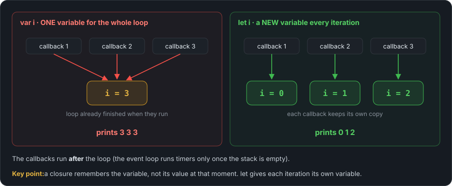

The callbacks run **after** the loop has finished (they're timers; see the event loop). A closure keeps a reference to the **variable**, not a copy of the value. `var` has one `i` for the whole function; `let` creates a **new `i` for every iteration**.

---

## 6. var / let / const interview questions

<details>
<summary><b>Q1. Why was let/const added if we had var?</b></summary>

`var` is function-scoped (it leaks out of `if`/`for` blocks), can be silently redeclared, and reads as `undefined` before its declaration. That caused bugs like the loop-closure one. `let`/`const` (ES2015) are block-scoped, can't be redeclared, and throw if used before declaration (the TDZ).
</details>

<details>
<summary><b>Q2. Is a const object immutable?</b></summary>

No. `const` only prevents reassigning the variable. The object's properties can still change. Use `Object.freeze()` for a shallow read-only object (nested objects stay mutable).
</details>

<details>
<summary><b>Q3. What is the temporal dead zone?</b></summary>

The time between entering a scope and the line where a `let`/`const` is declared. The variable exists (it's hoisted) but isn't initialized, so any access throws `ReferenceError`. Even `typeof x` throws there.
</details>

---

# TypeScript

## 1. What is TypeScript, and why was it introduced?

**TypeScript** is JavaScript **plus static types**. Microsoft released it in 2012 (it was designed by Anders Hejlsberg, who also created C#). It's a **superset**: any valid JavaScript is valid TypeScript, and the TypeScript compiler (`tsc`) turns your `.ts` files into plain `.js`.

JavaScript is **dynamically typed**: a variable can hold anything, and mistakes only show up when that line actually runs. That's fine for small scripts, and painful for big apps and teams:

```js
// JavaScript: no error anywhere, the bug ships
function total(order) {
  return order.price * order.qty
}
total({ price: 10, quantity: 2 })   // NaN. Typo: "quantity" instead of "qty"
```

```ts
// TypeScript: the same mistake is caught while typing
interface Order { price: number; qty: number }

function total(order: Order): number {
  return order.price * order.qty
}
total({ price: 10, quantity: 2 })
// error TS2353: Object literal may only specify known properties,
// and 'quantity' does not exist in type 'Order'.
```

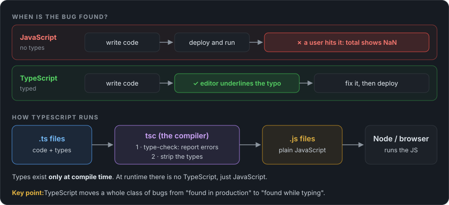

**What it solves:**

| Problem in plain JS | What TypeScript does |
|---|---|
| typos in property names, wrong argument types | compile error, red underline in the editor |
| `Cannot read properties of undefined` crashes | with `strict`, it forces you to handle `null` / `undefined` |
| "what does this function accept / return?" | the types **are** the documentation |
| weak autocomplete | the editor knows every field and method |
| scary refactors (rename a field in 50 files) | rename safely; every broken usage is flagged |
| large teams breaking each other's assumptions | interfaces are checked contracts between modules |

---

## 2. Types only exist at compile time

`tsc` does two jobs: **type-check**, then **strip the types**. What runs in Node is plain JavaScript, so types never slow your program down, and they also **can't** protect you from bad data at runtime.

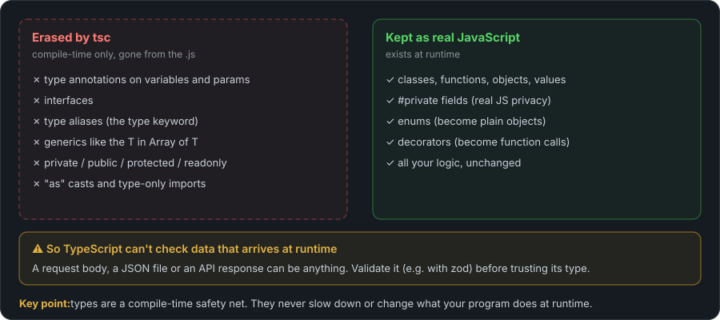

Running TypeScript in Node:

```bash
npx tsc               # type-check + compile src/*.ts → dist/*.js (settings in tsconfig.json)
node dist/index.js    # run the output

node src/index.ts     # recent Node (22.18+, 23.6+) can run .ts directly by STRIPPING types.
                      # It does not type-check, so still run `npx tsc --noEmit` in CI.
```

The one `tsconfig.json` setting to know: **`"strict": true`**. It turns on the important checks (`null`/`undefined` checks, no implicit `any`, …). Always use it.

---

## 3. Basic types

```ts
let title: string = 'Node notes'
let count: number = 3
let done: boolean = false
let tags: string[] = ['node', 'ts']           // array
let point: [number, number] = [10, 20]        // tuple: fixed length and types
let id: string | number = 'a1'                // union: one of these types
let dir: 'up' | 'down' = 'up'                 // literal type: only these exact values

let inferred = 42          // no annotation needed: TS infers number
inferred = 'x'             // ✗ error TS2322: Type 'string' is not assignable to type 'number'
```

**Functions:** type the parameters and the return value. `?` makes a parameter optional.

```ts
function greet(name: string, greeting?: string): string {
  return `${greeting ?? 'Hello'}, ${name}`
}

const add = (a: number, b: number): number => a + b

function log(message: string): void {   // void: returns nothing
  console.log(message)
}
```

**`null` / `undefined`** (with `strict`, TS makes you handle them):

```ts
function shout(name?: string) {
  return name.toUpperCase()        // ✗ error TS18048: 'name' is possibly 'undefined'
}

function shoutSafe(name?: string) {
  return name?.toUpperCase() ?? '' // ✓ handled
}
```

**`any` vs `unknown`:**

```ts
let a: any = JSON.parse('"hi"')
a.foo.bar()                  // compiles! any turns type checking OFF (crashes at runtime)

let u: unknown = JSON.parse('"hi"')
u.toUpperCase()              // ✗ error TS18046: 'u' is of type 'unknown'
if (typeof u === 'string') {
  u.toUpperCase()            // ✓ after the check, TS knows u is a string ("narrowing")
}
```

> [!TIP]
> **Interview tip:** `any` = "trust me, don't check". `unknown` = "I don't know yet, make me check first". Prefer `unknown` for data you don't control.

---

## 4. Interfaces and type aliases

Both describe the **shape of an object**:

```ts
interface User {
  id: number
  name: string
  email?: string                // optional
  readonly createdAt: Date      // can't be reassigned after creation
}

interface Admin extends User {  // interfaces extend other interfaces
  permissions: string[]
}

type Role = 'admin' | 'editor' | 'viewer'    // a union: only `type` can do this
type Point = { x: number; y: number }         // an object shape, like an interface
type UserWithRole = User & { role: Role }     // intersection: combine types

const u1: Admin = {
  id: 1,
  name: 'Asha',
  createdAt: new Date(),
  permissions: ['delete'],
}
```

**`interface` vs `type`:**

| | `interface` | `type` |
|---|---|---|
| Object shapes | ✓ | ✓ |
| Extending | `extends` | `&` (intersection) |
| Unions (`'a' \| 'b'`), tuples, primitives | ✗ | ✓ |
| Declaration merging (declare twice → merged) | ✓ | ✗ (error) |
| A class can `implements` it | ✓ | ✓ (if it's an object type) |

> [!TIP]
> **Rule of thumb:** `interface` for object shapes (models, public APIs), `type` for unions and everything else. Both are erased at runtime.

---

## 5. Classes in TypeScript

```ts
interface Shape {
  area(): number
}

class Circle implements Shape {               // must have everything Shape requires
  constructor(private readonly radius: number) {}   // "parameter property": declares + assigns
  area(): number {
    return Math.PI * this.radius ** 2
  }
}

class Account {
  public owner: string            // anyone can access (the default)
  protected balance = 0           // this class and subclasses only
  private pinHint = 'birthday'    // this class only (checked at compile time)
  #pin: string                    // REAL private: enforced by JavaScript at runtime
  static count = 0                // belongs to the class, not each object

  constructor(owner: string, pin: string) {
    this.owner = owner
    this.#pin = pin
    Account.count++
  }

  deposit(amount: number): void {
    this.balance += amount
  }
}

abstract class Animal {           // can't be instantiated: a base class only
  abstract sound(): string        // subclasses MUST implement this
  speak() {
    return `I say ${this.sound()}`
  }
}

class Dog extends Animal {
  sound() { return 'woof' }
}

new Dog().speak()                 // 'I say woof'
```

| Modifier | Who can access | Enforced when |
|---|---|---|
| `public` | everyone | n/a |
| `protected` | the class and its subclasses | compile time only |
| `private` | the class itself | compile time only |
| `#field` | the class itself | **runtime** (real JS) |
| `readonly` | can be read, never reassigned after the constructor | compile time only |

---

## 6. Generics (just the basics)

A **generic** is a type parameter: "this works for any type `T`, and keeps track of which one". You already use them:

```ts
const ids: Array<number> = [1, 2, 3]                 // same as number[]
async function getUser(id: number): Promise<User> {  // a Promise that resolves to a User
  return { id, name: 'Asha', createdAt: new Date() }
}

function first<T>(items: T[]): T | undefined {
  return items[0]
}
const n = first([1, 2, 3])        // T is number → n: number | undefined
const s = first(['a', 'b'])       // T is string → s: string | undefined

interface ApiResponse<T> {        // one shape, any payload
  data: T
  error?: string
}
const res: ApiResponse<User[]> = { data: [] }
```

Handy **built-in utility types** (also generics):

| Utility | Meaning | Example |
|---|---|---|
| `Partial<User>` | all fields optional | an update payload |
| `Pick<User, 'id' \| 'name'>` | only these fields | a public profile |
| `Omit<User, 'email'>` | all fields except these | hide private fields |
| `Readonly<User>` | nothing can be reassigned | config objects |
| `Record<string, number>` | an object with these key/value types | `{ apples: 3, pears: 5 }` |

---

## 7. TypeScript interview questions

<details>
<summary><b>Q1. What is TypeScript and why use it?</b></summary>

A superset of JavaScript that adds static types and compiles to plain JS. It catches type errors (typos, wrong arguments, `undefined` access) at compile time instead of in production, gives better autocomplete and safe refactoring, and documents the shapes of data. It has no runtime cost because the types are erased.
</details>

<details>
<summary><b>Q2. interface vs type?</b></summary>

Both describe object shapes. `interface` can be extended with `extends` and merged by declaring it twice. `type` can also describe unions, intersections, tuples and primitives. Common practice: interfaces for object shapes and public APIs, types for unions and composition.
</details>

<details>
<summary><b>Q3. any vs unknown?</b></summary>

`any` disables type checking for that value: anything compiles. `unknown` accepts any value but forces you to narrow it (`typeof`, `instanceof`, a validation library) before using it. `unknown` is the safe choice for untrusted data.
</details>

<details>
<summary><b>Q4. Does TypeScript check types at runtime?</b></summary>

No. Types are erased during compilation, so the running program is plain JavaScript. Data from outside (request bodies, JSON, APIs) must be validated at runtime, for example with `zod`.
</details>

<details>
<summary><b>Q5. <code>private</code> vs <code>#private</code>?</b></summary>

`private` is a TypeScript-only check: after compiling, the field is a normal property anyone can read. `#field` is a real JavaScript private field, so it's inaccessible from outside the class even at runtime.
</details>

---

# Tricky Output Questions

Predict the output first, then open the answer. Every answer here was checked by running it in Node (CommonJS, Node 20+).

## 1. Event loop and timers

**Q1.** The basics

```js
console.log('1')
setTimeout(() => console.log('2'), 0)
Promise.resolve().then(() => console.log('3'))
console.log('4')
```

<details>
<summary><b>Answer</b></summary>

`1 4 3 2`. Sync first (1, 4), then the microtask (promise: 3), then the macrotask (timer: 2).
</details>

**Q2.** nextTick vs Promise

```js
Promise.resolve().then(() => console.log('promise'))
process.nextTick(() => console.log('nextTick'))
console.log('sync')
```

<details>
<summary><b>Answer</b></summary>

`sync nextTick promise`. The `process.nextTick` queue is emptied before the promise microtask queue, even though the promise was created first.
</details>

**Q3.** Inside an I/O callback

```js
const fs = require('fs')
fs.readFile(__filename, () => {
  setTimeout(() => console.log('timeout'), 0)
  setImmediate(() => console.log('immediate'))
  process.nextTick(() => console.log('nextTick'))
})
```

<details>
<summary><b>Answer</b></summary>

`nextTick immediate timeout`, always. nextTick runs as soon as the callback ends. The I/O callback ran in the **poll** phase, the next phase is **check** (`setImmediate`), and timers only come on the next loop iteration.
</details>

**Q4.** The trick question

```js
setTimeout(() => console.log('timeout'), 0)
setImmediate(() => console.log('immediate'))
```

<details>
<summary><b>Answer</b></summary>

**It depends.** In the main module the order is not guaranteed: it depends on whether 1 ms has passed by the time the loop first checks timers. Saying "it's non-deterministic, unless it's inside an I/O callback" is the answer they want.
</details>

**Q5.** A microtask inside a timer

```js
setTimeout(() => {
  console.log('t1')
  Promise.resolve().then(() => console.log('p1'))
}, 0)
setTimeout(() => console.log('t2'), 0)
```

<details>
<summary><b>Answer</b></summary>

`t1 p1 t2`. After **each** timer callback, Node drains the microtasks before running the next timer (since Node 11).
</details>

**Q6.** Timers and promises scheduling each other

```js
setTimeout(() => {
  console.log('t1')
  Promise.resolve().then(() => console.log('p1'))
}, 0)

Promise.resolve().then(() => {
  console.log('p2')
  setTimeout(() => console.log('t2'), 0)
})
```

<details>
<summary><b>Answer</b></summary>

`p2 t1 p1 t2`. The microtask p2 runs first and schedules t2 **behind** t1. t1 runs, then its microtask p1, then t2.
</details>

## 2. Promises and async/await

**Q7.** The executor runs synchronously

```js
console.log('A')
new Promise(resolve => {
  console.log('B')
  resolve()
  console.log('C')
}).then(() => console.log('D'))
console.log('E')
```

<details>
<summary><b>Answer</b></summary>

`A B C E D`. The function you pass to `new Promise` runs **immediately**. `resolve()` doesn't stop it (C still prints). Only `.then` is async.
</details>

**Q8.** Two chains

```js
Promise.resolve().then(() => console.log(1)).then(() => console.log(2))
Promise.resolve().then(() => console.log(3)).then(() => console.log(4))
```

<details>
<summary><b>Answer</b></summary>

`1 3 2 4`. Each `.then` only queues the **next** step after it runs, so the two chains take turns.
</details>

**Q9.** await inside nested async functions

```js
async function a() {
  console.log('a1')
  await b()
  console.log('a2')
}
async function b() {
  console.log('b')
}
a()
console.log('c')
```

<details>
<summary><b>Answer</b></summary>

`a1 b c a2`. `b()` runs synchronously (it has no await). The `await` still pauses `a`, so `c` prints before `a2`.
</details>

**Q10.** What does an async function return?

```js
async function f() { return 1 }
console.log(f())
f().then(v => console.log(v))
```

<details>
<summary><b>Answer</b></summary>

`Promise { 1 }` then `1`. An async function always returns a promise, even for a plain value.
</details>

**Q11.** Settling twice

```js
new Promise((resolve, reject) => {
  resolve('first')
  resolve('second')
  reject(new Error('oops'))
})
  .then(v => console.log('then:', v))
  .catch(e => console.log('catch:', e.message))
```

<details>
<summary><b>Answer</b></summary>

`then: first`. A promise settles **once**. Later `resolve`/`reject` calls are ignored.
</details>

**Q12.** Errors skip ahead

```js
Promise.resolve(1)
  .then(() => { throw new Error('boom') })
  .then(() => console.log('skipped?'))
  .catch(e => console.log('caught', e.message))
  .then(() => console.log('after catch'))
```

<details>
<summary><b>Answer</b></summary>

`caught boom` then `after catch`. The throw skips every `.then` until a `.catch`. A `.catch` returns a normal promise, so the chain continues after it.
</details>

**Q13.** forEach with async

```js
[1, 2, 3].forEach(async n => {
  await null
  console.log(n)
})
console.log('done')
```

<details>
<summary><b>Answer</b></summary>

`done 1 2 3`. `forEach` ignores the promises the async callback returns, so it doesn't wait. Use `for...of` with `await`, or `await Promise.all(arr.map(...))`.
</details>

## 3. Scope and hoisting

**Q14.** var in a loop

```js
for (var i = 0; i < 3; i++) setTimeout(() => console.log(i), 0)
```

<details>
<summary><b>Answer</b></summary>

`3 3 3`. One shared `i`, read after the loop finished. With `let` it's `0 1 2`.
</details>

**Q15.** Hoisting

```js
console.log(a)
var a = 1

console.log(typeof b)
let b = 2
```

<details>
<summary><b>Answer</b></summary>

`undefined`, then **`ReferenceError: Cannot access 'b' before initialization`**. `var` is hoisted as `undefined`. `let` is in the TDZ, and even `typeof` throws there.
</details>

**Q16.** Function declaration vs function expression

```js
hi()
bye()

function hi() { console.log('hi') }
var bye = function () { console.log('bye') }
```

<details>
<summary><b>Answer</b></summary>

`hi`, then **`TypeError: bye is not a function`**. Function declarations are hoisted with their body. `var bye` is hoisted only as `undefined`.
</details>

**Q17.** const and objects

```js
const user = { name: 'Asha' }
user.name = 'Ravi'
console.log(user.name)
user = { name: 'Meera' }
```

<details>
<summary><b>Answer</b></summary>

`Ravi`, then **`TypeError: Assignment to constant variable.`** Mutating the object is fine; pointing the const at a new object is not.
</details>

## 4. JavaScript quick-fire

**Q18.**

```js
console.log(0.1 + 0.2 === 0.3)
console.log('5' + 2, '5' - 2)
console.log(typeof null)
console.log(NaN === NaN)
console.log([] + [])
console.log(typeof [])
```

<details>
<summary><b>Answer</b></summary>

- `false`: floating point. `0.1 + 0.2` is `0.30000000000000004`.
- `52 3`: `+` with a string concatenates; `-` converts to numbers.
- `object`: a famous bug from JS's first version, kept for compatibility.
- `false`: NaN is not equal to anything, even itself. Use `Number.isNaN()`.
- `''` (empty string): both arrays become empty strings.
- `object`: arrays are objects. Use `Array.isArray()`.
</details>

**Q19.** `this` in a regular method vs an arrow function

```js
const obj = {
  name: 'Node',
  regular() { return this.name },
  arrow: () => this.name,
}
console.log(obj.regular())
console.log(obj.arrow())
```

<details>
<summary><b>Answer</b></summary>

`Node`, then `undefined`. A regular method gets `this` from **how it's called** (`obj.regular()` → `obj`). An arrow function has no `this` of its own: it uses the `this` of the surrounding code (in a CommonJS module that's `module.exports`, an empty object).
</details>
