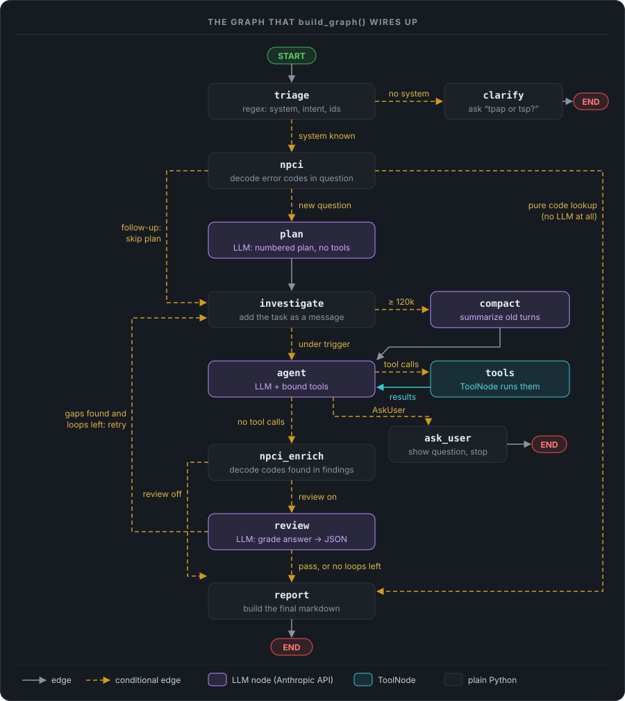
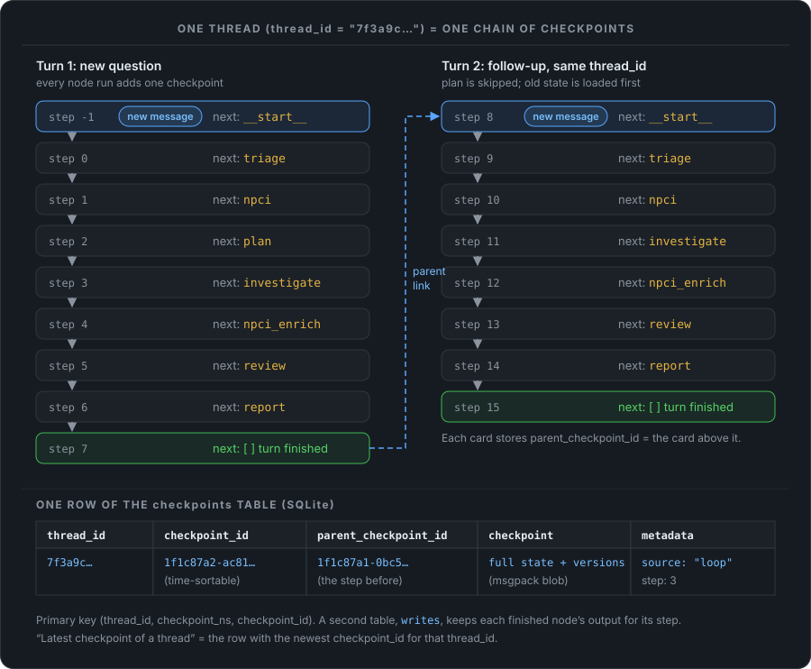
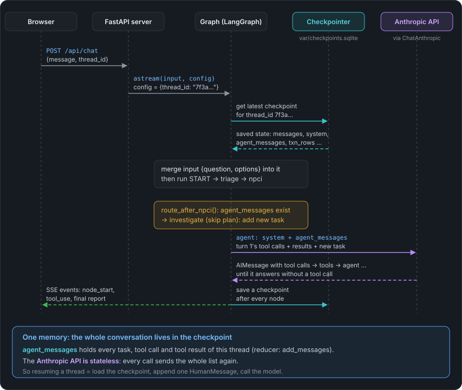
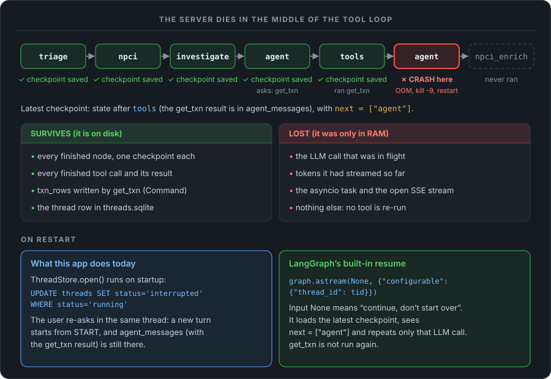
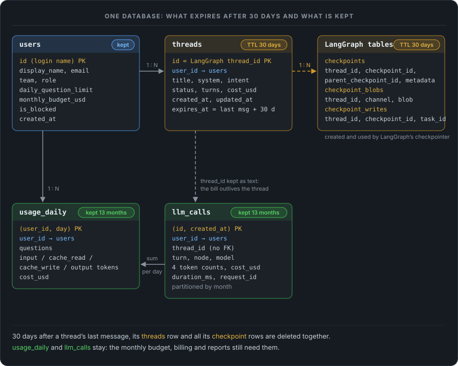
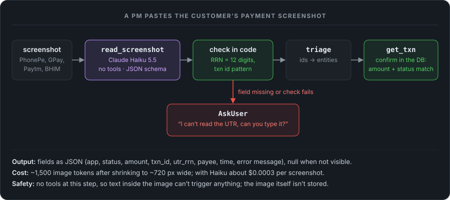
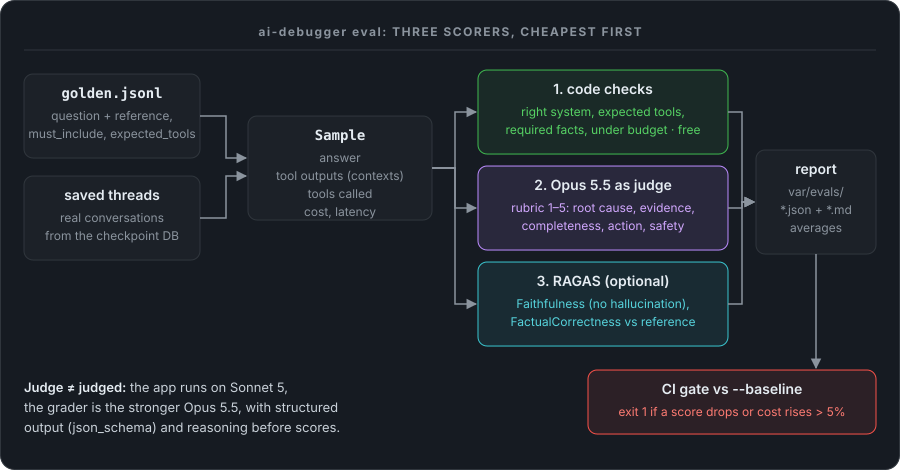

# LangGraph: Core Concepts

Notes for learning LangGraph: nodes, edges, conditional edges, state, the chat model, tools, checkpoints and threads, how a thread is resumed, what happens when the server crashes, and how to keep long threads cheap. Each concept comes with a generic code example and the same idea in my **LangGraph AI Debugger**, a production-debugging agent I built at work (code in `langgraph-ai-debugger/src/ai_debugger/`). Written for LangGraph 1.x (Python).

## 📚 Table of Contents

1. [What LangGraph is, in one minute](#1-what-langgraph-is-in-one-minute)
2. [The running example: the AI debugger graph](#2-the-running-example-the-ai-debugger-graph)
3. [State: the dict every node shares](#3-state-the-dict-every-node-shares)
4. [Node](#4-node)
5. [Edge](#5-edge)
6. [Conditional edge](#6-conditional-edge)
7. [START, END and compile()](#7-start-end-and-compile)
8. [The chat model: ChatAnthropic](#8-the-chat-model-chatanthropic)
9. [Tools](#9-tools)
10. [Checkpoint](#10-checkpoint)
11. [Thread](#11-thread)
12. [How a thread is resumed](#12-how-a-thread-is-resumed)
13. [What if the server crashes?](#13-what-if-the-server-crashes)
14. [Long threads: token cost, prompt caching and compaction](#14-long-threads-token-cost-prompt-caching-and-compaction)
15. [Production storage: one database, the data schema, and a 30-day thread TTL](#15-production-storage-one-database-the-data-schema-and-a-30-day-thread-ttl)
16. [Reading a payment screenshot with Claude Haiku](#16-reading-a-payment-screenshot-with-claude-haiku)
17. [Evaluating the agent: RAGAS and Claude Opus 5.5 as LLM-as-a-judge](#17-evaluating-the-agent-ragas-and-claude-opus-55-as-llm-as-a-judge)
18. [The hardest part: accuracy (answers that prove themselves)](#18-the-hardest-part-accuracy-answers-that-prove-themselves)
19. [Interview questions](#19-interview-questions)
20. [Cheat sheet](#20-cheat-sheet)
21. [Python side note: @dataclass vs Pydantic vs TypedDict](#21-python-side-note-dataclass-vs-pydantic-vs-typeddict)

---

## 1. What LangGraph is, in one minute

LangGraph is a Python (and JS) library from the LangChain team for building **stateful, multi-step LLM apps as a graph**. Think of a flowchart on a whiteboard:

| Whiteboard | LangGraph |
|---|---|
| The sticky note everyone reads and writes | **State**: one dict carried through the whole run |
| A box that does one job | **Node**: a plain Python function |
| An arrow: "after this box, go to that box" | **Edge** |
| An arrow with a question on it: "if X go left, else go right" | **Conditional edge** |
| Taking a photo of the board after every box | **Checkpoint** |
| One conversation's set of photos | **Thread** |

Why use a graph instead of a simple chain of LLM calls (`prompt → LLM → parser`)?

- **Loops.** A chain only goes forward. A graph can go back, e.g. "reviewer found gaps → investigate again".
- **Branching.** Pick the next step from the data: "no system given → ask the user".
- **Persistence.** State is saved after every step, so a conversation can continue later, survive a restart, or wait for a human.
- **Streaming.** You get events as each node starts and finishes, which is how the UI shows live progress.

Under the hood LangGraph runs the graph in **super-steps** (the model is called *Pregel*, after Google's graph-processing system). In each super-step, every node that was triggered runs (in parallel if there are several), their outputs are merged into the state, and a checkpoint is saved. Then the next super-step starts. In a straight-line graph like mine, one super-step = one node.

---

## 2. The running example: the AI debugger graph

The debugger takes a question like *"tsp: why is txn PTM… DEEMED?"*, decides what kind of question it is, and hands it to an agent: Claude through the Anthropic API, with LangGraph tools for the DB, logs, metrics, alerts and code. Three nodes call the LLM on every question (`plan`, `agent`, `review`) and `compact` does so occasionally on long threads. `tools` is LangGraph's prebuilt `ToolNode`, which runs the tools the model asks for, and the rest is plain Python.



Every concept below points back to this picture.

---

## 3. State: the dict every node shares

The **state** is a single dict that flows through the graph. You declare its shape once, usually as a `TypedDict`:

```python
from typing import Annotated, TypedDict
import operator

class DebugState(TypedDict, total=False):
    # append-only history: grows across every turn of the thread
    messages: Annotated[list[dict], operator.add]
    runs:     Annotated[list[dict], operator.add]   # one entry per LLM call (cost, time)

    # plain fields: each write replaces the old value
    question: str
    system: str | None        # "tpap" | "tsp" | None
    intent: str
    plan: str
    findings: str
    review: dict | None
    loops: int
    agent_messages: Annotated[list[AnyMessage], add_messages]  # the agent's conversation (section 9)
    report: str
```

**Reducers** decide how a node's output is merged into the state:

- A plain field (`plan: str`) is **overwritten**.
- A field marked `Annotated[list, operator.add]` is **appended to**. If the saved state has `runs = [A]` and a node returns `{"runs": [B]}`, the state becomes `runs = [A, B]`.

That is how the chat history keeps growing across turns while per-turn fields like `plan` and `review` start fresh each time.

> [!TIP]
> `total=False` makes every key optional. On the very first run most keys don't exist yet, so nodes read them with `state.get("key")`.

---

## 4. Node

A **node** is a function that takes the current state and returns a **partial update**: a small dict with only the keys it wants to change. LangGraph merges that dict into the state using the reducers. A node never copies or returns the whole state.

```python
async def triage(state: DebugState) -> dict:
    q = state["question"]
    system = detect_system(q) or state.get("system")   # regex, no LLM
    intent = classify(q)
    return {                                            # only what changed
        "system": system,
        "intent": intent,
        "plan": "", "review": None, "loops": 0,         # reset per-turn fields
        "messages": [{"role": "user", "content": q}],   # appended by the reducer
    }
```

A node can also take a second argument, `config`. LangGraph sees it in the signature and passes the run's config, which is where the thread id lives:

```python
async def plan(state: DebugState, config: RunnableConfig) -> dict:
    thread_id = config["configurable"]["thread_id"]
    res = await run_llm(plan_prompt(state), thread_id=thread_id)
    return {"plan": res.text, "runs": [res.stats()]}
```

You register nodes by name:

```python
g = StateGraph(DebugState)
g.add_node("triage", triage)      # pass the function itself, not triage()
g.add_node("plan", plan)
```

The nodes in my graph:

| Node | What it does | LLM? |
|---|---|---|
| `triage` | Regex: which system (tpap/tsp), what kind of question, extract txn ids / RRNs / error codes | No |
| `clarify` | Asks "tpap or tsp?", parks the question, ends the turn | No |
| `npci` | Translates error codes found in the question | No |
| `plan` | Writes a numbered investigation plan, no tools | **Yes** |
| `investigate` | Adds the task (new question, follow-up or reviewer gaps) to the agent's conversation | No |
| `compact` | Only when the last prompt passed the trigger: summarizes old turns with a cheaper model (section 14) | **Yes** (rarely) |
| `agent` | One LLM call with the tools bound. The reply either asks for tools or is the answer | **Yes** |
| `tools` | LangGraph's prebuilt `ToolNode`: runs the tool calls, adds the results | No (runs tools) |
| `ask_user` | The model called `AskUser`: shows its question, ends the turn | No |
| `npci_enrich` | Translates error codes the investigator found in logs / DB | No |
| `review` | Grades the answer, returns a JSON verdict with gaps | **Yes** |
| `report` | Glues findings + code table + verdict into the final markdown | No |

> [!IMPORTANT]
> Rules for a good node: return only the keys you change, never mutate `state` in place, and keep it **safe to run twice** (section 13 explains why).

---

## 5. Edge

A normal **edge** is a fixed arrow: "after node A finishes, always run node B".

```python
g.add_edge(START, "triage")            # the graph always begins at triage
g.add_edge("plan", "investigate")      # after plan, always investigate
g.add_edge("compact", "agent")
g.add_edge("tools", "agent")             # the tool loop: results go back to the model
g.add_edge("clarify", END)             # clarify ends the turn
g.add_edge("report", END)
```

These are the solid gray arrows in the diagram.

**Fan-out and fan-in.** If a node has two outgoing edges (`add_edge("a", "b")` and `add_edge("a", "c")`), then `b` and `c` both run in the **same super-step, in parallel**. To wait for both before continuing, use `add_edge(["b", "c"], "d")`: `d` runs only once both have finished. My graph doesn't need this, but it's the standard way to run, for example, a log search and a DB query at the same time.

---

## 6. Conditional edge

A **conditional edge** is an arrow with a decision. After the source node finishes, LangGraph calls a **route function** with the updated state, and the function returns the **name** of the next node.

```python
def route_after_triage(state: DebugState) -> str:
    if state.get("intent") == "npci_lookup":
        return "npci"
    return "npci" if state.get("system") else "clarify"

g.add_conditional_edges("triage", route_after_triage, ["clarify", "npci"])
```

- The route function **only reads** the state. It is not a node and cannot change the state.
- The third argument lists the possible targets. LangGraph uses it to validate the graph and draw it. It can also be a dict that maps return values to node names (`{"yes": "plan", "no": END}`).
- A route function may return `END` to stop, or a list of names to run several nodes in parallel.

My graph has six conditional edges (the dashed amber arrows):

| After | Route function | Goes to |
|---|---|---|
| `triage` | `route_after_triage` | `clarify` if no system was found, else `npci` |
| `npci` | `route_after_npci` | `report` for a pure "what is code ZM?" question; `investigate` on a follow-up (skip the plan); `plan` for a new question |
| `investigate` | `route_before_agent` | `compact` if the last prompt was at or over the trigger (120k tokens), else `agent` |
| `agent` | `route_after_agent` | `tools` if the reply has tool calls, `ask_user` for an `AskUser` call, else `npci_enrich` |
| `npci_enrich` | `route_after_enrich` | `review` if the reviewer is on, else `report` |
| `review` | `route_after_review` | back to `investigate` if there are gaps and loop budget left, else `report` |

### Conditional edges make loops, so guard them

`review → investigate` and `agent → tools → agent` are **cycles**. A cycle needs a way out, or a bad reviewer or a model that never stops calling tools keeps the graph going forever (and an LLM loop costs real money). My graph has four guards:

1. **A loop counter in state.** `review` returns `loops + 1`, and the route only goes back while `loops <= max_review_loops`.
2. **A safe default.** If the reviewer's reply is not valid JSON, `parse_review` treats it as "pass", so a chatty reviewer can't trap the graph.
3. **A tool budget.** After `AGENT_MAX_TOOL_CALLS` tool calls, the agent's next request is sent with `tool_choice={"type": "none"}`, so the model must answer.
4. **LangGraph's `recursion_limit`.** Passed in the config (`{"recursion_limit": 150}`), it caps the number of super-steps in one run. Going over raises `GraphRecursionError`.

> [!TIP]
> Another way to branch: a node can return `Command(goto="plan", update={...})`, which updates the state and picks the next node in one step, without a separate route function. Conditional edges keep routing visible in one place (`build_graph()`), which is why I used them.

---

## 7. START, END and compile()

- `START` and `END` are built-in node names: where the graph begins and where it stops.
- `StateGraph(...)` is only a description. `compile()` checks it (no node without a way in, no edge to an unknown node) and returns a runnable graph. This is also where you attach the checkpointer.

```python
async with AsyncSqliteSaver.from_conn_string("var/checkpoints.sqlite") as saver:
    graph = build_graph(belt).compile(checkpointer=saver)   # belt = the tools (section 9)

    config = {"configurable": {"thread_id": "7f3a9c"}, "recursion_limit": 150}
    async for mode, chunk in graph.astream({"question": "tsp: is C3 healthy?"}, config,
                                           stream_mode=["tasks", "custom"]):
        ...   # "tasks": a node started / finished; "custom": events the nodes sent
```

The compiled graph has `invoke` / `ainvoke` (wait for the end) and `stream` / `astream` (get events as they happen). My web server uses `astream` and forwards every event to the browser over Server-Sent Events.

---

## 8. The chat model: ChatAnthropic

`ChatAnthropic` (package `langchain-anthropic`) is LangChain's wrapper around Anthropic's Messages API. It gives Claude the same interface every LangChain chat model has, so the graph code doesn't care which provider is behind it.

```python
from langchain_anthropic import ChatAnthropic
from langchain_core.messages import HumanMessage, SystemMessage

model = ChatAnthropic(model="claude-opus-5-5", max_tokens=8192, timeout=300, max_retries=2)
# the API key comes from api_key=... or the ANTHROPIC_API_KEY environment variable

ai = await model.ainvoke([SystemMessage("You debug UPI payments."), HumanMessage("Why did txn X fail?")])
ai.text             # the reply text
ai.tool_calls       # [{"name": "get_txn", "args": {"txn_id": "X"}, "id": "toolu_..."}] when it wants a tool
ai.usage_metadata   # {"input_tokens": 1200, "output_tokens": 85, ...}
```

What it does for you:

| You write | ChatAnthropic sends to the API |
|---|---|
| `SystemMessage("...")` | the `system` field |
| `HumanMessage("...")` | a `user` turn |
| `AIMessage(content, tool_calls=[...])` | an `assistant` turn with `text` and `tool_use` blocks |
| `ToolMessage("result", tool_call_id=...)` | a `tool_result` block inside a `user` turn |
| `model.bind_tools([get_txn, run_sql, AskUser])` | the `tools` list: name, description and JSON schema of each |
| `bind_tools(..., tool_choice={"type": "none"})` | `tool_choice`: here "you may not call a tool now" |

The main methods:

- **`ainvoke(messages)`** waits and returns one `AIMessage`.
- **`astream(messages)`** yields `AIMessageChunk`s as the tokens arrive. Chunks add up with `+`; the sum is the full message, including tool calls whose JSON arrived in pieces.
- **`bind_tools(tools)`** returns a new model object that sends those tool schemas with every request.

> [!IMPORTANT]
> The Anthropic API is **stateless**: it remembers nothing between calls. Every call must send the whole conversation again. That's why the agent's conversation lives in the graph state (`agent_messages`) and is checkpointed: the checkpoint *is* the memory.

In my project `llm.py` has two functions. `chat_model()` builds the `ChatAnthropic` client from `.env`, and `call(model, messages, node=...)` streams one reply, sends each text chunk to the UI, and returns the `AIMessage` plus a record of tokens, time and cost. Because callers go through `llm.chat_model()`, a scripted fake model can be swapped in for an offline run.

---

## 9. Tools

A **tool** is a function the *model* may ask to run. The model never runs anything itself. It sees each tool's **name, description and argument schema**, and when it wants one, its reply contains a tool call (`AIMessage.tool_calls`). Your code runs the tool and sends the result back as a `ToolMessage`. Then the model continues.

### 9.1 The tool loop is part of the graph

In my debugger the loop is two nodes and a conditional edge:

```python
g.add_node("agent", make_agent_node(belt))       # LLM call with tools bound
g.add_node("tools", ToolNode(belt.all(), messages_key="agent_messages",
                             handle_tool_errors=True, awrap_tool_call=make_tool_guard(belt)))
g.add_edge("investigate", "agent")
g.add_conditional_edges("agent", route_after_agent, ["tools", "ask_user", "npci_enrich"])
g.add_edge("tools", "agent")                      # results go back to the model

def route_after_agent(state):
    last = state["agent_messages"][-1]
    if isinstance(last, AIMessage) and last.tool_calls:
        if any(tc["name"] == "AskUser" for tc in last.tool_calls):
            return "ask_user"
        return "tools"
    return "npci_enrich"                          # no tool calls = the final answer
```

One investigation then looks like `agent → tools → agent → tools → agent → npci_enrich`, and `agent_messages` grows like this:

```
HumanMessage   "Investigate txn PTM…"                     ← added by investigate
AIMessage      tool_calls=[get_txn(txn_id="PTM…")]        ← agent
ToolMessage    {"txn_info": [...], "txn_participants": …} ← tools
AIMessage      "## Finding\nThe payer bank declined…"     ← agent: no tool calls, done
```

Why put the loop in the graph instead of inside one node (the first version of my debugger ran the whole loop inside a Claude Code subprocess):

- **One checkpoint per tool round.** A crash loses at most one LLM call, never the tool calls that already finished (section 13).
- **Visible.** Every tool call is a graph step: it's streamed, it shows in the trace, and it's in the state history.
- **Controllable in code.** Budgets, guards, approval or caching sit between the model and the tool.

The cost: more super-steps per turn, so `recursion_limit` goes up (mine is 150).

### 9.2 Ways to build a tool

Every one of these produces a LangChain `BaseTool` (or a schema) that `bind_tools` and `ToolNode` accept. My project uses most of them on purpose:

| # | Way | Use it when | In my project |
|---|---|---|---|
| 1 | `@tool` on a function | Default. Docstring = description, type hints = schema | `get_table_schema`, `read_resource` |
| 2 | `@tool` on an `async def` | The tool does I/O (HTTP, DB) | `explain_sql`, `get_txn` |
| 3 | Subclass `BaseTool` | Full control; the tool holds config or a client; Pydantic `args_schema` | `run_sql` (`RunSqlTool`) |
| 4 | `StructuredTool.from_function` | Building tools in a loop / at runtime | `txn_status_counts`, `recent_failures`, `find_txn_by_rrn` |
| 5 | A tool that returns `Command` | The tool must also update the graph state | `get_txn` writes `txn_rows` |
| 6 | A Pydantic class in `bind_tools` | A "tool" with no code: structured output or routing | `AskUser` |
| 7 | `langchain-mcp-adapters` | Reuse existing MCP servers | ELK, Grafana, PMM, alerts, Jenkins… |
| 8 | `runnable.as_tool()` | Turn a chain or a whole compiled graph into a tool (agent as a tool) | not used yet |
| – | Provider tools (`{"type": "web_search_…"}`) | The provider runs them (web search, code execution) | not used |

**1. `@tool` with `parse_docstring=True`.** The `Args:` section becomes the per-argument descriptions the model reads:

```python
@tool(parse_docstring=True)
def get_table_schema(system: Annotated[str, InjectedState("system")], table: str = "") -> str:
    """Columns, types and indexes of a table, from the schema docs. Use it before writing SQL.

    Args:
        system: Filled in by the graph (tpap or tsp); never set by the model.
        table: Table name such as "txn_info". Empty lists every table.
    """
```

**3. `BaseTool` subclass.** The Pydantic schema rejects bad arguments before your code runs (`max_rows=5000` fails `le=500`), and the object can carry state (`client_factory`):

```python
class RunSqlArgs(BaseModel):
    sql: str = Field(description="One read-only statement ...")
    db_name: str = Field("", description="tpap: switchv2 | upi_config. tsp: switchv2_C1 ...")
    max_rows: int = Field(100, ge=1, le=500)
    timeout_sec: int = Field(20, ge=1, le=120)
    system: Annotated[str, InjectedState("system")]

class RunSqlTool(BaseTool):
    name: str = "run_sql"
    description: str = "Run read-only SQL on the transaction DB through Redash (20s timeout)."
    args_schema: type[BaseModel] = RunSqlArgs
    client_factory: Callable[[str], RedashClient] | None = None

    async def _arun(self, sql, system, db_name="", max_rows=100, timeout_sec=20) -> str: ...
```

**4. `StructuredTool.from_function` in a loop.** One table of canned queries becomes three tools. The SQL is fixed and the model only fills validated parameters (`rrn` must match `^\d{12}$`), so it can't inject SQL:

```python
CANNED_QUERIES = [CannedQuery("txn_status_counts", "Count transactions by status ...", _WindowArgs,
                              lambda a: f"SELECT status, npci_resp_code, COUNT(*) ... INTERVAL {a.minutes} MINUTE ..."),
                  ...]
tools = [StructuredTool.from_function(coroutine=make_runner(q), name=q.name,
                                      description=q.description, args_schema=q.args) for q in CANNED_QUERIES]
```

**5. A tool that returns `Command`.** A normal tool can only answer the model. This one also writes into the state, and the `report` node later turns `txn_rows` into a table:

```python
@tool
async def get_txn(txn_id: str, system: Annotated[str, InjectedState("system")],
                  tool_call_id: Annotated[str, InjectedToolCallId]) -> Command:
    """Fetch one UPI transaction by txn_id: its txn_info row and all txn_participants rows."""
    ...
    return Command(update={
        "txn_rows": {txn_id: summary},                                          # → graph state
        "agent_messages": [ToolMessage(content, tool_call_id=tool_call_id)],    # → the model
    })
```

**6. A schema-only tool.** `AskUser` has no code. The route function sees the call and sends the graph to `ask_user`, which shows the question and ends the turn:

```python
class AskUser(BaseModel):
    """Ask the user one question and stop until they answer."""
    question: str = Field(description="One short, specific question.")
```

**7. MCP tools.** `MultiServerMCPClient` starts each server, lists its tools and wraps them as `BaseTool`s:

```python
client = MultiServerMCPClient({"tsp_elk": {"transport": "stdio", "command": "python3",
                                           "args": ["mcp_servers/tsp/mcp/tsp_elk_mcp.py"]}},
                              tool_name_prefix=True)
tools = await client.get_tools()     # tsp_elk_search_logs, tsp_elk_list_indices, ...
```

### 9.3 Injected arguments: what the model must not choose

Some arguments come from the graph, not from the model. Mark them with an annotation and `ToolNode` fills them in; they are **removed from the schema the model sees**:

| Annotation | Filled with |
|---|---|
| `Annotated[str, InjectedState("system")]` | `state["system"]` |
| `Annotated[dict, InjectedState]` | the whole state |
| `Annotated[str, InjectedToolCallId]` | the id of this tool call (needed to build the `ToolMessage` in a `Command`) |

In my DB tools, `system` (tpap or tsp) is injected. The model can't send a TSP question to the TPAP database, because it never gets to choose.

### 9.4 ToolNode: the prebuilt node that runs tools

`ToolNode(tools)` takes the last `AIMessage`, runs every tool call in it (several run in parallel), and returns one `ToolMessage` per call. The options I use:

- **`messages_key="agent_messages"`**: where to read the tool calls and write the results (default `"messages"`).
- **`handle_tool_errors=True`**: an exception in a tool becomes an error `ToolMessage` ("Only SELECT ... allowed") that the model reads and fixes, instead of crashing the run.
- **`awrap_tool_call=guard`**: middleware around every call. Mine refuses tools that don't belong to this system, sends `tool_use` / `tool_result` events to the UI, cuts results longer than 12,000 characters, and logs each call into `state.tool_log`:

```python
async def guard(request: ToolCallRequest, execute):
    tc = request.tool_call                                   # {"name", "args", "id"}
    if tc["name"] not in belt.names_for(request.state):
        out = ToolMessage("Tool not available for this system", tool_call_id=tc["id"], status="error")
    else:
        out = await execute(request)                         # runs the real tool
    ...                                                      # trim, emit events, build a log record
    return Command(update={"agent_messages": [out], "tool_log": [record]})
```

The alternative is your own tools node that loops over `ai.tool_calls` and calls `tool.ainvoke(...)` for each. That gives full control, but you have to handle injection, errors and parallelism yourself.

### 9.5 Guard rails, in code rather than in the prompt

| Risk | Guard |
|---|---|
| Writes to prod | `check_read_only`: only SELECT/SHOW/EXPLAIN/WITH, one statement, no write keywords (string literals blanked first) |
| Huge results | Auto `LIMIT`, `max_rows ≤ 500`, results cut to 12,000 characters |
| Slow full scans | 20 s timeout that returns advice instead of waiting; `explain_sql` flags `type: ALL` |
| Wrong estate | `InjectedState("system")` + the belt only offers that system's MCP tools + the guard refuses the rest |
| Endless tool loop | `AGENT_MAX_TOOL_CALLS`: when it's used up, the next call has `tool_choice={"type": "none"}`, so the model has to answer |
| Reading secrets | File tools only open paths under `resources/` and `skills/` |

### 9.6 The tools in my debugger

| Tool | What it does |
|---|---|
| `get_txn` | txn_info + txn_participants for one txn, on every TSP shard until found; writes a summary into the state |
| `find_txn_by_rrn` | RRN → txn ids |
| `txn_status_counts` | Counts by status and NPCI code over the last N minutes |
| `recent_failures` | Latest failed txns, optionally for one NPCI code |
| `run_sql` | Any read-only query (guard rails above) |
| `explain_sql` | The query plan, with a full-scan warning |
| `get_table_schema` | Columns and indexes from the schema docs |
| `read_resource`, `search_resources` | Read and search the flow docs, schemas, NPCI guides |
| `<server>_<tool>` | Every tool of the MCP servers (ELK, Grafana, PMM, alerts, Jenkins, ArgoCD, Jira, Bitbucket…) |
| `AskUser` | Ask the user a question and stop |

The code is in `src/ai_debugger/tools/`: `db.py`, `redash.py`, `files.py`, `control.py`, `mcp.py`, and the `ToolBelt` in `__init__.py`.

---

## 10. Checkpoint

A **checkpoint** is a snapshot of the **entire state** saved after every super-step. The thing that saves it is the **checkpointer**, the object you pass to `compile()`.

Each checkpoint stores:

- the **state values** (all channels: messages, plan, findings, agent_messages, …),
- **`next`**: the node(s) that are about to run. Empty when the run finished,
- **metadata**: `source` (`"input"` for a new message, `"loop"` for a node step) and `step` (a counter that keeps going across turns),
- a **`parent_checkpoint_id`**, so the checkpoints of a thread form a linked chain.



The picture is simplified: in the real graph, every `agent ⇄ tools` round between `investigate` and `npci_enrich` adds two more checkpoints (one after `agent`, one after `tools`).

In my project the checkpointer is `AsyncSqliteSaver`, which writes to `var/checkpoints.sqlite`. It has two tables:

| Table | One row is |
|---|---|
| `checkpoints` | One snapshot: `thread_id`, `checkpoint_id`, `parent_checkpoint_id`, the state as a msgpack blob, metadata |
| `writes` | One output of one node (task) for a given checkpoint. These are the **pending writes**: if one of several parallel nodes fails, the ones that finished keep their output and are not re-run |

Checkpointer choices:

| Checkpointer | Use it for |
|---|---|
| `InMemorySaver` | Tests and notebooks. Gone when the process exits |
| `SqliteSaver` / `AsyncSqliteSaver` | One process on one machine (my debugger) |
| `PostgresSaver` / `AsyncPostgresSaver` | Production with several server replicas: any replica can load any thread |

### What checkpoints give you

1. **Memory across turns.** A follow-up question loads the last checkpoint, so the graph remembers everything (section 12).
2. **Human-in-the-loop.** The graph can stop, wait hours for a person, and continue from the saved state.
3. **Fault tolerance.** After a crash you continue from the last saved step instead of starting over (section 13).
4. **Time travel and debugging.** You can read every past state of a thread:

```python
snap = await graph.aget_state(config)          # latest checkpoint
snap.values["plan"]                            # the state dict
snap.next                                      # ("agent",) or () when finished

history = [s async for s in graph.aget_state_history(config)]   # newest first
```

My UI's "trace" view is built exactly like this: it walks `aget_state_history`, and the time between two checkpoints is how long that node took. You can also re-run from an older checkpoint by putting its `checkpoint_id` in the config, or change a past state with `update_state` (this *forks* the thread: a new branch of checkpoints starts there).

---

## 11. Thread

A **thread** is one conversation. It is identified by a **`thread_id`** that you choose and pass in the config:

```python
config = {"configurable": {"thread_id": "7f3a9c4be1d20a55"}}
```

- The checkpointer saves every checkpoint **under that thread_id**. One thread = one chain of checkpoints (the diagram above).
- Run the graph again with the **same** thread_id, and it first loads that thread's latest checkpoint: a follow-up.
- Use a **new** thread_id and the graph starts with an empty state: a new conversation.

Threads are independent. Two users, or two browser tabs with different thread ids, never see each other's state.

In my debugger:

```python
# server.py, POST /api/chat
tid = req.thread_id or uuid.uuid4().hex[:16]   # no id → new conversation
if tid in state.runs:
    raise HTTPException(409, "this thread is already running")
```

That 409 matters. Two runs on the same thread at the same time would both load the same checkpoint and write two competing chains, so the history would fork. **Allow one active run per thread.**

There are two SQLite files, which are easy to confuse:

| File | Owner | Holds |
|---|---|---|
| `var/checkpoints.sqlite` | LangGraph | The full state after every node of every thread. The source of truth |
| `var/threads.sqlite` | My `ThreadStore` | One small row per thread (title, status, cost) so the sidebar can list threads without loading every checkpoint |

Deleting a thread removes it in both places: `store.delete(tid)` and `checkpointer.adelete_thread(tid)`.

---

## 12. How a thread is resumed

"Resume" means two different things in LangGraph. Know both.

### 12.1 A follow-up message (new input, same thread_id)

The previous turn finished (`next` is empty). The user asks something new in the same thread.



Step by step:

1. The browser sends `POST /api/chat` with the message **and the old thread_id**.
2. The server calls `graph.astream({"question": ..., "options": ...}, {"configurable": {"thread_id": tid}})`. It passes **only the new keys**, not the whole state.
3. LangGraph asks the checkpointer for the **latest checkpoint** of that thread and loads its state.
4. It merges the new input into that state (reducers apply: `messages` gets appended, `question` gets replaced) and saves a checkpoint with `source: "input"`.
5. The graph runs from `START` again: `triage` → `npci`.
6. `route_after_npci` sees that `agent_messages` already holds turn 1's conversation, for the same system, so it **skips `plan`** and goes straight to `investigate`.
7. `investigate` appends the new question as one `HumanMessage`. `agent` sends the whole list to the API: turn 1's tool calls and results plus the new task, so the model still knows what it queried and found.
8. A checkpoint is saved after every node, and events stream back to the browser.

> [!IMPORTANT]
> There is only one memory: the checkpoint. The Anthropic API is stateless, so the model's "memory" is just `agent_messages`, the list of every task, tool call and tool result, saved after every node. Resuming a thread means loading the checkpoint, appending one `HumanMessage` and calling the model. If the system changes (a TSP question in a thread that was about TPAP), `investigate` clears the list first with `RemoveMessage(id=REMOVE_ALL_MESSAGES)`.

### 12.2 Continuing an unfinished run (input `None`)

Here the last checkpoint still has nodes in `next`: the run paused or died part-way. You resume by calling the graph with **`None` as the input**:

```python
await graph.ainvoke(None, {"configurable": {"thread_id": tid}})
```

`None` means "don't start a new turn, continue". LangGraph loads the latest checkpoint and runs the nodes in `next`, then carries on to the end.

| You call the graph with | LangGraph does |
|---|---|
| a dict (new input) | Starts a **new run from START** on top of the saved state. Unfinished nodes from the old run are dropped |
| `None` | **Continues** the unfinished run: runs the nodes in `next` |
| `Command(resume=value)` | Continues a run paused by `interrupt()`, and hands `value` to it |

### 12.3 Human-in-the-loop: my `clarify` vs LangGraph's `interrupt()`

When the system is unknown, my graph has to ask the user "tpap or tsp?". I did it by **ending the turn**:

```python
async def clarify(state):
    return {"needs_input": True,
            "pending_question": state["question"],   # park the original question
            "report": "Which system is this on, TPAP or TSP?"}
# clarify → END. The next message ("tsp") starts a new turn; triage sees
# pending_question, takes "tsp" as the answer and re-runs the parked question.
```

LangGraph's built-in way is **`interrupt()`**: it pauses *inside* a node, saves a checkpoint, and returns control to the caller. Resuming feeds the answer back in:

```python
from langgraph.types import interrupt, Command

async def ask_system(state):
    answer = interrupt("Which system, tpap or tsp?")   # pauses here
    return {"system": answer}

# later, when the user replies:
await graph.ainvoke(Command(resume="tsp"), config)
```

> [!WARNING]
> On resume, the interrupted node **starts again from its first line**, and this time `interrupt()` returns the value instead of pausing. So any code above `interrupt()` runs twice. Keep side effects (API calls, DB writes) after it, or make them idempotent.

Both work. Ending the turn kept my graph simple: every turn always runs START → END, and a reply is just another message.

My graph has a second, LLM-driven version of the same idea: the **`AskUser` tool** (section 9.2). `clarify` asks a fixed question when a regex can't find the system. `AskUser` lets the model decide, in the middle of the tool loop, that it needs something only the user knows ("which cluster, C3 or C6?"). The `ask_user` node answers every pending tool call (the API rejects a `tool_use` without a `tool_result`), shows the question and ends the turn. The reply arrives as the next message and the agent picks up where it stopped.

---

## 13. What if the server crashes?

Say the server process dies (out of memory, `kill -9`, the pod restarts) in the middle of the tool loop: `get_txn` has finished and the agent is waiting for the model's next reply.



### What is safe and what is lost

- **Safe:** every checkpoint up to the last **finished** node. Here that is the state after `tools`, with the `get_txn` result in `agent_messages` and `next = ["agent"]`. Each checkpoint is written in a SQLite transaction (WAL mode), so a checkpoint is either fully saved or not saved at all, never half-written.
- **Lost:** whatever existed only in memory: the LLM call that was in flight, the asyncio task, the open SSE stream to the browser.

So **the node is the unit of recovery**. LangGraph never resumes from the middle of a function. It re-runs the whole node that was in progress.

### How it resumes

1. Restart the server. It reopens `checkpoints.sqlite`, and nothing in it was lost.
2. Load the thread: `snap = await graph.aget_state(config)`. `snap.next == ("agent",)` shows the run did not finish.
3. Call `graph.astream(None, config)`. LangGraph repeats only that `agent` call, with the state saved after `tools`, then carries on. **`get_txn` is not run again, and neither is anything before it.** (I checked this offline: crash the second agent call, resume with `None`, and no extra DB query runs.)

### What my debugger does today

- On startup, `ThreadStore.open()` runs `UPDATE threads SET status='interrupted' WHERE status='running'`, because a restart leaves no run alive. The sidebar shows those threads as interrupted.
- Opening the thread calls `aget_state`, so the chat history and everything up to the crash are still shown.
- The user re-asks in the same thread. That is new input, so a **new turn starts from START** (the unfinished `agent` step is dropped), with all saved state, including the finished tool results, still there.

There is no automatic resume. Adding one is a few lines in the startup hook:

```python
# Not in the code yet: resume interrupted threads on startup.
for row in await store.list():
    if row["status"] == "interrupted":
        cfg = {"configurable": {"thread_id": row["id"]}}
        snap = await graph.aget_state(cfg)
        if snap.next:                                   # the run didn't finish
            state.runs[row["id"]] = asyncio.create_task(resume_run(row["id"], cfg))
            # resume_run is _run() with graph.astream(None, cfg)
```

### Things to get right for crash safety

1. **Nodes must be safe to run twice.** Execution is *at least once*: a node that crashed is run again from the top. If the crash hits the `tools` node while three tool calls run in parallel, all three run again. My tools are read-only, so re-running costs time but changes nothing. A tool that sends an email or moves money needs an idempotency key, or a check of whether it already happened.
2. **Keep each step small.** The first version of my debugger ran the whole tool loop inside one node (a Claude Code subprocess), so a crash threw away every tool call of the investigation. With the loop in the graph, a crash loses at most one LLM call or one round of tools.
3. **Retries for flaky calls.** For temporary errors (timeouts, rate limits), retry inside the run instead of failing it: `g.add_node("agent", agent, retry_policy=RetryPolicy(max_attempts=3))`. `ChatAnthropic(max_retries=2)` already retries rate limits and 5xx errors at the HTTP level.
4. **Durability mode.** `graph.astream(..., durability="sync")` waits for each checkpoint to be written before the next step starts. The default, `"async"`, writes it in the background while the next node runs. That is faster, but a crash at exactly the wrong moment can lose the newest checkpoint. `"exit"` saves only at the end, which is fastest and gives no mid-run recovery.
5. **More than one server.** A SQLite file lives on one machine. With several replicas behind a load balancer, use `PostgresSaver` so any replica can resume any thread, and add a lock or lease per thread so two replicas don't resume the same one.
6. **The client reconnects.** The SSE stream died with the server. The browser has to reload the thread (`GET /api/threads/{tid}`), which reads the state from the checkpoint.

---

## 14. Long threads: token cost, prompt caching and compaction

A classic interview question: *"A product manager keeps asking follow-ups in one thread for an hour. Every answer gets slower and more expensive. What do you do?"*

### 14.1 Why a long thread gets expensive

The Anthropic API is **stateless** (section 8): every call resends the tools, the system prompt and the **whole** conversation. In my debugger one investigation turn adds roughly 15–25k tokens, mostly tool results:

| Turn | Tokens sent per agent call |
|---|---|
| 1 | ~20k |
| 5 | ~100k |
| 10 | ~200k |

Each turn also makes several agent calls (one per tool round), and every one resends everything. So:

- the cost **per call** grows linearly with the length of the thread,
- the cost **of the whole thread** grows roughly **quadratically**: a 10-turn thread costs far more than ten 1-turn threads,
- answers get **slower** (more to read before the first token), and quality drops long before the context window is full, because the model is wading through stale tool output,
- at the far end, the request hits the **context window limit** and fails.

### 14.2 The levers, cheapest and safest first

| # | Lever | Quality cost | In my debugger |
|---|---|---|---|
| 1 | **Prompt caching**: the unchanged prefix is re-read at a fraction of the price | None | ✅ `llm.system_message` + `llm.with_cache` |
| 2 | **Keep tool results small**: `LIMIT`, row caps, cut long output, keep data in state instead of the transcript | Tiny | ✅ auto `LIMIT`, `max_rows ≤ 500`, 12k-character cap, `txn_rows` |
| 3 | **Avoid LLM calls that aren't needed** | None | ✅ triage and NPCI lookups are Python; `plan` is skipped on follow-ups |
| 4 | **Compaction**: summarize old turns once the prompt passes a high watermark | Some detail can be lost | ✅ the `compact` node |
| 5 | **Structured facts in state**: ids, statuses, codes, queries already run | None (if designed well) | partly: `txn_rows`, `findings` |
| 6 | **A cheaper model for simple work**: summaries, reviews, "what is U30?" | Small | ✅ summaries use `AGENT_SUMMARY_MODEL` (Haiku) |
| 7 | **Sub-agents** for heavy digging: their 100k tokens of logs never enter the main thread | Small | not yet |
| 8 | **Budgets and product limits**: tool budget, cost shown per thread, fresh context when the topic changes | None | ✅ tool budget, cost in the UI, context reset on a system switch |

### 14.3 Prompt caching

To answer, the model first has to **process** every input token, and that's what input pricing pays for. In an agent loop almost the whole request is the same as the previous one:

```
Call 1:  [tools 3k][system prompt 8k][turn 1: task + tool calls + results 20k]
Call 2:  [tools 3k][system prompt 8k][turn 1: task + tool calls + results 20k][new tool result 2k]
          └──────────────────────── identical to call 1 ────────────────────────┘
```

With caching, **Anthropic keeps the processed prefix on its servers** for a few minutes, and the next request that starts with exactly the same bytes reuses it: much cheaper, and the reply starts sooner.

**Whose side does what?**

| | Our side (client) | Anthropic's side (server) |
|---|---|---|
| Turning it on | We mark where the reusable prefix ends, with `cache_control`, in each request | — |
| Storing | Nothing | Stores the processed prefix |
| Matching | We keep the prefix **byte-for-byte identical** | Checks whether a new request starts with a stored prefix |
| Billing | — | A small premium to write the cache, a big discount to read it |

**How it's switched on** (from `llm.py`):

```python
# 1. Explicit breakpoint on the system prompt. Render order is tools → system → messages,
#    so this one marker caches the tool definitions + the skills together.
SystemMessage(content=[
    {"type": "text", "text": skills, "cache_control": {"type": "ephemeral"}},
    {"type": "text", "text": summary},          # after the marker: changing it never breaks the cache above
])

# 2. Automatic caching for the growing conversation: one top-level field, and the API puts
#    a second breakpoint on the last message and moves it forward every call.
model = ChatAnthropic(...).bind_tools(tools).bind(cache_control={"type": "ephemeral"})
```

`"ephemeral"` is the cache type (short-lived). `ChatAnthropic` passes both straight through to the API.

**The one rule: it's a prefix match.** The cache key is the exact bytes from the start of the request up to the marker. One changed byte anywhere in that prefix and everything after it misses. Nothing errors; the bill is just higher. Typical silent cache-killers:

- a timestamp or request id in the system prompt (my debugger keeps the current time in the task message, after the cached prefix),
- the tool list in a different order, or a tool added or removed,
- editing or deleting earlier messages instead of only appending. Compaction does exactly this, which is why it must be rare (section 14.4).

**The numbers** (Claude Opus 5.5):

| | |
|---|---|
| Lifetime (TTL) | 5 minutes by default, reset by every hit. `{"type": "ephemeral", "ttl": "1h"}` for 1 hour |
| Minimum prefix | 512 tokens on current models (1024–4096 on older ones); shorter prefixes silently aren't cached |
| Breakpoints | At most 4 per request |
| Writing | 1.25× the normal input price (5-minute TTL), 2× (1-hour TTL) |
| Reading | $0.20 per million tokens vs $4 normal input on Opus 5.5: 0.05×, about **20× cheaper** (0.1× on most models) |
| Scope | Per workspace; never shared with other organizations |

It pays off from the **second** request: 1.25× + 0.05× = 1.3× instead of 2×. Choose the TTL from the gap between requests: under 5 minutes (an agent loop, quick follow-ups), keep the default; 5–60 minutes (people who come back after a coffee), the 1-hour TTL is worth its higher write price.

#### The limits: how long, and how many

You can't cache a prompt for years. The limits:

**1. Lifetime: at most 1 hour.**

| Option | Lives for | Price to write it |
|---|---|---|
| Default `{"type": "ephemeral"}` | **5 minutes** | 1.25× the normal input price |
| `{"type": "ephemeral", "ttl": "1h"}` | **1 hour** | 2× the normal input price |

- **Every cache hit resets the timer, for free.** So "5 minutes" really means 5 minutes after the *last use*. With steady traffic (~1,000 questions a day is one request every ~36 seconds) the shared prefix stays cached all day. It expires only after 5 minutes (or 1 hour) with **no** request using it.
- The clock starts when a request **starts**, and generation time counts against it: a reply that takes 4 minutes leaves about 1 minute before a 5-minute entry expires.
- For gaps of 5–60 minutes there's a trick: just before the entry expires, send the same request again with `max_tokens: 0`. It's billed as a cheap cache read and resets the timer.

**2. How many?**

- **Up to 4 cache breakpoints (`cache_control` markers) per request**: 4 "cache up to here" points in one prompt (e.g. tools + skills, the summary, the conversation).
- **No fixed limit on how many different prompts you can have cached.** Every distinct prefix (each thread's conversation, for example) is its own entry. Each one costs a write (1.25×) and disappears after its TTL if unused. The real limit is cost: a cache write that's never read back is pure extra spending.

**3. Other limits.**

| Limit | Value |
|---|---|
| Minimum size | **512 tokens** on current models (1,024–4,096 on older ones); anything shorter is silently not cached |
| Maximum size | The whole prompt, up to the context window |
| Matching | **Exact prefix**: one changed byte anywhere before the marker means no hit |
| Scope | **Per workspace and per model**: another model, workspace or organization never sees your cache |

> **In one line:** "Anthropic's prompt cache lives 5 minutes by default, or 1 hour at a higher write price, and every hit resets the timer, so steady traffic keeps it warm indefinitely while an idle prefix expires within the hour. Up to 4 breakpoints per request, at least ~512 tokens, and no cap on how many prefixes you cache: you just pay for each write."

**How to check it works.** Every response reports `cache_creation_input_tokens` (written, paid at 1.25×), `cache_read_input_tokens` (read, paid at 0.05×) and `input_tokens` (the uncached rest). In LangChain the total is `usage_metadata["input_tokens"]` and the split is in `usage_metadata["input_token_details"]`. In a healthy agent loop the cached reads grow every call and the writes stay small, about the newly added part. If reads stay at 0 across repeated calls, something is changing the prefix. My `runs` records `cache_read_tokens` and `cache_write_tokens` per call, and the UI shows them.

### 14.4 Compaction: when do you summarize?

There's no magic number, and the strong answer explains what decides it:

1. **Quality drops long before the window is full.** Opus 5.5 has a 1M-token window, but that's a ceiling, not a comfortable working size. Old tool output dilutes the model's attention.
2. **Every compaction breaks the cache.** It rewrites the start of the conversation, so the next call pays a full cache write on the new prefix. Compacting often in small steps throws the caching savings away. **Compact rarely, in big steps.**
3. **Summarizing costs something too**: an extra LLM call, and details can get lost. So not every turn.
4. **Cheaper fixes come first**: small tool results (lever 2) often delay the first compaction by many turns.

So use **two thresholds, a high and a low watermark**:

> When the prompt passes a **trigger of about 100–150k tokens**, compact it **down to about 20–40k**: a summary of a few thousand tokens plus the last one or two turns word for word. Then leave it alone until it crosses the trigger again. The wide gap is what keeps compaction rare, so the cache survives in between. (For reference, Anthropic's built-in server-side compaction triggers at 150k by default.) Then tune both numbers by measuring answer quality on long threads against cost per thread.

In my debugger, with ~11k of fixed prompt (tools + skills) and ~20k per turn, a 120k trigger means the first compaction after about 5 turns, down to ~30k, then about 4–5 more turns until the next one.

**How it's built in the graph:**

```python
def route_before_agent(state):              # investigate → compact | agent, once per turn
    if state.get("context_tokens", 0) >= settings.compact_trigger_tokens:   # high watermark
        return "compact"
    return "agent"

async def compact(state):
    msgs = state["agent_messages"]
    starts = [i for i, m in enumerate(msgs) if isinstance(m, HumanMessage)]   # each turn starts here
    cut = starts[-settings.compact_keep_turns]                                # low watermark: keep the last N turns
    old = msgs[:cut]
    ai, run = await llm.call(llm.chat_model("claude-haiku-5-5"),             # a cheaper model writes the summary
                             [SystemMessage(SUMMARY_RULES), HumanMessage(previous_summary + transcript(old))],
                             node="compact")
    return {"agent_messages": [RemoveMessage(id=m.id) for m in old],         # delete the old turns from state
            "agent_summary": ai.text, "context_tokens": 0, "runs": [run]}

g.add_conditional_edges("investigate", route_before_agent, ["compact", "agent"])
g.add_edge("compact", "agent")
```

The details that matter:

- **How big is the context?** No extra call: the agent stores the prompt size of its last call (`usage_metadata["input_tokens"]`, cached part included) in `context_tokens`.
- **Where to cut?** At a turn boundary (a `HumanMessage`), never between a tool call and its result. The API rejects a `tool_use` without its `tool_result`.
- **What goes in the summary?** The summarizer is told to keep exact facts word for word (txn ids, RRNs, statuses, NPCI codes, shards, timestamps), every query already run with its key result (so it isn't repeated), the conclusions and the open questions, and to drop raw rows and log lines. Each new summary merges the previous one.
- **Where does the summary go?** Into the system prompt, as a second block **after** the cache breakpoint, so a new summary doesn't invalidate the cached tools + skills.
- **Once per turn.** The check sits between `investigate` and `agent`, so it runs at most once per turn, always at a turn start.
- **Build it or use the built-in?** Anthropic also offers server-side compaction (beta) and context editing that clears old tool results. Building it in LangGraph gives full control over what's kept, and you can see the summary in the state and the trace. A fair trade-off to name.

Settings: `AGENT_COMPACT_TRIGGER_TOKENS=120000`, `AGENT_COMPACT_KEEP_TURNS=2`, `AGENT_SUMMARY_MODEL=claude-haiku-5-5`, `AGENT_PROMPT_CACHE=1`, `AGENT_CACHE_TTL=5m`.

### 14.5 The answer in two minutes

> "The API is stateless, so every call resends the whole conversation: cost per call grows linearly, cost per thread quadratically, and eventually you hit the context limit. I'd measure tokens per call first. Then, in order: prompt caching for the stable prefix, which costs nothing in quality; keeping tool results small and out of the transcript; and compaction with a high/low watermark, around 120k down to 30k, done rarely because each compaction costs a cache miss, cutting at turn boundaries and keeping exact facts like ids and codes. A cheaper model writes the summaries and handles simple follow-ups. On top: a per-turn tool budget, visible cost per thread, and a fresh context when the topic changes. Then I tune the numbers by measuring quality against cost."

### 14.6 Interview question: how do you search logs without flooding the context?

*"Logs are huge. For one txn there can be hundreds of lines across services. Do you pull all of them into the LLM? How do you keep the tokens down?"*

**Why it matters.** One Elasticsearch hit isn't one line of text: it's a JSON document with the timestamp, level, logger and message, plus a lot of Kubernetes and host metadata. Roughly:

| What the model gets | Tokens |
|---|---|
| 1 raw hit, all fields | ~300–800 |
| ~300 raw hits for one txn across services | **~100–200k** |
| Only the ERROR / WARN lines, a few fields each | ~1–2k |
| Plus a handful of known INFO lines, searched by their exact text | +~0.5k |

And whatever enters the conversation is **resent on every later call** (section 14.1), so a log dump hurts for the rest of the thread.

**My answer: the agent never reads "all the logs". It searches like an engineer who knows the code.**

**1. It knows the codebase, so it searches for specific log lines.** The agent has the code and its documentation: the Bitbucket tools, the repo-to-log-pattern map in `skills/elasticsearch.md`, and the call-flow docs in `resources/flows/`. So it knows what each service logs at each step (for example, the line the switch writes when it sends the request to NPCI, or when it receives the response). Instead of "give me everything for this txn", it asks for exactly the lines that answer the question.

**2. First pass: ERROR and WARN lines only, never INFO.** In production almost all the volume is INFO, and the failure is almost always in an ERROR or WARN line. So the first query is:

```
"PTM1a34942533d8409c92df31424d37ee25" and log.level:(ERROR or WARN)
```

That's usually a few lines instead of hundreds, and often enough to find the cause.

**3. If it needs INFO lines, it searches for the specific line it knows from the code**, not all INFO lines. For example, to see when the request went to NPCI and what came back (the message texts here are illustrative):

```
"PTM1a34942533d8409c92df31424d37ee25" and log.message:"Sending ReqPay to NPCI"
"PTM1a34942533d8409c92df31424d37ee25" and log.message:"Received RespPay"
```

It knows these messages because it has read the `log.info(...)` calls in the code or the flow docs. Each query returns one or two lines, and the timestamps of those two lines alone give the NPCI round-trip time.

**4. Narrow everything else too:**

- **Time window from the DB, not `now-3d`.** `get_txn` gives `created_on` / `updated_on`, so search `[created_on − 1 min, updated_on + 5 min]`. The cluster in the DB row picks the right index.
- **Count before fetching.** An aggregation ("how many lines per service and level for this txn?") costs ~200 tokens and tells the agent where to look.
- **Only the needed fields**: `@timestamp`, `log.level`, `log.loggerName`, `log.message`. That removes ~70–80% of each hit.
- **Primary service first**: the switch's own index; consumers, BFF and recon only if the txn isn't found there (already a rule in the skills).

**5. Compress in code, not in the LLM.** The tool, not the model, turns hits into a compact timeline: relative timestamps (`+12ms`), short logger names, repeated lines collapsed ("×14"), long XML/JSON payloads and stack traces cut to the first part.

**6. If it's still too big, cut intelligently.** Keep all ERROR/WARN lines, the first and last lines and the key events, and say how many lines were left out. Never just cut the tail: logs come in time order, and the failure is usually at the end.

**7. Raw logs stay out of the prompt.** For broad searches (an error pattern across hours), keep the full result outside the conversation and give the model a summary plus a way to drill in, or let a sub-agent on a cheaper model read the raw lines and return only the findings.

> **In two minutes:** "The agent never pulls all the logs. It knows the codebase and the call flow, so it searches like an engineer: first only ERROR and WARN lines for the txn id, in a time window taken from the DB row, with just the fields it needs. If it needs INFO lines, it doesn't fetch all of them: it searches for the specific log message it knows from the code, like the line written when the request goes to NPCI, which returns one or two lines. A count query first tells it where the lines are, the tool compresses the hits into a short timeline, and anything still too big is cut to keep errors and the last lines, because the failure is usually at the end. That takes one txn's logs from ~150k tokens to a couple of thousand."

### 14.7 Interview question: how do you prevent misuse and control API cost?

"Misuse" is more than cost, so name the kinds first:

| Kind of misuse | Example |
|---|---|
| Runaway cost | An agent stuck in a tool loop, a 50-turn thread, someone scripting 1,000 requests |
| Off-purpose use | Using the debugger as a free general chatbot |
| Prompt injection through data | A log line or Jira comment saying "ignore your instructions and…" |
| Dangerous tool use | Writing to the prod DB, sending data somewhere it shouldn't go |
| Data exposure | Customer PII from DB rows and logs going to the LLM |
| Key leakage | The API key in the browser, in git or in a log line |

Then the controls, in layers:

**A. Access: who can use it at all.**

- The app sits behind the company login (SSO) and is never exposed publicly, so every request belongs to a known user.
- The API key only on the server: never in the browser, never in git, kept out of logs (in my code: `.env`, and `repr=False` on the settings field).
- A separate Anthropic workspace and key for this app, with a monthly spend limit and rate limits set in the Anthropic Console. That's the hard ceiling even if all the code-level limits fail.
- Every run tied to a user id, so cost and actions can be traced to a person.

**B. Hard limits in code, at every level.**

| Level | Limit | In my debugger |
|---|---|---|
| One LLM call | `max_tokens` | ✅ 8192 |
| One message | Input length | ✅ 20,000 characters (`ChatRequest`) |
| One turn | Tool-call budget, then `tool_choice=none` | ✅ 30 |
| One turn | `recursion_limit` (super-steps) | ✅ 150 |
| One turn | Review loops | ✅ 1 |
| One thread | One run at a time | ✅ 409 if already running |
| One thread | Token or $ budget (warn at 80%, stop at 100%) | ❌ not yet |
| One user | Questions per day | ✅ 100 per day (`AGENT_DAILY_QUESTIONS_PER_USER`, below) |
| One user | $ budget per month | ✅ $500 per month (`AGENT_MONTHLY_BUDGET_USD_PER_USER`): 10 PMs × $500 = $5,000 at most (section 14.8) |
| One user | Rate limit (requests per minute) | ❌ not yet |
| Whole server | Max concurrent runs | ❌ not yet (foobar had `AGENT_CONCURRENCY`; it went away with foobar) |
| Anything | Timeouts + a cancel button | ✅ |

**C. Cheap by design** (section 14): deterministic nodes where possible (triage and NPCI lookups use no LLM), prompt caching, compaction, a cheaper model for summaries, small tool outputs, narrow log searches. Plus a cheap **off-topic gate**: a regex or tiny classifier answers non-debugging questions with a fixed reply, without calling Opus (not built yet).

**D. Tools with least privilege, enforced in code.** Prompt injection can't be prevented by prompting alone, so the tools must be *unable* to do harm: read-only SQL (one statement, SELECT only) on a read-only DB user, no shell, file access limited to docs, MCP write tools on the deny list, tools scoped to one system, no tool that can send data out, and a human approval step (`interrupt()`) for anything risky.

**E. Data protection.** Mask PII (VPAs, phone and account numbers) in the tool layer before it reaches the model, keep only short previews in logs, and use the provider's data-retention options your company requires.

**F. Observability and alerts.**

- Cost per call and per thread is recorded (`runs`, `threads.cost_usd`), and per user per day (`usage.cost_usd`, next to the question count).
- Dashboards: tokens per call, cache hit rate, cost per thread, top users.
- Alerts on spikes: a thread over $X, a user over $Y per day, cache hits dropping to 0.
- The Anthropic Console usage view and spend-limit alerts as the independent second check.
- Kill switches: a cancel button per run (exists), a global off switch, per-user blocking.

#### The per-user daily limit in my code

```python
# server.py, POST /api/chat: checked and counted before anything costs money
user, day, limit = current_user(request), _today(), settings.daily_questions_per_user
allowed, used = await store.take_question(user, day, limit)
if not allowed:
    raise HTTPException(429, f"Daily limit reached: {used}/{limit} questions today for {user}. "
                             "It resets at midnight IST.")
```

```python
# store.py: one atomic SQL statement, so two requests at the same moment can't both
# take the last free slot
INSERT INTO usage(user, day, questions) VALUES(?, ?, 1)
ON CONFLICT(user, day) DO UPDATE SET questions = questions + 1
WHERE ? = 0 OR questions < ?          -- limit 0 = unlimited; if this fails, no row changes → refused
```

- **Who is the user?** The app sits behind the company login, which passes the logged-in user's name in a header (`AUTH_USER_HEADER`, default `X-Forwarded-User`). The header can be trusted because the login layer is the only way to reach the app and it overwrites whatever the browser sent. A request without it is refused with 401.
- **What counts?** Every message sent to `/api/chat`, counted *before* the run starts, so a burst of requests can't race past the limit. (A refinement: don't count questions that need no LLM, like "what is U30?".)
- **Day boundary:** midnight IST. The `usage` table keeps one row per user per day with the question count and the money spent, which is also the data for a per-user cost dashboard.
- The UI shows "12/100 today" in the top bar and turns amber at 80%. `GET /api/usage` returns the numbers.
- The terminal command `ai-debugger ask` doesn't go through this check. It's meant for the operator on the server itself.

> **In two minutes:** "I think in layers. Access first: everything behind the company login, the key only on the server, and a dedicated workspace with a provider-side spend limit as the hard ceiling. Then hard limits in code at every level: max_tokens per call, a tool budget and recursion limit per turn, one run per thread, and per user a daily quota, for example 100 questions a day, enforced atomically before anything is spent. Then cheap by design, including a cheap off-topic gate. Tools are least-privilege in code, because prompt injection can't be prompted away. PII is masked before it reaches the model. And cost per user and thread is on a dashboard, with alerts and kill switches."

### 14.8 The cost story: 10 PMs, Claude Sonnet 5, a $5,000-a-month budget

A story for "tell me about cost in a project you built". All numbers are estimates from the token profile of my graph; in production you replace them with the measured `runs` data after a few days.

**Situation.** 10 product managers use the debugger, each asking up to 100 questions a day, both new questions and follow-ups in old threads: about **1,000 questions a day, ~22,000 a month** (22 working days). Model: **Claude Sonnet 5** ($2 per million input tokens, $10 per million output; cache writes $2.50, cache reads $0.20).

**Task.** Keep the bill **at or under $5,000 a month**, without blocking normal use.

**Action.**

1. **Measured where the tokens go.** About 98% are *input*: every agent call resends the tools, the skills and the whole conversation (section 14.1).
2. **Turned on prompt caching** (section 14.3): the shared prefix stays warm all day, and inside a question each call only writes its new part.
3. **Two hard limits per PM**, both checked before a question costs anything:
   - **100 questions a day** (`AGENT_DAILY_QUESTIONS_PER_USER`)
   - **$500 a month** (`AGENT_MONTHLY_BUDGET_USD_PER_USER`): with 10 PMs, the total **can never exceed 10 × $500 = $5,000**. A question that starts under the cap still finishes, so the overshoot is at most one question per PM.
4. **Tracked cost per call, thread and user per day**, so every dollar is attributable.

**Result.**

| | Per question (avg) | Per day | Per month |
|---|---|---|---|
| Without prompt caching | ~$0.62 | ~$615 | ~$13,500 (the caps would stop each PM after about a week) |
| **With prompt caching** | **~$0.19** | **~$190** | **~$4,100**, under the $5,000 budget |
| Theoretical maximum | | | **$5,000**, enforced by the per-PM cap |

A typical PM: 100 questions × 22 days × ~$0.19 ≈ **$410 a month**, under their $500 cap. Only an unusually heavy month hits it.

#### Where the ~$4,100 a month goes

By token type:

| Part | Per month | Share | Why |
|---|---|---|---|
| Cache writes | ~$2,110 | 51% | Follow-ups often come more than 5 minutes later, so the old conversation is written to the cache again |
| Cache reads | ~$1,090 | 26% | The prefix and conversation re-read on every agent call, at 1/10 of the input price |
| Output (incl. thinking) | ~$930 | 23% | Tool calls, answers, Sonnet 5's thinking |

By question type:

| Type | Questions per day | Cost each | Per month |
|---|---|---|---|
| New thread (plan + ~7 agent calls + review, ~212k input) | 400 | ~$0.14 | ~$1,210 |
| Follow-up in an old thread (~5 agent calls + review, ~336k input) | 600 | ~$0.22 | ~$2,930 |

By graph node: `agent` ~93% (~$3,860), `review` ~5% (~$190), `plan` ~2% (~$85).

**The insight:** the bill is driven by *number of agent calls × size of what each one resends*, and half of it is cache writes for follow-ups that arrive after the 5-minute cache expires.

#### How the app knows what each user spent

LangGraph itself knows nothing about users or money. The chain is:

1. The Anthropic API returns token counts with every reply (input, output, cache read, cache write).
2. `ChatAnthropic` puts them on the reply as `ai.usage_metadata`.
3. `llm.run_record` turns tokens into dollars with the price settings (`AGENT_PRICE_*`), and the node stores it in the state (`runs`).
4. `server._run` adds up `cost_usd` from every finished node: the cost of this question.
5. The user comes from the login header in `POST /api/chat`. At the end of the run, the cost goes onto the thread (`threads.cost_usd`) and the user's row for today (`usage.cost_usd`). The monthly total is the sum of that user's daily rows, and the $500 check reads it.

The cost is recorded in a `finally` block, so a **cancelled or failed run is counted too**: its LLM calls were billed even though it never finished. Without that, cancelling runs would be a way around the budget.

#### What I'd do next: from ~$4,100 to ~$450 a month

Section 14's levers applied to this workload (cumulative estimates):

| Change | Per day | Per month |
|---|---|---|
| Today (Sonnet 5 + caching) | ~$190 | ~$4,100 |
| Parallel tool calls + purpose-built tools: ~7 agent calls per question → ~2 | ~$80 | ~$1,750 |
| Load only the tools and skills the intent needs: prefix ~20k → ~8k tokens | ~$60 | ~$1,300 |
| Plan and review only for incidents | ~$50 | ~$1,100 |
| Shorter follow-up history (compact at ~40k) + 1-hour cache TTL | ~$45 | ~$1,000 |
| Simple questions (~60%) to Claude Haiku 5.5, checked against Sonnet on real questions first | **~$20** | **~$450** |

> **In two minutes:** "Ten PMs ask about a thousand questions a day. The budget was $5,000 a month, so I set two hard per-user limits, 100 questions a day and $500 a month, both checked before a question costs anything, which caps the total at $5,000 by construction. Then I measured: 98% of the tokens were input resent on every agent call, so prompt caching cut the estimate from about $13,500 to about $4,100 a month. The breakdown showed half the remaining cost was cache writes for late follow-ups and 93% was the agent node, so the next steps are fewer agent calls per question, smaller prompts, and routing simple questions to a cheaper model, which should bring it to around $450."

---

## 15. Production storage: one database, the data schema, and a 30-day thread TTL

Locally the debugger uses two SQLite files (`checkpoints.sqlite` for LangGraph, `threads.sqlite` for the thread list and usage). SQLite is a single file on one machine, so it can't serve several server copies behind a load balancer. In production everything goes into **one shared database**.

### 15.1 What we store, and what expires

| Data | Used for | Lifetime |
|---|---|---|
| **Users** (login name, team, role, personal limits) | Login, permissions, per-user limits | Kept |
| **Threads** (title, owner, status, cost) | The sidebar ("my threads") | **30 days after the last message** |
| **Checkpoints** (LangGraph state: conversation, tool results) | Continuing a thread, resuming after a crash | **30 days after the last message**, together with the thread |
| **LLM calls** (one row per API call: tokens, cost) | Billing, matching the provider's invoice | Kept 13 months |
| **Daily usage** (questions and cost per user per day) | The 100/day and $500/month checks, dashboards | Kept 13 months |

**Every thread has a 30-day TTL, counted from its last message.** A follow-up resets the clock (a *sliding* TTL), so active threads never disappear. A thread nobody touched for 30 days is deleted with all its checkpoints. The TTL matters for two reasons:

- **Storage.** Each checkpoint can carry a fresh copy of the growing conversation. Roughly 1–2 MB per question × 1,000 questions a day is ~1–2 GB a day. With a 30-day TTL it levels off at ~30–60 GB instead of growing forever.
- **Compliance.** Conversations contain customer data (txn ids, VPAs from logs). "Deleted after 30 days" is a data-retention rule you can actually promise.

> [!IMPORTANT]
> The TTL applies to **conversations only**. Billing data must outlive the chat: if a thread from 31 days ago cost $4, that $4 still belongs in last month's invoice and this month's budget check. So `llm_calls` and `usage_daily` keep `thread_id` as plain text, with no foreign key: deleting the thread must not delete the bill.

### 15.2 Which database? PostgreSQL (MongoDB as the alternative)

| | PostgreSQL | MongoDB | Redis | DynamoDB | SQLite |
|---|---|---|---|---|---|
| Official LangGraph checkpointer | ✅ the standard production one | ✅ (with a built-in `ttl` option) | ✅ | ❌ community only | ✅ |
| TTL built in | ❌ an hourly job | ✅ TTL indexes | ✅ `EXPIRE` | ✅ | ❌ |
| Atomic "add 1 only if under the limit" | ✅ | ✅ | ✅ | ✅ | ✅ |
| Monthly totals, dashboards, reports | ✅ SQL, any BI tool | 🟡 aggregation pipelines | ❌ | ❌ | ✅ |
| Durable enough for billing data | ✅ | ✅ | 🟡 in-memory first | ✅ | ✅ |
| Large checkpoints (MBs per thread) | ✅ | ✅ (16 MB per document) | 🟡 everything in RAM | ❌ 400 KB per item | ✅ |
| Several app servers | ✅ | ✅ | ✅ | ✅ | ❌ one machine |

**PostgreSQL** is the choice: it's what LangGraph itself uses in production, the rest of the data is relational (users → threads → usage), cost reports are plain SQL, and the quota SQL from section 14.7 works unchanged. Its only gap, TTL, is one scheduled job.

**MongoDB** is the alternative if you want TTL with **no job at all**: TTL indexes delete expired documents by themselves, and LangGraph's MongoDB checkpointer has a `ttl` option. You give up plain SQL for reporting.

**Redis** is a good *addition* (rate limits, caching, live streams), not the only database: everything sits in memory, and billing data shouldn't live in a store designed as a cache first.

### 15.3 The data model



### 15.4 PostgreSQL schema

**LangGraph's tables** are created by the checkpointer itself (`await AsyncPostgresSaver.from_conn_string(url).setup()`); you don't design them:

| Table | Primary key | Holds |
|---|---|---|
| `checkpoints` | `(thread_id, checkpoint_ns, checkpoint_id)` | One row per super-step: `parent_checkpoint_id`, `checkpoint` (JSONB), `metadata` (JSONB) |
| `checkpoint_blobs` | `(thread_id, checkpoint_ns, channel, version)` | The large channel values (e.g. `agent_messages`), one row per new version |
| `checkpoint_writes` | `(thread_id, checkpoint_ns, checkpoint_id, task_id, idx)` | Pending writes of each task (section 10) |
| `checkpoint_migrations` | `v` | The checkpointer's own schema version |

All three data tables are indexed on `thread_id`, which is what "delete a thread" needs.

**Our tables:**

```sql
CREATE TABLE users (
  id                    TEXT PRIMARY KEY,            -- login name from the SSO header, e.g. 'pm-asha'
  display_name          TEXT NOT NULL,
  email                 TEXT UNIQUE,
  team                  TEXT,
  role                  TEXT NOT NULL DEFAULT 'pm',  -- pm | dev | admin
  daily_question_limit  INT,                         -- NULL = the global default (100)
  monthly_budget_usd    NUMERIC(10,2),               -- NULL = the global default ($500)
  is_blocked            BOOLEAN NOT NULL DEFAULT false,  -- kill switch for one user
  created_at            TIMESTAMPTZ NOT NULL DEFAULT now()
);

CREATE TABLE threads (
  id          TEXT PRIMARY KEY,                      -- the LangGraph thread_id
  user_id     TEXT NOT NULL REFERENCES users(id),
  title       TEXT NOT NULL,
  system      TEXT,                                  -- tpap | tsp
  intent      TEXT,
  status      TEXT NOT NULL DEFAULT 'idle',          -- running | done | needs_input | error | cancelled
  turns       INT NOT NULL DEFAULT 0,
  cost_usd    NUMERIC(12,4) NOT NULL DEFAULT 0,
  created_at  TIMESTAMPTZ NOT NULL DEFAULT now(),
  updated_at  TIMESTAMPTZ NOT NULL DEFAULT now(),
  expires_at  TIMESTAMPTZ NOT NULL DEFAULT now() + INTERVAL '30 days'   -- moved forward on every message
);
CREATE INDEX threads_user_updated ON threads (user_id, updated_at DESC);  -- the sidebar
CREATE INDEX threads_expires      ON threads (expires_at);                -- the TTL job

-- Billing ledger: one row per LLM API call. The source of truth for cost.
CREATE TABLE llm_calls (
  id                  BIGINT GENERATED ALWAYS AS IDENTITY,
  created_at          TIMESTAMPTZ NOT NULL DEFAULT now(),
  user_id             TEXT NOT NULL REFERENCES users(id),
  thread_id           TEXT NOT NULL,                 -- no FK: the thread expires, the bill stays
  turn                INT NOT NULL,
  node                TEXT NOT NULL,                 -- plan | agent | review | compact
  model               TEXT NOT NULL,                 -- e.g. claude-sonnet-5
  input_tokens        INT NOT NULL,                  -- uncached part
  cache_write_tokens  INT NOT NULL DEFAULT 0,
  cache_read_tokens   INT NOT NULL DEFAULT 0,
  output_tokens       INT NOT NULL,                  -- includes thinking
  cost_usd            NUMERIC(12,6) NOT NULL,
  duration_ms         INT,
  request_id          TEXT,                          -- the provider's id, to match their invoice
  PRIMARY KEY (id, created_at)
) PARTITION BY RANGE (created_at);                   -- one partition per month
CREATE INDEX llm_calls_user_time ON llm_calls (user_id, created_at);

-- Daily roll-up per user: what the limits and dashboards read.
CREATE TABLE usage_daily (
  user_id             TEXT NOT NULL REFERENCES users(id),
  day                 DATE NOT NULL,                 -- in IST
  questions           INT NOT NULL DEFAULT 0,
  input_tokens        BIGINT NOT NULL DEFAULT 0,
  cache_write_tokens  BIGINT NOT NULL DEFAULT 0,
  cache_read_tokens   BIGINT NOT NULL DEFAULT 0,
  output_tokens       BIGINT NOT NULL DEFAULT 0,
  cost_usd            NUMERIC(12,4) NOT NULL DEFAULT 0,
  PRIMARY KEY (user_id, day)
);

```

Design choices worth saying out loud:

- **Money is `NUMERIC`, never a float.** Floats can't represent 0.1 exactly, and millions of tiny per-call costs would drift.
- **Two billing tables on purpose.** `llm_calls` is the detailed ledger (one row per API call, matches the invoice, can rebuild anything). `usage_daily` is a small roll-up the limit checks read on every question, so they don't sum millions of rows.
- **Monthly partitions** for the big append-only table (`llm_calls`): removing old data is "drop the partition" (instant), not a slow `DELETE`.

**The queries:**

```sql
-- 1. Before a question: the monthly $ budget (section 14.8)
SELECT COALESCE(SUM(cost_usd), 0) FROM usage_daily
WHERE user_id = $1 AND day >= date_trunc('month', $2::date);

-- 2. Before a question: count it, only while under the daily limit (atomic, section 14.7)
INSERT INTO usage_daily (user_id, day, questions) VALUES ($1, $2, 1)
ON CONFLICT (user_id, day) DO UPDATE SET questions = usage_daily.questions + 1
WHERE usage_daily.questions < $3;            -- 0 rows changed = limit reached → 429

-- 3. On every new message: the thread is active, push the TTL 30 days forward (sliding)
UPDATE threads SET updated_at = now(), expires_at = now() + INTERVAL '30 days', turns = turns + 1
WHERE id = $1;

-- 4. After every LLM call, in ONE transaction: the ledger row + the daily roll-up + the thread total
BEGIN;
INSERT INTO llm_calls (user_id, thread_id, turn, node, model, input_tokens, cache_write_tokens,
                       cache_read_tokens, output_tokens, cost_usd, duration_ms, request_id)
VALUES (...);
UPDATE usage_daily SET cost_usd = cost_usd + $cost, input_tokens = input_tokens + $in, ...
WHERE user_id = $user AND day = $day;
UPDATE threads SET cost_usd = cost_usd + $cost WHERE id = $thread;
COMMIT;
```

**The 30-day TTL job.** Postgres has no TTL, so a scheduled job does it, here with the `pg_cron` extension, every hour. One statement deletes the expired threads and all their checkpoint rows together:

```sql
SELECT cron.schedule('expire-threads', '0 * * * *', $$
  WITH expired AS (DELETE FROM threads WHERE expires_at < now() RETURNING id),
       c AS (DELETE FROM checkpoints       WHERE thread_id IN (SELECT id FROM expired)),
       b AS (DELETE FROM checkpoint_blobs  WHERE thread_id IN (SELECT id FROM expired))
  DELETE FROM checkpoint_writes WHERE thread_id IN (SELECT id FROM expired);
$$);
```

The alternative is an app background task that finds expired threads and calls `await checkpointer.adelete_thread(thread_id)` for each, then deletes the row. That's slower, but it doesn't depend on the checkpointer's table names. Either way: `llm_calls` and `usage_daily` are never touched, and a thread in use never expires, because every message moves `expires_at` forward.

### 15.5 MongoDB schema

The same model as collections. Example documents:

```js
// users
{ _id: "pm-asha", displayName: "Asha", email: "asha@company.com", team: "payments", role: "pm",
  dailyQuestionLimit: null, monthlyBudgetUsd: null, isBlocked: false, createdAt: ISODate("2026-10-01T09:00:00Z") }

// threads: TTL index on expiresAt
{ _id: "7f3a9c4be1d20a55", userId: "pm-asha", title: "why is txn PTM… DEEMED?", system: "tsp",
  intent: "txn", status: "done", turns: 3, costUsd: NumberDecimal("0.6612"),
  createdAt: ISODate("2026-11-01T10:02:00Z"), updatedAt: ISODate("2026-11-01T10:41:00Z"),
  expiresAt: ISODate("2026-12-01T10:41:00Z") }              // last message + 30 days

// checkpoints / checkpoint_writes: written by LangGraph's MongoDBSaver(client, ttl=30*24*3600)
{ thread_id: "7f3a9c4be1d20a55", checkpoint_ns: "", checkpoint_id: "1f1c87a2-ac81-…",
  parent_checkpoint_id: "1f1c87a1-0bc5-…", type: "msgpack", checkpoint: BinData(…), metadata: {…},
  created_at: ISODate("2026-11-01T10:41:00Z") }             // only present when ttl is set

// llm_calls: the billing ledger
{ _id: ObjectId(…), createdAt: ISODate("2026-11-01T10:40:12Z"), userId: "pm-asha",
  threadId: "7f3a9c4be1d20a55", turn: 3, node: "agent", model: "claude-sonnet-5",
  tokens: { input: 1200, cacheWrite: 2400, cacheRead: 31000, output: 450 },
  costUsd: NumberDecimal("0.018020"), durationMs: 4120, requestId: "req_…" }

// usage_daily: the roll-up the limits read
{ _id: { userId: "pm-asha", day: "2026-11-01" }, questions: 37,
  tokens: { input: 52000, cacheWrite: 410000, cacheRead: 2900000, output: 61000 },
  costUsd: NumberDecimal("7.1420") }

```

**Indexes, including the TTLs:**

```js
db.threads.createIndex({ userId: 1, updatedAt: -1 })                       // the sidebar
db.threads.createIndex({ expiresAt: 1 }, { expireAfterSeconds: 0 })        // delete at expiresAt
// checkpoints + checkpoint_writes: MongoDBSaver(ttl=2592000) creates a TTL index on created_at itself
db.llm_calls.createIndex({ userId: 1, createdAt: 1 })
db.llm_calls.createIndex({ createdAt: 1 }, { expireAfterSeconds: 34128000 })   // ~13 months
// usage_daily: _id is already { userId, day }; small, so kept (or a TTL on a date field)
```

**How the 30-day TTL works here:** the checkpointer stamps every checkpoint with `created_at`, and the TTL index deletes each one 30 days later. The newest checkpoint holds the full state and is written on every message, so a thread effectively lives **30 days after its last activity**, the same rule as `threads.expiresAt`. Older checkpoints of an active thread expire along the way, which only trims history the thread no longer needs.

**The daily limit, atomically:**

```js
db.usage_daily.updateOne(
  { _id: { userId: "pm-asha", day: "2026-11-01" }, questions: { $lt: 100 } },
  { $inc: { questions: 1 } },
  { upsert: true })
// matched              → counted
// no document yet      → the upsert creates it with questions: 1
// questions already 100 → the filter misses, the upsert tries to insert the same _id
//                        → duplicate-key error (E11000) = "limit reached" → 429
```

**The monthly budget:**

```js
db.usage_daily.aggregate([
  { $match: { "_id.userId": "pm-asha", "_id.day": { $gte: "2026-11-01", $lt: "2026-12-01" } } },
  { $group: { _id: null, costUsd: { $sum: "$costUsd" } } } ])
```

**Things to know with MongoDB:**

- The TTL monitor runs about every 60 seconds and deletes in the background, so expiry isn't to the second. A thread document and its checkpoints can disappear a minute apart: treat "thread exists but has no checkpoint" as expired.
- Writing a ledger row, the daily roll-up and the thread total together needs a multi-document transaction (a replica set). Or accept that `usage_daily` can be rebuilt from `llm_calls` if a write is ever lost.
- Store money as `Decimal128` (`NumberDecimal`), not a double.

### 15.6 The answer in two minutes

> "One database. I'd use PostgreSQL: LangGraph's official Postgres checkpointer for the conversation state, and users, threads, a per-call billing ledger and a daily usage roll-up as normal tables. Every thread has a 30-day TTL from its last message: `expires_at` moves forward on each message, and an hourly pg_cron job deletes expired threads together with their checkpoint rows. Billing tables keep `thread_id` as plain text with no foreign key, so the cost survives the conversation: the monthly budget and the invoice still need it. Money is NUMERIC, the big append-only tables are partitioned by month, and the daily limit is one atomic upsert. If built-in TTL mattered more than SQL reporting, I'd pick MongoDB: TTL indexes on threads and checkpoints, the same atomic limit with `$inc` and `$lt`, and the monthly budget as an aggregation."

---

## 16. Reading a payment screenshot with Claude Haiku

Interview question: *"A PM pastes the customer's payment screen (the 'Payment successful / pending / failed' screen from PhonePe, Google Pay, Paytm or BHIM). How do you read it? Which model do you use?"*

My answer: **Claude Haiku 5.5 with structured output.** Send the image, get back exactly the fields you need as JSON.



### 16.1 The model: Claude Haiku 5.5

Reading the fields off a payment screen is an easy task, so the smallest, cheapest model is enough: **Claude Haiku 5.5** ($0.10 / $0.50 per million tokens). It reads the labels on the screen ("UPI Ref No", "Transaction ID", "UTR") the way a person does, so the same code works for every payment app, in light or dark mode. Cost: **about $0.0003 per screenshot**.

**Image tokens:** an image costs about **one token per 28×28-pixel patch**. A full phone screenshot (1080×2400) is ~3,000+ tokens. Shrinking it to ~720 px wide first brings it to ~1,500 tokens, and the text is still easy to read. Even 1,000 screenshots a day with Haiku costs well under $1.

### 16.2 Example (LangChain + ChatAnthropic)

```python
import base64
from typing import Literal
from langchain_anthropic import ChatAnthropic
from langchain_core.messages import HumanMessage
from pydantic import BaseModel, Field

class PaymentScreen(BaseModel):
    """What a UPI payment screenshot shows. Use null for anything not visible."""
    app: str | None = Field(None, description="PhonePe, Google Pay, Paytm, BHIM, ...")
    status: Literal["SUCCESS", "FAILED", "PENDING", "UNKNOWN"]
    amount: str | None = Field(None, description="Exactly as shown, e.g. '₹1,250.00'")
    txn_id: str | None = Field(None, description="The app's transaction id ('Transaction ID', 'UPI transaction ID')")
    utr_rrn: str | None = Field(None, description="The 12-digit UTR / RRN / 'UPI Ref No'")
    payee_name: str | None = None
    payee_vpa: str | None = None
    shown_time: str | None = Field(None, description="Date and time exactly as shown on the screen")
    error_message: str | None = Field(None, description="Any failure or pending message, word for word")

image_b64 = base64.b64encode(open("payment_screen.png", "rb").read()).decode()

reader = ChatAnthropic(model="claude-haiku-5-5", max_tokens=1024).with_structured_output(
    PaymentScreen, method="json_schema")      # Claude's native structured outputs

screen = await reader.ainvoke([HumanMessage(content=[
    {"type": "image", "base64": image_b64, "mime_type": "image/png"},
    {"type": "text", "text": "Read this UPI payment screenshot. Copy every id exactly as shown, "
                             "character by character. Use null for anything you can't see. Never guess."},
])])
```

`method="json_schema"` uses Claude's own structured-output feature, so the result always matches the schema. It's also the safe choice because the newest Claude models reject a *forced* tool call, which is what LangChain's default method sends. The Pydantic class does double duty: its field descriptions tell the model what each field means.

What comes back for a "Payment pending" screen (example values):

```json
{
  "app": "PhonePe",
  "status": "PENDING",
  "amount": "₹1,250.00",
  "txn_id": "T2611011040123456789012",
  "utr_rrn": "630512345678",
  "payee_name": "Sharma General Store",
  "payee_vpa": "sharmastore@ybl",
  "shown_time": "01 Nov 2026, 10:40 am",
  "error_message": "Payment is pending. Money will be refunded in 48 hours if it fails."
}
```

### 16.3 How it fits into the debugger

1. **A `read_screenshot` node before `triage`**, only when the message contains an image. It puts `txn_id` / `utr_rrn` into `entities`, so the rest of the graph works unchanged (`@ybl` in a VPA even hints at the system).
2. **Check the ids in code before using them:** an RRN must be exactly 12 digits, a txn id must match its expected pattern. Then **confirm against the DB**: `find_txn_by_rrn` / `get_txn` must return a row whose amount and status match the screen.
3. **If an important field is null or fails the check:** ask the user (`AskUser`: "I can't read the UTR, can you type it?").

### 16.4 Three things to say in an interview

- **Never trust the extracted ids blindly.** An id that's one digit off points to the wrong customer's transaction, so it has to pass a format check and a match against the DB.
- **Text inside an image can be a prompt injection** (a screenshot that says "ignore your instructions…"). The reading step has **no tools** and only fills a fixed schema, so the worst outcome is a wrong field, which the DB check catches.
- **Personal data:** the screenshot contains names, VPAs and sometimes phone numbers. Don't store the image; keep only the extracted fields, masked, and shrink the image before sending it.

> **In two minutes:** "I send the screenshot to Claude Haiku 5.5 with a Pydantic schema and native structured output, so I get the exact fields as JSON for a fraction of a cent, on any payment app. Ids are checked in code (12-digit RRN, txn id pattern) and confirmed against the DB before the investigation uses them. If a field is missing or wrong, the user is asked to type it. The reading step has no tools, so text in the image can't trigger anything, and I don't store the image, only the masked fields."

---

## 17. Evaluating the agent: RAGAS and Claude Opus 5.5 as LLM-as-a-judge

Every change can quietly make answers worse: a new prompt, routing simple questions to a cheaper model (section 14.2), a new tool, a lower compaction trigger. "It looked fine on two questions" doesn't scale. An **eval** runs a fixed set of questions through the agent and scores the answers the same way every time, so you can compare before and after.



The code is `src/ai_debugger/evals.py`, the cases are in `evals/golden.jsonl`, and the command is `ai-debugger eval`.

### 17.1 The golden dataset

A **golden case** is a question plus what a good answer must contain, written or reviewed by an engineer:

```json
{"id": "txn-u30", "question": "tsp: why did txn PTM1a34942533d8409c92df31424d37ee25 fail?", "system": "tsp",
 "reference": "The payer bank declined the debit with NPCI code U30 ... no action on our side, the customer should retry or contact their bank.",
 "must_include": ["U30"], "expected_tools": ["get_txn"]}
```

| Field | Used by |
|---|---|
| `question`, `system` | Running the graph, the right-system check |
| `reference` | The judge, and RAGAS `FactualCorrectness` |
| `must_include` | Code check: these facts must appear in the answer |
| `expected_tools` | Code check: a good investigation calls these tools |
| `budget_usd` | Code check: the answer must cost less than this |

**Where cases come from:** real threads. When a PM gets a wrong answer, that question (with the right answer) becomes a case, so the same mistake can't come back unnoticed. Cover every intent (txn, RRN, spikes, NPCI lookups) and the edge cases (no system given → it must ask). 30–100 good cases beat 1,000 generated ones.

There's a second mode: `--threads id1,id2` scores **saved real conversations** from the checkpoint DB without re-running anything, which is useful for spot-checking production quality.

### 17.2 Scorer 1: code checks (free)

Anything that can be checked in code should be: it's free, instant and never wrong.

| Check | Passes when |
|---|---|
| `right_system` | The graph routed to the expected system (tpap / tsp) |
| `expected_tools` | Every expected tool was called |
| `must_include` | Every required fact appears in the answer |
| `under_budget` | The answer cost less than `budget_usd` |
| `answered` | There is a real answer, not an empty one |

### 17.3 Scorer 2: Claude Opus 5.5 as LLM-as-a-judge

**LLM-as-a-judge** means a second model grades the first model's answer against a rubric. It catches what code can't: is the stated root cause *correct*, is every claim *backed by the evidence*, is the next step *useful*?

**Why Opus 5.5 as the judge:** the judge should be **stronger than the model it grades**. The app runs on Sonnet 5; Opus 5.5 is a level above, and judging is a small share of the cost (only on eval runs, not on every user question).

The rubric is a Pydantic model, so the verdict comes back as structured data:

```python
class Verdict(BaseModel):
    reasoning: str = Field(description="Step by step: compare the answer with the evidence and the reference.")
    root_cause: int = Field(ge=1, le=5, description="Is the stated cause correct (per the reference / evidence)?")
    evidence: int = Field(ge=1, le=5, description="Is every claim backed by a tool output? 1 = invented facts.")
    completeness: int = Field(ge=1, le=5, description="DB and logs checked, NPCI codes explained, timeline given?")
    actionability: int = Field(ge=1, le=5, description="Clear next step for the on-call / PM?")
    safety: int = Field(ge=1, le=5, description="Read-only, one system only, no guessed ids?")
    unsupported_claims: list[str] = Field(description="Claims in the answer that no tool output supports.")

judge = ChatAnthropic(model="claude-opus-5-5", max_tokens=4096).with_structured_output(
    Verdict, method="json_schema")
verdict = await judge.ainvoke([SystemMessage(JUDGE_RUBRIC), HumanMessage(question + evidence + reference + answer)])
```

The judge sees **exactly the evidence the agent saw** (its tool outputs), so "is this claim supported?" is a fair question.

**How to make a judge trustworthy:**

- **Reasoning before scores.** `reasoning` is the first field, so the model works through the answer before committing to numbers.
- **A specific rubric**, written for this job (root cause, evidence, completeness, actionability, safety), not "rate this 1–10".
- **Structured output with `method="json_schema"`.** LangChain's default sends a *forced* tool call, which Opus 5.5 rejects.
- **Known biases, written into the rubric or the setup:**
  - *Verbosity*: judges tend to prefer longer answers → "Do not reward length".
  - *Self-preference*: a model can favor answers in its own style → check against humans (next point).
  - *Position*: when comparing two answers side by side, the first one tends to win → run both orders and average.
- **Calibrate against humans.** Grade 20–30 cases yourself, compare with the judge, and adjust the rubric until you mostly agree. A judge you haven't checked is just another opinion.

**Cost:** ~10–20k input tokens per case (question, tool outputs, answer) at Opus 5.5 prices ($4 / $20 per million) is roughly **$0.06–0.10 per case**, so ~$5 for a 50-case run.

### 17.4 Scorer 3: RAGAS (optional)

**RAGAS** is an open-source Python library for evaluating LLM apps, originally built for RAG (retrieval-augmented generation). Its metrics are computed by an evaluator LLM following fixed recipes, so the numbers (0–1) are comparable across runs and across projects. It maps onto the debugger directly:

| RAGAS field | In the debugger |
|---|---|
| `user_input` | The question |
| `retrieved_contexts` | The tool outputs the agent saw (DB rows, log lines) |
| `response` | The answer |
| `reference` | The golden reference answer |

The two metrics used:

- **`Faithfulness`**: splits the answer into individual claims and checks each against the tool outputs. Score = the share of supported claims. This is the **hallucination** metric: 1.0 means nothing was made up.
- **`FactualCorrectness`**: compares the answer's claims with the reference answer's claims (precision / recall). Did the agent reach the *right* conclusion? Only runs when every case has a reference.

Others exist (context recall and precision, response relevancy, and agent metrics such as tool-call accuracy and goal accuracy). `ResponseRelevancy` needs an **embeddings** model, which Anthropic doesn't offer, so it would need a second provider; it's left out.

```python
from ragas import EvaluationDataset, SingleTurnSample, evaluate
from ragas.llms import LangchainLLMWrapper
from ragas.metrics import FactualCorrectness, Faithfulness

llm = LangchainLLMWrapper(OpusForRagas(model="claude-opus-5-5", max_tokens=4096))
dataset = EvaluationDataset(samples=[
    SingleTurnSample(user_input=s.question, response=s.answer, retrieved_contexts=s.contexts, reference=s.reference)
    for s in samples])
result = evaluate(dataset=dataset, metrics=[Faithfulness(llm=llm), FactualCorrectness(llm=llm)], llm=llm)
```

Two practical details:

- **RAGAS sets `temperature` on its LLM, and Opus 5.5 rejects sampling parameters with a 400.** `OpusForRagas` is a small `ChatAnthropic` subclass that drops `temperature`, `top_p` and `top_k` from the request payload.
- RAGAS's `evaluate()` is synchronous and runs its own event loop, so the CLI calls it after the async part finishes.

RAGAS is an **optional extra** (`uv sync --extra eval`), not needed to run the app. The code follows the RAGAS 0.2/0.3 API; check it against the version you install, because RAGAS changes its API between versions.

**Judge or RAGAS?** Both use an LLM. RAGAS gives standard, comparable numbers for generic qualities (faithfulness, factual agreement). The custom judge grades what matters for *this* product (right root cause, safe, actionable). Use RAGAS for the generic metrics, the judge for the domain ones, and code checks for everything that can be checked exactly.

### 17.5 Running it, and the CI gate

```bash
uv run ai-debugger eval --golden evals/golden.jsonl                     # live run + checks + Opus judge
uv run ai-debugger eval --golden evals/golden.jsonl --ragas             # + RAGAS (after `uv sync --extra eval`)
uv run ai-debugger eval --threads 7f3a9c4be1d20a55,9b21c0d4e8f1a7c3      # score saved real threads
uv run ai-debugger eval --golden evals/golden.jsonl --baseline var/evals/20261101-105315.json
```

Each run writes `var/evals/<time>.json` (every case, every score, the judge's reasoning and the unsupported claims it found) and a `.md` table with the averages:

| | check pass rates | judge scores (1–5) | RAGAS (0–1) | cost, latency |
|---|---|---|---|---|
| Example averages | `check_expected_tools` 1.0, `check_must_include` 0.8 … | `judge_root_cause` 4.4, `judge_evidence` 4.6 … | `ragas_faithfulness` 0.93 … | `cost_usd` 0.09, `latency_ms` 4200 |

**The CI gate:** with `--baseline`, the command exits with code 1 if any average got more than 5% worse: a score or pass rate went **down**, or cost or latency went **up**. Run it on every change to prompts, models, tools or routing, so a regression blocks the change instead of reaching the PMs.

> **In two minutes:** "I evaluate in three layers, cheapest first. A golden set of 30–100 real questions with reference answers, required facts and expected tools, built from past threads, especially the ones the agent got wrong. Layer one is code checks: right system, expected tools called, required facts present, under budget. Free and exact. Layer two is LLM-as-a-judge with Claude Opus 5.5, a stronger model than the Sonnet 5 the app runs on, grading root cause, evidence, completeness, actionability and safety from 1 to 5 with reasoning first, as structured output. I calibrate it against my own grades and guard against verbosity and position bias. Layer three is RAGAS: Faithfulness, the share of claims supported by the tool outputs, is my hallucination metric, and FactualCorrectness compares with the reference. Every run produces a report, and in CI it's compared with a baseline: if any score drops or cost rises by more than 5%, the change is blocked."

### 17.6 How it runs: a Jenkins job

Interview question: *"How is this eval run? By hand?"* No: evals should run automatically, not when someone remembers. A Jenkins job is the natural fit (GitHub Actions works the same way).

**The catch: live tools make the eval unrepeatable.** `ai-debugger eval --golden` runs the agent live, so it really queries Redash and ELK. In CI that causes three problems:

1. **The data disappears.** `txn_info` keeps only ~7 days of rows. A case about txn `PTM1a34…` passes this week, and next week `get_txn` finds nothing and the case "fails" although the agent didn't change.
2. **The data changes.** "How many failures in the last 30 minutes?" has a different answer every run, so you can't tell whether a score moved because of your change or because of the data.
3. **Security.** A CI machine usually shouldn't have network access to production databases and logs.

**The fix: record and replay.** Run each golden case live once and save the tool outputs into the case (`get_txn` → these rows, the log search → these lines). In CI the agent gets those saved outputs instead of calling Redash or ELK. The only thing that varies between runs is then the model, which is exactly what you want to measure, and the CI machine needs nothing but the Anthropic API. (This replay mode is the next step; the current code runs live.)

**Three jobs:**

| Job | When | What | Cost |
|---|---|---|---|
| **PR gate** | Every pull request that touches prompts, skills, the graph or tools | Replay mode, ~10–15 key cases, code checks + Opus judge, compared with the `main` baseline; **fails the build on a regression** | ~$1 |
| **Nightly** | Every night (cron) | All golden cases + RAGAS, plus a sample of yesterday's real threads (`--threads`); publish the report and the trend; alert if quality drops | ~$5–10 |
| **Manual** | Before a model switch (e.g. routing simple questions to Haiku) | The full set, 2–3 runs each, old and new model side by side | a few $ |

**A Jenkinsfile sketch:**

```groovy
pipeline {
  agent any
  triggers { cron('H 2 * * *') }                       // nightly; PR builds come from the multibranch setup
  stages {
    stage('Setup') { steps { sh 'uv sync --extra eval' } }
    stage('Lint')  { steps { sh 'uv run ruff check src scripts' } }
    stage('Eval') {
      when { anyOf { changeset 'skills/**'; changeset 'src/**'; triggeredBy 'TimerTrigger' } }
      steps {
        copyArtifacts projectName: 'ai-debugger/main', filter: 'var/evals/baseline.json', optional: true
        withCredentials([string(credentialsId: 'anthropic-eval-key', variable: 'ANTHROPIC_API_KEY')]) {
          sh 'uv run ai-debugger eval --golden evals/golden.jsonl --baseline var/evals/baseline.json'
        }
      }
    }
  }
  post {
    always { archiveArtifacts artifacts: 'var/evals/*.json, var/evals/*.md', allowEmptyArchive: true }
  }
}
```

`ai-debugger eval` already exits with code 1 on a regression, so Jenkins marks the build failed with no extra logic.

**Things to get right:**

- **LLM answers vary between runs.** The same question can score 4 one time and 3.5 the next. Compare **averages** over many cases, keep a tolerance (the built-in 5%), and run important cases 2–3 times. Otherwise the gate fails at random and people learn to ignore it.
- **The baseline:** keep the last `main` build's report as an artifact (or a committed `evals/baseline.json` you update on purpose). Every PR is compared with it.
- **The API key lives in Jenkins credentials**, never in the repo, and belongs to a **separate Anthropic workspace for evals with its own spend limit**, so a broken job looping overnight can't burn the production budget.
- **Only run when it matters:** the `changeset` condition limits the PR job to changes in prompts, skills, graph or tools. A README fix shouldn't cost $1.

> **In one line:** "The eval runs in Jenkins: a small replayed subset as a PR gate that fails the build on a regression, and a full nightly run with RAGAS and a sample of real threads. Tool outputs are recorded once and replayed, because prod data expires after 7 days and CI shouldn't touch prod. The key comes from Jenkins credentials, in a separate workspace with its own spend limit, and we compare averages with a tolerance because LLM outputs vary."

---

## 18. The hardest part: accuracy (answers that prove themselves)

Interview question: *"What was the most difficult part of building this?"*

**Accuracy.** The model writes fluent, confident answers, and sometimes a confident answer is a guess: *"the transaction is probably still processing"*, when the DB says it failed. Nothing crashes, nothing errors, and a PM acts on the answer. For a debugging tool, a wrong answer is worse than no answer.

The fix: **the answer has to prove itself.** It ends with proof, and some information **must** be there: for a transaction question, the transaction's DB data (`txn_info`). That's enforced in three layers, and measured.

### 18.1 Layer 1: the answer ends with a Proof section

The answer format (`skills/00-agent.md`, the investigator's system prompt) requires a last section, `## Proof`:

- **One line per claim**, with its source: the tool, the table or index, and the **exact value** returned.
- **Log lines quoted word for word**, with their timestamp.
- **For a txn question, the `txn_info` data must be there**: status, NPCI response code, amount, created_on.
- **Anything that couldn't be fetched is written as `not verified`**, never filled with a guess.

```markdown
## Proof
- Failed at the payer bank: txn_info.status = FAILURE, npci_resp_code = U30 (get_txn, switchv2_C3)
- Request reached NPCI at 10:40:12.304: "Sending ReqPay to NPCI txnId=PTM1a34…" (tsp_elk_search_logs)
- Reversal status: not verified (no log line found for the reversal)
```

### 18.2 Layer 2: required evidence, checked in code

A prompt is a request, not a guarantee. So before an answer is accepted, code checks that the evidence a correct answer needs was actually fetched (`missing_evidence` in `graph.py`):

```python
def missing_evidence(state) -> list[str]:
    ent = state.get("entities") or {}
    fetched = set(state.get("txn_rows") or {})          # get_txn records every txn it looked up
    missing = [f"the DB rows for txn {t} (call get_txn)" for t in ent.get("txn_ids", []) if t not in fetched]
    if ent.get("rrns") and "find_txn_by_rrn" not in tools_called(state):
        missing.append("the txn for the RRN (call find_txn_by_rrn)")
    return missing
```

If the question names a txn id and the agent tries to answer without its DB rows, the answer is **not accepted**. The agent node adds an instruction, *"Before answering, fetch the evidence a correct answer needs: the DB rows for txn … Then write the full answer again, ending with the ## Proof section"*, and `route_after_agent` sends it back to `agent`. This happens **at most once per question**, and only while there's tool budget left, so it can't loop.

An offline run with a model that tried to skip the DB shows the route:

```
triage → npci → investigate → agent ("probably still processing")
                            → agent (sent back: fetch the DB rows) → tools (get_txn) → agent (answer + Proof)
                            → npci_enrich → report
```

### 18.3 Layer 3: proof from the system, not from the model

The model could still misquote a value in its own Proof section. So the report node **appends a second proof built by code from the graph state**:

- **The DB data** comes from `txn_rows`, which the `get_txn` tool wrote into the state directly (it returns a `Command`, section 9.2). The model never touches it, so it can't be misquoted.
- **The list of tool calls** behind the answer comes from `tool_log`, for this question only.
- **If a txn in the question has no DB row**, the report shows a warning: *"Not verified against the database"* (older than ~7 days, or the wrong system).

```markdown
## Proof from the system
_Built from the tool results in the graph state, not written by the model._

| txn_id | shard | status | NPCI code | amount | created_on | participants |
|---|---|---|---|---|---|---|
| `PTM1a34942533d8409c92df31424d37ee25` | switchv2_C3 | FAILURE | U30 | 1250 | 2026-11-01 10:40 | 2 |

- `get_txn` {"txn_id": "PTM1a34942533d8409c92df31424d37ee25"} → 2310 chars
```

So the PM always sees the real DB values next to the model's explanation, and can check one against the other at a glance.

### 18.4 Measuring it

Accuracy you don't measure slowly gets worse. The eval (section 17) checks it on every change:

- **`has_proof`** (code check): the answer contains a `## Proof` section.
- **`must_include`** (code check): the facts from the DB, e.g. `U30`, appear in the answer.
- **RAGAS `Faithfulness`**: the share of claims supported by the tool outputs.
- **The Opus judge's `evidence` score** and its list of **unsupported claims**.

> **In two minutes:** "The hardest part was accuracy. The model is fluent and confident, and sometimes a confident answer is a guess, like 'the txn is probably still processing' when the DB says it failed. Nothing crashes, so you don't notice until a PM acts on it. My fix was to make every answer prove itself, in three layers. The answer must end with a Proof section: each claim with its tool and exact value, log lines quoted, and anything unfetched marked 'not verified' instead of guessed. Code checks that the required evidence was actually fetched: an answer about a txn without its DB rows is sent back once to fetch them. And the report appends the DB data from the graph state, written by the tool and not by the model, with a warning if there's no DB row. I measure it in the eval: a Proof check, the required facts, RAGAS faithfulness and the judge's list of unsupported claims."

---

## 19. Interview questions

**Q: What is the difference between a node and an edge?**
A node does work: a function that takes the state and returns a partial update. An edge only decides what runs next. Normal edges are fixed; conditional edges call a route function that reads the state and returns the next node's name.

**Q: Can a route function change the state?**
No. It only reads the state and returns a node name (or `END`, or a list of names). To update the state and route in one step, a node returns `Command(goto=..., update=...)`.

**Q: How do you stop a loop from running forever?**
Keep a counter in the state and check it in the route function, give the loop's decision a safe default, and set `recursion_limit` in the config so LangGraph raises `GraphRecursionError` as a last resort.

**Q: What is a reducer?**
The rule for merging a node's output into a state key. The default overwrites. `Annotated[list, operator.add]` appends, which is how chat history grows.

**Q: What exactly is saved in a checkpoint, and when?**
The full state, the `next` nodes, metadata (`source`, `step`) and the parent checkpoint id, after every super-step. Outputs of individual finished tasks are saved as pending writes.

**Q: What is a thread, and how is a conversation continued?**
A thread is the id under which checkpoints are saved. Calling the graph again with the same `thread_id` loads the latest checkpoint first, merges the new input and runs from START. A new `thread_id` starts with an empty state.

**Q: Invoking with new input vs with `None`: what's the difference?**
New input starts a new run on top of the saved state. `None` continues the unfinished run from `next`. `Command(resume=...)` continues a run paused by `interrupt()`.

**Q: The server crashed mid-run. What happens?**
Checkpoints up to the last finished node are on disk. On restart, `aget_state` shows the pending node in `next`, and `astream(None, config)` re-runs only that node and what follows. The interrupted node runs again from its first line, so nodes must be idempotent.

**Q: Why not keep state in memory, or in Redis with a TTL?**
In memory is lost on restart and can't be shared between replicas. A checkpointer gives durable, per-step history with parent links, which gives you resume, human-in-the-loop and time travel for free. Postgres is the usual choice for production.

**Q: How would you describe your project?**
A LangGraph pipeline for debugging production UPI issues. Cheap regex nodes triage the question and route it. An agent node (Claude through the Anthropic API) runs a tool loop with a prebuilt `ToolNode`: native DB tools on Redash with read-only guard rails, plus my existing MCP servers for logs, metrics, alerts and code, loaded through `langchain-mcp-adapters`. The system (TPAP or TSP) is injected into the tools from the state, so the model can't query the wrong estate. A reviewer node can send it back once for missing evidence. State is checkpointed per thread in SQLite after every step, so follow-ups continue the same conversation and a crash resumes from the last finished tool call. The UI streams every node, token and tool call over SSE.

**Q: What are the ways to define a tool?**
`@tool` on a function (sync or async), `StructuredTool.from_function`, a `BaseTool` subclass, a Pydantic class or JSON schema passed to `bind_tools` (schema only, no code), MCP tools via `langchain-mcp-adapters`, a runnable or graph via `.as_tool()`, and provider-side tools such as web search.

**Q: How does a tool get a value the model shouldn't choose, like the user id or the environment?**
Annotate the argument with `InjectedState` (or `InjectedToolCallId`, or use a store/runtime injection). `ToolNode` fills it from the state, and it's removed from the schema the model sees.

**Q: Can a tool change the graph state?**
Yes: it returns `Command(update={...})`. The update must include the `ToolMessage` for its tool call in the messages key.

**Q: What happens when a tool raises?**
With `ToolNode(handle_tool_errors=True)` the exception becomes an error `ToolMessage`. The model reads it and can retry with fixed arguments. Without it, the exception fails the run.

**Q: A PM keeps asking follow-ups in one thread. How do you control the token cost?**
See section 14.5: prompt caching first, small tool results, compaction with a high/low watermark, a cheaper model for summaries and simple follow-ups, budgets.

**Q: After how many tokens do you summarize?**
No fixed number: trigger on quality and cost, not on the window limit. My default is a high/low watermark (about 120k down to 30k), compacting rarely because each compaction costs a cache miss, cutting at turn boundaries and keeping exact facts (section 14.4).

**Q: How do you search logs? Do you pull all the logs for a txn?**
No. The agent knows the codebase, so it searches only specific log lines: first only ERROR and WARN lines for the txn id, in a time window taken from the DB row, with just the needed fields. INFO lines are never fetched in bulk. When one is needed, the agent searches for that exact log message, which it knows from the code (e.g. the line written when the request goes to NPCI). Section 14.6.

**Q: How do you prevent misuse and control the API cost?**
In layers: access (SSO, the key only on the server, a provider-side spend limit), hard limits at every level (per call, per turn, per thread, and per user, e.g. 100 questions a day, enforced atomically before anything is spent), cheap by design, least-privilege tools enforced in code, PII masking, and dashboards with alerts. Section 14.7.

**Q: How much does it cost, and how do you keep it under budget?**
10 PMs × ~100 questions a day on Claude Sonnet 5: about $13,500 a month without prompt caching, about $4,100 with it. Two per-user limits (100 questions a day, $500 a month) cap the total at $5,000. LangGraph doesn't know users or money: the API's token counts become dollars in `run_record`, and the server adds them to the logged-in user's daily row. Section 14.8.

**Q: Which database in production, and how do threads expire?**
One database, PostgreSQL: LangGraph's Postgres checkpointer plus users, threads, a billing ledger and a daily usage roll-up. Each thread has a 30-day TTL from its last message (a sliding `expires_at` + an hourly job that deletes the thread and its checkpoints). Billing rows are kept, because the budget and the invoice still need them. MongoDB is the alternative with built-in TTL indexes. Section 15.

**Q: How do you read a customer's payment screenshot? Which model?**
Claude Haiku 5.5 with a Pydantic schema and native structured output (`with_structured_output(..., method="json_schema")`), so the exact fields come back as JSON for a fraction of a cent. Ids are checked in code and confirmed against the DB; if one is missing, the user is asked. The reading step has no tools. Section 16.

**Q: How long can Anthropic cache a prompt, and how many prompts can you cache?**
At most 1 hour: 5 minutes by default (write at 1.25×) or 1 hour (write at 2×), and every hit resets the timer, so steady traffic keeps it warm. Up to 4 breakpoints per request, a minimum of ~512 tokens, and no cap on the number of cached prefixes; each write just costs money. Section 14.3.

**Q: What was the most difficult part of building this?**
Accuracy: the model is fluent and confident, and sometimes a confident answer is a guess, with no error to tell you. The fix was to make answers prove themselves: a required Proof section (each claim with its tool and exact value, "not verified" instead of guessing), a code check that the required evidence was fetched (no txn answer without its DB rows), and DB data appended to the report by code from the graph state. Measured in the eval. Section 18.

**Q: How do you evaluate your agent?**
Three layers, cheapest first, on a golden set of real questions with reference answers: code checks (right system, expected tools, required facts, under budget), Claude Opus 5.5 as LLM-as-a-judge with a rubric (1–5, reasoning first, calibrated against human grades), and RAGAS metrics. A baseline comparison in CI blocks any change that makes scores drop or cost rise. Section 17.

**Q: How is the eval run? By hand?**
Automatically, in Jenkins: a PR gate (replayed subset, code checks + Opus judge, fails the build on a regression vs the `main` baseline) and a nightly full run with RAGAS and a sample of real threads. Tool outputs are recorded once and replayed, because prod data expires after ~7 days and CI shouldn't reach prod. The key comes from Jenkins credentials in a separate workspace with a spend limit, and averages are compared with a tolerance because LLM outputs vary. Section 17.6.

**Q: What is RAGAS, and which metric catches hallucinations?**
An open-source library of LLM-computed evaluation metrics, originally for RAG. `Faithfulness` splits the answer into claims and checks each against the retrieved context (for the debugger: the tool outputs); the share of supported claims is the hallucination score. `FactualCorrectness` compares the answer with a reference answer. Section 17.4.

**Q: Why use a different, stronger model as the judge? What biases does a judge have?**
A judge should be at least as capable as the model it grades, so Opus 5.5 grades the Sonnet 5 app. Judges favor longer answers (verbosity), their own style (self-preference), and the first of two answers (position). Counter them with a rubric that says "don't reward length", calibration against human grades, and running pairwise comparisons in both orders. Section 17.3.

**Q: Is prompt caching on the client or the server?**
Both: the client opts in per request by marking the reusable prefix with `cache_control`; Anthropic stores the processed prefix on its servers for 5 minutes (or 1 hour) and bills reads at a fraction of the input price. It's an exact prefix match, so keep the stable parts first and only append.

**Q: How do you stop an agent from calling tools forever?**
Count tool calls in the state. When the budget is spent, call the model with `tool_choice` set to none, or route straight to the final node. `recursion_limit` is the last resort.

---

## 20. Cheat sheet

| Concept | One line | API |
|---|---|---|
| State | The dict every node reads and updates | `class S(TypedDict)`, `StateGraph(S)` |
| Reducer | How an update is merged (overwrite / append) | `Annotated[list, operator.add]` |
| Node | Function: state in, partial update out | `g.add_node("name", fn)` |
| Edge | Always go A → B | `g.add_edge("a", "b")` |
| Conditional edge | A route function picks the next node | `g.add_conditional_edges("a", route, [...])` |
| START / END | Where the graph begins / stops | `from langgraph.graph import START, END` |
| compile | Validate + attach the checkpointer | `g.compile(checkpointer=saver)` |
| Checkpoint | Full state + `next`, saved every super-step | `aget_state`, `aget_state_history` |
| Thread | Conversation id; the key for checkpoints | `{"configurable": {"thread_id": tid}}` |
| Follow-up | Same thread_id + new input | `astream({"question": ...}, cfg)` |
| Continue a run | Run the pending `next` nodes | `astream(None, cfg)` |
| Human-in-the-loop | Pause in a node, resume with an answer | `interrupt(...)`, `Command(resume=...)` |
| Chat model | Claude behind the LangChain interface | `ChatAnthropic(model=...)`, `ainvoke`, `astream` |
| Bind tools | Send tool schemas with every request | `model.bind_tools(tools, tool_choice=...)` |
| Tool | A function the model may ask to run | `@tool`, `BaseTool`, `StructuredTool.from_function` |
| Run tools | Execute the last AIMessage's tool calls | `ToolNode(tools, handle_tool_errors=True)` |
| Hidden tool args | Filled from the graph, not by the model | `InjectedState("key")`, `InjectedToolCallId` |
| Tool updates state | Return a state update from a tool | `Command(update={...})` |
| MCP tools | Existing MCP servers as tools | `MultiServerMCPClient(...).get_tools()` |
| Message list reducer | Append messages; remove with `RemoveMessage` | `Annotated[list, add_messages]` |
| Loop guard | Cap the super-steps per run | `{"recursion_limit": 150}` |
| Prompt caching | Re-read an unchanged prefix at ~1/20 of the price | `cache_control: {"type": "ephemeral"}` on a block or top-level |
| Compaction | Summarize old turns at a high watermark, keep the last N | a `compact` node + `RemoveMessage` |
| Per-user quota | N questions per user per day, checked before spending | atomic `INSERT … ON CONFLICT … WHERE questions < limit` |
| Per-user budget | $ per user per month, checked before spending | `SUM(usage.cost_usd)` for the month vs the cap |
| Production checkpointer | Shared, durable state for several servers | `AsyncPostgresSaver` (or `MongoDBSaver(ttl=...)`) |
| Thread TTL | Delete a thread 30 days after its last message | sliding `expires_at` + an hourly delete job |
| Reading images | A screenshot → validated fields as JSON | image block + `with_structured_output(Schema, method="json_schema")` |
| LLM-as-a-judge | A stronger model grades answers on a rubric | Opus 5.5 + Pydantic `Verdict` (reasoning first) + `method="json_schema"` |
| RAGAS faithfulness | Share of answer claims supported by the context (hallucination) | `evaluate(dataset, metrics=[Faithfulness(llm=...)])` |
| Eval regression gate | Block a change that makes the agent worse | compare averages with a baseline report, exit 1 |
| Eval in CI | PR gate + nightly run, repeatable | Jenkins job, recorded-and-replayed tool outputs, key from credentials |
| Evidence gate | Don't accept an answer that lacks required evidence | check the state in the agent node, add an instruction, route back to `agent` once |
| Proof from the system | Show real DB values next to the model's text | report built from tool-written state (`txn_rows`), not from the answer |
| Retries | Retry a node on temporary errors | `add_node(..., retry_policy=RetryPolicy(...))` |

---

## 21. Python side note: @dataclass vs Pydantic vs TypedDict

The project uses three ways to describe "a thing with fields". They look alike but behave differently, and the choice matters.

### What `@dataclass` does

In Python, `@something` above a class or function is a **decorator** (Java calls it an annotation). `@dataclass` takes a class that only lists its fields and **writes the boring methods for you**.

Without it:

```python
class CannedQuery:
    def __init__(self, name, description, args, sql):
        self.name = name
        self.description = description
        self.args = args
        self.sql = sql

    def __repr__(self):
        return f"CannedQuery(name={self.name!r}, description={self.description!r}, ...)"

    def __eq__(self, other):
        return (self.name, self.description, self.args, self.sql) == \
               (other.name, other.description, other.args, other.sql)
```

With it (from `tools/db.py`):

```python
from dataclasses import dataclass

@dataclass(frozen=True)
class CannedQuery:
    name: str
    description: str
    args: type[BaseModel]
    sql: Callable[[Any], str]
```

Both versions behave the same. From the field list, `@dataclass` generates:

| Generated | What you get |
|---|---|
| `__init__` | `CannedQuery("txn_status_counts", "Count…", _WindowArgs, lambda a: ...)` works |
| `__repr__` | `print(q)` shows `CannedQuery(name='txn_status_counts', …)` instead of `<object at 0x7f…>` |
| `__eq__` | Two objects with the same field values are `==` |

### Options used in the project

**`frozen=True`**: the object can't be changed after it's created. `CannedQuery` and `ServerInfo` (in `mcp_config.py`) use it:

```python
srv.name = "x"   # → FrozenInstanceError
```

Use it for config-like data that nobody should change by accident. Frozen objects can also be dict keys and set members.

**Default values**: fields with a default must come after fields without one:

```python
@dataclass(frozen=True)
class ServerInfo:
    name: str
    system: str
    deny: tuple[str, ...]
    default_off: bool = False      # optional when creating it
```

**`field(...)`** customises one field:

```python
@dataclass
class RedashClient:
    system: str
    base_url: str
    api_key: str = field(repr=False)   # left out of print(), so the key never lands in a log

@dataclass(frozen=True)
class Settings:
    disabled_servers: tuple[str, ...] = field(default_factory=tuple)
```

> [!WARNING]
> A mutable default such as a list needs `field(default_factory=list)`. A plain `= []` would be **one list shared by every object**; `default_factory` makes a fresh one each time. (Python actually refuses `= []` in a dataclass for exactly this reason.)

### The three side by side

| | `@dataclass` | Pydantic `BaseModel` | `TypedDict` |
|---|---|---|---|
| What it is at runtime | A real object: `q.name` | A real object: `args.minutes` | A plain dict: `state["system"]` |
| Checks types and values? | **No**, the type hints are just labels | **Yes**: converts and validates (`Field(le=500)` rejects 5000) | **No** |
| Used in my project for | Internal data: `CannedQuery`, `ServerInfo`, `Settings`, `RedashClient` | Tool arguments the **model** sends: `RunSqlArgs`, `AskUser` | The graph state: `DebugState` |

The rule of thumb:

- Data from **outside** (the LLM, an HTTP request) goes in **Pydantic**, because it needs validating. That's also why LangChain uses Pydantic for tool schemas: the JSON schema the model sees is generated from it.
- Your **own internal** data goes in **`@dataclass`**, which is lighter and has no validation cost.
- The **LangGraph state** is a **`TypedDict`**, because LangGraph wants a plain dict it can merge each node's partial update into. (LangGraph accepts a Pydantic model or a dataclass as the state schema too, but a `TypedDict` is the usual choice.)

> [!TIP]
> If you know Java: `@dataclass` is close to a Java `record` or Lombok's `@Data` / `@Value`, and `frozen=True` is the immutable `@Value` version. Pydantic is closer to a DTO with Bean Validation (`@Max(500)`) on its fields.
