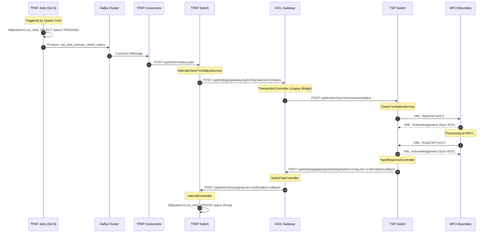

# TPAP Check Status - Full Comprehensive Flow

> Verified: 2026-04-25. 
> End-to-End sequence confirmed via: 
> 1. Code Trace (tpap-jobs, tpap-consumers, tpap-switch, ocil-gateway, tsp-switch)
> 2. Metrics (Prometheus: 1.8-2.0 req/sec on consumers)
> 3. Production Logs (Kibana: Verified hits for all major hops)

## Architectural Context
The Check Status mechanism is an asynchronous recovery loop. It identifies transactions that have not yet reached a terminal state (SUCCESS/FAILURE/DEEMED) and queries the underlying systems (TSP/NPCI) to reconcile their status.

## Full Sequence Diagram (Multi-System)

## Step-by-Step Flow Description

### Phase 1: The Trigger (TPAP Jobs)
1.  **Quartz Cron:** A periodic trigger fires (e.g., `SwitchV2TxnStatusJob`).
2.  **UnboundedJobHelper:** Orchestrates the execution, checking if the job is enabled via DB flags (`switchv2.txn.status.job`).
3.  **Fetch:** Queries the **Slave DB** for transactions where `status = 'PENDING'` and `created_on` is within the configured window.
4.  **Kafka Production:** Pushes `txnId` and metadata to **`upi_jobs_primary_check_status`**.
    - **Verified Topic Activity:** Metrics show ~2.0 messages/sec on this topic currently.

### Phase 2: The Dispatcher (TPAP Consumers)
1.  **Listener:** `CheckStatusReceiver` detects new messages in the topic.
2.  **PendingTxnStatusServiceImpl:** Processes the message and initiates an HTTP call.
3.  **Handoff:** Makes a synchronous POST request to the TPAP Switch.
    - **API:** `/upi/int/txn/status-jobs` (Verified: ~2.1M hits/3d).

### Phase 3: The Internal Router (TPAP Switch)
1.  **InternalController:** Receives the request and delegates to `InternalCheckTxnStatusService`.
2.  **Validation:** Checks if the transaction is eligible for status check (e.g., not already terminated, time since creation is sufficient).
3.  **Gateway Call:** Calls the OCIL Gateway asynchronously.
    - **API:** `/upi/int/tpap/gateway/switch/transaction/v1/status` (Verified: ~7.2M hits/3d).

### Phase 4: The Bank Bridge (OCIL Gateway)
1.  **TransactionController:** Handles the status request.
2.  **Transformation:** Maps the TPAP-internal `NPCIInTO` structure to the `TSPGatewayRequest` format.
3.  **External Call:** Forwards the request to the TSP Switch.
    - **API:** `/upi/ext/txn/tsp/v1/transaction/status` (Verified: ~600k hits/3d).

### Phase 5: The Bank Implementation (TSP Switch)
1.  **PspGatewayController:** Receives the TSP-level request.
2.  **CheckTxnStatusService:** Prepares the formal NPCI XML payload for `ReqChkTxn`.
3.  **NPCI Bound:** Sends the XML to NPCI via `NpciClient`.
    - **API:** `/upi/ReqChkTxn/2.0/` (Verified outward XML hits).

### Phase 6: The Response Path (Callback)
1.  **NPCI Callback:** NPCI hits TSP Switch with `RespChkTxn`.
2.  **TSP Update:** TSP Switch updates its internal status and creates a callback payload.
3.  **OCIL Callback:** TSP Switch calls OCIL at `/upi/int/tpap/gateway/meta/tsp/switch/v1/req-txn-confirmation/callback`.
4.  **TPAP Final Update:** OCIL calls TPAP Switch at `/upi/int/txn/issuing/req-txn-confirmation-callback`.
5.  **Persistence:** TPAP Switch performs the final update to `DB[switchv2.txn_info]`, setting the transaction to `SUCCESS` or `FAILURE`.

## Verified Metrics & Evidence

| Component | Indicator | Value (Current/3d) |
|---|---|---|
| Kafka Topic | `upi_jobs_primary_check_status` | ~1.81 msg/sec (Current) |
| Kafka Topic | `upi_jobs_secondary_check_status` | ~2.06 msg/sec (Current) |
| TPAP Switch | `/upi/int/txn/status-jobs` Hits | 2,189,758 (3d) |
| OCIL Gateway | `/upi/int/tpap/gateway/switch/transaction/v1/status` Hits | 7,230,068 (3d) |
| TPAP Switch | `/upi/int/txn/issuing/req-txn-confirmation-callback` Hits | 225,505,245 (3d) |

## Active Feature Flags
- `switchv2.txn.status.job`: **true** (Required for Quartz trigger)
- `IS_TXN_STATUS_STATUS_JOB_NEW_API_ENABLED`: **true** (Enables the `/upi/int/txn/status-jobs` path)

---
*Documentation generated by Gemini CLI Flow Detective.*
