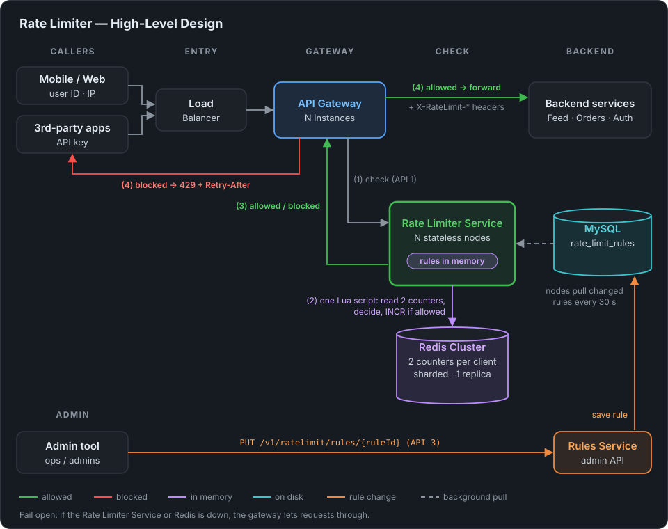

<style>
/* AlgoMaster-style look for MarkView dark mode. The content below is plain Markdown; viewers without CSS support ignore this block. */
html.markview-dark, html.markview-dark body { background: #0a0a0a !important; }
html.markview-dark #markview-container {
  --bg: #0a0a0a; --card: #141414; --card2: #1a1a1a; --bd: #262626;
  --tx: #fafafa; --tx2: #d4d4d4; --mu: #a3a3a3;
  --pri: #22c55e; --pri2: #4ade80; --pri-bg: rgba(34, 197, 94, .10); --pri-bd: rgba(34, 197, 94, .28);
  background: var(--bg) !important; color: var(--tx2);
  font-family: Inter, "Segoe UI Variable Text", "Segoe UI", system-ui, -apple-system, sans-serif;
  font-size: 16.5px; line-height: 1.75; -webkit-font-smoothing: antialiased;
}

/* Headings */
html.markview-dark #markview-container h1 { font-size: 42px; font-weight: 800; letter-spacing: -.025em; line-height: 1.15; color: var(--tx); border: 0; padding-bottom: 4px; }
html.markview-dark #markview-container h2 { font-size: 30px; font-weight: 800; letter-spacing: -.02em; line-height: 1.25; color: var(--tx);
  margin: 52px 0 8px; padding: 30px 0 0; border: 0; border-top: 1px solid var(--bd); }
html.markview-dark #markview-container h3 { font-size: 21px; font-weight: 700; letter-spacing: -.015em; line-height: 1.35; color: var(--tx); margin: 38px 0 10px; border: 0; }
html.markview-dark #markview-container hr { display: none; }

/* Text */
html.markview-dark #markview-container p { color: var(--tx2); }
html.markview-dark #markview-container strong { color: var(--tx); font-weight: 650; }
html.markview-dark #markview-container p > strong:first-child { color: var(--pri2); }
html.markview-dark #markview-container a { color: var(--pri2); }
html.markview-dark #markview-container blockquote { border: 0; background: none; padding: 0; margin: 0 0 22px; color: var(--mu); font-size: 17.5px; }
html.markview-dark #markview-container blockquote p { color: var(--mu); }
html.markview-dark #markview-container li::marker { color: var(--pri2); font-weight: 700; }
html.markview-dark #markview-container li + li { margin-top: 4px; }

/* Inline code */
html.markview-dark #markview-container :not(pre) > code {
  font-family: "JetBrains Mono", "Cascadia Code", Consolas, monospace; font-size: .84em;
  padding: 1.5px 6px; border-radius: 6px; color: var(--pri2); background: var(--pri-bg); border: 1px solid var(--pri-bd);
}

/* Code blocks: window bar with three dots */
html.markview-dark #markview-container pre {
  position: relative; background: #0d0d0d !important; border: 1px solid var(--bd); border-radius: 12px;
  padding: 46px 18px 14px; box-shadow: 0 1px 2px rgba(0, 0, 0, .25);
}
html.markview-dark #markview-container pre::before {
  content: ""; position: absolute; top: 0; left: 0; right: 0; height: 32px; border-radius: 12px 12px 0 0;
  border-bottom: 1px solid var(--bd);
  background:
    radial-gradient(circle at 18px 16px, #ff5f57 5px, transparent 5.5px),
    radial-gradient(circle at 36px 16px, #febc2e 5px, transparent 5.5px),
    radial-gradient(circle at 54px 16px, #28c840 5px, transparent 5.5px),
    #161616;
}
html.markview-dark #markview-container pre code { font-family: "JetBrains Mono", "Cascadia Code", Consolas, monospace; font-size: 13.4px; line-height: 1.65; color: #d4d4d4; background: none !important; }
html.markview-dark #markview-container pre code .hljs-comment, html.markview-dark #markview-container pre code .hljs-quote { color: #6a9955 !important; font-style: italic; }
html.markview-dark #markview-container pre code .hljs-attr, html.markview-dark #markview-container pre code .hljs-attribute, html.markview-dark #markview-container pre code .hljs-variable { color: #9cdcfe !important; }
html.markview-dark #markview-container pre code .hljs-string { color: #ce9178 !important; }
html.markview-dark #markview-container pre code .hljs-number { color: #b5cea8 !important; }
html.markview-dark #markview-container pre code .hljs-literal, html.markview-dark #markview-container pre code .hljs-keyword, html.markview-dark #markview-container pre code .hljs-built_in { color: #569cd6 !important; }
html.markview-dark #markview-container pre code .hljs-title, html.markview-dark #markview-container pre code .hljs-section, html.markview-dark #markview-container pre code .hljs-name { color: #dcdcaa !important; }
html.markview-dark #markview-container pre code .hljs-punctuation, html.markview-dark #markview-container pre code .hljs-meta { color: #a3a3a3 !important; }

/* Tables */
html.markview-dark #markview-container table {
  display: block; width: max-content; max-width: 100%; overflow-x: auto;
  border-collapse: separate; border-spacing: 0; border: 1px solid var(--bd); border-radius: 12px;
  font-size: 14.5px; line-height: 1.5; background: var(--card);
}
html.markview-dark #markview-container table th { background: var(--card2) !important; color: var(--tx); font-weight: 700; font-size: 13px; padding: 10px 14px; border: 0; border-bottom: 1px solid var(--bd); text-align: left; }
html.markview-dark #markview-container table td { padding: 9px 14px; border: 0; border-bottom: 1px solid var(--bd); color: var(--tx2); background: transparent !important; vertical-align: top; }
html.markview-dark #markview-container table tr { background: transparent !important; }
html.markview-dark #markview-container table tbody tr:last-child td { border-bottom: 0; }
html.markview-dark #markview-container table tbody tr:hover td { background: var(--card2) !important; }

/* Diagrams */
html.markview-dark #markview-container img[src*="svg/"] { display: block; margin: 18px auto 26px; max-width: 100%; height: auto; border: 1px solid var(--bd); border-radius: 14px; }
</style>

# 🚦 Rate Limiter

## ❓ Questions to Ask the Interviewer

> Clarify what we limit, how strict the limit is, and what happens on overload or failure before diving into architecture.

---

### 1. What is the expected scale?

**Why ask:** Sizes the counter store (how many Redis shards) and tells us whether one Redis round trip per request is affordable. It also confirms the API runs on many servers, so counters must be shared: if each server counted on its own, a client spread across 100 servers would get 100× the limit.

**Interviewer Answer:** About 10 million requests/second on average and around 30 million at peak, spread over hundreds of API servers. A client's limit must hold across all servers combined.

### 2. What do we rate limit by: user ID, IP address, or API key?

**Why ask:** This becomes the counter key (e.g. `rl:{userId}:{api}`). Logged-in calls can use the user ID; login and signup have no user yet, so they need the IP; third-party developers are identified by their API key.

**Interviewer Answer:** It must be flexible: user ID, API key and IP address. Each API chooses its identifier, e.g. login by IP and the feed API by user ID.

### 3. Do different APIs or user tiers need different limits? Can limits change without a deploy?

**Why ask:** Different limits per API and per tier mean the limits must live in a rules store (with a cache in front), not hardcoded in the app. Every request then needs a "which rule applies?" lookup.

**Interviewer Answer:** Yes. Free users get 100 requests/minute and premium users get 1,000 requests/minute. Login allows 5 attempts per minute per IP. Ops must be able to change rules without redeploying.

### 4. What should happen when a client exceeds the limit?

**Why ask:** Decides the response contract and whether we need a queue. We can reject the request (HTTP 429) or queue it to process later; Alex Xu mentions queueing orders that were limited during overload (p. 64).

**Interviewer Answer:** Reject with **HTTP 429 Too Many Requests** and headers that tell the client its limit, how many requests remain, and when to retry (`Retry-After`). Don't queue rejected requests.

### 5. Must the limit be exact, or is a small overshoot acceptable?

**Why ask:** Decides hard throttling (never above the limit) vs soft throttling (e.g. 10% overshoot allowed) (Grokking, p. 102):

1. Exact limits need an atomic check-and-increment on every request, with no local shortcuts.
2. If approximation is fine, we can use a cheaper algorithm (sliding window counter), and even local counters synced to Redis now and then.

**Interviewer Answer:** Some approximation is fine: 101 or 102 on a limit of 100 is OK, but no large overshoot.

### 6. Should we allow short bursts, or force a smooth, steady rate?

**Why ask:** Picks the algorithm. Token bucket allows a burst up to the bucket size (Alex Xu, p. 57: "allows a burst of traffic for short periods"); leaky bucket forces a steady outflow.

**Interviewer Answer:** Short bursts are fine. When the app opens it fires about 10 calls at once; those shouldn't be throttled as long as the per-minute limit holds.

### 7. What should happen if the rate limiter itself fails, e.g. Redis is down?

**Why ask:** Every request passes through the rate limiter, so it must never become a single point of failure:

1. **Fail open:** allow all traffic. Users are unaffected, but the backend is unprotected for a while.
2. **Fail closed:** block all traffic. The backend is safe, but it causes a full outage.

**Interviewer Answer:** The rate limiter must be highly available. If it fails, **fail open**: let requests through rather than block legitimate traffic.

---

## ⚙️ Functional Requirements

> What the rate limiter must do.

---

### 1. Rate Limiting

Limit the number of requests a client can make within a time window (e.g. 100 requests per minute):

1. The limit is the client's total across **all** API servers, not per server.
2. Short bursts are allowed (e.g. 10 calls when the app opens), as long as the client stays within its limit.

### 2. Multiple Identifiers

Support rate limiting by user ID, API key, IP address, or custom identifiers. Each API chooses which identifier it uses (e.g. login by IP, the feed API by user ID).

### 3. Configurable Rules

Allow different rate limits for different APIs, endpoints and user tiers (e.g. free 100/min, premium 1,000/min, login 5/min per IP). Rules can be changed at runtime without a redeploy.

### 4. Throttle Response

When the limit is exceeded, return **HTTP 429 Too Many Requests** with headers:

1. `X-RateLimit-Limit`: maximum requests allowed per window (e.g. 100).
2. `X-RateLimit-Remaining`: requests left in the current window (e.g. 0).
3. `X-RateLimit-Reset`: Unix timestamp when the window resets.
4. `Retry-After`: seconds to wait before retrying (sent only with 429).

---

## 🛡️ Non-Functional Requirements

> How well the rate limiter must do it.

---

### 1. High Availability

The rate limiter must not become a single point of failure. Target **99.99%** availability. If it fails (e.g. Redis is down), it **fails open**: requests are allowed through rather than blocking legitimate traffic.

### 2. Low Latency

Every API call passes through the rate limiter, so a decision must take single-digit milliseconds (**p99 < 5 ms**).

### 3. Scalability

Handle about **10 million requests/second** (around 30 million at peak) across hundreds of API servers.

### 4. Accuracy

Reasonably accurate. A slight overshoot (101 or 102 on a limit of 100) is acceptable in exchange for speed, but no large overshoot.

---

## 💬 Would you like me to cover back-of-the-envelope calculations as well, or focus on the high-level design?

---

## 🔌 API Design

> APIs of the Rate Limiter: called by the API gateway on every request (card 1), seen by end clients when throttled (card 2), and used by an admin tool to manage rules (card 3). All fields use camelCase. Cards 1 and 3 follow AlgoMaster's design; Alex Xu and Grokking have no API section (they put the check inline in middleware and keep rules in config files). Card 2 is what all sources agree on.

---

### 1. Check Rate Limit

```text
POST /v1/ratelimit/check
```

Ask whether one incoming request is allowed. Internal only: called by the API gateway for every request, before routing it to a backend service.

**Headers**

```text
// 1. Authorization — only the API gateway may call this API
Authorization: Bearer <service-token>

// 2. Content-Type — the body is JSON
Content-Type: application/json
```

**Request**

```jsonc
{
  // 1. endpoint — HTTP method + path of the incoming request.
  //    Used to find the matching rule (e.g. login has 5/min, feed has 100/min)
  "endpoint": "POST /v1/login",

  // 2. userId — from the verified auth token; null for logged-out calls (login, signup)
  "userId": "u_789",

  // 3. apiKey — for third-party developer calls; null otherwise
  "apiKey": null,

  // 4. ip — the client's IP address, always sent.
  //    4.1 The rule decides which identifier counts: userId, apiKey or ip.
  //    4.2 So the gateway sends everything it knows, and the rate limiter picks the key.
  "ip": "203.0.113.42",

  // 5. tier — FREE | PREMIUM, read from the verified auth token (the client can't set it)
  "tier": "FREE"
}
```

**Response — 200 OK**

```jsonc
{
  // 1. allowed — true: forward the request. false: return 429 to the client
  "allowed": false,

  // 2. limit — maximum requests per window for the matching rule
  "limit": 5,

  // 3. remaining — requests left in the current window
  "remaining": 0,

  // 4. resetAt — Unix timestamp (seconds) when the window resets
  "resetAt": 1731410460,

  // 5. retryAfter — seconds until the client may retry; only present when allowed = false
  "retryAfter": 30
}
```

**Notes:**

1. Always `200 OK`, whether the request is allowed or blocked. The answer is in `allowed`, so "blocked" is never confused with "the rate limiter broke".
2. **Fail open:** if this call errors or takes longer than ~10 ms, the gateway allows the request.
3. The gateway copies `limit`, `remaining` and `resetAt` into the `X-RateLimit-*` headers of every response (card 2).

**Interview line**

"The gateway calls the rate limiter once per request with everything it knows: endpoint, userId, apiKey, IP and tier. The rule decides which identifier to count. It always returns 200 with an `allowed` flag, and if the call fails or times out, the gateway fails open."

### 2. Throttled Response (what the client sees)

When `allowed` is false, the gateway does **not** forward the request. It returns this to the client:

```text
HTTP/1.1 429 Too Many Requests
Content-Type: application/json
X-RateLimit-Limit: 5
X-RateLimit-Remaining: 0
X-RateLimit-Reset: 1731410460
Retry-After: 30
```

```jsonc
{
  // 1. error — machine-readable code the client app can check
  "error": "RATE_LIMIT_EXCEEDED",

  // 2. message — human-readable text
  "message": "Too many requests. Please retry after 30 seconds.",

  // 3. retryAfter — same value as the Retry-After header, for clients that only read the body
  "retryAfter": 30
}
```

**Notes:**

1. Allowed responses also carry `X-RateLimit-Limit`, `X-RateLimit-Remaining` and `X-RateLimit-Reset`, so well-behaved clients can slow down **before** they hit 429.
2. `Retry-After` is sent only with 429.
3. Alex Xu names the headers `X-Ratelimit-Remaining`, `X-Ratelimit-Limit` and `X-Ratelimit-Retry-After` (p. 64). We use AlgoMaster's names, with the standard HTTP `Retry-After`.

**Interview line**

"A throttled client gets 429 Too Many Requests with Retry-After, so it knows exactly when to try again. Every response carries the X-RateLimit headers, so well-behaved clients can slow down before they're blocked."

### 3. Configure Rate Limit Rule (Admin)

```text
PUT /v1/ratelimit/rules/{ruleId}   → create or replace one rule
GET /v1/ratelimit/rules            → list all rules
```

Create or update a rule at runtime, without a redeploy. Called by an internal admin tool.

**Headers**

```text
// 1. Authorization — admin token; only ops/admins can change limits
Authorization: Bearer <admin-token>

// 2. Content-Type — the body is JSON
Content-Type: application/json
```

**Request**

```jsonc
{
  // 1. endpoint — method + path pattern; * matches anything (e.g. "GET /v1/feed/*")
  "endpoint": "POST /v1/login",

  // 2. identifier — USER_ID | API_KEY | IP: what we count by for this endpoint
  "identifier": "IP",

  // 3. tier — FREE | PREMIUM | ALL; lets premium users get a higher limit
  "tier": "ALL",

  // 4. limit — maximum requests per window
  "limit": 5,

  // 5. windowSeconds — window length (60 = per minute)
  "windowSeconds": 60
}
```

**Response — 200 OK**

```jsonc
{
  // 1. ruleId — the rule that was created or updated
  "ruleId": "login-by-ip",

  // 2. updatedAt — when it was saved (UTC)
  "updatedAt": "2026-11-12T15:30:00Z"
}
```

**Notes:**

1. `PUT` with the `ruleId` in the path makes the call idempotent: sending it twice gives the same rule.
2. Rules are saved in the database. Rate limiter nodes cache them and refresh about every 30 s, so a change takes effect within ~30 s (Alex Xu, p. 65: workers pull rules into a cache).
3. Errors: 400 invalid field · 401/403 not an admin · 409 another rule already has this endpoint and tier.

**Interview line**

"Rules live in a database and are managed through an admin API, so ops can change a limit without a deploy. Each rule says which endpoint, which identifier to count, which tier, the limit and the window. Nodes cache them and refresh every 30 seconds."

---

## 🗄️ Database Schema

> Two stores: a rules table (what the limits are) and Redis counters (how much each client has used). All sources agree on this split: AlgoMaster (PostgreSQL + Redis), Alex Xu (rules on disk + Redis, p. 62–65), Grokking Modern (rule database + cache).

---

### 1. Rate Limit Rules (MySQL)

**Database:** MySQL. **One row per endpoint per tier.** Read by a background refresher, never on the request path.

**Schema**

```text
rate_limit_rules
──────────────────────────────────────────────────────────────────────────────
id               BIGINT     PK, AUTO_INCREMENT → internal row id
rule_id          VARCHAR    NOT NULL, UNIQUE   → "login-by-ip", the {ruleId} in API 3
endpoint         VARCHAR    NOT NULL           → "POST /v1/login", "GET /v1/feed/*"
identifier       ENUM       NOT NULL           → USER_ID | API_KEY | IP
tier             ENUM       NOT NULL           → FREE | PREMIUM | ALL
request_limit    INT        NOT NULL           → max requests per window (`limit` is a reserved word in MySQL)
window_seconds   INT        NOT NULL           → 60 = per minute
enabled          BOOLEAN    NOT NULL           → false = rule switched off (soft delete)
created_at       TIMESTAMP
updated_at       TIMESTAMP  ON UPDATE CURRENT_TIMESTAMP → the refresher reads only changed rows
UNIQUE (endpoint, tier)                        → one limit per endpoint per tier
INDEX (updated_at)                             → fast "rows changed since X"
```

**Example rows**

```text
id  rule_id         endpoint         identifier  tier     request_limit  window_seconds  enabled
1   login-by-ip     POST /v1/login   IP          ALL      5              60              true
2   feed-free       GET /v1/feed/*   USER_ID     FREE     100            60              true
3   feed-premium    GET /v1/feed/*   USER_ID     PREMIUM  1000           60              true
```

**Which rule applies:** an exact endpoint beats a `*` pattern, and a specific tier beats `ALL`.

**Why MySQL:**

1. **Small and structured:** a few hundred rows, all the same shape.
2. **Constraints come free:** `UNIQUE (endpoint, tier)` blocks two conflicting limits, and the ENUMs reject bad values.
3. **Rarely written:** only admins change rules, through API 3.
4. PostgreSQL (AlgoMaster's choice) is equally fine. Config files (Lyft, Alex Xu) also work, but then changing a rule means editing and shipping a file.

**Why not NoSQL:**

1. NoSQL shines with huge scale, one-key lookups or nested data. The rules table has none of these: a few hundred flat rows, almost no writes.
2. DynamoDB would work (with `endpoint#tier` as the key), but it has no ENUMs, and "rows changed since X" needs a secondary index. It buys us nothing at this size.
3. The hot data, the counters, **is** on NoSQL: Redis is a key-value store (card 2).

**Cache (in each rate limiter node's memory):**

1. Every node loads **all** rules into memory at startup. A few hundred rows is only a few KB.
2. Every 30 s it reads `WHERE updated_at > lastRefresh`, so only changed rows come back.
3. That's why `enabled` exists: a deleted row would never show up as "changed", but a disabled one does.

**Trick question:** "Do you hit MySQL on every request?" No. Requests read rules from memory; MySQL only sees one small query per node every 30 s.

**Interview line**

"Rules go in a small MySQL table: endpoint, identifier, tier, limit and window, with a unique key on endpoint plus tier. Every rate limiter node keeps all rules in memory and pulls changed rows every 30 seconds, so the database is never on the request path."

### 2. Request Counters (Redis)

**Database:** Redis Cluster. **Two counters per rule per client** (this window and the previous one). Read and written on every request.

**Key and value**

```text
key:    rl:{<ruleId>:<identifierValue>}:<windowStart>
          rl:{feed-free:u_789}:1731410400            → this minute's counter
          rl:{feed-free:u_789}:1731410340            → previous minute's counter
          The {…} part is a Redis hash tag: both keys land on the same shard,
          so one Lua script can read both
value:  integer: requests counted in that window
TTL:    2 × window_seconds                           → the previous window must live one more window, then it disappears
```

**Algorithm: sliding window counter** (AlgoMaster's recommendation)

1. Estimate the requests in the last full minute: `previous × (1 − timeIntoWindow / window) + current`.
2. Example (AlgoMaster), limit 100/min: previous minute 80, current minute 30, now 25% into the minute → `80 × 0.75 + 30 = 90`. 90 < 100, so allow and increment current to 31.
3. If the estimate is at or above the limit → blocked; the counter is not incremented.

**Why this algorithm:**

1. **Bursts are allowed** (question 6): a client can send all 100 at once, as long as the rolling minute stays under 100.
2. **The limit really holds** (NFR accuracy): unlike token bucket (up to ~2× after an idle period) or fixed window (up to 2× at the edge of two windows).
3. **Accurate enough:** it assumes the previous window's requests were spread evenly, but Cloudflare measured only 0.003% wrong decisions over 400 million requests (Alex Xu, p. 62).
4. **Cheap:** two integers per client, no list of timestamps (that's sliding window log). All five algorithms are compared in the Deep Dives.

**Why Redis:**

1. **Fast:** in memory, under 1 ms per operation, so it fits the p99 < 5 ms target.
2. **Shared:** all API servers see the same counters, so the limit holds across servers (FR 1.1).
3. **Atomic:** a Lua script reads both counters, decides and increments as one step, so two servers can't both let the 100th request through (Alex Xu, p. 66).
4. **TTL:** old windows clean themselves up (Alex Xu, p. 62: `INCR` and `EXPIRE`).
5. **Small:** 1M active clients × 2 counters × ~100 bytes ≈ **200 MB** (AlgoMaster estimates ~100 bytes per client record), which fits easily in memory.

**Why not the others:**

1. **MySQL:** 30M writes per second, each to disk, for data that's useless a minute later.
2. **Memcached:** fast and has `INCR`, but no Lua scripts, so "read two counters, decide, increment" can't be one atomic step.
3. **Cassandra** (mentioned by Grokking Modern): durable but slower, and we don't need durability. Losing a counter only resets one window.

**Things to handle:**

1. **Scale:** 30M req/s at peak is too much for one Redis, so we use a Redis Cluster that shards keys by hash; the hash tag keeps a client's two counters together.
2. **Redis down:** fail open (NFR 1); details in the Deep Dives.
3. **Clock skew:** use Redis server time (`TIME`) to pick the window, not each server's clock.
4. **Lost counters:** Redis isn't durable here. If a shard fails over, some counters reset and clients get a fresh quota for one window. The accuracy NFR allows that.

**Interview line**

"Counters live in a Redis Cluster: two integers per rule per client, this minute and the previous one. A Lua script estimates the rolling minute as previous times the overlap plus current, and increments only if it's under the limit, all in one atomic step. TTLs clean up old windows, and 1 million active clients is only about 200 MB."

---

## 🏗️ High-Level Design

> How the parts fit together: callers, the API gateway, the Rate Limiter Service, the counter store and the rules path.

---

### 1. Architecture



**Components** (AlgoMaster's set):

1. **Load Balancer:** spreads incoming traffic across the API Gateway instances.
2. **API Gateway:** calls the Rate Limiter Service (API 1) before routing each request. Allowed → forwards it and adds the `X-RateLimit-*` headers. Blocked → returns 429 itself, so the backend never sees the request.
3. **Rate Limiter Service:** a **separate**, stateless service with N nodes. It holds all rules in memory, runs one Lua script on Redis per request, and returns allowed or blocked.
4. **Redis Cluster:** the shared counters (two per rule per client), sharded by key, with one replica per shard.
5. **Rules Service:** a small, separate admin service (API 3). It validates a rule and saves it to MySQL. Admin traffic stays off the hot path.
6. **MySQL:** the `rate_limit_rules` table, the source of truth for rules.
7. **Rule refresh:** every 30 s, each Rate Limiter node **pulls** rules changed since its last refresh (`updated_at > lastRefresh`). This is pull, as in Alex Xu and Grokking Modern; AlgoMaster pushes instead. A node that was down catches up by itself.

**Why a separate service, not a library inside the gateway:** it scales on its own and keeps the limiting logic in one place. The cost is one extra network hop (~0.5–1 ms), which fits the 5 ms budget. To save that hop, the same logic could run as a library inside the gateway (Alex Xu's middleware).

**Interview line**

"The gateway asks a separate Rate Limiter Service about every request. The service keeps all rules in memory and runs one atomic Lua script on a Redis Cluster that holds the counters. Allowed requests go to the backend; blocked ones get 429 straight from the gateway. Admins change rules through a Rules Service backed by MySQL, and the limiter nodes pull changes every 30 seconds."

### 2. Flow: Check a Request (allowed or blocked)

One API request from a client, checked through API 1.

**Part A: when the request arrives**

1. The client sends `GET /v1/feed` with its auth token.
2. The load balancer sends it to one API Gateway instance.
3. The gateway verifies the token (`userId = u_789`, `tier = FREE`) and reads the client IP.
4. The gateway calls `POST /v1/ratelimit/check` with `endpoint`, `userId`, `apiKey`, `ip` and `tier`.

**Part B: the decision (Rate Limiter Service)**

5. Find the rule in memory: an exact endpoint beats `*`, and a specific tier beats `ALL`. → `feed-free` (USER_ID, 100 per 60 s).
   1. If no rule matches, the request is allowed.
6. Build the key from the rule's identifier: `{feed-free:u_789}`.
7. Run one Lua script on Redis:
   1. Get the time from Redis and work out the current window.
   2. Read the current and previous counters (a missing key counts as 0).
   3. `estimate = previous × (1 − elapsed / 60) + current`.
   4. `estimate < 100` → increment current, set a 120 s TTL → **allowed**.
   5. Otherwise → **blocked**, with no increment.
8. Return `200` with `allowed`, `limit`, `remaining`, `resetAt` and `retryAfter`.

**Part C: the response**

9. **Allowed:** the gateway forwards the request to the backend and adds the `X-RateLimit-*` headers to the response.
10. **Blocked:** the gateway returns **429** with the headers plus `Retry-After`. The backend is never called.

**If something crashes:**

1. **A Rate Limiter node dies:** the gateway's call times out (~10 ms) → fail open. The next request goes to another node.
2. **Redis is down or slow:** fail open (details in the Deep Dives).
3. **It crashes after the counter was incremented, before replying:** the client loses one unit of quota. Harmless.

**Interview line**

"The gateway sends the request's endpoint, user, API key, IP and tier to the rate limiter. It finds the rule in memory and runs one Lua script on Redis that estimates the rolling-minute count and increments only if it's under the limit. Allowed requests go to the backend with rate-limit headers; blocked ones get 429 with Retry-After."

### 3. Flow: Change a Rule

An admin changes a limit through API 3.

**Part A: the admin saves the rule**

1. The admin tool sends `PUT /v1/ratelimit/rules/feed-free` with `limit: 200`.
2. The Rules Service checks the admin token and validates the rule.
3. It saves the rule to MySQL, and `updated_at` changes automatically.
   1. If another rule has the same endpoint and tier → **409 Conflict**.
4. It returns `200` with `ruleId` and `updatedAt`.

**Part B: the nodes pick it up**

5. Every 30 s, each Rate Limiter node reads the rules changed since its last refresh.
6. It updates them in memory. A disabled rule is removed.
7. Within ~30 s every node uses the new limit.

**If something crashes:**

1. **The Rules Service dies before saving:** nothing is saved, and the admin retries.
2. **A node is down:** on startup it loads all rules, so it misses nothing.
3. **MySQL is down:** nodes keep the rules they have. Requests are unaffected.

**Interview line**

"An admin updates a rule through the Rules Service, which validates it and saves it to MySQL. Every rate limiter node pulls changed rules every 30 seconds, so the change is live everywhere within half a minute, and the database is never on the request path."

---

## 🔍 Deep Dives

> The follow-up questions interviewers push on, answered for this design.

---

### Deep Dive Questions

**1. "Which rate limiting algorithm would you use, and why?"**

1. The five algorithms (Alex Xu, p. 54–62; AlgoMaster 6.1):

   | Algorithm | How it works | Bursts | Memory | Main problem |
   |---|---|---|---|---|
   | Token bucket | Tokens refill at a fixed rate; each request takes one | ✅ up to bucket size | Low | Up to ~2× the limit in one window after an idle period |
   | Leaky bucket | Requests join a queue that drains at a fixed rate | ❌ smooth output only | Medium | A burst fills the queue with old requests |
   | Fixed window counter | One counter per clock window (12:00–12:01) | ⚠️ | Very low | Up to 2× at the edge of two windows |
   | Sliding window log | Stores every request timestamp | ✅ | High | One entry per request, even rejected ones |
   | Sliding window counter | `previous × overlap + current` | ✅ | Low | Approximate |

2. **Our pick: sliding window counter** (AlgoMaster's default). Bursts are allowed, the limit holds, it needs only two integers per client, and the error rate is 0.003% (Cloudflare, via Alex Xu, p. 62).
3. **Token bucket** if bursts above the average rate are wanted. Amazon and Stripe use it (Alex Xu, p. 55).
4. **Leaky bucket** when the backend needs a steady rate.

**2. "Two requests arrive at the same time. Can both get through? Isn't Redis atomic?"**

1. Every **single** Redis command is atomic: Redis runs commands one at a time, so two `INCR`s on the same key never mix.
2. But the check is **three steps**, and the decision happens in our service, between them:
   1. `GET` the counter (Redis).
   2. Compare it with the limit (in the Rate Limiter Service, not in Redis).
   3. `INCR` the counter (Redis).
3. Each step is atomic, but the **gap between the steps isn't**. Example: limit 100, counter at 99, five requests arrive together on 5 nodes (AlgoMaster 6.2; Alex Xu, p. 66, Figure 4-14):

   ```text
   time   node A        node B        node C        node D        node E        Redis counter
   t1     GET → 99                                                              99
   t2                   GET → 99                                                99
   t3                                 GET → 99                                  99
   t4                                               GET → 99                    99
   t5                                                             GET → 99      99
   t6     99 < 100 ✓    99 < 100 ✓    99 < 100 ✓    99 < 100 ✓    99 < 100 ✓
   t7     INCR → 100    INCR → 101    INCR → 102    INCR → 103    INCR → 104    104
          allowed       allowed       allowed       allowed       allowed
   ```

   All five read 99 before anyone incremented, so all five are allowed. Redis did nothing wrong; our read-then-write logic did. This is the classic **check-then-act race**.
4. Locks would fix it, but they're slow (Alex Xu, p. 66).
5. **Our fix: one Lua script.** A Lua script runs inside Redis as one unit; while it runs, no other command touches Redis. The 5 scripts run one after another:

   ```text
   script:  GET current, GET previous → compute estimate → if < limit: INCR, EXPIRE

   A: reads 99  → allowed, INCR → 100
   B: reads 100 → blocked
   C: reads 100 → blocked
   D: reads 100 → blocked
   E: reads 100 → blocked
   ```

   The two keys share a hash tag, so they sit on the same shard and one script can read both.
6. **Why not just `INCR` first, then check?** `INCR` returns the new value atomically, so for a simple counter "INCR, reject if > 100" is race-free. It isn't enough for us:
   1. The sliding window counter needs two keys and math (`previous × overlap + current`); one `INCR` can't read the previous window or do the weighting.
   2. It counts rejected requests too: a spammer pushes the counter to 10,000, which wrecks the previous-window weighting for the next minute.
7. **Why not `MULTI/EXEC`** (Redis transactions)? Commands inside it can't use what an earlier command read to decide what to do next ("if under the limit, then INCR").

**Interview line:** "Each Redis command is atomic, but get, compare, increment is three steps, and five requests can all read 99 in between. A Lua script runs the whole check-and-increment inside Redis as one atomic unit, so only one of them gets through."

**3. "Why not counters on each API server, or sticky sessions?"**

1. **Local counters:** 4 gateways × 25 requests each = 100 in total, and each gateway sees only 25 (AlgoMaster 4.2).
2. **Sticky sessions:** "neither scalable nor flexible" (Alex Xu, p. 67).
3. So the counters go in a shared Redis Cluster, and the nodes stay stateless.

**4. "What if Redis or the Rate Limiter Service is down?"** (AlgoMaster 6.4)

1. Fail open (allow all) vs fail closed (block all). **We fail open**, with these fallbacks in order:
   1. Normal: the Redis Cluster.
   2. Fallback 1: a **local in-memory limit** per node (about limit ÷ number of nodes).
   3. Fallback 2: fail open, with alerts.
2. **Circuit breaker** around Redis: after repeated errors we stop calling it, so requests don't each wait for a timeout. Every few seconds one call is let through to test whether Redis is back.

**5. "Where should rate limiting happen?"** (AlgoMaster 6.3)

1. Not on the client, because it's easy to bypass (Alex Xu, p. 53).
2. **Multi-layer:**

   | Layer | Limits by | Stops |
   |---|---|---|
   | CDN / edge | IP, coarse | DDoS, obvious abuse |
   | API Gateway (ours) | User ID, API key | Free vs premium limits |
   | Application | Business rules | E.g. 3 password resets per day |

3. IP limits can also be enforced at layer 3 with iptables (Alex Xu, p. 69).

**6. "Users are worldwide. How does it work across data centers?"**

1. One central Redis would add 100+ ms per request. Alex Xu recommends edge servers and eventual consistency (p. 67–68).
2. AlgoMaster's options:
   1. Split the limit across regions.
   2. Local counters with async global sync.
   3. Sticky region.
3. **Our pick: Redis per region with async sync** (option 2). A small overshoot is OK.

**7. "Rate limit by IP or by user?"** (Grokking, p. 112)

1. **IP:** works before login, but a shared IP (an office, a mobile carrier) blocks everyone behind it.
2. **User:** fair, but on login an attacker can lock a real user out by typing wrong passwords.
3. **Hybrid: both.** Our schema allows one rule per endpoint and tier, so this needs the unique key widened to `(endpoint, tier, identifier)`.

**8. "Hard or soft limits?"** (Alex Xu, p. 69; Grokking, p. 102)

1. Hard = never above. Soft = may exceed by a set % for a short time. Elastic = may exceed while there's spare capacity.
2. Ours is close to hard (101–102 on 100).

**9. "A client is hammering us. Doesn't every blocked request still hit Redis?"**

1. Yes, which creates a hot key on one shard.
2. **Fix: a local deny cache.** Once blocked, the node remembers "blocked until `resetAt`" and answers 429 without calling Redis (Grokking, p. 111).

**10. "How should clients avoid being rate limited?"** (Alex Xu, p. 69)

1. Cache responses on the client.
2. Watch `X-RateLimit-Remaining`.
3. On a 429, retry after `Retry-After`, with backoff and jitter.

**Interview line**

"I'd use a sliding window counter: two integers per client, bursts allowed, and the limit holds. A Lua script makes the check atomic, the counters live in a shared Redis Cluster, and if Redis fails we fall back to local limits, then fail open, behind a circuit breaker. For worldwide traffic, each region keeps its own counters and syncs asynchronously."

---

## 📈 Monitoring

> How we know the rate limiter is healthy and its rules are right.

---

### Monitoring and Alerting

Is the rate limiter healthy, and are the rules effective (Alex Xu, p. 68)?

**Metrics and alerts** (AlgoMaster 7.1):

1. **Allowed and blocked per second**, per rule and per client. Alert if more than **5%** of all traffic is blocked: either a DDoS or a limit that's too strict.
2. **Check latency (p99):** alert above **10 ms**. Redis is probably overloaded, or the network is slow.
3. **Redis errors:** alert on any. It means a failover or the fallback is active.
4. **Fail-open / fallback count:** how often we used the local limit or let traffic through unchecked. It should be 0.
5. **Top blocked clients:** alert if one client causes more than **50%** of all blocks. That's likely abuse.
6. **Rule refresh age:** seconds since each node last refreshed its rules. Alert if it's well above 30 s, because that node is running old rules (our own addition, since we pull rules every 30 s).

**Are the rules right?** (Alex Xu, p. 68)

1. Many valid requests blocked → the rules are too strict; relax them.
2. Abuse getting through during spikes like flash sales → change the rules or the algorithm (Alex Xu suggests token bucket for bursts).

**Logs and dashboards:**

1. Log every blocked request (client, rule, endpoint), and sample the allowed ones. Above ~1,000 blocks per second on one rule (e.g. during a DDoS), sample the blocks too, so the logs don't flood.
2. Dashboards in Prometheus + Grafana: blocks per rule, check latency and Redis health.

**Interview line**

"I watch allowed versus blocked per rule, the check's p99 latency, Redis errors and how often we fail open, with alerts on each. Blocked-request logs show whether a rule is too strict or one client is abusing us, so we can tune the rules."
